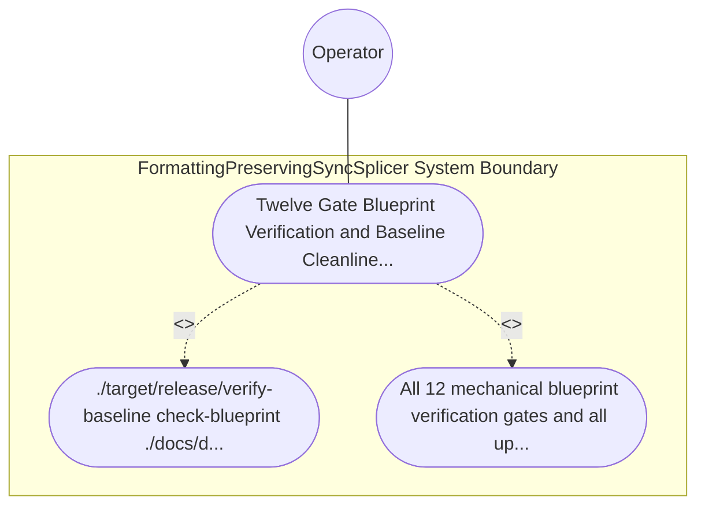

| Attribute | Specification Detail |
| :--- | :--- |
| **Issue ID** | #786 |
| **Title** | Use Case 58: Twelve Gate Blueprint Verification and Baseline Cleanliness Gate Conformance |
| **Type** | use-case |
| **Primary Actor** | Operator |
| **Scope** | FormattingPreservingSyncSplicer |
| **Level** | User Goal |
| **Generation Mode** | subagent |
| **Specification Source** | [schema/model.sysml](../../schema/model.sysml) |

# Use Case 58: Twelve Gate Blueprint Verification and Baseline Cleanliness Gate Conformance

## UML Diagrams

## 1. Actors
- `Operator`

## 2. Preconditions
- ./docs/designs/blueprint-10-rowan-salsa-incremental-sysml-compiler.md residing in the upstream compiler repository alongside workspace governance rules.

## 3. Trigger
- ./target/release/verify-baseline check-blueprint ./docs/designs/blueprint-10-rowan-salsa-incremental-sysml-compiler.md and ./target/release/verify-baseline . --no-domain are executed.

## 4. Main Success Scenario
1. `Operator` executes `./target/release/verify-baseline check-blueprint ./docs/designs/blueprint-10-rowan-salsa-incremental-sysml-compiler.md` on the upstream compiler blueprint.
2. `verify-baseline` evaluates all 12 mechanical blueprint verification gates (8-part structure, metadata table, 5-column STPA/FMECA table, KaTeX math blocks, Mermaid diagrams, and 7 Given-When-Then acceptance criteria).
3. `ingest-sysml` and `compile-sysml` extract and compile `BP_10_Incremental_Lossless_SysML_v2_and_Polyglot_Compiler_Engine` (`REQ-0610`, `C_INC_01..07`, `FormattingPreservingSyncSplicer`, `LogosRowanSysmlCstEngine`, `SalsaIncrementalCompilerDatabase`, `TypedPolyglotIngestionFrontend`).
4. `Operator` executes `./target/release/verify-baseline . --no-domain` to verify upstream landing-zone cleanliness, Check 34 AST purity, Check 36 docstring completeness, and Check 37 path integrity.
5. All 12 mechanical blueprint verification gates and all upstream workspace baseline checks pass with exit code 0, persisting `.pipeline/upstream/schema/model.sysml` and `.pipeline/upstream/schema/model-digest.json`.

## 5. Alternate and Exception Flows
- 3a. Any of the 12 mechanical blueprint verification gates fails on `blueprint-10-rowan-salsa-incremental-sysml-compiler.md`:
  - `verify-baseline check-blueprint` emits a structured diagnostic via `render_ariadne_diagnostic` / NDJSON, aborts artifact persistence, and exits fail-closed with code 1.
- 4a. Bijective roundtrip or constraint verification fails on `BP_10` (`Diagnostic: DEAP-E1001`):
  - `compile-sysml` aborts schema persistence, preserves prior verified state, and terminates fail-closed with exit code 1.
- 5a. Upstream baseline check (`verify-baseline . --no-domain`) detects any landing-zone or Check 34..37 violation:
  - `verify-baseline` reports the exact finding and exits fail-closed with non-zero status code 1.

## 6. Postconditions
- All 12 mechanical blueprint verification gates and all upstream workspace baseline checks pass with exit code 0, atomically persisting `.sysml` and `.digest.json` artifacts.

## 8. Realization Matrix
| Specification Item | Type | Link / Reference |
| :--- | :--- | :--- |
| **TBD** | User Story | [User Story 72: render ariadne diagnostic](../user-stories/US-72-render_ariadne_diagnostic.md) |
| **TBD** | Feature | [Feature 46: [BP 10 Incremental Lossless SysML v2 and Polyglot Compiler Engine] FormattingPreservingSyncSplicer](../features/FEAT-46-FormattingPreservingSyncSplicer.md) |

## Source References
Use case operational flows and lifecycle activity references:
- System Architecture Model: `schema/model.sysml`
- Normative Systems Engineering Standard: ISO/IEC/IEEE 29148:2018 §6.4.2 Concept of Operations

Operational use case realization and traceability links derive from `schema/model.sysml` pursuant to ISO/IEC/IEEE 29148.
