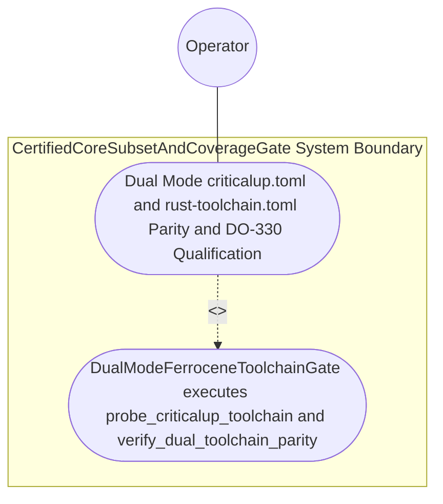

| Attribute | Specification Detail |
| :--- | :--- |
| **Issue ID** | #788 |
| **Title** | Use Case 59: Dual Mode criticalup toml and rust toolchain toml Parity Cross Platform Discovery and DO 330 Fixed Point Qualification |
| **Type** | use-case |
| **Primary Actor** | Operator |
| **Scope** | CertifiedCoreSubsetAndCoverageGate |
| **Level** | User Goal |
| **Generation Mode** | subagent |
| **Specification Source** | [schema/model.sysml](../../schema/model.sysml) |

# Use Case 59: Dual Mode criticalup toml and rust toolchain toml Parity Cross Platform Discovery and DO 330 Fixed Point Qualification

## UML Diagrams

## 1. Actors
- `Operator`

## 2. Preconditions
- A workspace containing paired `criticalup.toml` (`ferrocene-stable` pinned to an exact qualified release and target triple set) and `rust-toolchain.toml` (pinned to the matching upstream `rustc` semantic version and target set) parsed via `toml_edit`, `cargo-platform`, `cargo_metadata`, `cargo-lock`, and `cargo-util-schemas` (Contract B, zero hand-rolled scanners), alongside a negative fixture where `rust-toolchain.toml` drifts by one minor version or omits a qualified target triple.

## 3. Trigger
- `DualModeFerroceneToolchainGate` executes `probe_criticalup_toolchain` and `verify_dual_toolchain_parity`, evaluating Stage-1 versus Stage-2 self-hosted modular codegen SHA-256 digests (`E0705`) under Ferrocene and upstream `rustc` with `--locked --offline` reproducibility.

## 4. Main Success Scenario
1. `Operator` invokes `probe_criticalup_toolchain(config)` on `DualModeFerroceneToolchainGate` (`max_toolchain_version_drift = 0`, `stage_fixed_point_mismatch_files = 0`, `reproducible_ferrocene_lock = true`), transitioning `BP_11_Ferrocene_Qualified_Toolchain_FLS_Traceability_Structural_Coverage_and_3_Ring_Rust_Flutter_DO_178C_DO_330_Certification_Architecture_LifecycleState` from `Idle` to `ProbingCrossPlatformToolchain`.
2. `DualModeFerroceneToolchainGate` discovers qualified toolchain binaries dynamically via runtime `PATH` probing across macOS, Linux, and Windows (`std::env::consts::{DLL_PREFIX, DLL_SUFFIX, EXE_SUFFIX}`, `camino::Utf8Path`, `min_toolchain_discovery_probes` in `1..3`, `C_CERT_08`) inside `< 380` exec SLOC submodules (`crates/verify-baseline/src/ferrocene_gate/`, `C_CERT_07`) with zero hardcoded OS/user/machine paths and transitions to `VerifyingDualToolchainParity`.
3. `DualModeFerroceneToolchainGate` receives `criticalup.toml` and `rust-toolchain.toml` on `toolchain_manifests_in` (`toml_edit` + `cargo-platform`) and executes `verify_dual_toolchain_parity(spec)` under `Invariant_REQ_0611_SC_01`.
4. `DualModeFerroceneToolchainGate` verifies zero semantic `rustc` version or target-triple drift (`max_toolchain_version_drift == 0`, `C_CERT_01`) and confirms Stage-1 == Stage-2 self-hosted modular codegen SHA-256 fixed-point identity (`stage_fixed_point_mismatch_files == 0`, `C_CERT_02`).
5. `DualModeFerroceneToolchainGate` emits the DO-330 TQL-1/TQL-5 qualification receipt on `qualification_dossier_out` and transitions to `SynthesizingThreeRingPartitions`.

## 5. Alternate and Exception Flows
- 3a. `rust-toolchain.toml` semantic version or qualified target-triple set drifts from `criticalup.toml` (`max_toolchain_version_drift > 0`, `Diagnostic: DEAP-E1101`):
  - `DualModeFerroceneToolchainGate` transitions to `RejectedFailClosed` on `rejectToolchainDriftE1101`, emits single-line NDJSON diagnostic `DEAP-E1101` on `toolchain_diag_out`, and exits fail-closed with code 1.
- 4a. Stage-1 and Stage-2 self-hosted codegen SHA-256 digests diverge under Ferrocene compilation (`stage_fixed_point_mismatch_files > 0`, `Diagnostic: E0705`):
  - `DualModeFerroceneToolchainGate` transitions to `RejectedFailClosed`, emits diagnostic `E0705` on `toolchain_diag_out`, and terminates fail-closed with exit code 1.
- 5a. Ferrocene `criticalup` binary is absent while `require_formal_toolchains == true` (`Diagnostic: DEAP-E1101`):
  - `DualModeFerroceneToolchainGate` transitions to `RejectedFailClosed` on `rejectMissingToolchainE1101`, preserves prior verified state, and exits with code 1.

## 6. Postconditions
- `CertifiedCoreSubsetAndCoverageGate` and `DualModeFerroceneToolchainGate` satisfy declared objective `Dual Mode criticalup toml and rust toolchain toml Parity Cross Platform Discovery and DO 330 Fixed Point Qualification` with all subsystem invariants intact.
- Verified `Dual Mode criticalup toml and rust toolchain toml Parity Cross Platform Discovery and DO 330 Fixed Point Qualification` completion status is recorded for `Operator`.

## 7. Operational Context & Architectural Realization (3-Layer Definition of Done)
- **Contract A (Full OMG SysML v2.0 + KerML 1.0 Grammar Coverage)**: Ingests full SysML v2.0 + KerML 1.0 package, requirement, constraint, and `#dal`/`#fls` metadata constructs via `logos` + `rowan` + `salsa` + `ariadne` (`deap_core::sysml_cst`) with zero 16-construct caps.
- **Contract B (Official Rust Crate Stack & Zero Hand-Rolled Scanners)**: Parses `criticalup.toml` and `rust-toolchain.toml` via `toml_edit`, `cargo-platform`, `cargo_metadata`, `cargo-lock`, and `cargo-util-schemas` with dynamic cross-platform runtime `PATH` discovery across macOS, Linux, and Windows (`std::env::consts::{DLL_PREFIX, DLL_SUFFIX, EXE_SUFFIX}`, `camino::Utf8Path`).
- **Layer 1 (Domain State & Data Model)**: Typed `DualModeFerroceneToolchainGate` domain state (`max_toolchain_version_drift`, `stage_fixed_point_mismatch_files`, `reproducible_ferrocene_lock`, `require_formal_toolchains`, `deterministic_uuid`) and manifest AST models.
- **Layer 2 (Logic & State Management)**: Deterministic parity and Stage-1 == Stage-2 SHA-256 fixed-point verification inside `< 380`-SLOC submodules (`crates/verify-baseline/src/ferrocene_gate/`, `C_CERT_07`) with explicit deletion of legacy hand-rolled line/string toolchain scanners.
- **Layer 3 (Presentation & Actuator Interface Binding)**: Boundary ports `toolchain_manifests_in`, `qualification_dossier_out`, and `toolchain_diag_out` emitting DO-330 TQL-1/TQL-5 receipts and `DEAP-E1101` / `E0705` diagnostics.

## 8. Realization Matrix
| Specification Item | Type | Link / Reference |
| :--- | :--- | :--- |
| **#823** | User Story | [User Story 73: probe criticalup toolchain](../user-stories/US-73-probe_criticalup_toolchain.md) |
| **#824** | User Story | [User Story 74: verify dual toolchain parity](../user-stories/US-74-verify_dual_toolchain_parity.md) |
| **#848** | Feature | [Feature 50: [BP 11 Ferrocene Qualified Toolchain FLS Traceability Structural Coverage and 3 Ring Rust_Flutter DO 178 C DO 330 Certification Architecture] CertifiedCoreSubsetAndCoverageGate](../features/FEAT-50-CertifiedCoreSubsetAndCoverageGate.md) |
| **#849** | Feature | [Feature 51: [BP 11 Ferrocene Qualified Toolchain FLS Traceability Structural Coverage and 3 Ring Rust_Flutter DO 178 C DO 330 Certification Architecture] DualModeFerroceneToolchainGate](../features/FEAT-51-DualModeFerroceneToolchainGate.md) |

### Required User Stories
- [ ] #823 - [User Story 73: probe criticalup toolchain](../user-stories/US-73-probe_criticalup_toolchain.md)
- [ ] #824 - [User Story 74: verify dual toolchain parity](../user-stories/US-74-verify_dual_toolchain_parity.md)

### Required Features
- [ ] #848 - [Feature 50: [BP 11 Ferrocene Qualified Toolchain FLS Traceability Structural Coverage and 3 Ring Rust_Flutter DO 178 C DO 330 Certification Architecture] CertifiedCoreSubsetAndCoverageGate](../features/FEAT-50-CertifiedCoreSubsetAndCoverageGate.md)
- [ ] #849 - [Feature 51: [BP 11 Ferrocene Qualified Toolchain FLS Traceability Structural Coverage and 3 Ring Rust_Flutter DO 178 C DO 330 Certification Architecture] DualModeFerroceneToolchainGate](../features/FEAT-51-DualModeFerroceneToolchainGate.md)

## Source References
Use case operational flows and lifecycle activity references:
- System Architecture Model: `schema/model.sysml`
- Normative Systems Engineering Standard: ISO/IEC/IEEE 29148:2018 §6.4.2 Concept of Operations

Operational use case realization and traceability links derive from `schema/model.sysml` pursuant to ISO/IEC/IEEE 29148.
