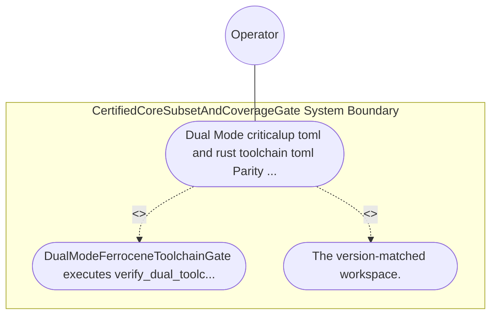

| Attribute | Specification Detail |
| :--- | :--- |
| **Issue ID** | TBD |
| **Title** | Use Case 59: Dual Mode criticalup toml and rust toolchain toml Parity and DO 330 Stage 2 Fixed Point Qualification |
| **Type** | use-case |
| **Primary Actor** | Operator |
| **Scope** | CertifiedCoreSubsetAndCoverageGate |
| **Level** | User Goal |
| **Generation Mode** | subagent |
| **Specification Source** | [schema/model.sysml](../../schema/model.sysml) |

# Use Case 59: Dual Mode criticalup toml and rust toolchain toml Parity and DO 330 Stage 2 Fixed Point Qualification

## UML Diagrams

## 1. Actors
- `Operator`

## 2. Preconditions
- A workspace containing paired criticalup.toml (ferrocene-stable pinned to an exact qualified release and target triple set) and rust-toolchain.toml (pinned to the matching upstream rustc semantic version and target set), alongside a negative fixture where rust-toolchain.toml drifts by one minor version or omits a qualified target triple.

## 3. Trigger
- DualModeFerroceneToolchainGate executes verify_dual_toolchain_parity and evaluates Stage-1 versus Stage-2 self-hosted modular codegen SHA-256 digests (E0705) under --message-format=json.

## 4. Main Success Scenario
1. DualModeFerroceneToolchainGate executes verify_dual_toolchain_parity and evaluates Stage-1 versus Stage-2 self-hosted modular codegen SHA-256 digests (E0705) under --message-format=json.
2. The version-matched workspace.

## 5. Alternate and Exception Flows
- Precondition guard failure in `CertifiedCoreSubsetAndCoverageGate`:
  - `CertifiedCoreSubsetAndCoverageGate` rejects the `Dual Mode criticalup toml and rust toolchain toml Parity and DO 330 Stage 2 Fixed Point Qualification` request without partial state mutation and reports diagnostic status to `Operator`.
- Invariant violation while enforcing `Dual Mode criticalup toml and rust toolchain toml Parity and DO 330 Stage 2 Fixed Point Qualification`:
  - `CertifiedCoreSubsetAndCoverageGate` aborts `Dual Mode criticalup toml and rust toolchain toml Parity and DO 330 Stage 2 Fixed Point Qualification` execution, preserves prior verified state, and notifies `Operator`.

## 6. Postconditions
- The version-matched workspace.

## 8. Realization Matrix
| Specification Item | Type | Link / Reference |
| :--- | :--- | :--- |
| **TBD** | User Story | [User Story 68: verify Toolchain And Stage Parity](../user-stories/US-68-verifyToolchainAndStageParity.md) |
| **TBD** | Feature | [Feature 55: [BP 11 Ferrocene Qualified Toolchain FLS Traceability Structural Coverage and 3 Ring Rust Flutter DO 178 C DO 330 Certification Architecture] CertifiedCoreSubsetAndCoverageGate](../features/FEAT-55-CertifiedCoreSubsetAndCoverageGate.md) |

## Source References
Use case operational flows and lifecycle activity references:
- System Architecture Model: `schema/model.sysml`
- Normative Systems Engineering Standard: ISO/IEC/IEEE 29148:2018 §6.4.2 Concept of Operations

Operational use case realization and traceability links derive from `schema/model.sysml` pursuant to ISO/IEC/IEEE 29148.
