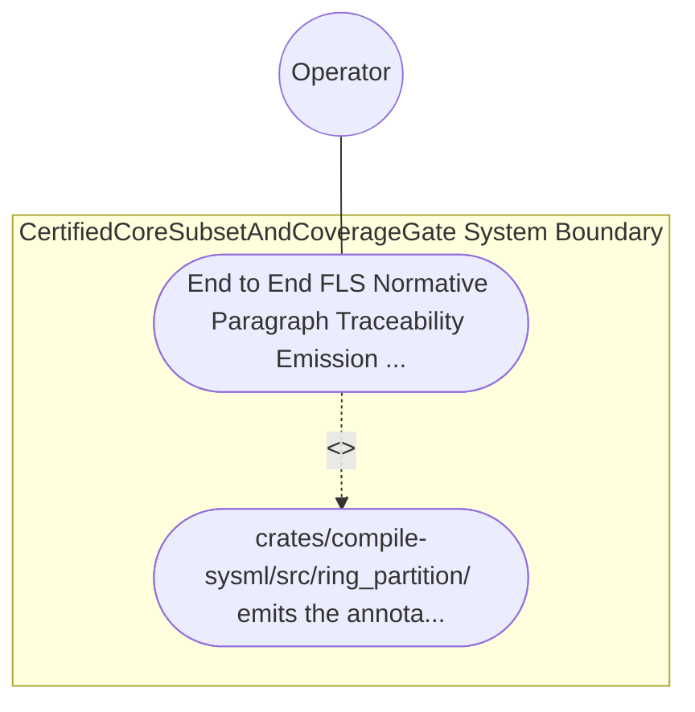

| Attribute | Specification Detail |
| :--- | :--- |
| **Issue ID** | #788 |
| **Title** | Use Case 60: End to End FLS Normative Paragraph Traceability Emission and Fail Closed Orphan Detection |
| **Type** | use-case |
| **Primary Actor** | Operator |
| **Scope** | CertifiedCoreSubsetAndCoverageGate |
| **Level** | User Goal |
| **Generation Mode** | subagent |
| **Specification Source** | [schema/model.sysml](../../schema/model.sysml) |

# Use Case 60: End to End FLS Normative Paragraph Traceability Emission and Fail Closed Orphan Detection

## UML Diagrams

## 1. Actors
- `Operator`

## 2. Preconditions
- A SysML v2 package declaring `RequirementDef` (`REQ-*`), STPA safety constraint (`SC-*`), Ring-1 `PartDef` / `StateDef` / `ConstraintDef` constructs, and Ring-2 FFI `PortDef` contracts compiled through `FlsParagraphTraceabilitySynthesizer`, plus a negative fixture containing a Ring-1 function missing its `FLS: fls_*` docstring tag and a Ring-2 `unsafe` block citing an unknown paragraph `fls_nonexistent999`.

## 3. Trigger
- crates/compile-sysml/src/ring_partition/ emits the annotated Rust units and crates/verify-baseline audits the 5-link FLS traceability chain against the pinned FLS paragraph catalog.

## 4. Main Success Scenario
1. `ThreeRingAssurancePartitionCompiler` routes lowered compilation units across `BP_11_PartitionToFlsTraceabilityConnection` (`lowered_module_graph_in`) to `FlsParagraphTraceabilitySynthesizer` (`unmapped_fls_item_count = 0`, `trace_chain_depth = 5`, `enforce_safety_comment_fls = true`), transitioning to `EmbeddingFlsTraceability`.
2. `FlsParagraphTraceabilitySynthesizer` stamps every generated Ring-1 item's 7-section docstring and every Ring-2 FFI `unsafe` block's `// SAFETY:` comment with normative Ferrocene Language Specification (`fls_*`) paragraph anchors inside `< 380` exec SLOC submodules (`crates/deap-core/src/fls_trace/`).
3. `FlsParagraphTraceabilitySynthesizer` invokes `verify_fls_traceability_chain(records, pinned_fls_catalog)` under `Invariant_REQ_0611_SC_02` to verify all 5 links (`REQ-*` -> `SC-*` -> `RustItem` -> `fls_*` -> `KaniAndCoverage`).
4. For the compliant package, `FlsParagraphTraceabilitySynthesizer` confirms `unmapped_fls_item_count == 0` (`C_CERT_03`), emits `FlsTaggedTraceBundle` on `fls_annotated_units_out`, and transitions to `AuditingCoreSubsetAndMcdc`.
5. For the negative fixture, `FlsParagraphTraceabilitySynthesizer` detects the missing Ring-1 `fls_*` tag and unknown `fls_nonexistent999` anchor, transitions to `RejectedFailClosed`, and emits `DEAP-E1102` on `fls_diag_out` with exit code 1.

## 5. Alternate and Exception Flows
- 3a. Ring-1 AST item or Ring-2 FFI `unsafe` block omits a required `fls_*` paragraph tag (`unmapped_fls_item_count > 0`, `Diagnostic: DEAP-E1102`):
  - `FlsParagraphTraceabilitySynthesizer` transitions to `RejectedFailClosed` on `rejectMissingFlsAnchorE1102`, emits single-line NDJSON diagnostic `DEAP-E1102` on `fls_diag_out`, and exits fail-closed with code 1.
- 4a. Cited `fls_*` anchor does not exist in `pinned_fls_catalog` (`Diagnostic: DEAP-E1102`):
  - `verify_fls_traceability_chain` rejects the orphan paragraph ID, emits `DEAP-E1102`, and terminates fail-closed with exit code 1.
- 5a. Incomplete 5-link traceability chain (`trace_chain_depth < 5`) under `Invariant_REQ_0611_SC_02`:
  - `CertifiedCoreSubsetAndCoverageGate` aborts execution without partial state mutation, preserves prior verified state, and notifies `Operator`.

## 6. Postconditions
- `CertifiedCoreSubsetAndCoverageGate` satisfies declared objective `End to End FLS Normative Paragraph Traceability Emission and Fail Closed Orphan Detection` with all subsystem invariants intact.
- Verified `End to End FLS Normative Paragraph Traceability Emission and Fail Closed Orphan Detection` completion status is recorded for `Operator`.

## 8. Realization Matrix
| Specification Item | Type | Link / Reference |
| :--- | :--- | :--- |
| **TBD** | User Story | [User Story 74: verify dual toolchain parity](../user-stories/US-74-verify_dual_toolchain_parity.md) |
| **TBD** | Feature | [Feature 50: [BP 11 Ferrocene Qualified Toolchain FLS Traceability Structural Coverage and 3 Ring Rust_Flutter DO 178 C DO 330 Certification Architecture] CertifiedCoreSubsetAndCoverageGate](../features/FEAT-50-CertifiedCoreSubsetAndCoverageGate.md) |

## Source References
Use case operational flows and lifecycle activity references:
- System Architecture Model: `schema/model.sysml`
- Normative Systems Engineering Standard: ISO/IEC/IEEE 29148:2018 §6.4.2 Concept of Operations

Operational use case realization and traceability links derive from `schema/model.sysml` pursuant to ISO/IEC/IEEE 29148.
