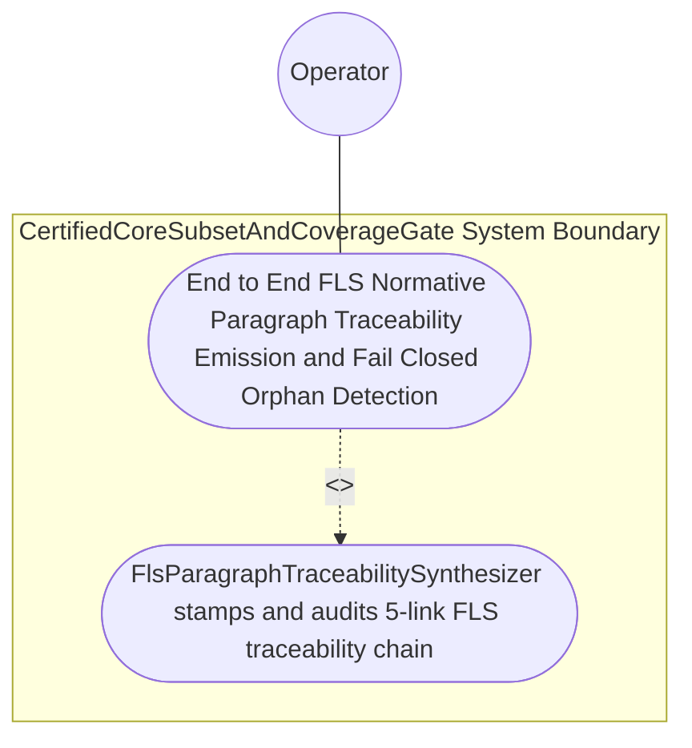

| Attribute | Specification Detail |
| :--- | :--- |
| **Issue ID** | #788 |
| **Title** | Use Case 60: End to End FLS Normative Paragraph Traceability Emission and Fail Closed Orphan Detection |
| **Type** | use-case |
| **Primary Actor** | Operator |
| **Scope** | CertifiedCoreSubsetAndCoverageGate |
| **Level** | User Goal |
| **Generation Mode** | subagent |
| **Specification Source** | [schema/model.sysml](../../schema/model.sysml) |

# Use Case 60: End to End FLS Normative Paragraph Traceability Emission and Fail Closed Orphan Detection

## UML Diagrams

## 1. Actors
- `Operator`

## 2. Preconditions
- A SysML v2.0 + KerML 1.0 package (Contract A, zero 16-construct caps) declaring `requirement def`/`requirement` (`REQ-*`), STPA safety constraint (`SC-*`), Ring-1 `part def`/`part`, `state def`/`state`, `action def`/`action`, `calc def`/`calc`, and `constraint def`/`constraint` constructs, and Ring-2 FFI `port def`/`port` contracts compiled through `FlsParagraphTraceabilitySynthesizer`, plus a negative fixture containing a Ring-1 function missing its `FLS: fls_*` docstring tag and a Ring-2 `unsafe` block citing an unknown paragraph `fls_nonexistent999`.

## 3. Trigger
- `crates/compile-sysml/src/ring_partition/` and `crates/deap-core/src/fls_trace/` emit `[FLS: fls_*]`-annotated Rust compilation units via `syn` + `proc-macro2` + `quote` + `prettyplease`, and `crates/verify-baseline/src/ferrocene_gate/` audits the 5-link FLS traceability chain against the pinned FLS paragraph catalog via `ra_ap_syntax`.

## 4. Main Success Scenario
1. `ThreeRingAssurancePartitionCompiler` routes lowered compilation units across `BP_11_PartitionToFlsTraceabilityConnection` (`lowered_module_graph_in`) to `FlsParagraphTraceabilitySynthesizer` (`unmapped_fls_item_count = 0`, `trace_chain_depth = 5`, `enforce_safety_comment_fls = true`), transitioning to `EmbeddingFlsTraceability`.
2. `FlsParagraphTraceabilitySynthesizer` stamps every generated Ring-1 item's 7-section docstring and every Ring-2 FFI `unsafe` block's `// SAFETY: [SC-*] [FLS: fls_*]` comment with normative Ferrocene Language Specification (`fls_*`) paragraph anchors via `syn` + `proc-macro2` + `quote` + `prettyplease` inside `< 380` exec SLOC submodules (`crates/deap-core/src/fls_trace/`, `C_CERT_07`).
3. `FlsParagraphTraceabilitySynthesizer` invokes `verify_fls_traceability_chain(records, pinned_fls_catalog)` via `ra_ap_syntax` (`ast::{Fn, HasDocComments, HasAttrs}`) under `Invariant_REQ_0611_SC_02` to verify all 5 links (`REQ-*` -> `SC-*` -> `RustItem` -> `fls_*` -> `KaniAndCoverage`).
4. For the compliant package, `FlsParagraphTraceabilitySynthesizer` confirms `unmapped_fls_item_count == 0` (`C_CERT_03`), emits `FlsTaggedTraceBundle` on `fls_annotated_units_out`, and transitions to `AuditingCoreSubsetAndMcdc`.
5. For the negative fixture, `FlsParagraphTraceabilitySynthesizer` detects the missing Ring-1 `fls_*` tag and unknown `fls_nonexistent999` anchor, transitions to `RejectedFailClosed`, and emits `DEAP-E1102` on `fls_diag_out` with exit code 1.

## 5. Alternate and Exception Flows
- 3a. Ring-1 AST item or Ring-2 FFI `unsafe` block omits a required `fls_*` paragraph tag (`unmapped_fls_item_count > 0`, `Diagnostic: DEAP-E1102`):
  - `FlsParagraphTraceabilitySynthesizer` transitions to `RejectedFailClosed` on `rejectMissingFlsAnchorE1102`, emits single-line NDJSON diagnostic `DEAP-E1102` on `fls_diag_out`, and exits fail-closed with code 1.
- 4a. Cited `fls_*` anchor does not exist in `pinned_fls_catalog` (`Diagnostic: DEAP-E1102`):
  - `verify_fls_traceability_chain` rejects the orphan paragraph ID, emits `DEAP-E1102`, and terminates fail-closed with exit code 1.
- 5a. Incomplete 5-link traceability chain (`trace_chain_depth < 5`) under `Invariant_REQ_0611_SC_02`:
  - `CertifiedCoreSubsetAndCoverageGate` aborts execution without partial state mutation, preserves prior verified state, and notifies `Operator`.

## 6. Postconditions
- `CertifiedCoreSubsetAndCoverageGate` and `FlsParagraphTraceabilitySynthesizer` satisfy declared objective `End to End FLS Normative Paragraph Traceability Emission and Fail Closed Orphan Detection` with all subsystem invariants intact.
- Verified `End to End FLS Normative Paragraph Traceability Emission and Fail Closed Orphan Detection` completion status is recorded for `Operator`.

## 7. Operational Context & Architectural Realization (3-Layer Definition of Done)
- **Contract A (Full OMG SysML v2.0 + KerML 1.0 Grammar Coverage)**: Extracts full SysML v2.0 + KerML 1.0 CST/AST definitions and usages (`requirement def`/`requirement`, `constraint def`/`constraint`, `part def`/`part`, `state def`/`state`, `action def`/`action`, `calc def`/`calc`, `port def`/`port`, `#fls`/`#dal` metadata) via `logos` + `rowan` + `salsa` + `ariadne` (`deap_core::sysml_cst`) with zero 16-construct caps.
- **Contract B (Official Rust Crate Stack & Zero Hand-Rolled Scanners)**: Synthesizes `[FLS: fls_*]` docstrings via `syn` + `proc-macro2` + `quote` + `prettyplease` and audits docstrings and `// SAFETY:` comments via `ra_ap_syntax` (`ast::{Fn, HasDocComments, HasAttrs}`) with zero hand-rolled string/line scanners.
- **Layer 1 (Domain State & Data Model)**: Typed `FlsParagraphTraceabilitySynthesizer` domain state (`unmapped_fls_item_count`, `trace_chain_depth`, `enforce_safety_comment_fls`), `FlsTaggedTraceBundle`, and `pinned_fls_catalog`.
- **Layer 2 (Logic & State Management)**: Deterministic 5-link FLS traceability synthesis and orphan detection inside `< 380`-SLOC submodules (`crates/deap-core/src/fls_trace/`, `C_CERT_07`) with explicit deletion of legacy hand-rolled docstring/comment line scanners.
- **Layer 3 (Presentation & Actuator Interface Binding)**: Boundary ports `lowered_module_graph_in`, `fls_annotated_units_out`, and `fls_diag_out` emitting `FlsTaggedTraceBundle` and `DEAP-E1102` diagnostics.

## 8. Realization Matrix
| Specification Item | Type | Link / Reference |
| :--- | :--- | :--- |
| **#825** | User Story | [User Story 76: verify fls traceability chain](../user-stories/US-76-verify_fls_traceability_chain.md) |
| **#756** | Feature | [Feature 50: [BP 11 Ferrocene Qualified Toolchain FLS Traceability Structural Coverage and 3 Ring Rust_Flutter DO 178 C DO 330 Certification Architecture] CertifiedCoreSubsetAndCoverageGate](../features/FEAT-50-CertifiedCoreSubsetAndCoverageGate.md) |
| **#758** | Feature | [Feature 52: [BP 11 Ferrocene Qualified Toolchain FLS Traceability Structural Coverage and 3 Ring Rust_Flutter DO 178 C DO 330 Certification Architecture] FlsParagraphTraceabilitySynthesizer](../features/FEAT-52-FlsParagraphTraceabilitySynthesizer.md) |

### Required User Stories
- [ ] #825 - [User Story 76: verify fls traceability chain](../user-stories/US-76-verify_fls_traceability_chain.md)

### Required Features
- [ ] #756 - [Feature 50: [BP 11 Ferrocene Qualified Toolchain FLS Traceability Structural Coverage and 3 Ring Rust_Flutter DO 178 C DO 330 Certification Architecture] CertifiedCoreSubsetAndCoverageGate](../features/FEAT-50-CertifiedCoreSubsetAndCoverageGate.md)
- [ ] #758 - [Feature 52: [BP 11 Ferrocene Qualified Toolchain FLS Traceability Structural Coverage and 3 Ring Rust_Flutter DO 178 C DO 330 Certification Architecture] FlsParagraphTraceabilitySynthesizer](../features/FEAT-52-FlsParagraphTraceabilitySynthesizer.md)

## Source References
Use case operational flows and lifecycle activity references:
- System Architecture Model: `schema/model.sysml`
- Normative Systems Engineering Standard: ISO/IEC/IEEE 29148:2018 §6.4.2 Concept of Operations

Operational use case realization and traceability links derive from `schema/model.sysml` pursuant to ISO/IEC/IEEE 29148.
