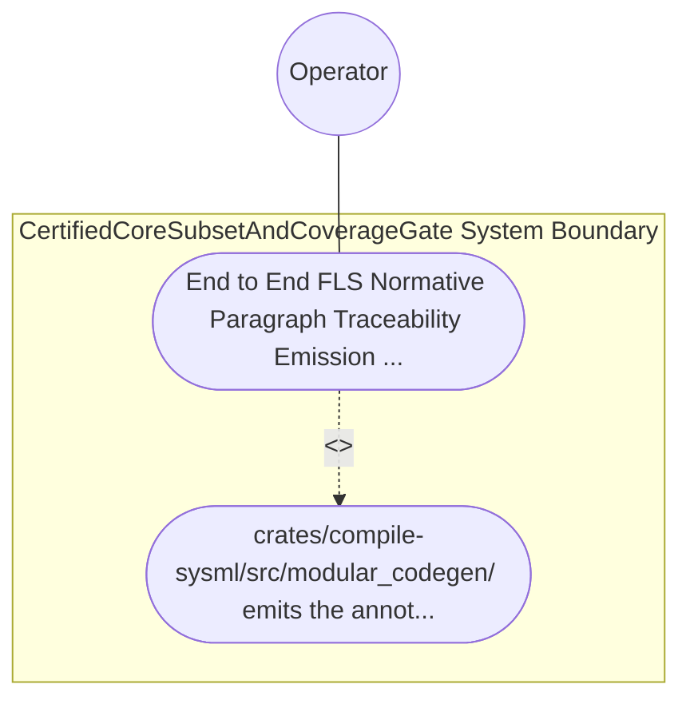

| Attribute | Specification Detail |
| :--- | :--- |
| **Issue ID** | TBD |
| **Title** | Use Case 60: End to End FLS Normative Paragraph Traceability Emission and Fail Closed Orphan Detection |
| **Type** | use-case |
| **Primary Actor** | Operator |
| **Scope** | CertifiedCoreSubsetAndCoverageGate |
| **Level** | User Goal |
| **Generation Mode** | subagent |
| **Specification Source** | [schema/model.sysml](../../schema/model.sysml) |

# Use Case 60: End to End FLS Normative Paragraph Traceability Emission and Fail Closed Orphan Detection

## UML Diagrams

## 1. Actors
- `Operator`

## 2. Preconditions
- A SysML v2 package declaring RequirementDef (REQ-*), STPA safety constraint (SC-*), Ring-1 PartDef / StateDef / ConstraintDef constructs, and Ring-2 FFI PortDef contracts compiled through FlsParagraphTraceabilitySynthesizer, plus a negative fixture containing a Ring-1 function missing its [FLS: fls_*] docstring tag and a Ring-2 unsafe block citing an unknown paragraph fls_nonexistent999.

## 3. Trigger
- crates/compile-sysml/src/modular_codegen/ emits the annotated Rust units and crates/verify-baseline audits the 5-link FLS traceability chain against the pinned FLS paragraph catalog.

## 4. Main Success Scenario
1. crates/compile-sysml/src/modular_codegen/ emits the annotated Rust units and crates/verify-baseline audits the 5-link FLS traceability chain against the pinned FLS paragraph catalog.

## 5. Alternate and Exception Flows
- Precondition guard failure in `CertifiedCoreSubsetAndCoverageGate`:
  - `CertifiedCoreSubsetAndCoverageGate` rejects the `End to End FLS Normative Paragraph Traceability Emission and Fail Closed Orphan Detection` request without partial state mutation and reports diagnostic status to `Operator`.
- Invariant violation while enforcing `End to End FLS Normative Paragraph Traceability Emission and Fail Closed Orphan Detection`:
  - `CertifiedCoreSubsetAndCoverageGate` aborts `End to End FLS Normative Paragraph Traceability Emission and Fail Closed Orphan Detection` execution, preserves prior verified state, and notifies `Operator`.

## 6. Postconditions
- `CertifiedCoreSubsetAndCoverageGate` satisfies declared objective `End to End FLS Normative Paragraph Traceability Emission and Fail Closed Orphan Detection` with all subsystem invariants intact.
- Verified `End to End FLS Normative Paragraph Traceability Emission and Fail Closed Orphan Detection` completion status is recorded for `Operator`.

## 8. Realization Matrix
| Specification Item | Type | Link / Reference |
| :--- | :--- | :--- |
| **TBD** | User Story | [User Story 69: synthesize Three Ring Workspace](../user-stories/US-69-synthesizeThreeRingWorkspace.md) |
| **TBD** | Feature | [Feature 55: [BP 11 Ferrocene Qualified Toolchain FLS Traceability Structural Coverage and 3 Ring Rust Flutter DO 178 C DO 330 Certification Architecture] CertifiedCoreSubsetAndCoverageGate](../features/FEAT-55-CertifiedCoreSubsetAndCoverageGate.md) |

## Source References
Use case operational flows and lifecycle activity references:
- System Architecture Model: `schema/model.sysml`
- Normative Systems Engineering Standard: ISO/IEC/IEEE 29148:2018 §6.4.2 Concept of Operations

Operational use case realization and traceability links derive from `schema/model.sysml` pursuant to ISO/IEC/IEEE 29148.
