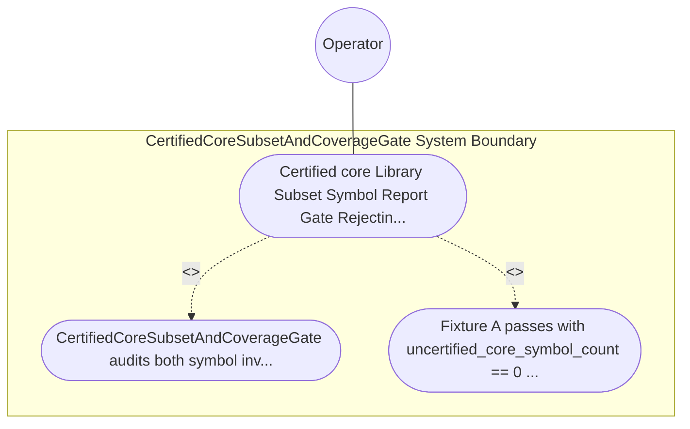

| Attribute | Specification Detail |
| :--- | :--- |
| **Issue ID** | TBD |
| **Title** | Use Case 61: Certified core Library Subset Symbol Report Gate Rejecting std alloc and Dynamic Formatting Symbols |
| **Type** | use-case |
| **Primary Actor** | Operator |
| **Scope** | CertifiedCoreSubsetAndCoverageGate |
| **Level** | User Goal |
| **Generation Mode** | subagent |
| **Specification Source** | [schema/model.sysml](../../schema/model.sysml) |

# Use Case 61: Certified core Library Subset Symbol Report Gate Rejecting std alloc and Dynamic Formatting Symbols

## UML Diagrams

## 1. Actors
- `Operator`

## 2. Preconditions
- Two Ring-1 #![no_std] safety_kernel symbol-report fixtures: Fixture A linking exclusively certified core::option, core::result, core::num, and fixed-size array operations, and Fixture B inadvertently linking __rust_alloc, alloc::vec::Vec, or std::io::stdio::_print.

## 3. Trigger
- CertifiedCoreSubsetAndCoverageGate audits both symbol inventories against the certified core allowlist prefix catalog.

## 4. Main Success Scenario
1. CertifiedCoreSubsetAndCoverageGate audits both symbol inventories against the certified core allowlist prefix catalog.
2. Fixture A passes with uncertified_core_symbol_count == 0 (**C-CERT-04**), whereas Fixture B fails closed immediately with DEAP-E1103 enumerating every prohibited std, alloc, or.

## 5. Alternate and Exception Flows
- Precondition guard failure in `CertifiedCoreSubsetAndCoverageGate`:
  - `CertifiedCoreSubsetAndCoverageGate` rejects the `Certified core Library Subset Symbol Report Gate Rejecting std alloc and Dynamic Formatting Symbols` request without partial state mutation and reports diagnostic status to `Operator`.
- Invariant violation while enforcing `Certified core Library Subset Symbol Report Gate Rejecting std alloc and Dynamic Formatting Symbols`:
  - `CertifiedCoreSubsetAndCoverageGate` aborts `Certified core Library Subset Symbol Report Gate Rejecting std alloc and Dynamic Formatting Symbols` execution, preserves prior verified state, and notifies `Operator`.

## 6. Postconditions
- Fixture A passes with uncertified_core_symbol_count == 0 (**C-CERT-04**), whereas Fixture B fails closed immediately with DEAP-E1103 enumerating every prohibited std, alloc, or.

## 8. Realization Matrix
| Specification Item | Type | Link / Reference |
| :--- | :--- | :--- |
| **TBD** | User Story | [User Story 70: attach And Audit Fls Traceability](../user-stories/US-70-attachAndAuditFlsTraceability.md) |
| **TBD** | Feature | [Feature 55: [BP 11 Ferrocene Qualified Toolchain FLS Traceability Structural Coverage and 3 Ring Rust Flutter DO 178 C DO 330 Certification Architecture] CertifiedCoreSubsetAndCoverageGate](../features/FEAT-55-CertifiedCoreSubsetAndCoverageGate.md) |

## Source References
Use case operational flows and lifecycle activity references:
- System Architecture Model: `schema/model.sysml`
- Normative Systems Engineering Standard: ISO/IEC/IEEE 29148:2018 §6.4.2 Concept of Operations

Operational use case realization and traceability links derive from `schema/model.sysml` pursuant to ISO/IEC/IEEE 29148.
