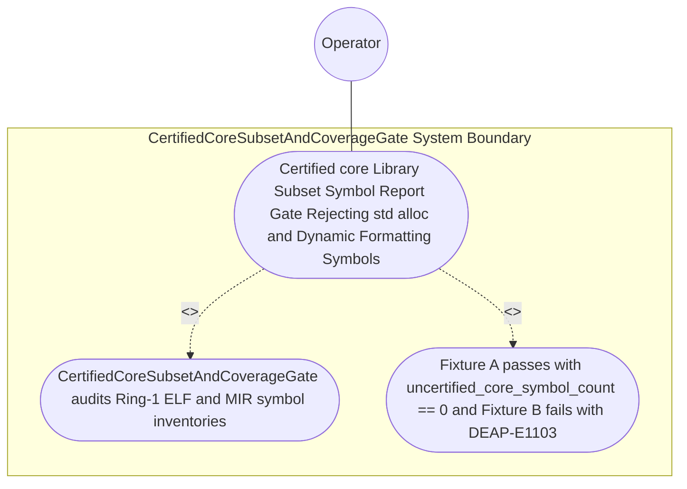

| Attribute | Specification Detail |
| :--- | :--- |
| **Issue ID** | #790 |
| **Title** | Use Case 61: Certified core Library Subset Symbol Report Gate Rejecting std alloc and Dynamic Formatting Symbols |
| **Type** | use-case |
| **Primary Actor** | Operator |
| **Scope** | CertifiedCoreSubsetAndCoverageGate |
| **Level** | User Goal |
| **Generation Mode** | subagent |
| **Specification Source** | [schema/model.sysml](../../schema/model.sysml) |

# Use Case 61: Certified core Library Subset Symbol Report Gate Rejecting std alloc and Dynamic Formatting Symbols

## UML Diagrams

## 1. Actors
- `Operator`

## 2. Preconditions
- Two Ring-1 inner `#![no_std]` `safety_kernel` Ferrocene `symbol-report` fixtures parsed via typed `serde_json` schemas (Contract B, zero hand-rolled scanners): Fixture A linking exclusively certified `core::option`, `core::result`, `core::num`, and fixed-size array operations, and Fixture B inadvertently linking `__rust_alloc`, `alloc::vec::Vec`, or `std::io::stdio::_print`.

## 3. Trigger
- `CertifiedCoreSubsetAndCoverageGate` audits both Ring-1 `symbol-report` inventories against the Ferrocene certified `core` allowlist prefix catalog (`S_core^cert`).

## 4. Main Success Scenario
1. `FlsParagraphTraceabilitySynthesizer` transitions `BP_11_Ferrocene_Qualified_Toolchain_FLS_Traceability_Structural_Coverage_and_3_Ring_Rust_Flutter_DO_178C_DO_330_Certification_Architecture_LifecycleState` to `AuditingCoreSubsetAndMcdc` on `fiveLinkFlsChainComplete` and invokes `verify_certified_core_and_table_a7_coverage(summary, certified_core_prefixes)` on `CertifiedCoreSubsetAndCoverageGate` (`uncertified_core_symbol_count = 0`).
2. `CertifiedCoreSubsetAndCoverageGate` receives Ring-1 ELF/MIR `symbol-report` inventories on `elf_and_profdata_in` inside `< 380` exec SLOC submodules (`crates/verify-baseline/src/ferrocene_gate/`, `C_CERT_07`).
3. `CertifiedCoreSubsetAndCoverageGate` audits every linked symbol in Fixture A and Fixture B against the Ferrocene certified `core` subset allowlist prefix catalog (`S_core^cert`) under `Invariant_REQ_0611_SC_03`.
4. Fixture A passes with `uncertified_core_symbol_count == 0` (`C_CERT_04`), emitting certified `core` symbol attestation on `table_a7_evidence_out`.
5. Fixture B fails closed immediately upon matching `__rust_alloc`, `alloc::vec::Vec`, and `std::io::stdio::_print`, transitioning to `RejectedFailClosed` and emitting `DEAP-E1103` on `coverage_diag_out` with exit code 1.

## 5. Alternate and Exception Flows
- 3a. Ring-1 ELF or MIR symbol table contains any symbol outside `certified_core_prefixes` (`uncertified_core_symbol_count > 0`, `Diagnostic: DEAP-E1103`):
  - `CertifiedCoreSubsetAndCoverageGate` transitions to `RejectedFailClosed` on `rejectUncertifiedSymbolOrCoverageE1103E1104`, emits single-line NDJSON diagnostic `DEAP-E1103` on `coverage_diag_out`, and exits fail-closed with code 1.
- 4a. Ring-1 `safety_kernel` crate omits inner `#![no_std]` or links `alloc` (`max_ring1_heap_allocations > 0`, `Diagnostic: DEAP-E1103`):
  - `CertifiedCoreSubsetAndCoverageGate` rejects the Ring-1 artifact and terminates fail-closed with exit code 1.
- 5a. Invariant violation while enforcing `C_CERT_04` or `Invariant_REQ_0611_SC_03`:
  - `CertifiedCoreSubsetAndCoverageGate` aborts execution without partial state mutation, preserves prior verified state, and notifies `Operator`.

## 6. Postconditions
- Fixture A passes with `uncertified_core_symbol_count == 0` (`C_CERT_04`), whereas Fixture B fails closed immediately with `DEAP-E1103` enumerating every prohibited `std`, `alloc`, or dynamic formatting symbol.

## 7. Operational Context & Architectural Realization (3-Layer Definition of Done)
- **Contract A (Full OMG SysML v2.0 + KerML 1.0 Grammar Coverage)**: Binds Ring-1 `part def`/`part`, `action def`/`action`, `calc def`/`calc`, `state def`/`state`, and `constraint def`/`constraint` CST/AST elements via `logos` + `rowan` + `salsa` + `ariadne` (`deap_core::sysml_cst`) with zero 16-construct caps.
- **Contract B (Official Rust Crate Stack & Zero Hand-Rolled Scanners)**: Audits Ferrocene `symbol-report` JSON/ELF symbol tables via typed `serde_json` schemas and `ra_ap_syntax` (`ast::{HasAttrs}`) with zero hand-rolled string/line scanners.
- **Layer 1 (Domain State & Data Model)**: Typed `CertifiedCoreSubsetAndCoverageGate` domain state (`uncertified_core_symbol_count`, `certified_core_prefixes`) and `symbol-report` inventory records.
- **Layer 2 (Logic & State Management)**: Deterministic `symbol-report` allowlist verification (`C_CERT_04`, `Invariant_REQ_0611_SC_03`) inside `< 380`-SLOC submodules (`crates/verify-baseline/src/ferrocene_gate/`, `C_CERT_07`) with explicit deletion of legacy hand-rolled symbol-table line scanners.
- **Layer 3 (Presentation & Actuator Interface Binding)**: Boundary ports `elf_and_profdata_in`, `table_a7_evidence_out`, and `coverage_diag_out` emitting certified `core` attestations and `DEAP-E1103` diagnostics.

## 8. Realization Matrix
| Specification Item | Type | Link / Reference |
| :--- | :--- | :--- |
| **#825** | User Story | [User Story 75: Synthesize Three Ring Workspace](../user-stories/US-75-synthesize_three_ring_workspace.md) |
| **#827** | User Story | [User Story 77: Verify Certified Core And Table A7 Coverage](../user-stories/US-77-verify_certified_core_and_table_a7_coverage.md) |
| **#848** | Feature | [Feature 50: [BP 11 Ferrocene Qualified Toolchain FLS Traceability Structural Coverage and 3 Ring Rust_Flutter DO 178 C DO 330 Certification Architecture] CertifiedCoreSubsetAndCoverageGate](../features/FEAT-50-CertifiedCoreSubsetAndCoverageGate.md) |

### Required User Stories
- [ ] #825 - [User Story 75: Synthesize Three Ring Workspace](../user-stories/US-75-synthesize_three_ring_workspace.md)
- [ ] #827 - [User Story 77: Verify Certified Core And Table A7 Coverage](../user-stories/US-77-verify_certified_core_and_table_a7_coverage.md)

### Required Features
- [ ] #848 - [Feature 50: [BP 11 Ferrocene Qualified Toolchain FLS Traceability Structural Coverage and 3 Ring Rust_Flutter DO 178 C DO 330 Certification Architecture] CertifiedCoreSubsetAndCoverageGate](../features/FEAT-50-CertifiedCoreSubsetAndCoverageGate.md)

## Source References
Use case operational flows and lifecycle activity references:
- System Architecture Model: `schema/model.sysml`
- Normative Systems Engineering Standard: ISO/IEC/IEEE 29148:2018 §6.4.2 Concept of Operations

Operational use case realization and traceability links derive from `schema/model.sysml` pursuant to ISO/IEC/IEEE 29148.
