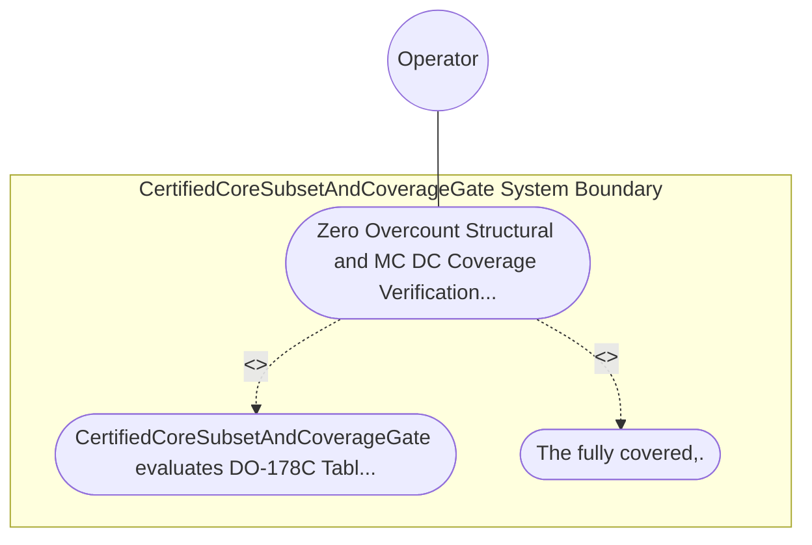

| Attribute | Specification Detail |
| :--- | :--- |
| **Issue ID** | TBD |
| **Title** | Use Case 62: Zero Overcount Structural and MC DC Coverage Verification Mapped to SysML Verification Cases |
| **Type** | use-case |
| **Primary Actor** | Operator |
| **Scope** | CertifiedCoreSubsetAndCoverageGate |
| **Level** | User Goal |
| **Generation Mode** | subagent |
| **Specification Source** | [schema/model.sysml](../../schema/model.sysml) |

# Use Case 62: Zero Overcount Structural and MC DC Coverage Verification Mapped to SysML Verification Cases

## UML Diagrams

## 1. Actors
- `Operator`

## 2. Preconditions
- A DAL-A Ring-1 SafetyKernel module exercised by blanket / llvm-profdata MC/DC condition-vector profiles linked to SysML TestCaseDef declarations (TEST-01 -> REQ-0611), alongside three negative fixtures: (1) a boolean decision a && (b || c) missing independent flip coverage for condition c (99% MC/DC), (2) an overcounted macro-duplicated source span, and (3) a coverage test lacking a SysML TEST-* -> REQ-* verified_by binding.

## 3. Trigger
- CertifiedCoreSubsetAndCoverageGate evaluates DO-178C Table A-7 coverage thresholds for DalLevel::DalA.

## 4. Main Success Scenario
1. CertifiedCoreSubsetAndCoverageGate evaluates DO-178C Table A-7 coverage thresholds for DalLevel::DalA.
2. The fully covered,.

## 5. Alternate and Exception Flows
- Precondition guard failure in `CertifiedCoreSubsetAndCoverageGate`:
  - `CertifiedCoreSubsetAndCoverageGate` rejects the `Zero Overcount Structural and MC DC Coverage Verification Mapped to SysML Verification Cases` request without partial state mutation and reports diagnostic status to `Operator`.
- Invariant violation while enforcing `Zero Overcount Structural and MC DC Coverage Verification Mapped to SysML Verification Cases`:
  - `CertifiedCoreSubsetAndCoverageGate` aborts `Zero Overcount Structural and MC DC Coverage Verification Mapped to SysML Verification Cases` execution, preserves prior verified state, and notifies `Operator`.

## 6. Postconditions
- The fully covered,.

## 8. Realization Matrix
| Specification Item | Type | Link / Reference |
| :--- | :--- | :--- |
| **TBD** | User Story | [User Story 71: audit Core Subset And Mcdc Coverage](../user-stories/US-71-auditCoreSubsetAndMcdcCoverage.md) |
| **TBD** | Feature | [Feature 55: [BP 11 Ferrocene Qualified Toolchain FLS Traceability Structural Coverage and 3 Ring Rust Flutter DO 178 C DO 330 Certification Architecture] CertifiedCoreSubsetAndCoverageGate](../features/FEAT-55-CertifiedCoreSubsetAndCoverageGate.md) |

## Source References
Use case operational flows and lifecycle activity references:
- System Architecture Model: `schema/model.sysml`
- Normative Systems Engineering Standard: ISO/IEC/IEEE 29148:2018 §6.4.2 Concept of Operations

Operational use case realization and traceability links derive from `schema/model.sysml` pursuant to ISO/IEC/IEEE 29148.
