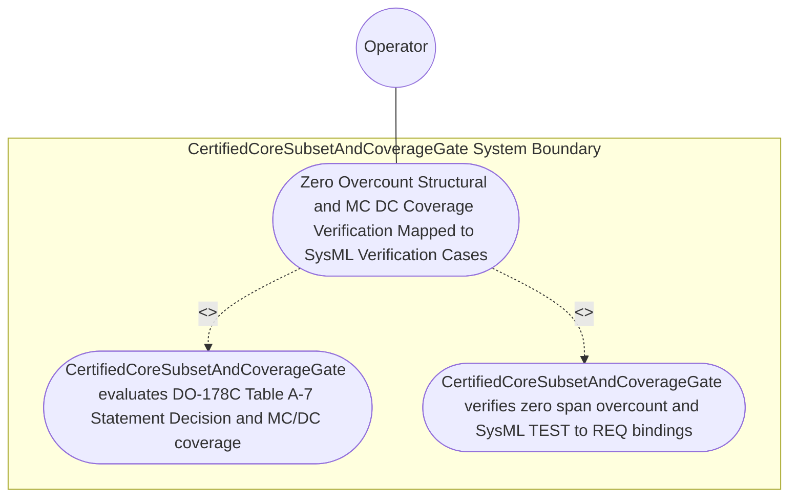

| Attribute | Specification Detail |
| :--- | :--- |
| **Issue ID** | #791 |
| **Title** | Use Case 62: Zero Overcount Structural and MC DC Coverage Verification Mapped to SysML Verification Cases |
| **Type** | use-case |
| **Primary Actor** | Operator |
| **Scope** | CertifiedCoreSubsetAndCoverageGate |
| **Level** | User Goal |
| **Generation Mode** | subagent |
| **Specification Source** | [schema/model.sysml](../../schema/model.sysml) |

# Use Case 62: Zero Overcount Structural and MC DC Coverage Verification Mapped to SysML Verification Cases

## UML Diagrams

## 1. Actors
- `Operator`

## 2. Preconditions
- A DAL-A Ring-1 `SafetyKernel` module exercised by Ferrocene `blanket` / `llvm-profdata` MC/DC condition-vector profiles linked to OMG SysML v2.0 + KerML 1.0 `test case def`/`test case` and `verification def`/`verification` declarations (`TEST-01 -> REQ-0611`, Contract A, zero 16-construct caps), alongside three negative fixtures: (1) a boolean decision `a && (b || c)` missing independent flip coverage for condition `c` (`99%` MC/DC), (2) an overcounted macro-duplicated source span, and (3) a coverage test lacking a SysML `TEST-* -> REQ-*` `verify requirement` binding.

## 3. Trigger
- `CertifiedCoreSubsetAndCoverageGate` evaluates DO-178C Table A-7 structural coverage thresholds for `DalLevel::DalA` using typed `serde_json` schemas (Contract B, zero hand-rolled scanners).

## 4. Main Success Scenario
1. `Operator` supplies `blanket` / `llvm-profdata` JSON coverage profiles and SysML `test case def` bindings (`TEST-01 -> REQ-0611`) on `elf_and_profdata_in` to `CertifiedCoreSubsetAndCoverageGate` (`dal_a_mcdc_coverage_min_pct = 100`, `overcounted_span_count = 0`, `require_sysml_test_case_link = true`).
2. `CertifiedCoreSubsetAndCoverageGate` invokes `verify_certified_core_and_table_a7_coverage(summary, certified_core_prefixes)` inside `< 380` exec SLOC submodules (`crates/verify-baseline/src/ferrocene_gate/`, `C_CERT_07`) using typed `serde_json` schemas.
3. `CertifiedCoreSubsetAndCoverageGate` evaluates DO-178C Table A-7 thresholds for `DalLevel::DalA` under `Invariant_REQ_0611_SC_03`, verifying `100%` Statement, `100%` Decision, and `100%` MC/DC independent condition-flip pairs (`dal_a_mcdc_coverage_min_pct == 100`, `C_CERT_05`).
4. `CertifiedCoreSubsetAndCoverageGate` verifies `overcounted_span_count == 0` across macro-expanded spans and confirms every coverage record resolves via a SysML `TEST-* -> REQ-*` binding (`require_sysml_test_case_link == true`), emitting `Do178cTableA7Receipt` on `table_a7_evidence_out` and transitioning to `VerifyingRing1SafetyMonitor`.
5. For the three negative fixtures (`99%` MC/DC on `a && (b || c)`, macro-duplicated span overcount, or missing `TEST-* -> REQ-*` binding), `CertifiedCoreSubsetAndCoverageGate` transitions to `RejectedFailClosed` and emits `DEAP-E1104` on `coverage_diag_out` with exit code 1.

## 5. Alternate and Exception Flows
- 3a. Ring-1 DAL-A unit achieves `< 100%` Statement, Decision, or MC/DC structural coverage (`C_CERT_05`, `Diagnostic: DEAP-E1104`):
  - `CertifiedCoreSubsetAndCoverageGate` transitions to `RejectedFailClosed` on `rejectUncertifiedSymbolOrCoverageE1103E1104`, emits single-line NDJSON diagnostic `DEAP-E1104` on `coverage_diag_out`, and exits fail-closed with code 1.
- 4a. Coverage report contains macro-duplicated source-span overcounting (`overcounted_span_count > 0`, `Diagnostic: DEAP-E1104`):
  - `verify_certified_core_and_table_a7_coverage` rejects the inflated coverage profile, emits `DEAP-E1104`, and terminates fail-closed with exit code 1.
- 5a. Coverage record lacks a verified SysML `test case def` (`TEST-* -> REQ-*`) traceability link (`Diagnostic: DEAP-E1104`):
  - `CertifiedCoreSubsetAndCoverageGate` aborts certification evidence emission, preserves prior verified state, and exits fail-closed with code 1.

## 6. Postconditions
- Compliant DAL-A units pass with `100%` Statement, Decision, and MC/DC coverage (`C_CERT_05`), `overcounted_span_count == 0`, and verified `TEST-* -> REQ-*` links, while all three negative fixtures fail closed with `DEAP-E1104`.

## 7. Operational Context & Architectural Realization (3-Layer Definition of Done)
- **Contract A (Full OMG SysML v2.0 + KerML 1.0 Grammar Coverage)**: Ingests SysML v2.0 + KerML 1.0 `verification def`/`verification` and `test case def`/`test case` (`verify requirement`) CST/AST nodes via `logos` + `rowan` + `salsa` + `ariadne` (`deap_core::sysml_cst`) with zero 16-construct caps.
- **Contract B (Official Rust Crate Stack & Zero Hand-Rolled Scanners)**: Deserializes Ferrocene `blanket` and `llvm-profdata` JSON coverage reports via typed `serde_json` schemas with zero hand-rolled line/string coverage scanners.
- **Layer 1 (Domain State & Data Model)**: Typed `CertifiedCoreSubsetAndCoverageGate` domain state (`dal_a_mcdc_coverage_min_pct`, `overcounted_span_count`, `require_sysml_test_case_link`) and `Do178cTableA7Receipt`.
- **Layer 2 (Logic & State Management)**: Deterministic DO-178C Table A-7 Statement, Decision, and MC/DC condition-flip verification inside `< 380`-SLOC submodules (`crates/verify-baseline/src/ferrocene_gate/`, `C_CERT_07`) with explicit deletion of legacy hand-rolled coverage scanners.
- **Layer 3 (Presentation & Actuator Interface Binding)**: Boundary ports `elf_and_profdata_in`, `table_a7_evidence_out`, and `coverage_diag_out` emitting `Do178cTableA7Receipt` and `DEAP-E1104` diagnostics.

## 8. Realization Matrix
| Specification Item | Type | Link / Reference |
| :--- | :--- | :--- |
| **#826** | User Story | [User Story 76: Verify Fls Traceability Chain](../user-stories/US-76-verify_fls_traceability_chain.md) |
| **#827** | User Story | [User Story 77: Verify Certified Core And Table A7 Coverage](../user-stories/US-77-verify_certified_core_and_table_a7_coverage.md) |
| **#848** | Feature | [Feature 50: [BP 11 Ferrocene Qualified Toolchain FLS Traceability Structural Coverage and 3 Ring Rust_Flutter DO 178 C DO 330 Certification Architecture] CertifiedCoreSubsetAndCoverageGate](../features/FEAT-50-CertifiedCoreSubsetAndCoverageGate.md) |

### Required User Stories
- [ ] #826 - [User Story 76: Verify Fls Traceability Chain](../user-stories/US-76-verify_fls_traceability_chain.md)
- [ ] #827 - [User Story 77: Verify Certified Core And Table A7 Coverage](../user-stories/US-77-verify_certified_core_and_table_a7_coverage.md)

### Required Features
- [ ] #848 - [Feature 50: [BP 11 Ferrocene Qualified Toolchain FLS Traceability Structural Coverage and 3 Ring Rust_Flutter DO 178 C DO 330 Certification Architecture] CertifiedCoreSubsetAndCoverageGate](../features/FEAT-50-CertifiedCoreSubsetAndCoverageGate.md)

## Source References
Use case operational flows and lifecycle activity references:
- System Architecture Model: `schema/model.sysml`
- Normative Systems Engineering Standard: ISO/IEC/IEEE 29148:2018 §6.4.2 Concept of Operations

Operational use case realization and traceability links derive from `schema/model.sysml` pursuant to ISO/IEC/IEEE 29148.
