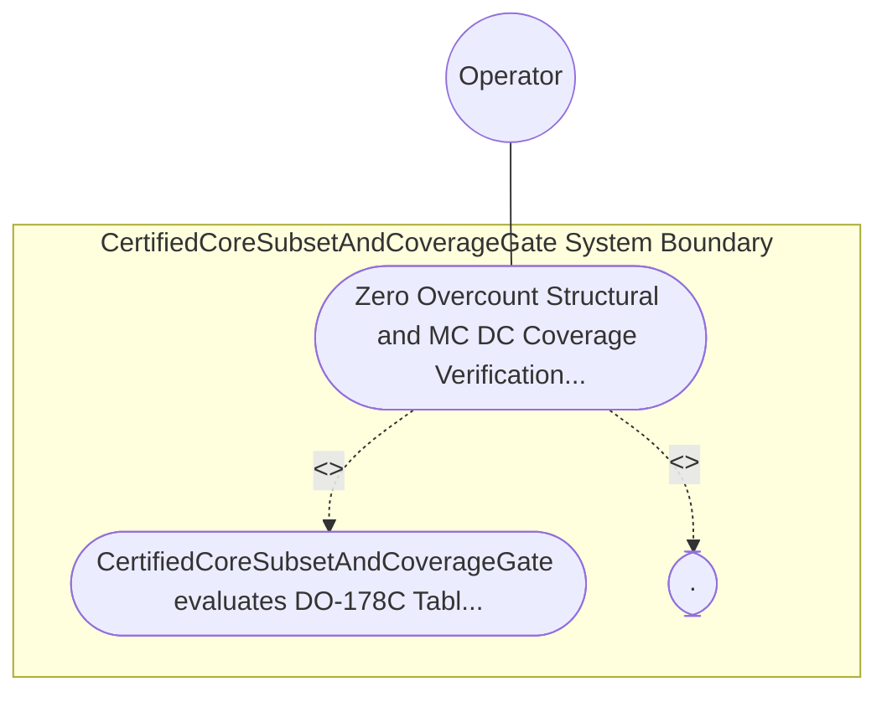

| Attribute | Specification Detail |
| :--- | :--- |
| **Issue ID** | #790 |
| **Title** | Use Case 62: Zero Overcount Structural and MC DC Coverage Verification Mapped to SysML Verification Cases |
| **Type** | use-case |
| **Primary Actor** | Operator |
| **Scope** | CertifiedCoreSubsetAndCoverageGate |
| **Level** | User Goal |
| **Generation Mode** | subagent |
| **Specification Source** | [schema/model.sysml](../../schema/model.sysml) |

# Use Case 62: Zero Overcount Structural and MC DC Coverage Verification Mapped to SysML Verification Cases

## UML Diagrams

## 1. Actors
- `Operator`

## 2. Preconditions
- A DAL-A Ring-1 SafetyKernel module exercised by blanket / llvm-profdata MC/DC condition-vector profiles linked to SysML TestCaseDef declarations (TEST-01 -> REQ-0611), alongside three negative fixtures: (1) a boolean decision a && (b || c) missing independent flip coverage for condition c (99% MC/DC), (2) an overcounted macro-duplicated source span, and (3) a coverage test lacking a SysML TEST-* -> REQ-* verified_by binding.

## 3. Trigger
- CertifiedCoreSubsetAndCoverageGate evaluates DO-178C Table A-7 coverage thresholds for DalLevel::DalA using typed serde_json schemas.

## 4. Main Success Scenario
1. `Operator` supplies `blanket` / `llvm-profdata` JSON coverage profiles and SysML `TestCaseDef` bindings (`TEST-01 -> REQ-0611`) on `elf_and_profdata_in` to `CertifiedCoreSubsetAndCoverageGate` (`dal_a_mcdc_coverage_min_pct = 100`, `overcounted_span_count = 0`, `require_sysml_test_case_link = true`).
2. `CertifiedCoreSubsetAndCoverageGate` invokes `verify_certified_core_and_table_a7_coverage(summary, certified_core_prefixes)` inside `< 380` exec SLOC submodules (`crates/verify-baseline/src/ferrocene_gate/`) using typed `serde_json` schemas.
3. `CertifiedCoreSubsetAndCoverageGate` evaluates DO-178C Table A-7 thresholds for `DalLevel::DalA` under `Invariant_REQ_0611_SC_03`, verifying `100%` Statement, `100%` Decision, and `100%` MC/DC independent condition-flip pairs (`dal_a_mcdc_coverage_min_pct == 100`, `C_CERT_05`).
4. `CertifiedCoreSubsetAndCoverageGate` verifies `overcounted_span_count == 0` across macro-expanded spans and confirms every coverage record resolves via a SysML `TEST-* -> REQ-*` binding (`require_sysml_test_case_link == true`), emitting `Do178cTableA7Receipt` on `table_a7_evidence_out` and transitioning to `VerifyingRing1SafetyMonitor`.
5. For the three negative fixtures (99% MC/DC on `a && (b || c)`, macro-duplicated span overcount, or missing `TEST-* -> REQ-*` binding), `CertifiedCoreSubsetAndCoverageGate` transitions to `RejectedFailClosed` and emits `DEAP-E1104` on `coverage_diag_out` with exit code 1.

## 5. Alternate and Exception Flows
- 3a. Ring-1 DAL-A unit achieves `< 100%` Statement, Decision, or MC/DC structural coverage (`C_CERT_05`, `Diagnostic: DEAP-E1104`):
  - `CertifiedCoreSubsetAndCoverageGate` transitions to `RejectedFailClosed` on `rejectUncertifiedSymbolOrCoverageE1103E1104`, emits single-line NDJSON diagnostic `DEAP-E1104` on `coverage_diag_out`, and exits fail-closed with code 1.
- 4a. Coverage report contains macro-duplicated source-span overcounting (`overcounted_span_count > 0`, `Diagnostic: DEAP-E1104`):
  - `verify_certified_core_and_table_a7_coverage` rejects the inflated coverage profile, emits `DEAP-E1104`, and terminates fail-closed with exit code 1.
- 5a. Coverage record lacks a verified SysML `TestCaseDef` (`TEST-* -> REQ-*`) traceability link (`Diagnostic: DEAP-E1104`):
  - `CertifiedCoreSubsetAndCoverageGate` aborts certification evidence emission, preserves prior verified state, and exits fail-closed with code 1.

## 6. Postconditions
- Compliant DAL-A units pass with `100%` Statement, Decision, and MC/DC coverage (`C_CERT_05`), `overcounted_span_count == 0`, and verified `TEST-* -> REQ-*` links, while all three negative fixtures fail closed with `DEAP-E1104`.

## 8. Realization Matrix
| Specification Item | Type | Link / Reference |
| :--- | :--- | :--- |
| **TBD** | User Story | [User Story 76: verify fls traceability chain](../user-stories/US-76-verify_fls_traceability_chain.md) |
| **TBD** | Feature | [Feature 50: [BP 11 Ferrocene Qualified Toolchain FLS Traceability Structural Coverage and 3 Ring Rust_Flutter DO 178 C DO 330 Certification Architecture] CertifiedCoreSubsetAndCoverageGate](../features/FEAT-50-CertifiedCoreSubsetAndCoverageGate.md) |

## Source References
Use case operational flows and lifecycle activity references:
- System Architecture Model: `schema/model.sysml`
- Normative Systems Engineering Standard: ISO/IEC/IEEE 29148:2018 §6.4.2 Concept of Operations

Operational use case realization and traceability links derive from `schema/model.sysml` pursuant to ISO/IEC/IEEE 29148.
