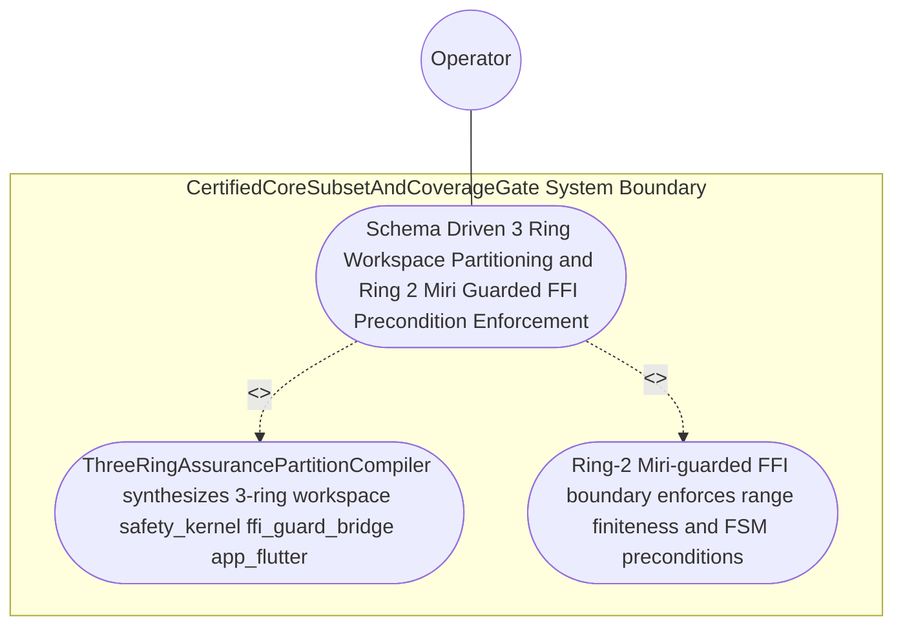

| Attribute | Specification Detail |
| :--- | :--- |
| **Issue ID** | #791 |
| **Title** | Use Case 63: Schema Driven 3 Ring Workspace Partitioning and Ring 2 Miri Guarded FFI Precondition Enforcement |
| **Type** | use-case |
| **Primary Actor** | Operator |
| **Scope** | CertifiedCoreSubsetAndCoverageGate |
| **Level** | User Goal |
| **Generation Mode** | subagent |
| **Specification Source** | [schema/model.sysml](../../schema/model.sysml) |

# Use Case 63: Schema Driven 3 Ring Workspace Partitioning and Ring 2 Miri Guarded FFI Precondition Enforcement

## UML Diagrams

## 1. Actors
- `Operator`

## 2. Preconditions
- An OMG SysML v2.0 + KerML 1.0 system model (Contract A, zero 16-construct caps) annotated with `#dal` (`AssuranceLevel`) and `@Layer` metadata (`Domain`, `Application`, `Presentation`) and `port def`/`port` `(min..max)` ranges, plus two negative probes: Probe A introducing an illegal `safety_kernel -> ffi_guard_bridge` or `safety_kernel -> app_flutter` dependency edge, and Probe B injecting an out-of-range or `NaN` `OperatorConsole` input across the Ring-2 FFI boundary.

## 3. Trigger
- `ThreeRingAssurancePartitionCompiler` synthesizes the 3-ring workspace (`safety_kernel/`, `ffi_guard_bridge/`, `app_flutter/`) via `syn` + `proc-macro2` + `quote` + `prettyplease` and executes the Ring-2 Miri-guarded FFI boundary and `cargo_metadata` dependency verification suite (Contract B, zero hand-rolled scanners).

## 4. Main Success Scenario
1. `DualModeFerroceneToolchainGate` transitions to `SynthesizingThreeRingPartitions` on `toolchainAndStage2ParityLocked` and invokes `synthesize_three_ring_workspace(spec)` on `ThreeRingAssurancePartitionCompiler` (`assurance_ring_count = 3`, `max_ring1_heap_allocations = 0`, `max_unguarded_ffi_entrypoints = 0`) via `sysml_assurance_ast_in`.
2. `ThreeRingAssurancePartitionCompiler` partitions the model inside `< 380` exec SLOC submodules (`crates/compile-sysml/src/ring_partition/`, `C_CERT_07`) into `assurance_ring_count == 3` (`C_CERT_06`) isolated rings: Ring 1 (`safety_kernel/`, inner `#![no_std]` + `#![forbid(unsafe_code)]`), Ring 2 (`ffi_guard_bridge/`), and Ring 3 (`app_flutter/`).
3. `ThreeRingAssurancePartitionCompiler` emits the `ThreeRingWorkspacePlan` on `partitioned_workspace_out` and verifies one-way dependency isolation (`Ring 1` has zero dependencies on `Ring 2` or `Ring 3` via `cargo_metadata`) under `Invariant_REQ_0611_SC_04`.
4. `ThreeRingAssurancePartitionCompiler` synthesizes Ring-2 Miri-verified FFI precondition guards (`Gamma_R2(x, sigma) == 1`) checking finiteness, `(x_min..x_max)` bounds, and FSM state preconditions across every entrypoint (`max_unguarded_ffi_entrypoints == 0`).
5. For Probe A (illegal `safety_kernel -> ffi_guard_bridge` / `app_flutter` edge) and Probe B (out-of-range or `NaN` FFI payload), `ThreeRingAssurancePartitionCompiler` rejects the violation fail-closed and emits `DEAP-E1105` on `partition_diag_out` with exit code 1.

## 5. Alternate and Exception Flows
- 3a. Probe A introduces an upward or cross-ring dependency from `safety_kernel` to `ffi_guard_bridge` or `app_flutter` (`Diagnostic: DEAP-E1105`):
  - `ThreeRingAssurancePartitionCompiler` transitions to `RejectedFailClosed` on `rejectCrossRingCouplingE1105`, emits single-line NDJSON diagnostic `DEAP-E1105` on `partition_diag_out`, and exits fail-closed with code 1.
- 4a. Probe B injects a `NaN`, infinite, or out-of-range `(x_min..x_max)` value across the Ring-2 FFI boundary (`Diagnostic: DEAP-E1105`):
  - Ring-2 FFI guard `Gamma_R2` rejects the payload fail-closed before reaching Ring-1 `safety_kernel` state and emits `DEAP-E1105`.
- 5a. Any Ring-2 FFI entrypoint bypasses range, finiteness, or FSM state precondition checks (`max_unguarded_ffi_entrypoints > 0`):
  - `ThreeRingAssurancePartitionCompiler` aborts workspace synthesis, preserves prior verified state, and exits fail-closed with code 1.

## 6. Postconditions
- The 3-ring workspace (`safety_kernel/`, `ffi_guard_bridge/`, `app_flutter/`) is partitioned with `assurance_ring_count == 3` (`C_CERT_06`), and Probes A and B fail closed with `DEAP-E1105`.

## 7. Operational Context & Architectural Realization (3-Layer Definition of Done)
- **Contract A (Full OMG SysML v2.0 + KerML 1.0 Grammar Coverage)**: Ingests full SysML v2.0 + KerML 1.0 `package`, `part def`/`part`, `port def`/`port`, `state def`/`state`, `action def`/`action`, `constraint def`/`constraint`, `allocation def`/`allocation`, and `#dal`/`@Layer` CST/AST constructs via `logos` + `rowan` + `salsa` + `ariadne` (`deap_core::sysml_cst`, `deap_core::dart_cst`) with zero 16-construct caps.
- **Contract B (Official Rust Crate Stack & Zero Hand-Rolled Scanners)**: Synthesizes 3-Ring `Rust_Flutter` crates via `syn` + `proc-macro2` + `quote` + `prettyplease` and verifies crate dependency DAGs and FFI guards via `cargo_metadata`, `cargo-lock`, `toml_edit`, and `ra_ap_syntax` with zero hand-rolled scanners.
- **Layer 1 (Domain State & Data Model)**: Typed `ThreeRingAssurancePartitionCompiler` domain state (`assurance_ring_count`, `max_ring1_heap_allocations`, `max_unguarded_ffi_entrypoints`, `enable_ring1_safety_monitor`) and `ThreeRingWorkspacePlan`.
- **Layer 2 (Logic & State Management)**: Deterministic 3-Ring partition synthesis and Ring-2 Miri FFI guard generation inside `< 380`-SLOC submodules (`crates/compile-sysml/src/ring_partition/`, `C_CERT_07`) with explicit deletion of legacy hand-rolled workspace/FFI string scanners.
- **Layer 3 (Presentation & Actuator Interface Binding)**: Boundary ports `sysml_assurance_ast_in`, `partitioned_workspace_out`, and `partition_diag_out` emitting `ThreeRingWorkspacePlan` and `DEAP-E1105` diagnostics.

## 8. Realization Matrix
| Specification Item | Type | Link / Reference |
| :--- | :--- | :--- |
| **#824** | User Story | [User Story 75: synthesize three ring workspace](../user-stories/US-75-synthesize_three_ring_workspace.md) |
| **#826** | User Story | [User Story 77: verify certified core and table a7 coverage](../user-stories/US-77-verify_certified_core_and_table_a7_coverage.md) |
| **#756** | Feature | [Feature 50: [BP 11 Ferrocene Qualified Toolchain FLS Traceability Structural Coverage and 3 Ring Rust_Flutter DO 178 C DO 330 Certification Architecture] CertifiedCoreSubsetAndCoverageGate](../features/FEAT-50-CertifiedCoreSubsetAndCoverageGate.md) |
| **#759** | Feature | [Feature 53: [BP 11 Ferrocene Qualified Toolchain FLS Traceability Structural Coverage and 3 Ring Rust_Flutter DO 178 C DO 330 Certification Architecture] ThreeRingAssurancePartitionCompiler](../features/FEAT-53-ThreeRingAssurancePartitionCompiler.md) |

### Required User Stories
- [ ] #824 - [User Story 75: synthesize three ring workspace](../user-stories/US-75-synthesize_three_ring_workspace.md)
- [ ] #826 - [User Story 77: verify certified core and table a7 coverage](../user-stories/US-77-verify_certified_core_and_table_a7_coverage.md)

### Required Features
- [ ] #756 - [Feature 50: [BP 11 Ferrocene Qualified Toolchain FLS Traceability Structural Coverage and 3 Ring Rust_Flutter DO 178 C DO 330 Certification Architecture] CertifiedCoreSubsetAndCoverageGate](../features/FEAT-50-CertifiedCoreSubsetAndCoverageGate.md)
- [ ] #759 - [Feature 53: [BP 11 Ferrocene Qualified Toolchain FLS Traceability Structural Coverage and 3 Ring Rust_Flutter DO 178 C DO 330 Certification Architecture] ThreeRingAssurancePartitionCompiler](../features/FEAT-53-ThreeRingAssurancePartitionCompiler.md)

## Source References
Use case operational flows and lifecycle activity references:
- System Architecture Model: `schema/model.sysml`
- Normative Systems Engineering Standard: ISO/IEC/IEEE 29148:2018 §6.4.2 Concept of Operations

Operational use case realization and traceability links derive from `schema/model.sysml` pursuant to ISO/IEC/IEEE 29148.
