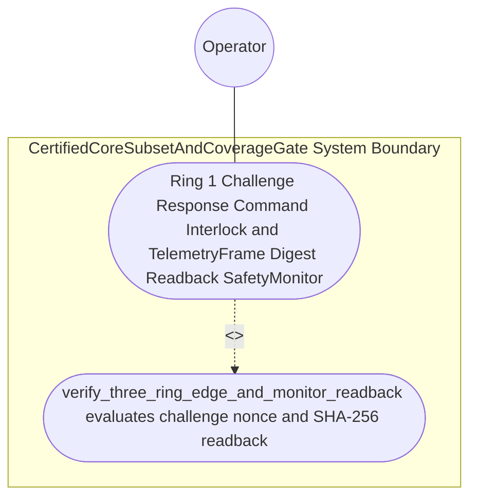

| Attribute | Specification Detail |
| :--- | :--- |
| **Issue ID** | #793 |
| **Title** | Use Case 64: Ring 1 Challenge Response Command Interlock and Telemetry Frame Digest Readback Safety Monitor Against Ring 3 Faults |
| **Type** | use-case |
| **Primary Actor** | Operator |
| **Scope** | CertifiedCoreSubsetAndCoverageGate |
| **Level** | User Goal |
| **Generation Mode** | subagent |
| **Specification Source** | [schema/model.sysml](../../schema/model.sysml) |

# Use Case 64: Ring 1 Challenge Response Command Interlock and Telemetry Frame Digest Readback Safety Monitor Against Ring 3 Faults

## UML Diagrams

## 1. Actors
- `Operator`

## 2. Preconditions
- An active Ring-1 `SafetyMonitor` issuing sequenced `TelemetryFrame` envelopes (`seq_t`, FIPS 180-4 SHA-256 digest `h_t`) and two-step challenge nonces (`eta_t`) through Ring 2 (`ffi_guard_bridge/`) to the untrusted Ring-3 `Flutter_OperatorConsole` (`app_flutter/`), tested against three Ring-3 fault injections: (1) corrupted display frame-digest readback (`hat_h_t != h_t`), (2) stale frame sequence counter (`hat_seq_t < seq_t`), and (3) spurious single-step critical `ActuatorCommand` lacking matching challenge nonce `eta_t`.

## 3. Trigger
- `verify_three_ring_edge_and_monitor_readback` evaluates the inbound confirmation and readback envelope across the Ring-3 -> Ring-2 -> Ring-1 assurance boundary.

## 4. Main Success Scenario
1. `DualModeFerroceneToolchainGate` transitions `BP_11_Ferrocene_Qualified_Toolchain_FLS_Traceability_Structural_Coverage_and_3_Ring_Rust_Flutter_DO_178C_DO_330_Certification_Architecture_LifecycleState` from `AuditingCoreSubsetAndMcdc` to `VerifyingRing1SafetyMonitor` on `coreSubsetAndTableA7Verified`.
2. `ThreeRingAssurancePartitionCompiler` (`enable_ring1_safety_monitor = true`) synthesizes the Ring-1 `SafetyMonitor` issuing sequenced `TelemetryFrame` envelopes (`seq_t`, FIPS 180-4 SHA-256 digest `h_t`) and two-step challenge nonces (`eta_t`) through Ring 2 to the Ring-3 `Flutter_OperatorConsole`.
3. `ThreeRingAssurancePartitionCompiler` invokes `verify_three_ring_edge_and_monitor_readback(from_ring, to_ring, envelope)` inside `< 380` exec SLOC submodules (`crates/compile-sysml/src/ring_partition/`, `C_CERT_07`) under `Invariant_REQ_0611_SC_04`.
4. When `hat_eta_t == eta_t`, `hat_h_t == h_t`, `hat_seq_t == seq_t`, and `Gamma_R2(u_crit, sigma_t) == 1`, `verify_three_ring_edge_and_monitor_readback` commits the critical command (`Commit_R1 == 1`), returns `SafetyMonitorReadbackReceipt`, and transitions to `CertifiedPackageReady`.
5. Across all three Ring-3 fault injections (corrupted digest `hat_h_t != h_t`, stale sequence `hat_seq_t < seq_t`, or missing challenge nonce `hat_eta_t != eta_t`), `SafetyMonitor` blocks actuator commit, transitions to `RejectedFailClosed` on `rejectMonitorReadbackFaultE1106`, and emits `DEAP-E1106` on `partition_diag_out`.

## 5. Alternate and Exception Flows
- 3a. Ring-3 `Flutter_OperatorConsole` returns a corrupted `TelemetryFrame` digest readback (`hat_h_t != h_t`, `Diagnostic: DEAP-E1106`):
  - `verify_three_ring_edge_and_monitor_readback` rejects the frame, latches Ring-1 safe-state inhibit, emits `DEAP-E1106` on `partition_diag_out`, and exits fail-closed with code 1.
- 4a. Ring-3 returns a stale sequence counter (`hat_seq_t < seq_t`, `Diagnostic: DEAP-E1106`):
  - `SafetyMonitor` detects the frozen/stale display state, aborts command execution without mutating Ring-1 actuator state, and emits `DEAP-E1106`.
- 5a. Spurious single-step critical `ActuatorCommand` arrives without a matching challenge nonce (`hat_eta_t != eta_t`, `Diagnostic: DEAP-E1106`):
  - `SafetyMonitor` enforces the two-step challenge-response interlock (`Commit_R1 == 0`), preserves prior verified state, and emits `DEAP-E1106` to `Operator`.

## 6. Postconditions
- `CertifiedCoreSubsetAndCoverageGate` and `ThreeRingAssurancePartitionCompiler` satisfy declared objective `Ring 1 Challenge Response Command Interlock and TelemetryFrame Digest Readback SafetyMonitor Against Ring 3 Faults` with all subsystem invariants intact.
- Verified `Ring 1 Challenge Response Command Interlock and Telemetry Frame Digest Readback Safety Monitor Against Ring 3 Faults` completion status is recorded for `Operator`.

## 7. Operational Context & Architectural Realization (3-Layer Definition of Done)
- **Contract A (Full OMG SysML v2.0 + KerML 1.0 Grammar Coverage)**: Ingests full SysML v2.0 + KerML 1.0 `interaction def`/`interaction`, `flow def`/`flow`, `port def`/`port`, `state def`/`state`, and `constraint def`/`constraint` CST/AST nodes via `logos` + `rowan` + `salsa` + `ariadne` (`deap_core::sysml_cst`, `deap_core::dart_cst`) with zero 16-construct caps.
- **Contract B (Official Rust Crate Stack & Zero Hand-Rolled Scanners)**: Synthesizes Ring-1 `#![no_std]` `SafetyMonitor` interlock and SHA-256 readback logic via `syn` + `proc-macro2` + `quote` + `prettyplease` and verifies Dart/Rust FFI boundaries via `deap_core::dart_cst` and `ra_ap_syntax` with zero hand-rolled scanners.
- **Layer 1 (Domain State & Data Model)**: Typed `SafetyMonitor` state, `TelemetryFrame` readback envelope (`seq_t`, SHA-256 `h_t`, challenge nonce `eta_t`), and `SafetyMonitorReadbackReceipt`.
- **Layer 2 (Logic & State Management)**: Deterministic two-step challenge-response interlock and SHA-256 `TelemetryFrame` readback verification inside `< 380`-SLOC submodules (`crates/compile-sysml/src/ring_partition/`, `C_CERT_07`) with explicit deletion of legacy hand-rolled FFI/monitor scanners.
- **Layer 3 (Presentation & Actuator Interface Binding)**: Boundary ports `sysml_assurance_ast_in`, `partitioned_workspace_out`, and `partition_diag_out` emitting `SafetyMonitorReadbackReceipt` and `DEAP-E1106` diagnostics.

## 8. Realization Matrix
| Specification Item | Type | Link / Reference |
| :--- | :--- | :--- |
| **#828** | User Story | [User Story 78: Verify Three Ring Edge And Monitor Readback](../user-stories/US-78-verify_three_ring_edge_and_monitor_readback.md) |
| **#848** | Feature | [Feature 50: [BP 11 Ferrocene Qualified Toolchain FLS Traceability Structural Coverage and 3 Ring Rust_Flutter DO 178 C DO 330 Certification Architecture] CertifiedCoreSubsetAndCoverageGate](../features/FEAT-50-CertifiedCoreSubsetAndCoverageGate.md) |
| **#851** | Feature | [Feature 53: [BP 11 Ferrocene Qualified Toolchain FLS Traceability Structural Coverage and 3 Ring Rust_Flutter DO 178 C DO 330 Certification Architecture] ThreeRingAssurancePartitionCompiler](../features/FEAT-53-ThreeRingAssurancePartitionCompiler.md) |

### Required User Stories
- [ ] #828 - [User Story 78: Verify Three Ring Edge And Monitor Readback](../user-stories/US-78-verify_three_ring_edge_and_monitor_readback.md)

### Required Features
- [ ] #848 - [Feature 50: [BP 11 Ferrocene Qualified Toolchain FLS Traceability Structural Coverage and 3 Ring Rust_Flutter DO 178 C DO 330 Certification Architecture] CertifiedCoreSubsetAndCoverageGate](../features/FEAT-50-CertifiedCoreSubsetAndCoverageGate.md)
- [ ] #851 - [Feature 53: [BP 11 Ferrocene Qualified Toolchain FLS Traceability Structural Coverage and 3 Ring Rust_Flutter DO 178 C DO 330 Certification Architecture] ThreeRingAssurancePartitionCompiler](../features/FEAT-53-ThreeRingAssurancePartitionCompiler.md)

## Source References
Use case operational flows and lifecycle activity references:
- System Architecture Model: `schema/model.sysml`
- Normative Systems Engineering Standard: ISO/IEC/IEEE 29148:2018 §6.4.2 Concept of Operations

Operational use case realization and traceability links derive from `schema/model.sysml` pursuant to ISO/IEC/IEEE 29148.
