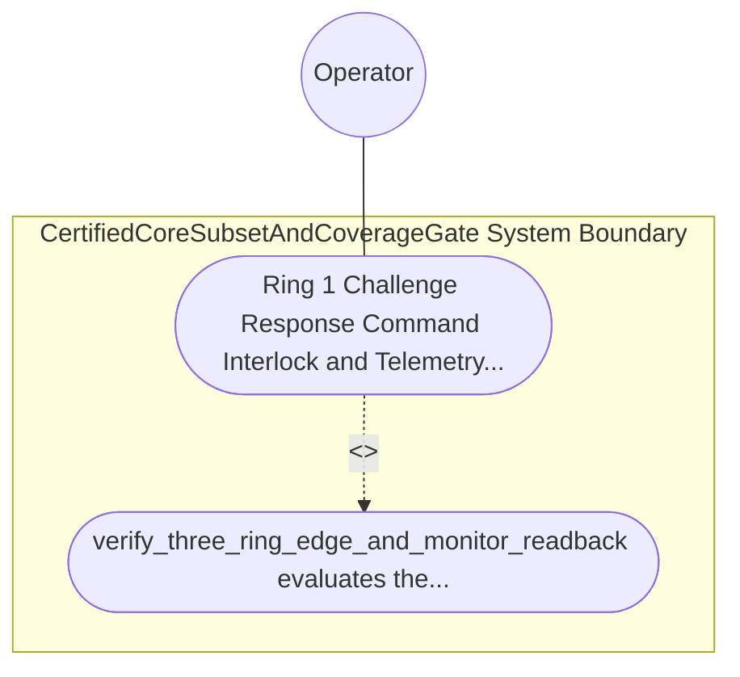

| Attribute | Specification Detail |
| :--- | :--- |
| **Issue ID** | TBD |
| **Title** | Use Case 64: Ring 1 Challenge Response Command Interlock and Telemetry Frame Digest Readback Safety Monitor Against Ring 3 Faults |
| **Type** | use-case |
| **Primary Actor** | Operator |
| **Scope** | CertifiedCoreSubsetAndCoverageGate |
| **Level** | User Goal |
| **Generation Mode** | subagent |
| **Specification Source** | [schema/model.sysml](../../schema/model.sysml) |

# Use Case 64: Ring 1 Challenge Response Command Interlock and Telemetry Frame Digest Readback Safety Monitor Against Ring 3 Faults

## UML Diagrams

## 1. Actors
- `Operator`

## 2. Preconditions
- An active Ring-1 SafetyMonitor issuing sequenced TelemetryFrame envelopes (seq_t, FIPS 180-4 SHA-256 digest h_t) and two-step challenge nonces (eta_t) through Ring 2 to the untrusted Ring-3 Flutter OperatorConsole, tested against three Ring-3 fault injections: (1) corrupted display frame-digest readback (hat_h_t != h_t), (2) stale frame sequence counter (hat_seq_t < seq_t), and (3) spurious single-step critical ActuatorCommand lacking matching challenge nonce eta_t.

## 3. Trigger
- verify_three_ring_edge_and_monitor_readback evaluates the inbound confirmation and readback envelope.

## 4. Main Success Scenario
1. verify_three_ring_edge_and_monitor_readback evaluates the inbound confirmation and readback envelope.

## 5. Alternate and Exception Flows
- Precondition guard failure in `CertifiedCoreSubsetAndCoverageGate`:
  - `CertifiedCoreSubsetAndCoverageGate` rejects the `Ring 1 Challenge Response Command Interlock and Telemetry Frame Digest Readback Safety Monitor Against Ring 3 Faults` request without partial state mutation and reports diagnostic status to `Operator`.
- Invariant violation while enforcing `Ring 1 Challenge Response Command Interlock and TelemetryFrame Digest Readback SafetyMonitor Against Ring 3 Faults`:
  - `CertifiedCoreSubsetAndCoverageGate` aborts `Ring 1 Challenge Response Command Interlock and Telemetry Frame Digest Readback Safety Monitor Against Ring 3 Faults` execution, preserves prior verified state, and notifies `Operator`.

## 6. Postconditions
- `CertifiedCoreSubsetAndCoverageGate` satisfies declared objective `Ring 1 Challenge Response Command Interlock and TelemetryFrame Digest Readback SafetyMonitor Against Ring 3 Faults` with all subsystem invariants intact.
- Verified `Ring 1 Challenge Response Command Interlock and Telemetry Frame Digest Readback Safety Monitor Against Ring 3 Faults` completion status is recorded for `Operator`.

## 8. Realization Matrix
| Specification Item | Type | Link / Reference |
| :--- | :--- | :--- |
| **TBD** | User Story | [User Story 68: verify Toolchain And Stage Parity](../user-stories/US-68-verifyToolchainAndStageParity.md) |
| **TBD** | Feature | [Feature 55: [BP 11 Ferrocene Qualified Toolchain FLS Traceability Structural Coverage and 3 Ring Rust Flutter DO 178 C DO 330 Certification Architecture] CertifiedCoreSubsetAndCoverageGate](../features/FEAT-55-CertifiedCoreSubsetAndCoverageGate.md) |

## Source References
Use case operational flows and lifecycle activity references:
- System Architecture Model: `schema/model.sysml`
- Normative Systems Engineering Standard: ISO/IEC/IEEE 29148:2018 §6.4.2 Concept of Operations

Operational use case realization and traceability links derive from `schema/model.sysml` pursuant to ISO/IEC/IEEE 29148.
