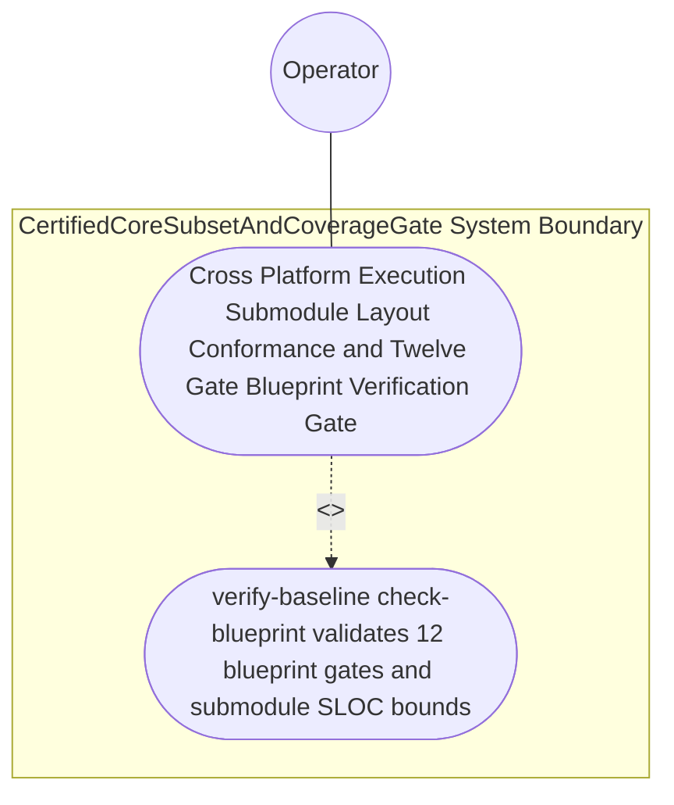

| Attribute | Specification Detail |
| :--- | :--- |
| **Issue ID** | #794 |
| **Title** | Use Case 65: Cross Platform Execution Submodule Layout Conformance and Twelve Gate Blueprint Verification Gate |
| **Type** | use-case |
| **Primary Actor** | Operator |
| **Scope** | CertifiedCoreSubsetAndCoverageGate |
| **Level** | User Goal |
| **Generation Mode** | subagent |
| **Specification Source** | [schema/model.sysml](../../schema/model.sysml) |

# Use Case 65: Cross Platform Execution Submodule Layout Conformance and Twelve Gate Blueprint Verification Gate

## UML Diagrams

## 1. Actors
- `Operator`

## 2. Preconditions
- `docs/designs/blueprint-11-ferrocene-do178c-do330-3ring-certification-architecture.md` specifying dynamic cross-platform driver probing across macOS, Linux, and Windows (`std::env::consts::{DLL_PREFIX, DLL_SUFFIX, EXE_SUFFIX}`, `camino::Utf8Path`, zero hardcoded OS/user/machine paths), modular submodules under `< 380` SLOC (**C-CERT-07**), and the `--require-formal-toolchains` qualification flag, evaluated in an environment where a required driver is absent versus present.

## 3. Trigger
- `Operator` executes `./target/release/verify-baseline check-blueprint docs/designs/blueprint-11-ferrocene-do178c-do330-3ring-certification-architecture.md` and `./target/release/verify-baseline . --no-domain` to verify cross-platform runtime `PATH` discovery, `< 380`-SLOC submodule modularity, and all 12 mechanical blueprint verification gates.

## 4. Main Success Scenario
1. `Operator` invokes `probe_criticalup_toolchain(config)` on `DualModeFerroceneToolchainGate` (`min_toolchain_discovery_probes` in `1..3`, `C_CERT_08`) across macOS, Linux, and Windows using `std::env::consts::{DLL_PREFIX, DLL_SUFFIX, EXE_SUFFIX}` and `camino::Utf8Path` with zero hardcoded OS/user/machine paths.
2. `verify-baseline` audits all certification architecture submodules (`crates/compile-sysml/src/ring_partition/`, `crates/verify-baseline/src/ferrocene_gate/`, `crates/deap-core/src/fls_trace/`) via `ra_ap_syntax` under `Invariant_REQ_0611_SC_05`, confirming `max_module_exec_sloc <= 380` (`C_CERT_07`), explicit deletion of legacy hand-rolled scanners, and zero CST syntax errors.
3. `Operator` executes `./target/release/verify-baseline check-blueprint docs/designs/blueprint-11-ferrocene-do178c-do330-3ring-certification-architecture.md` to validate all 12 mechanical blueprint verification gates.
4. `ingest-sysml` and `compile-sysml` extract and compile `BP_11_Ferrocene_Qualified_Toolchain_FLS_Traceability_Structural_Coverage_and_3_Ring_Rust_Flutter_DO_178C_DO_330_Certification_Architecture` (`REQ-0611`, `C_CERT_01..08`) with full OMG SysML v2.0 + KerML 1.0 grammar coverage (Contract A, zero 16-construct caps), verifying bijective SysML v2 AST roundtrip parity.
5. All 12 mechanical blueprint verification gates and upstream baseline checks (`verify-baseline . --no-domain`) pass with exit code 0, persisting `.pipeline/upstream/schema/model.sysml` and `.pipeline/upstream/schema/model-digest.json`.

## 5. Alternate and Exception Flows
- 3a. Required qualification toolchain is absent while `--require-formal-toolchains` (`require_formal_toolchains == true`) is active (`Diagnostic: DEAP-E1101`):
  - `DualModeFerroceneToolchainGate` transitions to `RejectedFailClosed`, emits single-line NDJSON diagnostic `DEAP-E1101` on `toolchain_diag_out`, and exits fail-closed with code 1.
- 4a. Any certification submodule exceeds `380` exec SLOC (`C_CERT_07`) or fails CST syntax verification (`Diagnostic: DEAP-E1101`):
  - `verify-baseline` rejects the oversized module, emits a structured diagnostic, and terminates fail-closed with exit code 1.
- 5a. Any of the 12 mechanical blueprint verification gates fails on `blueprint-11-ferrocene-do178c-do330-3ring-certification-architecture.md`:
  - `verify-baseline check-blueprint` aborts `.sysml` and `.digest.json` persistence, preserves prior verified state, and exits fail-closed with code 1.

## 6. Postconditions
- `CertifiedCoreSubsetAndCoverageGate` satisfies declared objective `Cross Platform Execution Submodule Layout Conformance and Twelve Gate Blueprint Verification Gate` with all subsystem invariants intact.
- Verified `Cross Platform Execution Submodule Layout Conformance and Twelve Gate Blueprint Verification Gate` completion status is recorded for `Operator`.

## 7. Operational Context & Architectural Realization (3-Layer Definition of Done)
- **Contract A (Full OMG SysML v2.0 + KerML 1.0 Grammar Coverage)**: Verifies bijective SysML v2.0 + KerML 1.0 CST/AST roundtrip parity via `logos` + `rowan` + `salsa` + `ariadne` (`deap_core::sysml_cst`) with zero 16-construct caps.
- **Contract B (Official Rust Crate Stack & Zero Hand-Rolled Scanners)**: Audits submodule SLOC bounds (`ra_ap_syntax`, `ra_ap_line_index`, `camino`, `ignore`), Markdown AST (`pulldown-cmark`), and cross-platform runtime `PATH` discovery across macOS, Linux, and Windows (`std::env::consts::{DLL_PREFIX, DLL_SUFFIX, EXE_SUFFIX}`, `camino::Utf8Path`) with zero hand-rolled scanners.
- **Layer 1 (Domain State & Data Model)**: Typed cross-platform toolchain probe configurations (`min_toolchain_discovery_probes` in `1..3`, `C_CERT_08`) and submodule SLOC budgets (`max_module_exec_sloc <= 380`, `C_CERT_07`).
- **Layer 2 (Logic & State Management)**: Deterministic 12-gate blueprint verification and `< 380`-SLOC submodule modularity enforcement across `crates/compile-sysml/src/ring_partition/`, `crates/verify-baseline/src/ferrocene_gate/`, and `crates/deap-core/src/fls_trace/` with explicit deletion of legacy hand-rolled scanners.
- **Layer 3 (Presentation & Actuator Interface Binding)**: CLI verification gates (`verify-baseline check-blueprint`) and single-line NDJSON diagnostic reporting (`DEAP-E1101..E1106`).

## 8. Realization Matrix
| Specification Item | Type | Link / Reference |
| :--- | :--- | :--- |
| **#823** | User Story | [User Story 73: Probe Criticalup Toolchain](../user-stories/US-73-probe_criticalup_toolchain.md) |
| **#824** | User Story | [User Story 74: Verify Dual Toolchain Parity](../user-stories/US-74-verify_dual_toolchain_parity.md) |
| **#848** | Feature | [Feature 50: [BP 11 Ferrocene Qualified Toolchain FLS Traceability Structural Coverage and 3 Ring Rust_Flutter DO 178 C DO 330 Certification Architecture] CertifiedCoreSubsetAndCoverageGate](../features/FEAT-50-CertifiedCoreSubsetAndCoverageGate.md) |
| **#849** | Feature | [Feature 51: [BP 11 Ferrocene Qualified Toolchain FLS Traceability Structural Coverage and 3 Ring Rust_Flutter DO 178 C DO 330 Certification Architecture] DualModeFerroceneToolchainGate](../features/FEAT-51-DualModeFerroceneToolchainGate.md) |
| **#850** | Feature | [Feature 52: [BP 11 Ferrocene Qualified Toolchain FLS Traceability Structural Coverage and 3 Ring Rust_Flutter DO 178 C DO 330 Certification Architecture] FlsParagraphTraceabilitySynthesizer](../features/FEAT-52-FlsParagraphTraceabilitySynthesizer.md) |
| **#851** | Feature | [Feature 53: [BP 11 Ferrocene Qualified Toolchain FLS Traceability Structural Coverage and 3 Ring Rust_Flutter DO 178 C DO 330 Certification Architecture] ThreeRingAssurancePartitionCompiler](../features/FEAT-53-ThreeRingAssurancePartitionCompiler.md) |

### Required User Stories
- [ ] #823 - [User Story 73: Probe Criticalup Toolchain](../user-stories/US-73-probe_criticalup_toolchain.md)
- [ ] #824 - [User Story 74: Verify Dual Toolchain Parity](../user-stories/US-74-verify_dual_toolchain_parity.md)

### Required Features
- [ ] #848 - [Feature 50: [BP 11 Ferrocene Qualified Toolchain FLS Traceability Structural Coverage and 3 Ring Rust_Flutter DO 178 C DO 330 Certification Architecture] CertifiedCoreSubsetAndCoverageGate](../features/FEAT-50-CertifiedCoreSubsetAndCoverageGate.md)
- [ ] #849 - [Feature 51: [BP 11 Ferrocene Qualified Toolchain FLS Traceability Structural Coverage and 3 Ring Rust_Flutter DO 178 C DO 330 Certification Architecture] DualModeFerroceneToolchainGate](../features/FEAT-51-DualModeFerroceneToolchainGate.md)
- [ ] #850 - [Feature 52: [BP 11 Ferrocene Qualified Toolchain FLS Traceability Structural Coverage and 3 Ring Rust_Flutter DO 178 C DO 330 Certification Architecture] FlsParagraphTraceabilitySynthesizer](../features/FEAT-52-FlsParagraphTraceabilitySynthesizer.md)
- [ ] #851 - [Feature 53: [BP 11 Ferrocene Qualified Toolchain FLS Traceability Structural Coverage and 3 Ring Rust_Flutter DO 178 C DO 330 Certification Architecture] ThreeRingAssurancePartitionCompiler](../features/FEAT-53-ThreeRingAssurancePartitionCompiler.md)

## Source References
Use case operational flows and lifecycle activity references:
- System Architecture Model: `schema/model.sysml`
- Normative Systems Engineering Standard: ISO/IEC/IEEE 29148:2018 §6.4.2 Concept of Operations

Operational use case realization and traceability links derive from `schema/model.sysml` pursuant to ISO/IEC/IEEE 29148.
