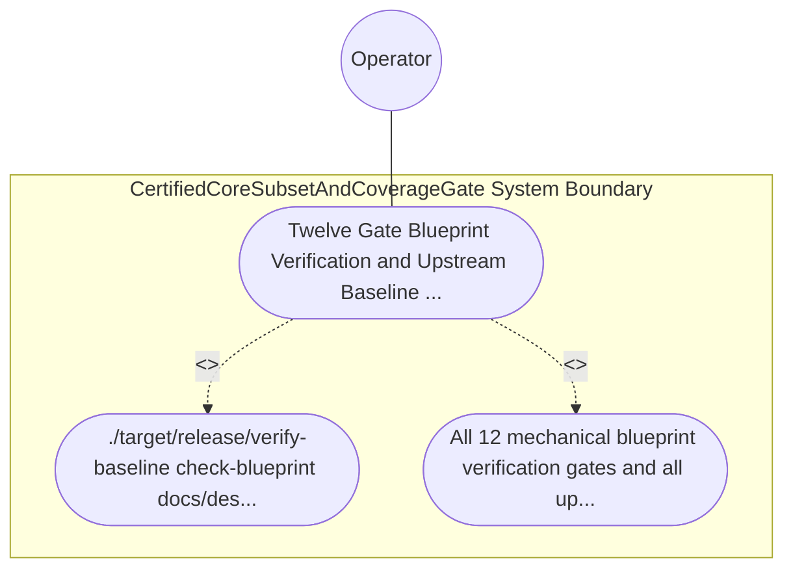

| Attribute | Specification Detail |
| :--- | :--- |
| **Issue ID** | TBD |
| **Title** | Use Case 65: Twelve Gate Blueprint Verification and Upstream Baseline Cleanliness Conformance |
| **Type** | use-case |
| **Primary Actor** | Operator |
| **Scope** | CertifiedCoreSubsetAndCoverageGate |
| **Level** | User Goal |
| **Generation Mode** | subagent |
| **Specification Source** | [schema/model.sysml](../../schema/model.sysml) |

# Use Case 65: Twelve Gate Blueprint Verification and Upstream Baseline Cleanliness Conformance

## UML Diagrams

## 1. Actors
- `Operator`

## 2. Preconditions
- docs/designs/blueprint-11-ferrocene-do178c-do330-3ring-certification-architecture.md persisted in the upstream DEAP01-spec-core repository.

## 3. Trigger
- ./target/release/verify-baseline check-blueprint docs/designs/blueprint-11-ferrocene-do178c-do330-3ring-certification-architecture.md and ./target/release/verify-baseline . --no-domain are executed.

## 4. Main Success Scenario
1. ./target/release/verify-baseline check-blueprint docs/designs/blueprint-11-ferrocene-do178c-do330-3ring-certification-architecture.md and ./target/release/verify-baseline . --no-domain are executed.
2. All 12 mechanical blueprint verification gates and all upstream workspace baseline gates (Check 10 through Check 41) exit with code 0, atomically persisting.

## 5. Alternate and Exception Flows
- Precondition guard failure in `CertifiedCoreSubsetAndCoverageGate`:
  - `CertifiedCoreSubsetAndCoverageGate` rejects the `Twelve Gate Blueprint Verification and Upstream Baseline Cleanliness Conformance` request without partial state mutation and reports diagnostic status to `Operator`.
- Invariant violation while enforcing `Twelve Gate Blueprint Verification and Upstream Baseline Cleanliness Conformance`:
  - `CertifiedCoreSubsetAndCoverageGate` aborts `Twelve Gate Blueprint Verification and Upstream Baseline Cleanliness Conformance` execution, preserves prior verified state, and notifies `Operator`.

## 6. Postconditions
- All 12 mechanical blueprint verification gates and all upstream workspace baseline gates (Check 10 through Check 41) exit with code 0, atomically persisting.

## 8. Realization Matrix
| Specification Item | Type | Link / Reference |
| :--- | :--- | :--- |
| **TBD** | User Story | [User Story 68: verify Toolchain And Stage Parity](../user-stories/US-68-verifyToolchainAndStageParity.md) |
| **TBD** | Feature | [Feature 55: [BP 11 Ferrocene Qualified Toolchain FLS Traceability Structural Coverage and 3 Ring Rust Flutter DO 178 C DO 330 Certification Architecture] CertifiedCoreSubsetAndCoverageGate](../features/FEAT-55-CertifiedCoreSubsetAndCoverageGate.md) |

## Source References
Use case operational flows and lifecycle activity references:
- System Architecture Model: `schema/model.sysml`
- Normative Systems Engineering Standard: ISO/IEC/IEEE 29148:2018 §6.4.2 Concept of Operations

Operational use case realization and traceability links derive from `schema/model.sysml` pursuant to ISO/IEC/IEEE 29148.
