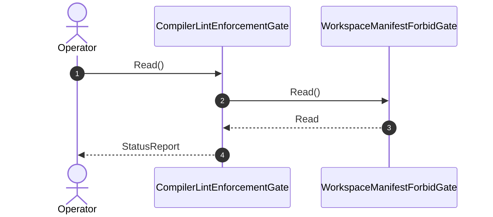

| Attribute | Specification Detail |
| :--- | :--- |
| **Issue ID** | #563 |
| **Title** | User Story 02: Read |
| **Type** | user-story |
| **Parent Epic** | [EPIC-01-BP_01_Compiler_Enforced_Forbid_Lint_Gate_and_Zero_Suppression_AST_Architecture_Blueprint](../epics/EPIC-01-BP_01_Compiler_Enforced_Forbid_Lint_Gate_and_Zero_Suppression_AST_Architecture_Blueprint.md) |
| **SysML Interaction** | `BP_01_Compiler_Enforced_Forbid_Lint_Gate_and_Zero_Suppression_AST_Architecture_Blueprint_SequenceInteraction` |
| **SysML Test Case** | `Test_Read` |
| **Generation Mode** | subagent |
| **Specification Source** | [schema/model.sysml](../../schema/model.sysml) |

# User Story 02: Read

## UML Sequence Diagram

## Acceptance Criteria (BDD)
- [ ] AC-US-02-01: Given operational environment initialized, When Read executes, Then WorkspaceManifestForbidGate processes the AST within defined latency envelope.
- [ ] AC-US-02-02: Given formal constraints, When semantic validator executes, Then asserts invariant satisfaction.
- [ ] AC-US-02-03: Given exceptional conditions, When error recovery activates, Then graceful recovery occurs without data loss.

## Required Features
- [ ] #655 - [Feature 01: [BP 01 Compiler Enforced Forbid Lint Gate and Zero Suppression AST Architecture Blueprint] CompilerLintEnforcementGate](../features/FEAT-01-CompilerLintEnforcementGate.md)
- [ ] #656 - [Feature 02: [BP 01 Compiler Enforced Forbid Lint Gate and Zero Suppression AST Architecture Blueprint] WorkspaceManifestForbidGate](../features/FEAT-02-WorkspaceManifestForbidGate.md)

## Source References
Operational concept definitions and system sequence interaction models:
- System Architecture Model: `schema/model.sysml`
- Normative Systems Engineering Standard: ISO/IEC/IEEE 29148:2018 §6.4.2 Concept of Operations

Authoritative user story flows and interaction lifelines derive from `schema/model.sysml` pursuant to ISO/IEC/IEEE 29148.
