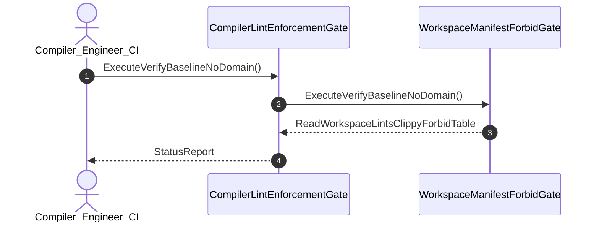

| Attribute | Specification Detail |
| :--- | :--- |
| **Issue ID** | #702 |
| **Title** | User Story 03: Execute Verify Baseline No Domain |
| **Type** | user-story |
| **Parent Epic** | [EPIC-01-BP_01_Compiler_Enforced_Forbid_Lint_Gate_and_Zero_Suppression_AST_Architecture_Blueprint](../epics/EPIC-01-BP_01_Compiler_Enforced_Forbid_Lint_Gate_and_Zero_Suppression_AST_Architecture_Blueprint.md) |
| **SysML Interaction** | `BP_01_Compiler_Enforced_Forbid_Lint_Gate_and_Zero_Suppression_AST_Architecture_Blueprint_SequenceInteraction` |
| **SysML Test Case** | `Test_ExecuteVerifyBaselineNoDomain` |
| **Generation Mode** | subagent |
| **Specification Source** | [schema/model.sysml](../../schema/model.sysml) |

# User Story 03: Execute Verify Baseline No Domain

## User Story

As a `Compiler_Engineer_CI`, I want to invoke `ExecuteVerifyBaselineNoDomain()` on `WorkspaceManifestForbidGate`, so that Execute verify-baseline . --no-domain.

## Architectural Realization (3-Layer Definition of Done)

### Layer 1: Domain State & Data Model
- Domain state attributes on `WorkspaceManifestForbidGate`: `quantity: Integer`.
- Action `ExecuteVerifyBaselineNoDomain` invocation message envelope bound to `WorkspaceManifestForbidGate` typed domain schema.
- Declared lifecycle state model: `BP_01_Compiler_Enforced_Forbid_Lint_Gate_and_Zero_Suppression_AST_Architecture_Blueprint_LifecycleState`, `ScanningSource`, `SkippingLineComment`, `SkippingBlockComment`, `InspectingAttribute`, `NormalizingBracketBody`, `ViolationRecorded`.

### Layer 2: Logic & State Management
- Behavioral execution contract: invokes `ExecuteVerifyBaselineNoDomain()` on `WorkspaceManifestForbidGate` with atomic precondition verification.
- State transition management: `ScanningSource -> SkippingLineComment` (trigger `slashSlashDetected`).
- Formal constraints and requirements enforced: `REQ-0601 (REQ_0601_BP_01_Compiler_Enforced_Forbid_Lint_Gate_and_Zero_Suppression_AST_Architecture_Blueprint)`.

### Layer 3: Presentation & Actuator Interface Binding
- Component port bindings on `WorkspaceManifestForbidGate`: `cmd_in: String (in)`, `status_out: String (out)`.
- Interaction binding (`BP_01_Compiler_Enforced_Forbid_Lint_Gate_and_Zero_Suppression_AST_Architecture_Blueprint_SequenceInteraction`): routes `ExecuteVerifyBaselineNoDomain` invocation from `Compiler_Engineer_CI` to `WorkspaceManifestForbidGate` and returns `ReadWorkspaceLintsClippyForbidTable`.
- Diagnostic fault surface: reports deterministic rejection diagnostics to `Compiler_Engineer_CI` across the declared interface boundary when guard or invariant checks fail.

## UML Sequence Diagram

## Acceptance Criteria (BDD)
- [ ] AC-US-03-01: Given `WorkspaceManifestForbidGate` is in declared state `ScanningSource` with domain state attributes (`quantity: Integer`), When `Compiler_Engineer_CI` invokes `ExecuteVerifyBaselineNoDomain` on `WorkspaceManifestForbidGate`, Then `WorkspaceManifestForbidGate` validates and binds the request against `WorkspaceManifestForbidGate` domain state (`quantity: Integer`) and transitions to `SkippingLineComment`.
- [ ] AC-US-03-02: Given `WorkspaceManifestForbidGate` active state management during `ExecuteVerifyBaselineNoDomain`, When `WorkspaceManifestForbidGate` evaluates formal constraint `Invariant_REQ_0601_C_LINT_03`, Then `WorkspaceManifestForbidGate` verifies constraint satisfaction before committing state updates.
- [ ] AC-US-03-03: Given `WorkspaceManifestForbidGate` active state management during `ExecuteVerifyBaselineNoDomain`, When `WorkspaceManifestForbidGate` evaluates formal constraint `Invariant_REQ_0601_FormalInvariant`, Then `WorkspaceManifestForbidGate` verifies constraint satisfaction before committing state updates.
- [ ] AC-US-03-04: Given `WorkspaceManifestForbidGate` requirement allocation for `ExecuteVerifyBaselineNoDomain`, When `WorkspaceManifestForbidGate` verifies formal requirement `REQ-0601 (REQ_0601_BP_01_Compiler_Enforced_Forbid_Lint_Gate_and_Zero_Suppression_AST_Architecture_Blueprint)`, Then `WorkspaceManifestForbidGate` confirms normative requirement satisfaction across execution.
- [ ] AC-US-03-05: Given `WorkspaceManifestForbidGate` ingress port binding (`cmd_in: String`), When `WorkspaceManifestForbidGate` completes `ExecuteVerifyBaselineNoDomain`, Then `WorkspaceManifestForbidGate` delivers `ReadWorkspaceLintsClippyForbidTable` across egress port (`status_out: String`) to `Compiler_Engineer_CI`.
- [ ] AC-US-03-06: Given violated formal constraint `Invariant_REQ_0601_C_LINT_03`, When `Compiler_Engineer_CI` invokes `ExecuteVerifyBaselineNoDomain` on `WorkspaceManifestForbidGate`, Then `WorkspaceManifestForbidGate` rejects the request without partial state mutation, preserves prior verified state, and emits a deterministic fault diagnostic across the interface binding.

## Required Features
- [ ] #655 - [Feature 01: [BP 01 Compiler Enforced Forbid Lint Gate and Zero Suppression AST Architecture Blueprint] CompilerLintEnforcementGate](../features/FEAT-01-CompilerLintEnforcementGate.md)
- [ ] #656 - [Feature 02: [BP 01 Compiler Enforced Forbid Lint Gate and Zero Suppression AST Architecture Blueprint] WorkspaceManifestForbidGate](../features/FEAT-02-WorkspaceManifestForbidGate.md)

## Source References
Operational concept definitions and system sequence interaction models:
- System Architecture Model: `schema/model.sysml`
- Normative Systems Engineering Standard: ISO/IEC/IEEE 29148:2018 §6.4.2 Concept of Operations

Authoritative user story flows and interaction lifelines derive from `schema/model.sysml` pursuant to ISO/IEC/IEEE 29148.
