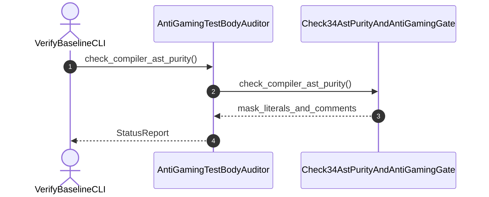

| Attribute | Specification Detail |
| :--- | :--- |
| **Issue ID** | #567 |
| **Title** | User Story 06: check compiler ast purity |
| **Type** | user-story |
| **Parent Epic** | [EPIC-02-BP_02_Check_34_AST_Purity_Fail_Closed_IO_and_Anti_Gaming_Test_Gate_Blueprint](../epics/EPIC-02-BP_02_Check_34_AST_Purity_Fail_Closed_IO_and_Anti_Gaming_Test_Gate_Blueprint.md) |
| **SysML Interaction** | `BP_02_Check_34_AST_Purity_Fail_Closed_IO_and_Anti_Gaming_Test_Gate_Blueprint_SequenceInteraction` |
| **SysML Test Case** | `Test_check_compiler_ast_purity` |
| **Generation Mode** | subagent |
| **Specification Source** | [schema/model.sysml](../../schema/model.sysml) |

# User Story 06: check compiler ast purity

## User Story

As a `VerifyBaselineCLI`, I want to invoke `check_compiler_ast_purity()` on `Check34AstPurityAndAntiGamingGate`, so that check_compiler_ast_purity(repo_root).

## Architectural Realization (3-Layer Definition of Done)

### Layer 1: Domain State & Data Model
- Domain state attributes on `Check34AstPurityAndAntiGamingGate`: `direct_range_slice_count: Integer`, `fail_open_io_site_count: Integer`, `vacuous_test_count: Integer`, `duplicate_sha256_impl_count: Integer`, `duplicate_lexer_impl_count: Integer`.
- Action `check_compiler_ast_purity` invocation message envelope bound to `Check34AstPurityAndAntiGamingGate` typed domain schema.
- Declared lifecycle state model: `BP_02_Check_34_AST_Purity_Fail_Closed_IO_and_Anti_Gaming_Test_Gate_Blueprint_LifecycleState`, `AntiGamingTestBodyAuditor_State`, `Check34AstPurityAndAntiGamingGate_State`, `FailClosedIoAstVerifier_State`.

### Layer 2: Logic & State Management
- Behavioral execution contract: invokes `check_compiler_ast_purity()` on `Check34AstPurityAndAntiGamingGate` with atomic precondition verification.
- State transition management: `AntiGamingTestBodyAuditor_State -> Check34AstPurityAndAntiGamingGate_State` (trigger `check_compiler_ast_purity`).
- Formal constraints and requirements enforced: `REQ-0602 (REQ_0602_BP_02_Check_34_AST_Purity_Fail_Closed_IO_and_Anti_Gaming_Test_Gate_Blueprint)`.

### Layer 3: Presentation & Actuator Interface Binding
- Component port bindings on `Check34AstPurityAndAntiGamingGate`: `WorkspaceSourceAstPort: String (in)`, `TestFunctionAstStreamPort: String (in)`, `PurityViolationDiagnosticPort: String (out)`, `Check34GateStatusPort: Integer (out)`.
- Interaction binding (`BP_02_Check_34_AST_Purity_Fail_Closed_IO_and_Anti_Gaming_Test_Gate_Blueprint_SequenceInteraction`): routes `check_compiler_ast_purity` invocation from `VerifyBaselineCLI` to `Check34AstPurityAndAntiGamingGate` and returns `mask_literals_and_comments`.
- Diagnostic fault surface: reports deterministic rejection diagnostics to `VerifyBaselineCLI` across the declared interface boundary when guard or invariant checks fail.

## UML Sequence Diagram

## Acceptance Criteria (BDD)
- [ ] AC-US-06-01: Given `Check34AstPurityAndAntiGamingGate` is in declared state `AntiGamingTestBodyAuditor_State` with domain state attributes (`direct_range_slice_count: Integer`, `fail_open_io_site_count: Integer`, `vacuous_test_count: Integer`, `duplicate_sha256_impl_count: Integer`, `duplicate_lexer_impl_count: Integer`), When `VerifyBaselineCLI` invokes `check_compiler_ast_purity` on `Check34AstPurityAndAntiGamingGate`, Then `Check34AstPurityAndAntiGamingGate` validates and binds the request against `Check34AstPurityAndAntiGamingGate` domain state (`direct_range_slice_count: Integer`, `fail_open_io_site_count: Integer`, `vacuous_test_count: Integer`, `duplicate_sha256_impl_count: Integer`, `duplicate_lexer_impl_count: Integer`) and transitions to `Check34AstPurityAndAntiGamingGate_State`.
- [ ] AC-US-06-02: Given `Check34AstPurityAndAntiGamingGate` active state management during `check_compiler_ast_purity`, When `Check34AstPurityAndAntiGamingGate` evaluates formal constraint `Invariant_REQ_0602_SC_01`, Then `Check34AstPurityAndAntiGamingGate` verifies constraint satisfaction before committing state updates.
- [ ] AC-US-06-03: Given `Check34AstPurityAndAntiGamingGate` active state management during `check_compiler_ast_purity`, When `Check34AstPurityAndAntiGamingGate` evaluates formal constraint `Invariant_REQ_0602_SC_02`, Then `Check34AstPurityAndAntiGamingGate` verifies constraint satisfaction before committing state updates.
- [ ] AC-US-06-04: Given `Check34AstPurityAndAntiGamingGate` requirement allocation for `check_compiler_ast_purity`, When `Check34AstPurityAndAntiGamingGate` verifies formal requirement `REQ-0602 (REQ_0602_BP_02_Check_34_AST_Purity_Fail_Closed_IO_and_Anti_Gaming_Test_Gate_Blueprint)`, Then `Check34AstPurityAndAntiGamingGate` confirms normative requirement satisfaction across execution.
- [ ] AC-US-06-05: Given `Check34AstPurityAndAntiGamingGate` ingress port binding (`WorkspaceSourceAstPort: String`, `TestFunctionAstStreamPort: String`), When `Check34AstPurityAndAntiGamingGate` completes `check_compiler_ast_purity`, Then `Check34AstPurityAndAntiGamingGate` delivers `mask_literals_and_comments` across egress port (`PurityViolationDiagnosticPort: String`, `Check34GateStatusPort: Integer`) to `VerifyBaselineCLI`.
- [ ] AC-US-06-06: Given violated formal constraint `Invariant_REQ_0602_SC_01`, When `VerifyBaselineCLI` invokes `check_compiler_ast_purity` on `Check34AstPurityAndAntiGamingGate`, Then `Check34AstPurityAndAntiGamingGate` rejects the request without partial state mutation, preserves prior verified state, and emits a deterministic fault diagnostic across the interface binding.

## Required Features
- [ ] #662 - [Feature 06: [BP 02 Check 34 AST Purity Fail Closed IO and Anti Gaming Test Gate Blueprint] AntiGamingTestBodyAuditor](../features/FEAT-06-AntiGamingTestBodyAuditor.md)
- [ ] #664 - [Feature 07: [BP 02 Check 34 AST Purity Fail Closed IO and Anti Gaming Test Gate Blueprint] Check34AstPurityAndAntiGamingGate](../features/FEAT-07-Check34AstPurityAndAntiGamingGate.md)

## Source References
Operational concept definitions and system sequence interaction models:
- System Architecture Model: `schema/model.sysml`
- Normative Systems Engineering Standard: ISO/IEC/IEEE 29148:2018 §6.4.2 Concept of Operations

Authoritative user story flows and interaction lifelines derive from `schema/model.sysml` pursuant to ISO/IEC/IEEE 29148.
