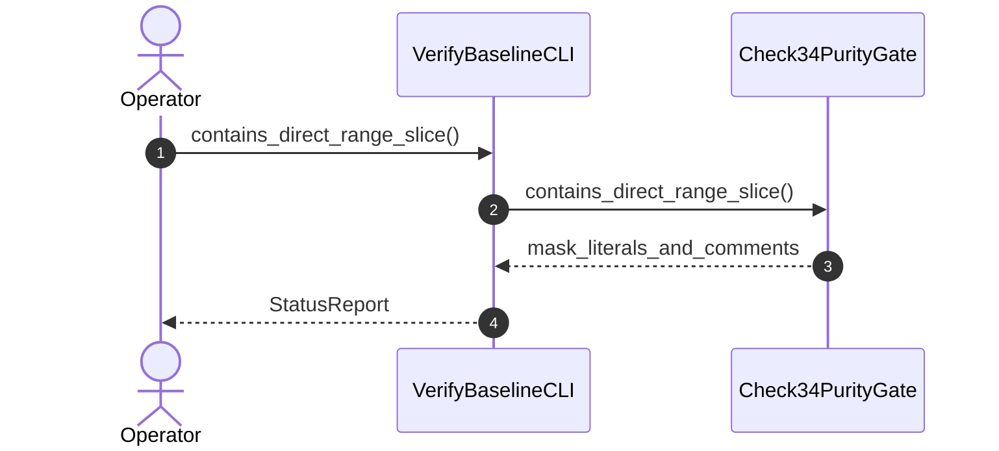

| Attribute | Specification Detail |
| :--- | :--- |
| **Issue ID** | #570 |
| **Title** | User Story 09: contains direct range slice |
| **Type** | user-story |
| **Parent Epic** | [EPIC-02-ConOps](../epics/EPIC-02-ConOps.md) |
| **SysML Interaction** | `BP_02_Check_34_AST_Purity_Fail_Closed_IO_and_Anti_Gaming_Test_Gate_Blueprint_SequenceInteraction` |
| **SysML Test Case** | `Test_contains_direct_range_slice` |
| **Generation Mode** | subagent |
| **Specification Source** | [schema/subsystems/b_p_02_check_34_a_s_t_purity_fail_closed_i_o_and_anti_gaming_test_gate_blueprint/behavior.sysml](../../schema/subsystems/b_p_02_check_34_a_s_t_purity_fail_closed_i_o_and_anti_gaming_test_gate_blueprint/behavior.sysml) |

# User Story 09: contains direct range slice

## UML Sequence Diagram

## Acceptance Criteria (BDD)
- [ ] AC-US-09-01: Given operational environment initialized, When contains_direct_range_slice executes, Then Check34PurityGate processes the AST within defined latency envelope.
- [ ] AC-US-09-02: Given formal constraints, When semantic validator executes, Then asserts invariant satisfaction.
- [ ] AC-US-09-03: Given exceptional conditions, When error recovery activates, Then graceful recovery occurs without data loss.

## Required Features
- [ ] #655 - [Feature 01: [BP 01 Compiler Enforced Forbid Lint Gate and Zero Suppression AST Architecture Blueprint] CompilerLintEnforcementGate](../features/FEAT-01-CompilerLintEnforcementGate.md)
- [ ] [Feature 06: [BP 02 Check 34 AST Purity Fail Closed IO and Anti Gaming Test Gate Blueprint] Check34PurityGate](../features/FEAT-06-Check34PurityGate.md)

## Source References
Operational concept definitions and system sequence interaction models:
- Subsystem Behavior Specification: `schema/subsystems/b_p_02_check_34_a_s_t_purity_fail_closed_i_o_and_anti_gaming_test_gate_blueprint/behavior.sysml`
- ConOps Operational Activities: `schema/conops/activities.sysml`
- System Architecture Model: `schema/model.sysml`
- Normative Systems Engineering Standard: ISO/IEC/IEEE 29148:2018 §6.4.2 Concept of Operations

Authoritative user story flows and interaction lifelines derive from `schema/subsystems/b_p_02_check_34_a_s_t_purity_fail_closed_i_o_and_anti_gaming_test_gate_blueprint/behavior.sysml` pursuant to ISO/IEC/IEEE 29148.
