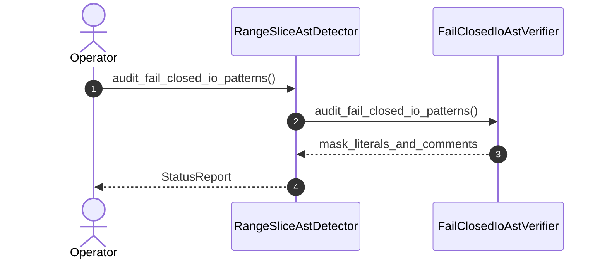

| Attribute | Specification Detail |
| :--- | :--- |
| **Issue ID** | #571 |
| **Title** | User Story 10: audit fail closed io patterns |
| **Type** | user-story |
| **Parent Epic** | [EPIC-02-BP_02_Check_34_AST_Purity_Fail_Closed_IO_and_Anti_Gaming_Test_Gate_Blueprint](../epics/EPIC-02-BP_02_Check_34_AST_Purity_Fail_Closed_IO_and_Anti_Gaming_Test_Gate_Blueprint.md) |
| **SysML Interaction** | `BP_02_Check_34_AST_Purity_Fail_Closed_IO_and_Anti_Gaming_Test_Gate_Blueprint_SequenceInteraction` |
| **SysML Test Case** | `Test_audit_fail_closed_io_patterns` |
| **Generation Mode** | subagent |
| **Specification Source** | [schema/model.sysml](../../schema/model.sysml) |

# User Story 10: audit fail closed io patterns

## UML Sequence Diagram

## Acceptance Criteria (BDD)
- [ ] AC-US-10-01: Given operational environment initialized, When audit_fail_closed_io_patterns executes, Then FailClosedIoAstVerifier processes the AST within defined latency envelope.
- [ ] AC-US-10-02: Given formal constraints, When semantic validator executes, Then asserts invariant satisfaction.
- [ ] AC-US-10-03: Given exceptional conditions, When error recovery activates, Then graceful recovery occurs without data loss.

## Required Features
- [ ] #660 - [Feature 06: [BP 02 Check 34 AST Purity Fail Closed IO and Anti Gaming Test Gate Blueprint] RangeSliceAstDetector](../features/FEAT-06-RangeSliceAstDetector.md)
- [ ] #661 - [Feature 07: [BP 02 Check 34 AST Purity Fail Closed IO and Anti Gaming Test Gate Blueprint] FailClosedIoAstVerifier](../features/FEAT-07-FailClosedIoAstVerifier.md)

## Source References
Operational concept definitions and system sequence interaction models:
- System Architecture Model: `schema/model.sysml`
- Normative Systems Engineering Standard: ISO/IEC/IEEE 29148:2018 §6.4.2 Concept of Operations

Authoritative user story flows and interaction lifelines derive from `schema/model.sysml` pursuant to ISO/IEC/IEEE 29148.
