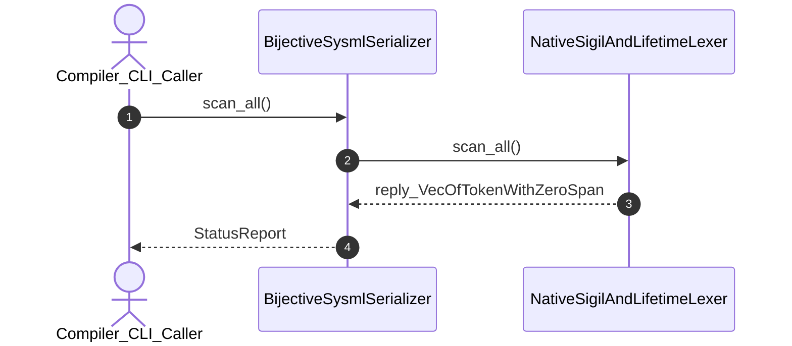

| Attribute | Specification Detail |
| :--- | :--- |
| **Issue ID** | #577 |
| **Title** | User Story 12: scan all |
| **Type** | user-story |
| **Parent Epic** | [EPIC-03-BP_03_SysML_v2_AST_Bijective_Roundtrip_and_Token_Stream_Parser_Gate_Blueprint](../epics/EPIC-03-BP_03_SysML_v2_AST_Bijective_Roundtrip_and_Token_Stream_Parser_Gate_Blueprint.md) |
| **SysML Interaction** | `BP_03_SysML_v2_AST_Bijective_Roundtrip_and_Token_Stream_Parser_Gate_Blueprint_SequenceInteraction` |
| **SysML Test Case** | `Test_scan_all` |
| **Generation Mode** | subagent |
| **Specification Source** | [schema/model.sysml](../../schema/model.sysml) |

# User Story 12: scan all

## User Story

As a `Compiler_CLI_Caller`, I want to invoke `scan_all()` on `NativeSigilAndLifetimeLexer`, so that scan_all(raw_sysml_source).

## Architectural Realization (3-Layer Definition of Done)

### Layer 1: Domain State & Data Model
- Domain state attributes on `NativeSigilAndLifetimeLexer`: `quantity: Integer`, `type: String`.
- Action `scan_all` invocation message envelope bound to `NativeSigilAndLifetimeLexer` typed domain schema.
- Declared lifecycle state model: `BP_03_SysML_v2_AST_Bijective_Roundtrip_and_Token_Stream_Parser_Gate_Blueprint_LifecycleState`, `LexicalScanning`, `RecursiveDescentParsing`, `RejectedE0100`, `CanonicalSerialization`, `RejectedE0200`, `RoundtripReparsing`, `AstStructuralEqualityCheck`, `RejectedE0400`, `VerifiedBijectiveAst`.

### Layer 2: Logic & State Management
- Behavioral execution contract: invokes `scan_all()` on `NativeSigilAndLifetimeLexer` with atomic precondition verification.
- State transition management: `LexicalScanning -> RecursiveDescentParsing` (trigger `zeroDriftTokenStream`).
- Formal constraints and requirements enforced: `REQ-0603 (REQ_0603_BP_03_SysML_v2_AST_Bijective_Roundtrip_and_Token_Stream_Parser_Gate_Blueprint)`.

### Layer 3: Presentation & Actuator Interface Binding
- Component interface endpoints: binds `NativeSigilAndLifetimeLexer` command ingress and completion notification egress channels.
- Interaction binding (`BP_03_SysML_v2_AST_Bijective_Roundtrip_and_Token_Stream_Parser_Gate_Blueprint_SequenceInteraction`): routes `scan_all` invocation from `Compiler_CLI_Caller` to `NativeSigilAndLifetimeLexer` and returns `reply_VecOfTokenWithZeroSpan`.
- Diagnostic fault surface: reports deterministic rejection diagnostics to `Compiler_CLI_Caller` across the declared interface boundary when guard or invariant checks fail.

## UML Sequence Diagram

## Acceptance Criteria (BDD)
- [ ] AC-US-12-01: Given `NativeSigilAndLifetimeLexer` is in declared state `LexicalScanning` with domain state attributes (`quantity: Integer`, `type: String`), When `Compiler_CLI_Caller` invokes `scan_all` on `NativeSigilAndLifetimeLexer`, Then `NativeSigilAndLifetimeLexer` validates and binds the request against `NativeSigilAndLifetimeLexer` domain state (`quantity: Integer`, `type: String`) and transitions to `RecursiveDescentParsing`.
- [ ] AC-US-12-02: Given `NativeSigilAndLifetimeLexer` active state management during `scan_all`, When `NativeSigilAndLifetimeLexer` evaluates formal constraint `Invariant_REQ_0603_Formal_Bijectivity_Complexity_Invariants`, Then `NativeSigilAndLifetimeLexer` verifies constraint satisfaction before committing state updates.
- [ ] AC-US-12-03: Given `NativeSigilAndLifetimeLexer` active state management during `scan_all`, When `NativeSigilAndLifetimeLexer` evaluates formal constraint `Invariant_REQ_0603_SC_04`, Then `NativeSigilAndLifetimeLexer` verifies constraint satisfaction before committing state updates.
- [ ] AC-US-12-04: Given `NativeSigilAndLifetimeLexer` requirement allocation for `scan_all`, When `NativeSigilAndLifetimeLexer` verifies formal requirement `REQ-0603 (REQ_0603_BP_03_SysML_v2_AST_Bijective_Roundtrip_and_Token_Stream_Parser_Gate_Blueprint)`, Then `NativeSigilAndLifetimeLexer` confirms normative requirement satisfaction across execution.
- [ ] AC-US-12-05: Given `NativeSigilAndLifetimeLexer` interface binding for `BP_03_SysML_v2_AST_Bijective_Roundtrip_and_Token_Stream_Parser_Gate_Blueprint_SequenceInteraction`, When `NativeSigilAndLifetimeLexer` completes `scan_all`, Then `NativeSigilAndLifetimeLexer` delivers `reply_VecOfTokenWithZeroSpan` to `Compiler_CLI_Caller`.
- [ ] AC-US-12-06: Given violated formal constraint `Invariant_REQ_0603_Formal_Bijectivity_Complexity_Invariants`, When `Compiler_CLI_Caller` invokes `scan_all` on `NativeSigilAndLifetimeLexer`, Then `NativeSigilAndLifetimeLexer` rejects the request without partial state mutation, preserves prior verified state, and emits a deterministic fault diagnostic across the interface binding.

## Required Features
- [ ] #667 - [Feature 11: [BP 03 SysML v2 AST Bijective Roundtrip and Token Stream Parser Gate Blueprint] BijectiveSysmlSerializer](../features/FEAT-11-BijectiveSysmlSerializer.md)
- [ ] #665 - [Feature 14: [BP 03 SysML v2 AST Bijective Roundtrip and Token Stream Parser Gate Blueprint] NativeSigilAndLifetimeLexer](../features/FEAT-14-NativeSigilAndLifetimeLexer.md)

## Source References
Operational concept definitions and system sequence interaction models:
- System Architecture Model: `schema/model.sysml`
- Normative Systems Engineering Standard: ISO/IEC/IEEE 29148:2018 §6.4.2 Concept of Operations

Authoritative user story flows and interaction lifelines derive from `schema/model.sysml` pursuant to ISO/IEC/IEEE 29148.
