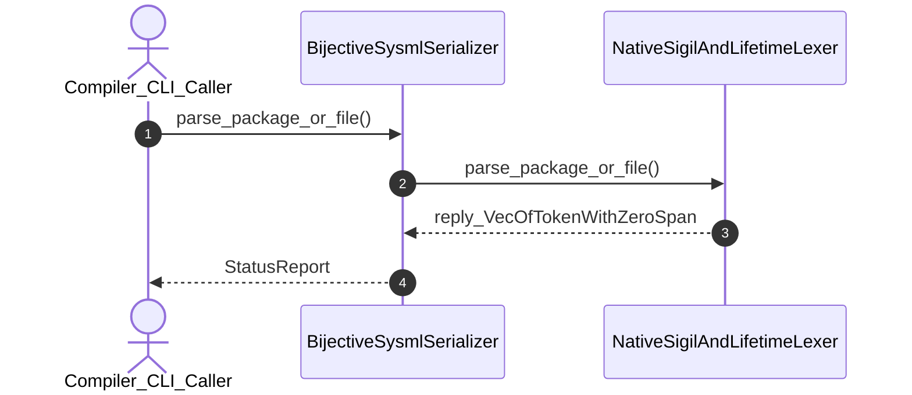

| Attribute | Specification Detail |
| :--- | :--- |
| **Issue ID** | #579 |
| **Title** | User Story 13: Parse Package Or File |
| **Type** | user-story |
| **Parent Epic** | [EPIC-03-BP_03_SysML_v2_AST_Bijective_Roundtrip_and_Token_Stream_Parser_Gate_Blueprint](../epics/EPIC-03-BP_03_SysML_v2_AST_Bijective_Roundtrip_and_Token_Stream_Parser_Gate_Blueprint.md) |
| **SysML Interaction** | `BP_03_SysML_v2_AST_Bijective_Roundtrip_and_Token_Stream_Parser_Gate_Blueprint_SequenceInteraction` |
| **SysML Test Case** | `Test_parse_package_or_file` |
| **Generation Mode** | subagent |
| **Specification Source** | [schema/model.sysml](../../schema/model.sysml) |

# User Story 13: Parse Package Or File

## User Story

As a `Compiler_CLI_Caller`, I want to invoke `parse_package_or_file()` on `NativeSigilAndLifetimeLexer`, so that parse_package_or_file(tokens).

## Architectural Realization (3-Layer Definition of Done)

### Layer 1: Domain State & Data Model
- Domain state attributes on `NativeSigilAndLifetimeLexer`: `quantity: Integer`, `type: String`.
- Action `parse_package_or_file` invocation message envelope bound to `NativeSigilAndLifetimeLexer` typed domain schema.
- Declared lifecycle state model: `BP_03_SysML_v2_AST_Bijective_Roundtrip_and_Token_Stream_Parser_Gate_Blueprint_LifecycleState`, `LexicalScanning`, `RecursiveDescentParsing`, `RejectedE0100`, `CanonicalSerialization`, `RejectedE0200`, `RoundtripReparsing`, `AstStructuralEqualityCheck`, `RejectedE0400`, `VerifiedBijectiveAst`.
- Contract A CST/HIR domain coverage: parses 100% of the normative OMG SysML v2.0 + KerML 1.0 BNF grammar across all 6 clauses (Namespaces & Metadata, Structural & Data Types, Behavioral & State, Calculations/Constraints/Requirements, Use Cases/Analysis/Verification/Views, and KerML 1.0 Specialization/Multiplicity/Expressions) with zero 16-construct artificial caps, supporting `#hazard`, `#risk`, `#capability`, `#rt_loop`, `#dal`, `#fls` `metadata def` (`@Metadata` / `#user_keyword`) alongside backward-compatible `hazard def`, `risk def`, and `capability def` declarations.

### Layer 2: Logic & State Management
- Contract B behavioral execution contract: invokes `parse_package_or_file()` on `NativeSigilAndLifetimeLexer` with atomic precondition verification using `logos` + `rowan` lossless Red/Green CST construction (`deap_core::sysml_cst`), `salsa` incremental query evaluation (`salsa::input`, `salsa::tracked`), and Stage-1 == Stage-2 bijective round-trip enforcement (`silent_skip_branch_count == 0`, zero `skip_until_semi_or_brace` silent-erasure branches, zero hand-rolled scanners).
- State transition management: `LexicalScanning -> RecursiveDescentParsing` (trigger `zeroDriftTokenStream`).
- Formal constraints and requirements enforced: `REQ-0603 (REQ_0603_BP_03_SysML_v2_AST_Bijective_Roundtrip_and_Token_Stream_Parser_Gate_Blueprint)`.
- Modularity & net-negative ratchet target: bounds implementation inside `< 380` exec SLOC submodules (`./crates/deap-core/src/sysml_cst/` and `./crates/compile-sysml/src/roundtrip/`) while explicitly deleting legacy hand-rolled scanner and recursive-descent parser monoliths (`-2,400+` SLOC).

### Layer 3: Presentation & Actuator Interface Binding
- Component interface endpoints: binds `NativeSigilAndLifetimeLexer` command ingress (`TokenStreamChannelPort`) and completion notification egress (`SerializedSysmlOutputPort`, `BijectiveDiffDiagnosticPort`) channels.
- Interaction binding (`BP_03_SysML_v2_AST_Bijective_Roundtrip_and_Token_Stream_Parser_Gate_Blueprint_SequenceInteraction`): routes `parse_package_or_file` invocation from `Compiler_CLI_Caller` to `NativeSigilAndLifetimeLexer` and returns `reply_VecOfTokenWithZeroSpan`.
- Diagnostic fault surface: reports deterministic `ariadne` source-span rejection diagnostics (`E0200`) to `Compiler_CLI_Caller` across the declared interface boundary when guard or invariant checks fail.

## UML Sequence Diagram

## Acceptance Criteria (BDD)
- [ ] AC-US-13-01: Given `NativeSigilAndLifetimeLexer` is in declared state `LexicalScanning` with domain state attributes (`quantity: Integer`, `type: String`), When `Compiler_CLI_Caller` invokes `parse_package_or_file` on `NativeSigilAndLifetimeLexer`, Then `NativeSigilAndLifetimeLexer` validates and binds the request against `NativeSigilAndLifetimeLexer` domain state (`quantity: Integer`, `type: String`) and transitions to `RecursiveDescentParsing`.
- [ ] AC-US-13-02: Given `NativeSigilAndLifetimeLexer` active state management during `parse_package_or_file`, When `NativeSigilAndLifetimeLexer` evaluates formal constraint `Invariant_REQ_0603_Formal_Bijectivity_Complexity_Invariants`, Then `NativeSigilAndLifetimeLexer` verifies constraint satisfaction before committing state updates.
- [ ] AC-US-13-03: Given `NativeSigilAndLifetimeLexer` active state management during `parse_package_or_file`, When `NativeSigilAndLifetimeLexer` evaluates formal constraint `Invariant_REQ_0603_SC_04`, Then `NativeSigilAndLifetimeLexer` verifies constraint satisfaction before committing state updates.
- [ ] AC-US-13-04: Given `NativeSigilAndLifetimeLexer` requirement allocation for `parse_package_or_file`, When `NativeSigilAndLifetimeLexer` verifies formal requirement `REQ-0603 (REQ_0603_BP_03_SysML_v2_AST_Bijective_Roundtrip_and_Token_Stream_Parser_Gate_Blueprint)`, Then `NativeSigilAndLifetimeLexer` confirms normative requirement satisfaction across execution.
- [ ] AC-US-13-05: Given `NativeSigilAndLifetimeLexer` interface binding for `BP_03_SysML_v2_AST_Bijective_Roundtrip_and_Token_Stream_Parser_Gate_Blueprint_SequenceInteraction`, When `NativeSigilAndLifetimeLexer` completes `parse_package_or_file`, Then `NativeSigilAndLifetimeLexer` delivers `reply_VecOfTokenWithZeroSpan` to `Compiler_CLI_Caller`.
- [ ] AC-US-13-06: Given violated formal constraint `Invariant_REQ_0603_Formal_Bijectivity_Complexity_Invariants`, When `Compiler_CLI_Caller` invokes `parse_package_or_file` on `NativeSigilAndLifetimeLexer`, Then `NativeSigilAndLifetimeLexer` rejects the request without partial state mutation, preserves prior verified state, and emits a deterministic fault diagnostic across the interface binding.

## Required Features
- [ ] #667 - [Feature 11: [BP 03 SysML v2 AST Bijective Roundtrip and Token Stream Parser Gate Blueprint] BijectiveSysmlSerializer](../features/FEAT-11-BijectiveSysmlSerializer.md)
- [ ] #665 - [Feature 14: [BP 03 SysML v2 AST Bijective Roundtrip and Token Stream Parser Gate Blueprint] NativeSigilAndLifetimeLexer](../features/FEAT-14-NativeSigilAndLifetimeLexer.md)

## Source References
Operational concept definitions and system sequence interaction models:
- System Architecture Model: `schema/model.sysml`
- Normative Systems Engineering Standard: ISO/IEC/IEEE 29148:2018 §6.4.2 Concept of Operations

Authoritative user story flows and interaction lifelines derive from `schema/model.sysml` pursuant to ISO/IEC/IEEE 29148.
