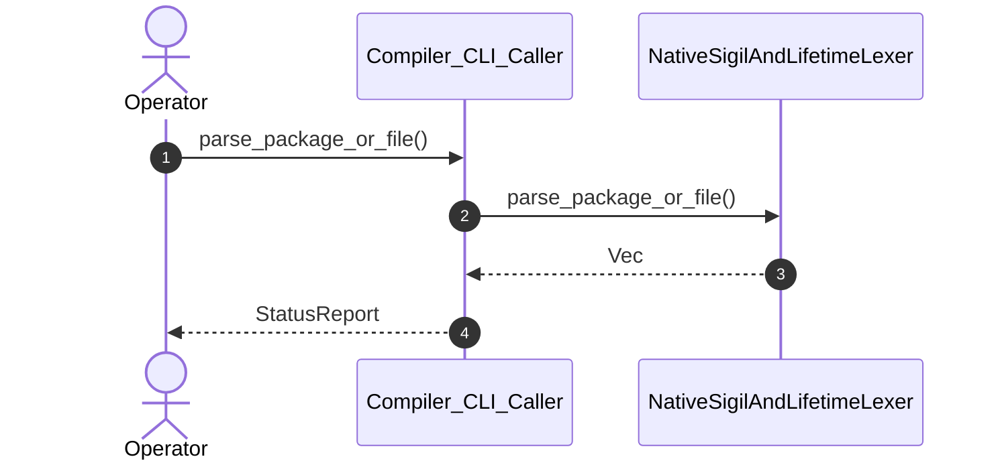

| Attribute | Specification Detail |
| :--- | :--- |
| **Issue ID** | #579 |
| **Title** | User Story 18: parse package or file |
| **Type** | user-story |
| **Parent Epic** | [EPIC-03-BP_03_SysML_v2_AST_Bijective_Roundtrip_and_Token_Stream_Parser_Gate_Blueprint](../epics/EPIC-03-BP_03_SysML_v2_AST_Bijective_Roundtrip_and_Token_Stream_Parser_Gate_Blueprint.md) |
| **SysML Interaction** | `BP_03_SysML_v2_AST_Bijective_Roundtrip_and_Token_Stream_Parser_Gate_Blueprint_SequenceInteraction` |
| **SysML Test Case** | `Test_parse_package_or_file` |
| **Generation Mode** | subagent |
| **Specification Source** | [schema/subsystems/b_p_03_sys_m_l_v2_a_s_t_bijective_roundtrip_and_token_stream_parser_gate_blueprint/behavior.sysml](../../schema/subsystems/b_p_03_sys_m_l_v2_a_s_t_bijective_roundtrip_and_token_stream_parser_gate_blueprint/behavior.sysml) |

# User Story 18: parse package or file

## UML Sequence Diagram

## Acceptance Criteria (BDD)
- [ ] AC-US-18-01: Given operational environment initialized, When parse_package_or_file executes, Then NativeSigilAndLifetimeLexer processes the AST within defined latency envelope.
- [ ] AC-US-18-02: Given formal constraints, When semantic validator executes, Then asserts invariant satisfaction.
- [ ] AC-US-18-03: Given exceptional conditions, When error recovery activates, Then graceful recovery occurs without data loss.

## Required Features
- [ ] #655 - [Feature 01: [BP 01 Compiler Enforced Forbid Lint Gate and Zero Suppression AST Architecture Blueprint] CompilerLintEnforcementGate](../features/FEAT-01-CompilerLintEnforcementGate.md)
- [ ] #665 - [Feature 11: [BP 03 Sys ML v2 AST Bijective Roundtrip and Token Stream Parser Gate Blueprint] NativeSigilAndLifetimeLexer](../features/FEAT-11-NativeSigilAndLifetimeLexer.md)

## Source References
Operational concept definitions and system sequence interaction models:
- Subsystem Behavior Specification: `schema/subsystems/b_p_03_sys_m_l_v2_a_s_t_bijective_roundtrip_and_token_stream_parser_gate_blueprint/behavior.sysml`
- ConOps Operational Activities: `schema/conops/activities.sysml`
- System Architecture Model: `schema/model.sysml`
- Normative Systems Engineering Standard: ISO/IEC/IEEE 29148:2018 §6.4.2 Concept of Operations

Authoritative user story flows and interaction lifelines derive from `schema/subsystems/b_p_03_sys_m_l_v2_a_s_t_bijective_roundtrip_and_token_stream_parser_gate_blueprint/behavior.sysml` pursuant to ISO/IEC/IEEE 29148.
