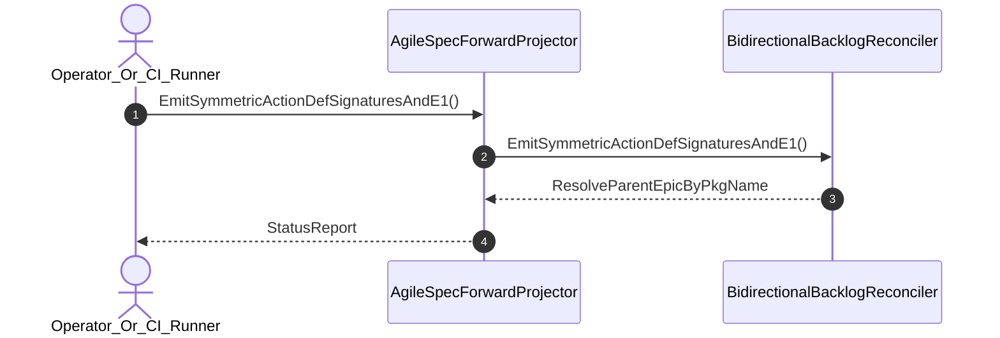

| Attribute | Specification Detail |
| :--- | :--- |
| **Issue ID** | #710 |
| **Title** | User Story 21: Emit Symmetric Action Def Signatures And E1 |
| **Type** | user-story |
| **Parent Epic** | [EPIC-04-BP_04_Deterministic_Specification_ICD_and_WBS_Forward_Compiler_Blueprint](../epics/EPIC-04-BP_04_Deterministic_Specification_ICD_and_WBS_Forward_Compiler_Blueprint.md) |
| **SysML Interaction** | `BP_04_Deterministic_Specification_ICD_and_WBS_Forward_Compiler_Blueprint_SequenceInteraction` |
| **SysML Test Case** | `Test_EmitSymmetricActionDefSignaturesAndE1` |
| **Generation Mode** | subagent |
| **Specification Source** | [schema/model.sysml](../../schema/model.sysml) |

# User Story 21: Emit Symmetric Action Def Signatures And E1

## User Story

As a `Operator_Or_CI_Runner`, I want to invoke `EmitSymmetricActionDefSignaturesAndE1()` on `AgileSpecForwardProjector` and `BidirectionalBacklogReconciler`, so that all OMG SysML v2.0 + KerML 1.0 `action def`/`action` and `calc def`/`calc` operations emit symmetric typed `in`, `out`, `inout`, and `return` parameter signatures across Mermaid diagrams and CommonMark bullets (`preserveTypedActionParams = true`) with zero Check 13B E1-E5 violations (`mermaid_e1_e5_violation_count == 0`) via `salsa` and `pulldown-cmark-to-cmark`.

## Architectural Realization (3-Layer Definition of Done)

### Layer 1: Domain State & Data Model
- Domain state attributes on `BidirectionalBacklogReconciler` (`trackHtmlCommentState: Boolean`, `parentInclusiveEpics: Boolean`), `AgileSpecForwardProjector` (`maxForwardLatencyMs: Integer`, `preserveTypedActionParams: Boolean`), and `DeterministicSpecIcdWbsForwardCompiler` (`mermaid_e1_e5_violation_count: Integer`).
- **Contract A (Full OMG SysML v2.0 + KerML 1.0 Grammar Coverage -- Zero 16-Construct Caps)**: Action `EmitSymmetricActionDefSignaturesAndE1` message envelope binds to the complete OMG SysML v2.0 and KerML 1.0 `action def`/`action` (`perform`, `accept`, `send`, `assign`, `if`/`else`, `while`/`loop`, `for`, `fork`, `join`, `merge`, `decide`, `first ... then ...`), `calc def`/`calc` (`return`), `port def`/`port` (`in`, `out`, `inout`, `~`), `state def`/`state`, `interaction def`/`interaction`, and `ISQ`/`SI`/`ScalarValues` parameter AST (`deap_core::sysml_cst`, `logos` + `rowan` + `salsa`) with zero 16-construct caps.
- **Contract B (`pulldown-cmark` + `pulldown-cmark-to-cmark` Lossless Markdown AST + `toml_edit` + `salsa` Across All 6 Crates -- Zero Hand-Rolled Scanners)**: Synthesizes Mermaid code-block AST nodes and CommonMark list items via `salsa` derived queries and `pulldown-cmark` + `pulldown-cmark-to-cmark` across `deap-core`, `compile-sysml`, `ingest-sysml`, `reconcile-backlog`, `verify-baseline`, and `assemble-conops` with zero hand-rolled scanners.
- Declared lifecycle state model: `BP_04_Deterministic_Specification_ICD_and_WBS_Forward_Compiler_Blueprint_LifecycleState` (`AstLoaded`, `ForwardProjected`, `IcdSynthesized`, `WbsExported`, `BacklogReconciled`, `ReverseSynced`, `Rejected`, `VerifiedRoundtrip`).

### Layer 2: Logic & State Management
- Behavioral execution contract: invokes `EmitSymmetricActionDefSignaturesAndE1()` with `preserveTypedActionParams == true`, validating zero curly braces in class members, double-quoted special labels, and 100% typed parameter parity (`mermaid_e1_e5_violation_count == 0`).
- State transition management: `AstLoaded -> ForwardProjected` (trigger `forwardSyncSpecs`).
- Formal constraints and requirements enforced: `Invariant_REQ_0604_SC_01`, `Invariant_REQ_0604_SC_02`, and `REQ-0604 (REQ_0604_BP_04_Deterministic_Specification_ICD_and_WBS_Forward_Compiler_Blueprint)`.
- Modularity & explicit legacy scanner deletion target: bounds implementation inside `< 380` executable SLOC submodules (`./crates/compile-sysml/src/forward_sync/`, `./crates/compile-sysml/src/icd_wbs/`, `./crates/reconcile-backlog/src/table_cst/`) while enforcing explicit deletion of legacy hand-rolled Markdown/Mermaid/SysML string emitters and line-by-line scanners (`-1,100+` SLOC net-negative ratchet).

### Layer 3: Presentation & Actuator Interface Binding
- Component port bindings on `AgileSpecForwardProjector` (`packageAstInPort: String (in)`, `specMarkdownOutPort: String (out)`) and `BidirectionalBacklogReconciler` (`specDocsInOutPort: String (inout)`, `subpackageSyncOutPort: String (out)`).
- Interaction binding (`BP_04_Deterministic_Specification_ICD_and_WBS_Forward_Compiler_Blueprint_SequenceInteraction`): routes `EmitSymmetricActionDefSignaturesAndE1` invocation from `Operator_Or_CI_Runner` to `BidirectionalBacklogReconciler` and returns `ResolveParentEpicByPkgName`.
- Diagnostic fault surface: reports deterministic `ariadne` / `miette` rejection diagnostics (`E0100`) to `Operator_Or_CI_Runner` across the declared interface boundary when guard or invariant checks fail.

## UML Sequence Diagram



## Formal SysML Test Case & Verification Binding
```sysml
test case def Test_EmitSymmetricActionDefSignaturesAndE1 {
    subject BidirectionalBacklogReconciler;
    verify requirement REQ_0604_BP_04_Deterministic_Specification_ICD_and_WBS_Forward_Compiler_Blueprint;
    objective "Verify symmetric in/out/inout/return ActionDef and CalcDef parameter emission and Check 13B E1-E5 Mermaid compliance";
}
```

## Acceptance Criteria (BDD)
- [ ] AC-US-21-01: Given `BidirectionalBacklogReconciler` is in declared state `AstLoaded` with domain state attributes (`trackHtmlCommentState: Boolean`, `parentInclusiveEpics: Boolean`), When `Operator_Or_CI_Runner` invokes `EmitSymmetricActionDefSignaturesAndE1` on `BidirectionalBacklogReconciler`, Then `BidirectionalBacklogReconciler` validates and binds the request against `BidirectionalBacklogReconciler` domain state (`trackHtmlCommentState: Boolean`, `parentInclusiveEpics: Boolean`) and transitions to `ForwardProjected`.
- [ ] AC-US-21-02: Given `BidirectionalBacklogReconciler` active state management during `EmitSymmetricActionDefSignaturesAndE1`, When `BidirectionalBacklogReconciler` evaluates formal constraint `Invariant_REQ_0604_SC_01`, Then `BidirectionalBacklogReconciler` verifies constraint satisfaction (`mermaid_e1_e5_violation_count == 0`) before committing state updates.
- [ ] AC-US-21-03: Given `BidirectionalBacklogReconciler` active state management during `EmitSymmetricActionDefSignaturesAndE1`, When `BidirectionalBacklogReconciler` evaluates formal constraint `Invariant_REQ_0604_SC_02`, Then `BidirectionalBacklogReconciler` verifies constraint satisfaction before committing state updates.
- [ ] AC-US-21-04: Given `BidirectionalBacklogReconciler` requirement allocation for `EmitSymmetricActionDefSignaturesAndE1`, When `BidirectionalBacklogReconciler` verifies formal requirement `REQ-0604 (REQ_0604_BP_04_Deterministic_Specification_ICD_and_WBS_Forward_Compiler_Blueprint)` across the full OMG SysML v2.0 + KerML 1.0 grammar (Contract A, zero 16-construct caps) and `pulldown-cmark` + `pulldown-cmark-to-cmark` + `toml_edit` + `salsa` stack (Contract B, zero hand-rolled scanners) inside `< 380`-SLOC submodules with legacy scanners deleted, Then `BidirectionalBacklogReconciler` confirms normative requirement satisfaction across execution.
- [ ] AC-US-21-05: Given `BidirectionalBacklogReconciler` ingress port binding (`specDocsInOutPort: String`), When `BidirectionalBacklogReconciler` completes `EmitSymmetricActionDefSignaturesAndE1`, Then `BidirectionalBacklogReconciler` delivers `ResolveParentEpicByPkgName` across egress port (`specDocsInOutPort: String`, `subpackageSyncOutPort: String`) to `Operator_Or_CI_Runner`.
- [ ] AC-US-21-06: Given violated formal constraint `Invariant_REQ_0604_SC_01`, When `Operator_Or_CI_Runner` invokes `EmitSymmetricActionDefSignaturesAndE1` on `BidirectionalBacklogReconciler`, Then `BidirectionalBacklogReconciler` rejects the request without partial state mutation, preserves prior verified state, and emits a deterministic fault diagnostic across the interface binding.

## Required Features
- [ ] #670 - [Feature 16: [BP 04 Deterministic Specification ICD and WBS Forward Compiler Blueprint] AgileSpecForwardProjector](../features/FEAT-16-AgileSpecForwardProjector.md) (enforces preserveTypedActionParams == true and E1-E5 Mermaid synthesis)
- [ ] #671 - [Feature 17: [BP 04 Deterministic Specification ICD and WBS Forward Compiler Blueprint] BidirectionalBacklogReconciler](../features/FEAT-17-BidirectionalBacklogReconciler.md) (preserves typed ActionDef signatures across bidirectional sync)

## Source References
Operational concept definitions and system sequence interaction models:
- System Architecture Model: `schema/model.sysml`
- Normative Systems Engineering Standard: ISO/IEC/IEEE 29148:2018 §6.4.2 Concept of Operations

Authoritative user story flows and interaction lifelines derive from `schema/model.sysml` pursuant to ISO/IEC/IEEE 29148.
