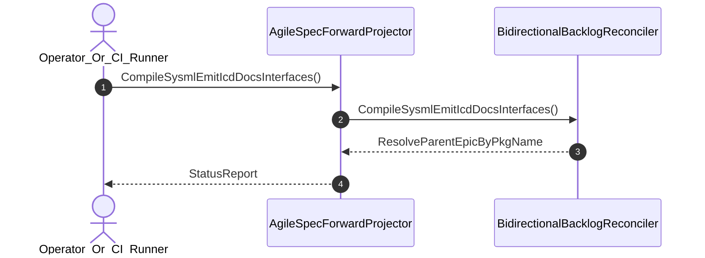

| Attribute | Specification Detail |
| :--- | :--- |
| **Issue ID** | #711 |
| **Title** | User Story 22: Compile Sysml Emit Icd Docs Interfaces |
| **Type** | user-story |
| **Parent Epic** | [EPIC-04-BP_04_Deterministic_Specification_ICD_and_WBS_Forward_Compiler_Blueprint](../epics/EPIC-04-BP_04_Deterministic_Specification_ICD_and_WBS_Forward_Compiler_Blueprint.md) |
| **SysML Interaction** | `BP_04_Deterministic_Specification_ICD_and_WBS_Forward_Compiler_Blueprint_SequenceInteraction` |
| **SysML Test Case** | `Test_CompileSysmlEmitIcdDocsInterfaces` |
| **Generation Mode** | subagent |
| **Specification Source** | [schema/model.sysml](../../schema/model.sysml) |

# User Story 22: Compile Sysml Emit Icd Docs Interfaces

## User Story

As a `Operator_Or_CI_Runner`, I want to invoke `CompileSysmlEmitIcdDocsInterfaces()` on `BidirectionalBacklogReconciler`, so that compile-sysml --emit-icd docs/interfaces.

## Architectural Realization (3-Layer Definition of Done)

### Layer 1: Domain State & Data Model
- Domain state attributes on `BidirectionalBacklogReconciler`: `trackHtmlCommentState: Boolean`, `parentInclusiveEpics: Boolean`.
- Action `CompileSysmlEmitIcdDocsInterfaces` invocation message envelope bound to `BidirectionalBacklogReconciler` typed domain schema.
- Declared lifecycle state model: `BP_04_Deterministic_Specification_ICD_and_WBS_Forward_Compiler_Blueprint_LifecycleState`, `AstLoaded`, `ForwardProjected`, `IcdSynthesized`, `WbsExported`, `BacklogReconciled`, `ReverseSynced`, `Rejected`, `VerifiedRoundtrip`.

### Layer 2: Logic & State Management
- Behavioral execution contract: invokes `CompileSysmlEmitIcdDocsInterfaces()` on `BidirectionalBacklogReconciler` with atomic precondition verification.
- State transition management: `AstLoaded -> ForwardProjected` (trigger `forwardSyncSpecs`).
- Formal constraints and requirements enforced: `REQ-0604 (REQ_0604_BP_04_Deterministic_Specification_ICD_and_WBS_Forward_Compiler_Blueprint)`.

### Layer 3: Presentation & Actuator Interface Binding
- Component port bindings on `BidirectionalBacklogReconciler`: `specDocsInOutPort: String (inout)`, `subpackageSyncOutPort: String (out)`.
- Interaction binding (`BP_04_Deterministic_Specification_ICD_and_WBS_Forward_Compiler_Blueprint_SequenceInteraction`): routes `CompileSysmlEmitIcdDocsInterfaces` invocation from `Operator_Or_CI_Runner` to `BidirectionalBacklogReconciler` and returns `ResolveParentEpicByPkgName`.
- Diagnostic fault surface: reports deterministic rejection diagnostics to `Operator_Or_CI_Runner` across the declared interface boundary when guard or invariant checks fail.

## UML Sequence Diagram

## Acceptance Criteria (BDD)
- [ ] AC-US-22-01: Given `BidirectionalBacklogReconciler` is in declared state `AstLoaded` with domain state attributes (`trackHtmlCommentState: Boolean`, `parentInclusiveEpics: Boolean`), When `Operator_Or_CI_Runner` invokes `CompileSysmlEmitIcdDocsInterfaces` on `BidirectionalBacklogReconciler`, Then `BidirectionalBacklogReconciler` validates and binds the request against `BidirectionalBacklogReconciler` domain state (`trackHtmlCommentState: Boolean`, `parentInclusiveEpics: Boolean`) and transitions to `ForwardProjected`.
- [ ] AC-US-22-02: Given `BidirectionalBacklogReconciler` active state management during `CompileSysmlEmitIcdDocsInterfaces`, When `BidirectionalBacklogReconciler` evaluates formal constraint `Invariant_REQ_0604_SC_01`, Then `BidirectionalBacklogReconciler` verifies constraint satisfaction before committing state updates.
- [ ] AC-US-22-03: Given `BidirectionalBacklogReconciler` active state management during `CompileSysmlEmitIcdDocsInterfaces`, When `BidirectionalBacklogReconciler` evaluates formal constraint `Invariant_REQ_0604_SC_02`, Then `BidirectionalBacklogReconciler` verifies constraint satisfaction before committing state updates.
- [ ] AC-US-22-04: Given `BidirectionalBacklogReconciler` requirement allocation for `CompileSysmlEmitIcdDocsInterfaces`, When `BidirectionalBacklogReconciler` verifies formal requirement `REQ-0604 (REQ_0604_BP_04_Deterministic_Specification_ICD_and_WBS_Forward_Compiler_Blueprint)`, Then `BidirectionalBacklogReconciler` confirms normative requirement satisfaction across execution.
- [ ] AC-US-22-05: Given `BidirectionalBacklogReconciler` ingress port binding (`specDocsInOutPort: String`), When `BidirectionalBacklogReconciler` completes `CompileSysmlEmitIcdDocsInterfaces`, Then `BidirectionalBacklogReconciler` delivers `ResolveParentEpicByPkgName` across egress port (`specDocsInOutPort: String`, `subpackageSyncOutPort: String`) to `Operator_Or_CI_Runner`.
- [ ] AC-US-22-06: Given violated formal constraint `Invariant_REQ_0604_SC_01`, When `Operator_Or_CI_Runner` invokes `CompileSysmlEmitIcdDocsInterfaces` on `BidirectionalBacklogReconciler`, Then `BidirectionalBacklogReconciler` rejects the request without partial state mutation, preserves prior verified state, and emits a deterministic fault diagnostic across the interface binding.

## Required Features
- [ ] #670 - [Feature 16: [BP 04 Deterministic Specification ICD and WBS Forward Compiler Blueprint] AgileSpecForwardProjector](../features/FEAT-16-AgileSpecForwardProjector.md)
- [ ] #671 - [Feature 17: [BP 04 Deterministic Specification ICD and WBS Forward Compiler Blueprint] BidirectionalBacklogReconciler](../features/FEAT-17-BidirectionalBacklogReconciler.md)

## Source References
Operational concept definitions and system sequence interaction models:
- System Architecture Model: `schema/model.sysml`
- Normative Systems Engineering Standard: ISO/IEC/IEEE 29148:2018 §6.4.2 Concept of Operations

Authoritative user story flows and interaction lifelines derive from `schema/model.sysml` pursuant to ISO/IEC/IEEE 29148.
