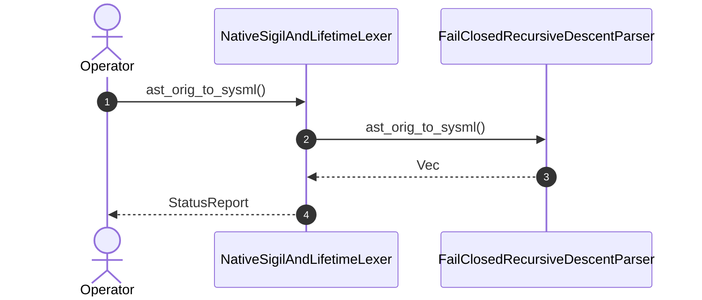

| Attribute | Specification Detail |
| :--- | :--- |
| **Issue ID** | #583 |
| **Title** | User Story 22: ast orig to sysml |
| **Type** | user-story |
| **Parent Epic** | [EPIC-03-BP_03_SysML_v2_AST_Bijective_Roundtrip_and_Token_Stream_Parser_Gate_Blueprint](../epics/EPIC-03-BP_03_SysML_v2_AST_Bijective_Roundtrip_and_Token_Stream_Parser_Gate_Blueprint.md) |
| **SysML Interaction** | `BP_03_SysML_v2_AST_Bijective_Roundtrip_and_Token_Stream_Parser_Gate_Blueprint_SequenceInteraction` |
| **SysML Test Case** | `Test_ast_orig_to_sysml` |
| **Generation Mode** | subagent |
| **Specification Source** | [schema/model.sysml](../../schema/model.sysml) |

# User Story 22: ast orig to sysml

## UML Sequence Diagram

## Acceptance Criteria (BDD)
- [ ] AC-US-22-01: Given operational environment initialized, When ast_orig_to_sysml executes, Then FailClosedRecursiveDescentParser processes the AST within defined latency envelope.
- [ ] AC-US-22-02: Given formal constraints, When semantic validator executes, Then asserts invariant satisfaction.
- [ ] AC-US-22-03: Given exceptional conditions, When error recovery activates, Then graceful recovery occurs without data loss.

## Required Features
- [ ] #665 - [Feature 11: [BP 03 Sys ML v2 AST Bijective Roundtrip and Token Stream Parser Gate Blueprint] NativeSigilAndLifetimeLexer](../features/FEAT-11-NativeSigilAndLifetimeLexer.md)
- [ ] #666 - [Feature 12: [BP 03 Sys ML v2 AST Bijective Roundtrip and Token Stream Parser Gate Blueprint] FailClosedRecursiveDescentParser](../features/FEAT-12-FailClosedRecursiveDescentParser.md)

## Source References
Operational concept definitions and system sequence interaction models:
- System Architecture Model: `schema/model.sysml`
- Normative Systems Engineering Standard: ISO/IEC/IEEE 29148:2018 §6.4.2 Concept of Operations

Authoritative user story flows and interaction lifelines derive from `schema/model.sysml` pursuant to ISO/IEC/IEEE 29148.
