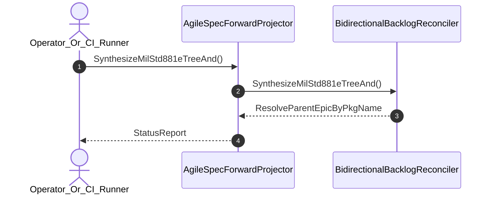

| Attribute | Specification Detail |
| :--- | :--- |
| **Issue ID** | #714 |
| **Title** | User Story 25: Synthesize Mil Std881 e Tree And |
| **Type** | user-story |
| **Parent Epic** | [EPIC-04-BP_04_Deterministic_Specification_ICD_and_WBS_Forward_Compiler_Blueprint](../epics/EPIC-04-BP_04_Deterministic_Specification_ICD_and_WBS_Forward_Compiler_Blueprint.md) (#688) |
| **SysML Interaction** | `BP_04_Deterministic_Specification_ICD_and_WBS_Forward_Compiler_Blueprint_SequenceInteraction` |
| **SysML Test Case** | `Test_SynthesizeMilStd881eTreeAnd` |
| **Generation Mode** | subagent |
| **Specification Source** | [schema/model.sysml](../../schema/model.sysml) |

# User Story 25: Synthesize Mil Std881 e Tree And

## User Story

As a `Operator_Or_CI_Runner`, I want to invoke `SynthesizeMilStd881eTreeAnd()` on `MilStd881eWbsExporter` and `BidirectionalBacklogReconciler`, so that the 4-level MIL-STD-881E WBS tree (`WBS_01..03`) and RFC 4180 CSV / JSON AST enterprise exports are deterministically synthesized from the full OMG SysML v2.0 + KerML 1.0 `salsa` AST and `pulldown-cmark-to-cmark` with zero hand-rolled scanners.

## Architectural Realization (3-Layer Definition of Done)

### Layer 1: Domain State & Data Model
- Domain state attributes on `BidirectionalBacklogReconciler` (`trackHtmlCommentState: Boolean`, `parentInclusiveEpics: Boolean`) and `MilStd881eWbsExporter` (`wbsHierarchyDepth: Integer`, `maxWbsLatencyMs: Integer`).
- **Contract A (Full OMG SysML v2.0 + KerML 1.0 Grammar Coverage -- Zero 16-Construct Caps)**: Action `SynthesizeMilStd881eTreeAnd` message envelope binds to the full OMG SysML v2.0 + KerML 1.0 `package`/`library package`/`standard library package`, `part def`/`part`, `allocation def`/`allocation`, `requirement def`/`requirement`, `verification def`/`verification`, `test case def`/`test case`, `use case def`/`use case`, `interaction def`/`interaction`, and `#capability`/`#dal`/`#fls` CST/AST (`deap_core::sysml_cst`, `logos` + `rowan` + `salsa`) with zero 16-construct caps.
- **Contract B (`pulldown-cmark` + `pulldown-cmark-to-cmark` Lossless Markdown AST + `toml_edit` + `salsa` Across All 6 Crates -- Zero Hand-Rolled Scanners)**: Constructs `WBS_01..03` as `pulldown-cmark::Event` AST tables and RFC 4180 CSV / typed `serde_json` exports across `deap-core`, `compile-sysml`, `ingest-sysml`, `reconcile-backlog`, `verify-baseline`, and `assemble-conops`.
- Declared lifecycle state model: `BP_04_Deterministic_Specification_ICD_and_WBS_Forward_Compiler_Blueprint_LifecycleState` (`AstLoaded`, `ForwardProjected`, `IcdSynthesized`, `WbsExported`, `BacklogReconciled`, `ReverseSynced`, `Rejected`, `VerifiedRoundtrip`).

### Layer 2: Logic & State Management
- Behavioral execution contract: invokes `SynthesizeMilStd881eTreeAnd()` via memoized `salsa` WBS synthesis queries (`wbsHierarchyDepth == 4`) with atomic precondition verification and zero hand-rolled scanners.
- State transition management: `AstLoaded -> ForwardProjected` (trigger `forwardSyncSpecs`) and `IcdSynthesized -> WbsExported` (trigger `emitMilStd881eWbs`).
- Formal constraints and requirements enforced: `Invariant_REQ_0604_SC_01`, `Invariant_REQ_0604_SC_02`, and `REQ-0604 (REQ_0604_BP_04_Deterministic_Specification_ICD_and_WBS_Forward_Compiler_Blueprint)`.
- Modularity & explicit legacy scanner deletion target: bounds implementation inside `< 380` executable SLOC submodules (`./crates/compile-sysml/src/forward_sync/`, `./crates/compile-sysml/src/icd_wbs/`, `./crates/reconcile-backlog/src/table_cst/`) while enforcing explicit deletion of legacy hand-rolled WBS/Markdown/table string emitters and line-by-line scanners (`-1,100+` SLOC net-negative ratchet).

### Layer 3: Presentation & Actuator Interface Binding
- Component port bindings on `MilStd881eWbsExporter` (`wbsAstMetadataInPort: String (in)`, `wbsArtifactsOutPort: String (out)`) and `BidirectionalBacklogReconciler` (`specDocsInOutPort: String (inout)`, `subpackageSyncOutPort: String (out)`).
- Interaction binding (`BP_04_Deterministic_Specification_ICD_and_WBS_Forward_Compiler_Blueprint_SequenceInteraction`): routes `SynthesizeMilStd881eTreeAnd` invocation from `Operator_Or_CI_Runner` to `BidirectionalBacklogReconciler` and returns `ResolveParentEpicByPkgName`.
- Diagnostic fault surface: reports deterministic `ariadne` / `miette` rejection diagnostics (`E0300`) to `Operator_Or_CI_Runner` across the declared interface boundary when guard or invariant checks fail.

## UML Sequence Diagram



## Formal SysML Test Case & Verification Binding
```sysml
test case def Test_SynthesizeMilStd881eTreeAnd {
    subject BidirectionalBacklogReconciler;
    verify requirement REQ_0604_BP_04_Deterministic_Specification_ICD_and_WBS_Forward_Compiler_Blueprint;
    objective "Verify 4-level MIL-STD-881E WBS tree synthesis and RFC 4180 CSV / JSON AST export via salsa and pulldown-cmark-to-cmark";
}
```

## Acceptance Criteria (BDD)
- [ ] AC-US-25-01: Given `BidirectionalBacklogReconciler` is in declared state `AstLoaded` with domain state attributes (`trackHtmlCommentState: Boolean`, `parentInclusiveEpics: Boolean`), When `Operator_Or_CI_Runner` invokes `SynthesizeMilStd881eTreeAnd` on `BidirectionalBacklogReconciler`, Then `BidirectionalBacklogReconciler` validates and binds the request against `BidirectionalBacklogReconciler` domain state (`trackHtmlCommentState: Boolean`, `parentInclusiveEpics: Boolean`) and transitions to `ForwardProjected`.
- [ ] AC-US-25-02: Given `BidirectionalBacklogReconciler` active state management during `SynthesizeMilStd881eTreeAnd`, When `BidirectionalBacklogReconciler` evaluates formal constraint `Invariant_REQ_0604_SC_01`, Then `BidirectionalBacklogReconciler` verifies constraint satisfaction before committing state updates.
- [ ] AC-US-25-03: Given `BidirectionalBacklogReconciler` active state management during `SynthesizeMilStd881eTreeAnd`, When `BidirectionalBacklogReconciler` evaluates formal constraint `Invariant_REQ_0604_SC_02`, Then `BidirectionalBacklogReconciler` verifies constraint satisfaction before committing state updates.
- [ ] AC-US-25-04: Given `BidirectionalBacklogReconciler` requirement allocation for `SynthesizeMilStd881eTreeAnd`, When `BidirectionalBacklogReconciler` verifies formal requirement `REQ-0604 (REQ_0604_BP_04_Deterministic_Specification_ICD_and_WBS_Forward_Compiler_Blueprint)` across the full OMG SysML v2.0 + KerML 1.0 grammar (Contract A, zero 16-construct caps) and `pulldown-cmark` + `pulldown-cmark-to-cmark` + `toml_edit` + `salsa` stack (Contract B, zero hand-rolled scanners) inside `< 380`-SLOC submodules with legacy scanners deleted, Then `BidirectionalBacklogReconciler` confirms normative requirement satisfaction across execution.
- [ ] AC-US-25-05: Given `BidirectionalBacklogReconciler` ingress port binding (`specDocsInOutPort: String`), When `BidirectionalBacklogReconciler` completes `SynthesizeMilStd881eTreeAnd`, Then `BidirectionalBacklogReconciler` delivers `ResolveParentEpicByPkgName` across egress port (`specDocsInOutPort: String`, `subpackageSyncOutPort: String`) to `Operator_Or_CI_Runner`.
- [ ] AC-US-25-06: Given violated formal constraint `Invariant_REQ_0604_SC_01`, When `Operator_Or_CI_Runner` invokes `SynthesizeMilStd881eTreeAnd` on `BidirectionalBacklogReconciler`, Then `BidirectionalBacklogReconciler` rejects the request without partial state mutation, preserves prior verified state, and emits a deterministic fault diagnostic (`E0300`) across the interface binding.

## Required Features
- [ ] #670 - [Feature 16: [BP 04 Deterministic Specification ICD and WBS Forward Compiler Blueprint] AgileSpecForwardProjector](../features/FEAT-16-AgileSpecForwardProjector.md) (projects package and feature metadata for WBS synthesis)
- [ ] #671 - [Feature 17: [BP 04 Deterministic Specification ICD and WBS Forward Compiler Blueprint] BidirectionalBacklogReconciler](../features/FEAT-17-BidirectionalBacklogReconciler.md) (parses CommonMark frontmatter tables via pulldown-cmark)
- [ ] #674 - [Feature 20: [BP 04 Deterministic Specification ICD and WBS Forward Compiler Blueprint] MilStd881eWbsExporter](../features/FEAT-20-MilStd881eWbsExporter.md) (synthesizes MIL-STD-881E WBS_01..03 and CSV/JSON exports)

## Source References
Operational concept definitions and system sequence interaction models:
- System Architecture Model: `schema/model.sysml`
- Normative Systems Engineering Standard: ISO/IEC/IEEE 29148:2018 §6.4.2 Concept of Operations

Authoritative user story flows and interaction lifelines derive from `schema/model.sysml` pursuant to ISO/IEC/IEEE 29148.
