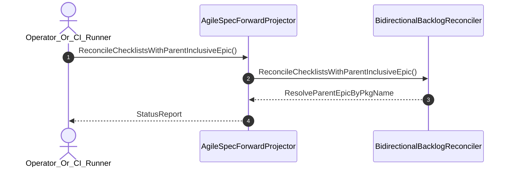

| Attribute | Specification Detail |
| :--- | :--- |
| **Issue ID** | #717 |
| **Title** | User Story 28: Reconcile Checklists With Parent Inclusive Epic |
| **Type** | user-story |
| **Parent Epic** | [EPIC-04-BP_04_Deterministic_Specification_ICD_and_WBS_Forward_Compiler_Blueprint](../epics/EPIC-04-BP_04_Deterministic_Specification_ICD_and_WBS_Forward_Compiler_Blueprint.md) (#688) |
| **SysML Interaction** | `BP_04_Deterministic_Specification_ICD_and_WBS_Forward_Compiler_Blueprint_SequenceInteraction` |
| **SysML Test Case** | `Test_ReconcileChecklistsWithParentInclusiveEpic` |
| **Generation Mode** | subagent |
| **Specification Source** | [schema/model.sysml](../../schema/model.sysml) |

# User Story 28: Reconcile Checklists With Parent Inclusive Epic

## User Story

As a `Operator_Or_CI_Runner`, I want to invoke `ReconcileChecklistsWithParentInclusiveEpic()` on `BidirectionalBacklogReconciler`, so that bidirectional Epic, Feature, User Story, and Use Case checklists are reconciled using parent-inclusive Epic cardinality (`parentInclusiveEpics = true`) via `salsa` and `pulldown-cmark` + `pulldown-cmark-to-cmark` without single-epic wildcard misbinding or hand-rolled scanners.

## Architectural Realization (3-Layer Definition of Done)

### Layer 1: Domain State & Data Model
- Domain state attributes on `BidirectionalBacklogReconciler`: `trackHtmlCommentState: Boolean`, `parentInclusiveEpics: Boolean`.
- **Contract A (Full OMG SysML v2.0 + KerML 1.0 Grammar Coverage -- Zero 16-Construct Caps)**: Action `ReconcileChecklistsWithParentInclusiveEpic` message envelope binds to the full OMG SysML v2.0 + KerML 1.0 `package`/`library package`/`standard library package`, `part def`/`part`, `item def`/`item`, `action def`/`action`, `state def`/`state`, `interaction def`/`interaction`, `use case def`/`use case`, `verification def`/`verification`, `test case def`/`test case`, and `#capability` CST/AST (`deap_core::sysml_cst`, `logos` + `rowan` + `salsa`) with zero 16-construct caps.
- **Contract B (`pulldown-cmark` + `pulldown-cmark-to-cmark` Lossless Markdown AST + `toml_edit` + `salsa` Across All 6 Crates -- Zero Hand-Rolled Scanners)**: Reconciles tasklist items (`Event::TaskListMarker`) via `pulldown-cmark` + `pulldown-cmark-to-cmark` and `salsa` parent-inclusive Epic queries across `deap-core`, `compile-sysml`, `ingest-sysml`, `reconcile-backlog`, `verify-baseline`, and `assemble-conops`.
- Declared lifecycle state model: `BP_04_Deterministic_Specification_ICD_and_WBS_Forward_Compiler_Blueprint_LifecycleState` (`AstLoaded`, `ForwardProjected`, `IcdSynthesized`, `WbsExported`, `BacklogReconciled`, `ReverseSynced`, `Rejected`, `VerifiedRoundtrip`).

### Layer 2: Logic & State Management
- Behavioral execution contract: invokes `ReconcileChecklistsWithParentInclusiveEpic()` on `BidirectionalBacklogReconciler` with `parentInclusiveEpics == true` so child-only document slices include referenced parent Epics in the total Epic cardinality count before checklist binding.
- State transition management: `AstLoaded -> ForwardProjected` (trigger `forwardSyncSpecs`) and `WbsExported -> BacklogReconciled` (trigger `reconcileBacklog`).
- Formal constraints and requirements enforced: `Invariant_REQ_0604_SC_01`, `Invariant_REQ_0604_SC_02`, and `REQ-0604 (REQ_0604_BP_04_Deterministic_Specification_ICD_and_WBS_Forward_Compiler_Blueprint)`.
- Modularity & explicit legacy scanner deletion target: bounds implementation inside `< 380` executable SLOC submodules (`./crates/compile-sysml/src/forward_sync/`, `./crates/compile-sysml/src/icd_wbs/`, `./crates/reconcile-backlog/src/table_cst/`) while enforcing explicit deletion of legacy hand-rolled checklist/Markdown string scanners (`-1,100+` SLOC net-negative ratchet).

### Layer 3: Presentation & Actuator Interface Binding
- Component port bindings on `BidirectionalBacklogReconciler`: `specDocsInOutPort: String (inout)`, `subpackageSyncOutPort: String (out)`.
- Interaction binding (`BP_04_Deterministic_Specification_ICD_and_WBS_Forward_Compiler_Blueprint_SequenceInteraction`): routes `ReconcileChecklistsWithParentInclusiveEpic` invocation from `Operator_Or_CI_Runner` to `BidirectionalBacklogReconciler` and returns `ResolveParentEpicByPkgName`.
- Diagnostic fault surface: reports deterministic `ariadne` / `miette` rejection diagnostics (`E0300`) to `Operator_Or_CI_Runner` across the declared interface boundary when guard or invariant checks fail.

## UML Sequence Diagram



## Formal SysML Test Case & Verification Binding
```sysml
test case def Test_ReconcileChecklistsWithParentInclusiveEpic {
    subject BidirectionalBacklogReconciler;
    verify requirement REQ_0604_BP_04_Deterministic_Specification_ICD_and_WBS_Forward_Compiler_Blueprint;
    objective "Verify parent-inclusive Epic count checklist reconciliation via pulldown-cmark-to-cmark without wildcard misbinding";
}
```

## Acceptance Criteria (BDD)
- [ ] AC-US-28-01: Given `BidirectionalBacklogReconciler` is in declared state `AstLoaded` with domain state attributes (`trackHtmlCommentState: Boolean`, `parentInclusiveEpics: Boolean`), When `Operator_Or_CI_Runner` invokes `ReconcileChecklistsWithParentInclusiveEpic` on `BidirectionalBacklogReconciler`, Then `BidirectionalBacklogReconciler` validates and binds the request against `BidirectionalBacklogReconciler` domain state (`trackHtmlCommentState: Boolean`, `parentInclusiveEpics: Boolean`) and transitions to `ForwardProjected`.
- [ ] AC-US-28-02: Given `BidirectionalBacklogReconciler` active state management during `ReconcileChecklistsWithParentInclusiveEpic`, When `BidirectionalBacklogReconciler` evaluates formal constraint `Invariant_REQ_0604_SC_01`, Then `BidirectionalBacklogReconciler` verifies constraint satisfaction before committing state updates.
- [ ] AC-US-28-03: Given `BidirectionalBacklogReconciler` active state management during `ReconcileChecklistsWithParentInclusiveEpic`, When `BidirectionalBacklogReconciler` evaluates formal constraint `Invariant_REQ_0604_SC_02`, Then `BidirectionalBacklogReconciler` verifies constraint satisfaction before committing state updates.
- [ ] AC-US-28-04: Given `BidirectionalBacklogReconciler` requirement allocation for `ReconcileChecklistsWithParentInclusiveEpic`, When `BidirectionalBacklogReconciler` verifies formal requirement `REQ-0604 (REQ_0604_BP_04_Deterministic_Specification_ICD_and_WBS_Forward_Compiler_Blueprint)` across the full OMG SysML v2.0 + KerML 1.0 grammar (Contract A, zero 16-construct caps) and `pulldown-cmark` + `pulldown-cmark-to-cmark` + `toml_edit` + `salsa` stack (Contract B, zero hand-rolled scanners) inside `< 380`-SLOC submodules with legacy scanners deleted, Then `BidirectionalBacklogReconciler` confirms normative requirement satisfaction across execution.
- [ ] AC-US-28-05: Given `BidirectionalBacklogReconciler` ingress port binding (`specDocsInOutPort: String`), When `BidirectionalBacklogReconciler` completes `ReconcileChecklistsWithParentInclusiveEpic`, Then `BidirectionalBacklogReconciler` delivers `ResolveParentEpicByPkgName` across egress port (`specDocsInOutPort: String`, `subpackageSyncOutPort: String`) to `Operator_Or_CI_Runner`.
- [ ] AC-US-28-06: Given violated formal constraint `Invariant_REQ_0604_SC_01`, When `Operator_Or_CI_Runner` invokes `ReconcileChecklistsWithParentInclusiveEpic` on `BidirectionalBacklogReconciler`, Then `BidirectionalBacklogReconciler` rejects the request without partial state mutation, preserves prior verified state, and emits a deterministic fault diagnostic (`E0300`) across the interface binding.

## Required Features
- [ ] #670 - [Feature 16: [BP 04 Deterministic Specification ICD and WBS Forward Compiler Blueprint] AgileSpecForwardProjector](../features/FEAT-16-AgileSpecForwardProjector.md) (emits parent-child Epic, Feature, Story, and Use Case tasklists)
- [ ] #671 - [Feature 17: [BP 04 Deterministic Specification ICD and WBS Forward Compiler Blueprint] BidirectionalBacklogReconciler](../features/FEAT-17-BidirectionalBacklogReconciler.md) (enforces parentInclusiveEpics == true during checklist reconciliation)

## Source References
Operational concept definitions and system sequence interaction models:
- System Architecture Model: `schema/model.sysml`
- Normative Systems Engineering Standard: ISO/IEC/IEEE 29148:2018 §6.4.2 Concept of Operations

Authoritative user story flows and interaction lifelines derive from `schema/model.sysml` pursuant to ISO/IEC/IEEE 29148.
