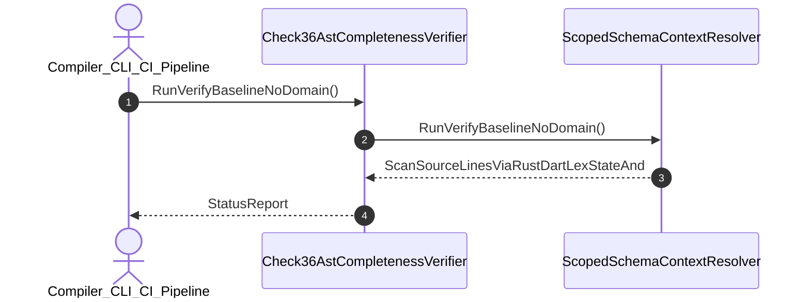

| Attribute | Specification Detail |
| :--- | :--- |
| **Issue ID** | #723 |
| **Title** | User Story 34: Run Verify Baseline No Domain |
| **Type** | user-story |
| **Parent Epic** | [EPIC-05-BP_05_Unified_AST_Safety_Docstring_Synthesizer_and_Check_36_Verification_Blueprint](../epics/EPIC-05-BP_05_Unified_AST_Safety_Docstring_Synthesizer_and_Check_36_Verification_Blueprint.md) |
| **SysML Interaction** | `BP_05_Unified_AST_Safety_Docstring_Synthesizer_and_Check_36_Verification_Blueprint_SequenceInteraction` |
| **SysML Test Case** | `Test_RunVerifyBaselineNoDomain` |
| **Generation Mode** | subagent |
| **Specification Source** | [schema/model.sysml](../../schema/model.sysml) |

# User Story 34: Run Verify Baseline No Domain

## User Story

As a `Compiler_CLI_CI_Pipeline`, I want to invoke `RunVerifyBaselineNoDomain()` on `ScopedSchemaContextResolver`, so that Run verify-baseline . --no-domain (Check 36 & Check 34).

## Architectural Realization (3-Layer Definition of Done)

### Layer 1: Domain State & Data Model
- Domain state attributes on `ScopedSchemaContextResolver`: `quantity: Integer`, `type: String`.
- Action `RunVerifyBaselineNoDomain` invocation message envelope bound to `ScopedSchemaContextResolver` typed domain schema.
- Declared lifecycle state model: `BP_05_Unified_AST_Safety_Docstring_Synthesizer_and_Check_36_Verification_Blueprint_LifecycleState`, `Check36AstCompletenessVerifier_State`, `ScopedSchemaContextResolver_State`, `SevenSectionDocstringGenerator_State`.

### Layer 2: Logic & State Management
- Behavioral execution contract: invokes `RunVerifyBaselineNoDomain()` on `ScopedSchemaContextResolver` with atomic precondition verification.
- State transition management: `Check36AstCompletenessVerifier_State -> ScopedSchemaContextResolver_State` (trigger `RunCompileSysmlInjectSafetyDocstrings`).
- Formal constraints and requirements enforced: `REQ-0605 (REQ_0605_BP_05_Unified_AST_Safety_Docstring_Synthesizer_and_Check_36_Verification_Blueprint)`.

### Layer 3: Presentation & Actuator Interface Binding
- Component interface endpoints: binds `ScopedSchemaContextResolver` command ingress and completion notification egress channels.
- Interaction binding (`BP_05_Unified_AST_Safety_Docstring_Synthesizer_and_Check_36_Verification_Blueprint_SequenceInteraction`): routes `RunVerifyBaselineNoDomain` invocation from `Compiler_CLI_CI_Pipeline` to `ScopedSchemaContextResolver` and returns `ScanSourceLinesViaRustDartLexStateAnd`.
- Diagnostic fault surface: reports deterministic rejection diagnostics to `Compiler_CLI_CI_Pipeline` across the declared interface boundary when guard or invariant checks fail.

## UML Sequence Diagram

## Acceptance Criteria (BDD)
- [ ] AC-US-34-01: Given `ScopedSchemaContextResolver` is in declared state `Check36AstCompletenessVerifier_State` with domain state attributes (`quantity: Integer`, `type: String`), When `Compiler_CLI_CI_Pipeline` invokes `RunVerifyBaselineNoDomain` on `ScopedSchemaContextResolver`, Then `ScopedSchemaContextResolver` validates and binds the request against `ScopedSchemaContextResolver` domain state (`quantity: Integer`, `type: String`) and transitions to `ScopedSchemaContextResolver_State`.
- [ ] AC-US-34-02: Given `ScopedSchemaContextResolver` active state management during `RunVerifyBaselineNoDomain`, When `ScopedSchemaContextResolver` evaluates formal constraint `Invariant_REQ_0605_Under_REQ_0605_and_parametric_constraints_C_DOC_01_through_C_DOC_04_lexical_scanning_schema_context_resolution_and_forward_docstring_injection_satisfy_the_following_linear_complexity_and_idempotency_bounds`, Then `ScopedSchemaContextResolver` verifies constraint satisfaction before committing state updates.
- [ ] AC-US-34-03: Given `ScopedSchemaContextResolver` requirement allocation for `RunVerifyBaselineNoDomain`, When `ScopedSchemaContextResolver` verifies formal requirement `REQ-0605 (REQ_0605_BP_05_Unified_AST_Safety_Docstring_Synthesizer_and_Check_36_Verification_Blueprint)`, Then `ScopedSchemaContextResolver` confirms normative requirement satisfaction across execution.
- [ ] AC-US-34-04: Given `ScopedSchemaContextResolver` interface binding for `BP_05_Unified_AST_Safety_Docstring_Synthesizer_and_Check_36_Verification_Blueprint_SequenceInteraction`, When `ScopedSchemaContextResolver` completes `RunVerifyBaselineNoDomain`, Then `ScopedSchemaContextResolver` delivers `ScanSourceLinesViaRustDartLexStateAnd` to `Compiler_CLI_CI_Pipeline`.
- [ ] AC-US-34-05: Given violated formal constraint `Invariant_REQ_0605_Under_REQ_0605_and_parametric_constraints_C_DOC_01_through_C_DOC_04_lexical_scanning_schema_context_resolution_and_forward_docstring_injection_satisfy_the_following_linear_complexity_and_idempotency_bounds`, When `Compiler_CLI_CI_Pipeline` invokes `RunVerifyBaselineNoDomain` on `ScopedSchemaContextResolver`, Then `ScopedSchemaContextResolver` rejects the request without partial state mutation, preserves prior verified state, and emits a deterministic fault diagnostic across the interface binding.

## Required Features
- [ ] #678 - [Feature 21: [BP 05 Unified AST Safety Docstring Synthesizer and Check 36 Verification Blueprint] Check36AstCompletenessVerifier](../features/FEAT-21-Check36AstCompletenessVerifier.md)
- [ ] #676 - [Feature 22: [BP 05 Unified AST Safety Docstring Synthesizer and Check 36 Verification Blueprint] ScopedSchemaContextResolver](../features/FEAT-22-ScopedSchemaContextResolver.md)

## Source References
Operational concept definitions and system sequence interaction models:
- System Architecture Model: `schema/model.sysml`
- Normative Systems Engineering Standard: ISO/IEC/IEEE 29148:2018 §6.4.2 Concept of Operations

Authoritative user story flows and interaction lifelines derive from `schema/model.sysml` pursuant to ISO/IEC/IEEE 29148.
