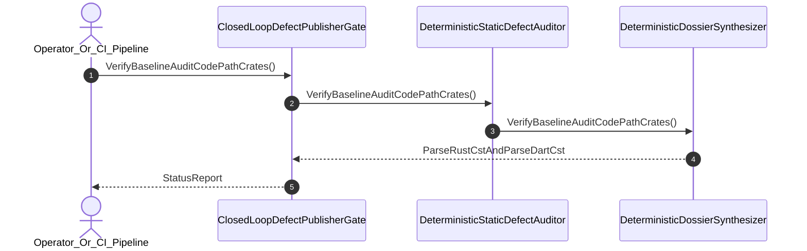

| Attribute | Specification Detail |
| :--- | :--- |
| **Issue ID** | #726 |
| **Title** | User Story 37: Verify Baseline Audit Code Path Crates |
| **Type** | user-story |
| **Parent Epic** | [EPIC-06-BP_06_Deterministic_Static_5_Pillar_Code_Auditor_and_Defect_Dossier_Synthesizer_Blueprint](../epics/EPIC-06-BP_06_Deterministic_Static_5_Pillar_Code_Auditor_and_Defect_Dossier_Synthesizer_Blueprint.md) |
| **SysML Interaction** | `BP_06_Deterministic_Static_5_Pillar_Code_Auditor_and_Defect_Dossier_Synthesizer_Blueprint_SequenceInteraction` |
| **SysML Test Case** | `Test_VerifyBaselineAuditCodePathCrates` |
| **Generation Mode** | subagent |
| **Specification Source** | [schema/model.sysml](../../schema/model.sysml) |

# User Story 37: Verify Baseline Audit Code Path Crates

## User Story

As a `Operator_Or_CI_Pipeline`, I want to invoke `VerifyBaselineAuditCodePathCrates()` (`./target/release/verify-baseline audit-code --path ./crates/ --publish`) on `DeterministicStaticDefectAuditor` and `DeterministicDossierSynthesizer`, so that deterministic zero-subagent 5-pillar static auditing executes across Rust (`ra_ap_syntax` typed AST + Stage-2 `./lints/deap-dylint-mir/` `rustc_middle::mir` `TyCtxt`) and Dart (`deap_core::dart_cst` `logos` + `rowan`) with `./crates/deap-core/src/source_ast.rs` (`source_ast.rs`) permanently deleted.

## Architectural Realization (3-Layer Definition of Done)

### Layer 1: Domain State & Data Model
- Domain state attributes on `DeterministicStaticDefectAuditor` (`auditor_subagent_count: Integer = 0`, `dossier_schema_check_count: Integer = 12`, `pillar_coverage_count: Integer = 5`, `closed_loop_mismatch_bytes: Integer = 0`) and `DeterministicDossierSynthesizer` (`mandatorySectionCount: Integer = 7`, `whysChainDepth: Integer = 5`).
- Enforces **Contract A** (100% normative OMG SysML v2.0 + KerML 1.0 textual grammar coverage with full Definition and Usage symmetry and zero 16-construct artificial caps) and **Contract B** (`ra_ap_syntax` typed AST + Stage-2 isolated `Dylint` `rustc_middle::mir` (`TyCtxt`) 5-pillar defect dossier auditor in `./lints/deap-dylint-mir/` + isolated `deap_core::dart_cst` (`logos` + `rowan`) + `pulldown-cmark` / `pulldown-cmark-to-cmark` + complete deletion of `source_ast.rs` with zero hand-rolled scanners).
- Action `VerifyBaselineAuditCodePathCrates` invocation message envelope bound to `DeterministicStaticDefectAuditor` and `DeterministicDossierSynthesizer` typed domain schemas.
- Declared lifecycle state model: `BP_06_Deterministic_Static_5_Pillar_Code_Auditor_and_Defect_Dossier_Synthesizer_Blueprint_LifecycleState` (`Idle`, `IngestingRustAndDartCst`, `EvaluatingFivePillars`, `SynthesizingDossier`, `Verified`, `Validating12Gates`, `Rejected`, `DeduplicatingSsot`, `PublishingClosedLoop`).

### Layer 2: Logic & State Management
- Behavioral execution contract: invokes `VerifyBaselineAuditCodePathCrates()` with atomic precondition verification (`auditor_subagent_count == 0`, `zeroRegexMode == true`).
- State transition management: `Idle -> IngestingRustAndDartCst` (trigger `verify_baseline_audit_code_path`).
- Formal constraints and requirements enforced: **REQ-0606** (`REQ_0606_BP_06_Deterministic_Static_5_Pillar_Code_Auditor_and_Defect_Dossier_Synthesizer_Blueprint`), `Invariant_REQ_0606_SC_01`, and `Invariant_REQ_0606_SC_02`.
- Modularity & legacy scanner deletion target: bounds implementation inside `< 380`-SLOC submodules (`./crates/verify-baseline/src/defect_auditor/`, `./crates/verify-baseline/src/defect_dossier/`, `./lints/deap-dylint-mir/`, and `./crates/deap-core/src/dart_cst/`) while permanently deleting `./crates/deap-core/src/source_ast.rs` (`source_ast.rs`) and retiring all hand-rolled regex/substring/line defect scanners.

### Layer 3: Presentation & Actuator Interface Binding
- Component port bindings: `TargetRustCstInputPort: String (in)`, `DefectDossierArtifactPort: String (out)`, `findingInPort: String (in)`, `dossierMarkdownOutPort: String (out)`.
- Interaction binding (`BP_06_Deterministic_Static_5_Pillar_Code_Auditor_and_Defect_Dossier_Synthesizer_Blueprint_SequenceInteraction`): routes `VerifyBaselineAuditCodePathCrates` invocation from `Operator_Or_CI_Pipeline` to `DeterministicStaticDefectAuditor` and `DeterministicDossierSynthesizer` and initiates `ParseRustCstAndParseDartCst`.
- Diagnostic fault surface: reports deterministic `ariadne` / `miette` rejection diagnostics (`E0601`--`E0605`) to `Operator_Or_CI_Pipeline` across the declared interface boundary when guard or invariant checks fail.

## UML Sequence Diagram

## Acceptance Criteria (BDD)
- [ ] AC-US-37-01: Given `DeterministicStaticDefectAuditor` and `DeterministicDossierSynthesizer` are in declared state `Idle` with `auditor_subagent_count == 0`, `mandatorySectionCount == 7`, and `whysChainDepth == 5`, When `Operator_Or_CI_Pipeline` invokes `VerifyBaselineAuditCodePathCrates`, Then the subsystem validates the request against Contract A (zero 16-construct caps) and Contract B (`ra_ap_syntax` + Stage-2 `./lints/deap-dylint-mir/` `rustc_middle::mir` `TyCtxt` + `deap_core::dart_cst` with `source_ast.rs` deleted) and transitions to `IngestingRustAndDartCst`.
- [ ] AC-US-37-02: Given active state management during `VerifyBaselineAuditCodePathCrates`, When the subsystem evaluates formal constraint `Invariant_REQ_0606_SC_01` (`auditor_subagent_count == 0 && dossier_schema_check_count == 12 && pillar_coverage_count == 5`), Then constraint satisfaction is verified before committing state updates.
- [ ] AC-US-37-03: Given active state management during `VerifyBaselineAuditCodePathCrates`, When the subsystem evaluates formal constraint `Invariant_REQ_0606_SC_02` (`closed_loop_mismatch_bytes == 0 && zeroRegexMode == true`), Then constraint satisfaction is verified before committing state updates.
- [ ] AC-US-37-04: Given requirement allocation for `VerifyBaselineAuditCodePathCrates`, When the subsystem verifies formal requirement **REQ-0606** (`REQ_0606_BP_06_Deterministic_Static_5_Pillar_Code_Auditor_and_Defect_Dossier_Synthesizer_Blueprint`), Then normative requirement satisfaction is confirmed across `< 380`-SLOC submodules with zero hand-rolled scanners.
- [ ] AC-US-37-05: Given ingress port bindings (`TargetRustCstInputPort: String`, `findingInPort: String`), When `VerifyBaselineAuditCodePathCrates` completes initialization, Then the subsystem dispatches `ParseRustCstAndParseDartCst` and reports status across egress port (`dossierMarkdownOutPort: String`) to `Operator_Or_CI_Pipeline`.
- [ ] AC-US-37-06: Given violated formal constraint `Invariant_REQ_0606_SC_01` or an unreadable target workspace path, When `Operator_Or_CI_Pipeline` invokes `VerifyBaselineAuditCodePathCrates`, Then the subsystem rejects the request fail-closed without partial state mutation, preserves prior verified state, and emits a deterministic `ariadne` / `miette` fault diagnostic (`E0601`).

## Required Features
- [ ] #680 - [Feature 26: [BP 06 Deterministic Static 5 Pillar Code Auditor and Defect Dossier Synthesizer Blueprint] ClosedLoopDefectPublisherGate](../features/FEAT-26-ClosedLoopDefectPublisherGate.md)
- [ ] #681 - [Feature 27: [BP 06 Deterministic Static 5 Pillar Code Auditor and Defect Dossier Synthesizer Blueprint] DeterministicDossierSynthesizer](../features/FEAT-27-DeterministicDossierSynthesizer.md)
- [ ] #682 - [Feature 28: [BP 06 Deterministic Static 5 Pillar Code Auditor and Defect Dossier Synthesizer Blueprint] DeterministicStaticDefectAuditor](../features/FEAT-28-DeterministicStaticDefectAuditor.md)

## Source References
Operational concept definitions and system sequence interaction models:
- System Architecture Model: `schema/model.sysml`
- Normative Systems Engineering Standard: ISO/IEC/IEEE 29148:2018 §6.4.2 Concept of Operations

Authoritative user story flows and interaction lifelines derive from `schema/model.sysml` pursuant to ISO/IEC/IEEE 29148.
