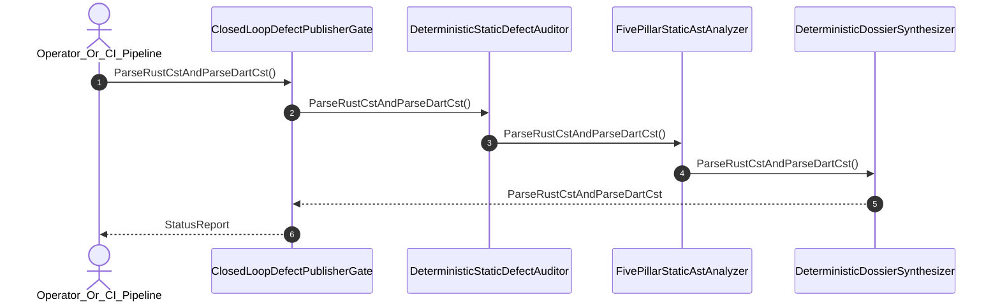

| Attribute | Specification Detail |
| :--- | :--- |
| **Issue ID** | #727 |
| **Title** | User Story 38: Parse Rust Cst And Parse Dart Cst |
| **Type** | user-story |
| **Parent Epic** | [EPIC-06-BP_06_Deterministic_Static_5_Pillar_Code_Auditor_and_Defect_Dossier_Synthesizer_Blueprint](../epics/EPIC-06-BP_06_Deterministic_Static_5_Pillar_Code_Auditor_and_Defect_Dossier_Synthesizer_Blueprint.md) |
| **SysML Interaction** | `BP_06_Deterministic_Static_5_Pillar_Code_Auditor_and_Defect_Dossier_Synthesizer_Blueprint_SequenceInteraction` |
| **SysML Test Case** | `Test_ParseRustCstAndParseDartCst` |
| **Generation Mode** | subagent |
| **Specification Source** | [schema/model.sysml](../../schema/model.sysml) |

# User Story 38: Parse Rust Cst And Parse Dart Cst

## User Story

As a `Operator_Or_CI_Pipeline`, I want to invoke `ParseRustCstAndParseDartCst()` on `DeterministicStaticDefectAuditor` and `FivePillarStaticAstAnalyzer`, so that Rust source files are parsed into lossless typed ASTs via `ra_ap_syntax` (`ast::{MatchExpr, MatchArmList, CallExpr, MethodCallExpr, TryExpr, Fn, HasDocComments, HasAttrs}`, `ra_ap_vfs`, `ra_ap_line_index`, `rowan`) and Stage-2 `rustc_middle::mir` (`TyCtxt`) in `./lints/deap-dylint-mir/`, while Dart source files are parsed in complete isolation via `deap_core::dart_cst` (`logos` + `rowan`) with `./crates/deap-core/src/source_ast.rs` (`source_ast.rs`) permanently deleted.

## Architectural Realization (3-Layer Definition of Done)

### Layer 1: Domain State & Data Model
- Domain state attributes on `DeterministicStaticDefectAuditor` (`auditor_subagent_count: Integer = 0`, `pillar_coverage_count: Integer = 5`), `FivePillarStaticAstAnalyzer` (`activePillarCount: Integer = 5`, `zeroRegexMode: Boolean = true`), and `DeterministicDossierSynthesizer` (`mandatorySectionCount: Integer = 7`, `whysChainDepth: Integer = 5`).
- Enforces **Contract A** (100% normative OMG SysML v2.0 + KerML 1.0 grammar coverage with full Definition and Usage symmetry and zero 16-construct caps) and **Contract B** (`ra_ap_syntax` typed AST + Stage-2 `./lints/deap-dylint-mir/` `rustc_middle::mir` (`TyCtxt`) + isolated `deap_core::dart_cst` (`logos` + `rowan`) + complete deletion of `source_ast.rs`, zero hand-rolled scanners).
- Action `ParseRustCstAndParseDartCst` invocation message envelope bound to `TargetRustCstInputPort` and `astStreamInPort`.
- Declared lifecycle state model: `BP_06_Deterministic_Static_5_Pillar_Code_Auditor_and_Defect_Dossier_Synthesizer_Blueprint_LifecycleState` (`Idle`, `IngestingRustAndDartCst`, `EvaluatingFivePillars`, `SynthesizingDossier`, `Verified`, `Validating12Gates`, `Rejected`, `DeduplicatingSsot`, `PublishingClosedLoop`).

### Layer 2: Logic & State Management
- Behavioral execution contract: invokes `ParseRustCstAndParseDartCst()` using `ra_ap_syntax::SourceFile::parse` for Rust CST/AST nodes and `deap_core::dart_cst` (`logos` + `rowan`) for Dart CST nodes with atomic precondition verification.
- State transition management: `IngestingRustAndDartCst -> EvaluatingFivePillars` (trigger `RustCstItem_slice_parsed`).
- Formal constraints and requirements enforced: **REQ-0606** (`REQ_0606_BP_06_Deterministic_Static_5_Pillar_Code_Auditor_and_Defect_Dossier_Synthesizer_Blueprint`), `Invariant_REQ_0606_SC_01`, and `Invariant_REQ_0606_SC_02`.
- Modularity & legacy scanner deletion target: bounds implementation inside `< 380`-SLOC submodules (`./crates/verify-baseline/src/defect_auditor/`, `./crates/deap-core/src/dart_cst/`, and `./lints/deap-dylint-mir/`) while permanently deleting `./crates/deap-core/src/source_ast.rs` (`source_ast.rs`) and all hand-rolled line/character/regex scanners.

### Layer 3: Presentation & Actuator Interface Binding
- Component port bindings: `TargetRustCstInputPort: String (in)`, `astStreamInPort: String (in)`, `findingInPort: String (in)`, `dossierMarkdownOutPort: String (out)`.
- Interaction binding (`BP_06_Deterministic_Static_5_Pillar_Code_Auditor_and_Defect_Dossier_Synthesizer_Blueprint_SequenceInteraction`): routes `ParseRustCstAndParseDartCst` across `DeterministicStaticDefectAuditor`, `FivePillarStaticAstAnalyzer`, and `DeterministicDossierSynthesizer`.
- Diagnostic fault surface: emits `ariadne` / `miette` byte-span diagnostics (`E0601`) to `Operator_Or_CI_Pipeline` when syntax tree parsing or invariant checks fail.

## UML Sequence Diagram

## Acceptance Criteria (BDD)
- [ ] AC-US-38-01: Given `DeterministicStaticDefectAuditor` and `FivePillarStaticAstAnalyzer` are in declared state `IngestingRustAndDartCst` with `zeroRegexMode == true`, When `Operator_Or_CI_Pipeline` invokes `ParseRustCstAndParseDartCst`, Then Rust files are parsed via `ra_ap_syntax` typed AST and Dart files via isolated `deap_core::dart_cst` (`logos` + `rowan`) with `source_ast.rs` deleted, and the state machine transitions to `EvaluatingFivePillars`.
- [ ] AC-US-38-02: Given active state management during `ParseRustCstAndParseDartCst`, When formal constraint `Invariant_REQ_0606_SC_01` is evaluated, Then constraint satisfaction is verified before committing state updates.
- [ ] AC-US-38-03: Given active state management during `ParseRustCstAndParseDartCst`, When formal constraint `Invariant_REQ_0606_SC_02` (`zeroRegexMode == true`) is evaluated, Then zero hand-rolled string or regex scanners are used.
- [ ] AC-US-38-04: Given requirement allocation for `ParseRustCstAndParseDartCst`, When formal requirement **REQ-0606** (`REQ_0606_BP_06_Deterministic_Static_5_Pillar_Code_Auditor_and_Defect_Dossier_Synthesizer_Blueprint`) is verified, Then Contract A and Contract B conformance is confirmed across `< 380`-SLOC submodules.
- [ ] AC-US-38-05: Given ingress port bindings (`TargetRustCstInputPort: String`, `astStreamInPort: String`), When `ParseRustCstAndParseDartCst` completes, Then lossless CST/AST item streams are delivered to `FivePillarStaticAstAnalyzer` and `DeterministicDossierSynthesizer`.
- [ ] AC-US-38-06: Given a malformed source file or violated formal constraint `Invariant_REQ_0606_SC_01`, When `ParseRustCstAndParseDartCst` executes, Then the subsystem rejects the request fail-closed without partial state mutation, preserves prior verified state, and emits a deterministic `ariadne` / `miette` fault diagnostic (`E0601`).

## Required Features
- [ ] #680 - [Feature 26: [BP 06 Deterministic Static 5 Pillar Code Auditor and Defect Dossier Synthesizer Blueprint] ClosedLoopDefectPublisherGate](../features/FEAT-26-ClosedLoopDefectPublisherGate.md)
- [ ] #681 - [Feature 27: [BP 06 Deterministic Static 5 Pillar Code Auditor and Defect Dossier Synthesizer Blueprint] DeterministicDossierSynthesizer](../features/FEAT-27-DeterministicDossierSynthesizer.md)
- [ ] #682 - [Feature 28: [BP 06 Deterministic Static 5 Pillar Code Auditor and Defect Dossier Synthesizer Blueprint] DeterministicStaticDefectAuditor](../features/FEAT-28-DeterministicStaticDefectAuditor.md)
- [ ] #683 - [Feature 29: [BP 06 Deterministic Static 5 Pillar Code Auditor and Defect Dossier Synthesizer Blueprint] FivePillarStaticAstAnalyzer](../features/FEAT-29-FivePillarStaticAstAnalyzer.md)

## Source References
Operational concept definitions and system sequence interaction models:
- System Architecture Model: `schema/model.sysml`
- Normative Systems Engineering Standard: ISO/IEC/IEEE 29148:2018 §6.4.2 Concept of Operations

Authoritative user story flows and interaction lifelines derive from `schema/model.sysml` pursuant to ISO/IEC/IEEE 29148.
