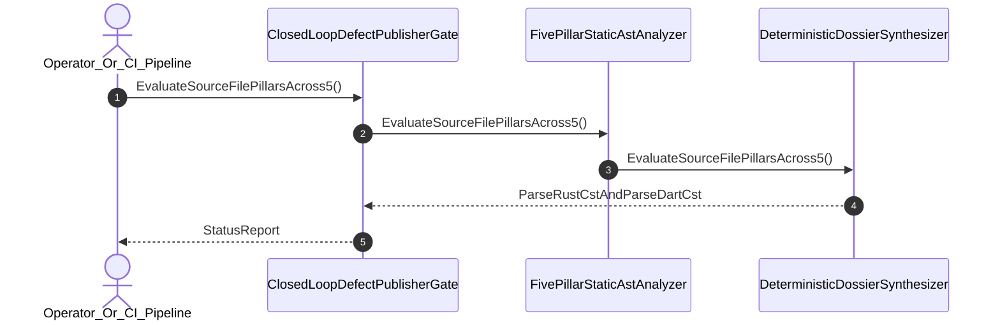

| Attribute | Specification Detail |
| :--- | :--- |
| **Issue ID** | #728 |
| **Title** | User Story 39: Evaluate Source File Pillars Across5 |
| **Type** | user-story |
| **Parent Epic** | [EPIC-06-BP_06_Deterministic_Static_5_Pillar_Code_Auditor_and_Defect_Dossier_Synthesizer_Blueprint](../epics/EPIC-06-BP_06_Deterministic_Static_5_Pillar_Code_Auditor_and_Defect_Dossier_Synthesizer_Blueprint.md) |
| **SysML Interaction** | `BP_06_Deterministic_Static_5_Pillar_Code_Auditor_and_Defect_Dossier_Synthesizer_Blueprint_SequenceInteraction` |
| **SysML Test Case** | `Test_EvaluateSourceFilePillarsAcross5` |
| **Generation Mode** | subagent |
| **Specification Source** | [schema/model.sysml](../../schema/model.sysml) |

# User Story 39: Evaluate Source File Pillars Across5

## User Story

As a `Operator_Or_CI_Pipeline`, I want to invoke `EvaluateSourceFilePillarsAcross5()` on `FivePillarStaticAstAnalyzer` and `DeterministicDossierSynthesizer`, so that `evaluate_source_file_pillars` evaluates all 5 adversarial correctness risk pillars (`E0601` through `E0605`) across `ra_ap_syntax` typed AST nodes (`ast::{MatchExpr, MatchArmList, CallExpr, MethodCallExpr, TryExpr, Fn, HasDocComments, HasAttrs}`), Stage-2 isolated `Dylint` `rustc_middle::mir` (`TyCtxt`) control-flow graphs in `./lints/deap-dylint-mir/`, and `deap_core::dart_cst` (`logos` + `rowan`) syntax trees with `./crates/deap-core/src/source_ast.rs` (`source_ast.rs`) permanently deleted.

## Architectural Realization (3-Layer Definition of Done)

### Layer 1: Domain State & Data Model
- Domain state attributes on `FivePillarStaticAstAnalyzer` (`activePillarCount: Integer = 5`, `zeroRegexMode: Boolean = true`) and `DeterministicDossierSynthesizer` (`mandatorySectionCount: Integer = 7`, `whysChainDepth: Integer = 5`).
- Enforces **Contract A** (100% normative OMG SysML v2.0 + KerML 1.0 textual grammar coverage with full Definition and Usage symmetry and zero 16-construct artificial caps) and **Contract B** (`ra_ap_syntax` typed AST + Stage-2 `./lints/deap-dylint-mir/` `rustc_middle::mir` (`TyCtxt`) 5-pillar defect dossier auditor + `deap_core::dart_cst` (`logos` + `rowan`) isolation + complete deletion of `source_ast.rs`, zero hand-rolled scanners).
- Action `EvaluateSourceFilePillarsAcross5` invocation message envelope bound to `FivePillarStaticAstAnalyzer` and `DeterministicDossierSynthesizer` typed domain schemas.
- Declared lifecycle state model: `BP_06_Deterministic_Static_5_Pillar_Code_Auditor_and_Defect_Dossier_Synthesizer_Blueprint_LifecycleState` (`Idle`, `IngestingRustAndDartCst`, `EvaluatingFivePillars`, `SynthesizingDossier`, `Verified`, `Validating12Gates`, `Rejected`, `DeduplicatingSsot`, `PublishingClosedLoop`).

### Layer 2: Logic & State Management
- Behavioral execution contract: invokes `EvaluateSourceFilePillarsAcross5()` across all `activePillarCount == 5` pillars (`E0601` partial functions/panics, `E0602` unchecked arithmetic/IEEE-754 bounds, `E0603` silent error discarding/incomplete `MatchExpr`/`SwitchInt`, `E0604` unbounded recursion/real-time `#rt_loop` heap allocation, `E0605` unsynchronized shared state/FFI boundary violations) using `ra_ap_syntax` typed AST and Stage-2 `./lints/deap-dylint-mir/` `rustc_middle::mir` (`TyCtxt`).
- State transition management: `EvaluatingFivePillars -> SynthesizingDossier` (trigger `AuditFinding_emitted`) or `EvaluatingFivePillars -> Verified` (trigger `zero_findings_detected`).
- Formal constraints and requirements enforced: **REQ-0606** (`REQ_0606_BP_06_Deterministic_Static_5_Pillar_Code_Auditor_and_Defect_Dossier_Synthesizer_Blueprint`), `Invariant_REQ_0606_SC_01`, and `Invariant_REQ_0606_SC_02`.
- Modularity & legacy scanner deletion target: bounds implementation inside `< 380`-SLOC submodules (`./crates/verify-baseline/src/defect_auditor/`, `./lints/deap-dylint-mir/`, and `./crates/deap-core/src/dart_cst/`) while permanently deleting `./crates/deap-core/src/source_ast.rs` (`source_ast.rs`) and retiring all ad-hoc regex/substring defect detectors.

### Layer 3: Presentation & Actuator Interface Binding
- Component port bindings: `astStreamInPort: String (in)`, `findingStreamOutPort: String (out)`, `findingInPort: String (in)`, `dossierMarkdownOutPort: String (out)`.
- Interaction binding (`BP_06_Deterministic_Static_5_Pillar_Code_Auditor_and_Defect_Dossier_Synthesizer_Blueprint_SequenceInteraction`): routes `EvaluateSourceFilePillarsAcross5` from `Operator_Or_CI_Pipeline` through `FivePillarStaticAstAnalyzer` to `DeterministicDossierSynthesizer`.
- Diagnostic fault surface: emits line-exact `AuditFinding` records and `ariadne` / `miette` byte-span diagnostics (`E0601`--`E0605`) across the declared interface boundary.

## UML Sequence Diagram

## Acceptance Criteria (BDD)
- [ ] AC-US-39-01: Given `FivePillarStaticAstAnalyzer` is in declared state `EvaluatingFivePillars` with `activePillarCount == 5` and `zeroRegexMode == true`, When `Operator_Or_CI_Pipeline` invokes `EvaluateSourceFilePillarsAcross5`, Then `FivePillarStaticAstAnalyzer` evaluates all 5 pillars via `ra_ap_syntax` typed AST, Stage-2 `./lints/deap-dylint-mir/` `rustc_middle::mir` (`TyCtxt`), and `deap_core::dart_cst` (`logos` + `rowan`) and transitions to `SynthesizingDossier` on `AuditFinding_emitted` (or `Verified` on `zero_findings_detected`).
- [ ] AC-US-39-02: Given active state management during `EvaluateSourceFilePillarsAcross5`, When formal constraint `Invariant_REQ_0606_SC_01` (`pillar_coverage_count == 5 && auditor_subagent_count == 0`) is evaluated, Then constraint satisfaction is verified before committing state updates.
- [ ] AC-US-39-03: Given active state management during `EvaluateSourceFilePillarsAcross5`, When formal constraint `Invariant_REQ_0606_SC_02` (`zeroRegexMode == true`) is evaluated, Then zero regular expressions or hand-rolled line scanners are executed and `source_ast.rs` remains absent.
- [ ] AC-US-39-04: Given requirement allocation for `EvaluateSourceFilePillarsAcross5`, When formal requirement **REQ-0606** (`REQ_0606_BP_06_Deterministic_Static_5_Pillar_Code_Auditor_and_Defect_Dossier_Synthesizer_Blueprint`) is verified, Then normative Contract A and Contract B satisfaction is confirmed across `< 380`-SLOC submodules.
- [ ] AC-US-39-05: Given ingress port binding (`astStreamInPort: String`), When `EvaluateSourceFilePillarsAcross5` completes, Then line-exact `AuditFinding` records are streamed across `findingStreamOutPort: String` and `findingInPort: String` to `DeterministicDossierSynthesizer`.
- [ ] AC-US-39-06: Given violated formal constraint `Invariant_REQ_0606_SC_01` (`activePillarCount != 5`), When `Operator_Or_CI_Pipeline` invokes `EvaluateSourceFilePillarsAcross5`, Then the subsystem rejects the request fail-closed without partial state mutation, preserves prior verified state, and emits a deterministic `ariadne` / `miette` fault diagnostic (`E0601`).

## Required Features
- [ ] #680 - [Feature 26: [BP 06 Deterministic Static 5 Pillar Code Auditor and Defect Dossier Synthesizer Blueprint] ClosedLoopDefectPublisherGate](../features/FEAT-26-ClosedLoopDefectPublisherGate.md)
- [ ] #681 - [Feature 27: [BP 06 Deterministic Static 5 Pillar Code Auditor and Defect Dossier Synthesizer Blueprint] DeterministicDossierSynthesizer](../features/FEAT-27-DeterministicDossierSynthesizer.md)
- [ ] #682 - [Feature 28: [BP 06 Deterministic Static 5 Pillar Code Auditor and Defect Dossier Synthesizer Blueprint] DeterministicStaticDefectAuditor](../features/FEAT-28-DeterministicStaticDefectAuditor.md)
- [ ] #683 - [Feature 29: [BP 06 Deterministic Static 5 Pillar Code Auditor and Defect Dossier Synthesizer Blueprint] FivePillarStaticAstAnalyzer](../features/FEAT-29-FivePillarStaticAstAnalyzer.md)

## Source References
Operational concept definitions and system sequence interaction models:
- System Architecture Model: `schema/model.sysml`
- Normative Systems Engineering Standard: ISO/IEC/IEEE 29148:2018 §6.4.2 Concept of Operations

Authoritative user story flows and interaction lifelines derive from `schema/model.sysml` pursuant to ISO/IEC/IEEE 29148.
