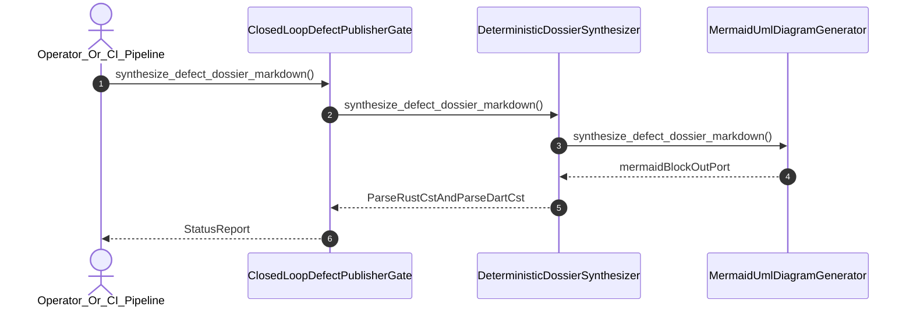

| Attribute | Specification Detail |
| :--- | :--- |
| **Issue ID** | #615 |
| **Title** | User Story 40: Synthesize Defect Dossier Markdown |
| **Type** | user-story |
| **Parent Epic** | [EPIC-06-BP_06_Deterministic_Static_5_Pillar_Code_Auditor_and_Defect_Dossier_Synthesizer_Blueprint](../epics/EPIC-06-BP_06_Deterministic_Static_5_Pillar_Code_Auditor_and_Defect_Dossier_Synthesizer_Blueprint.md) |
| **SysML Interaction** | `BP_06_Deterministic_Static_5_Pillar_Code_Auditor_and_Defect_Dossier_Synthesizer_Blueprint_SequenceInteraction` |
| **SysML Test Case** | `Test_synthesize_defect_dossier_markdown` |
| **Generation Mode** | subagent |
| **Specification Source** | [schema/model.sysml](../../schema/model.sysml) |

# User Story 40: Synthesize Defect Dossier Markdown

## User Story

As a `Operator_Or_CI_Pipeline`, I want to invoke `synthesize_defect_dossier_markdown()` on `DeterministicDossierSynthesizer` and `MermaidUmlDiagramGenerator`, so that `synthesize_defect_dossier_markdown(finding)` deterministically generates a 7-section Markdown defect dossier (`mandatorySectionCount = 7`, `whysChainDepth = 5`) via `pulldown-cmark-to-cmark` with Check 13B Rules E1--E5 compliant Mermaid UML diagrams (`forbidSemicolons = true`, `check13bCompliant = true`) from `ra_ap_syntax`, Stage-2 `./lints/deap-dylint-mir/` `rustc_middle::mir` (`TyCtxt`), and `deap_core::dart_cst` (`logos` + `rowan`) findings.

## Architectural Realization (3-Layer Definition of Done)

### Layer 1: Domain State & Data Model
- Domain state attributes on `DeterministicDossierSynthesizer` (`mandatorySectionCount: Integer = 7`, `whysChainDepth: Integer = 5`) and `MermaidUmlDiagramGenerator` (`forbidSemicolons: Boolean = true`, `check13bCompliant: Boolean = true`).
- Enforces **Contract A** (100% normative OMG SysML v2.0 + KerML 1.0 textual grammar coverage with full Definition and Usage symmetry and zero 16-construct artificial caps) and **Contract B** (`pulldown-cmark` / `pulldown-cmark-to-cmark` lossless Markdown AST synthesis from `ra_ap_syntax` typed AST, Stage-2 `./lints/deap-dylint-mir/` `rustc_middle::mir` (`TyCtxt`), and `deap_core::dart_cst` (`logos` + `rowan`) findings, with complete deletion of `source_ast.rs` and zero hand-rolled scanners).
- Action `synthesize_defect_dossier_markdown` invocation message envelope bound to `DeterministicDossierSynthesizer` and `MermaidUmlDiagramGenerator` typed domain schemas.
- Declared lifecycle state model: `BP_06_Deterministic_Static_5_Pillar_Code_Auditor_and_Defect_Dossier_Synthesizer_Blueprint_LifecycleState` (`Idle`, `IngestingRustAndDartCst`, `EvaluatingFivePillars`, `SynthesizingDossier`, `Verified`, `Validating12Gates`, `Rejected`, `DeduplicatingSsot`, `PublishingClosedLoop`).

### Layer 2: Logic & State Management
- Behavioral execution contract: invokes `synthesize_defect_dossier_markdown()` on `DeterministicDossierSynthesizer` and `MermaidUmlDiagramGenerator` with atomic precondition verification, producing all 7 canonical dossier sections, 5 causal `Why ...? Because ...` steps in Section 2, a Check 13B compliant Mermaid diagram in Section 4, and the `## Audit Source` footer with zero Unicode em dashes and zero hardcoded OS/user/machine paths.
- State transition management: `SynthesizingDossier -> Validating12Gates` (trigger `synthesize_defect_dossier_markdown`).
- Formal constraints and requirements enforced: **REQ-0606** (`REQ_0606_BP_06_Deterministic_Static_5_Pillar_Code_Auditor_and_Defect_Dossier_Synthesizer_Blueprint`), `Invariant_REQ_0606_SC_01`, and `Invariant_REQ_0606_SC_02`.
- Modularity & legacy scanner deletion target: bounds implementation inside `< 380`-SLOC submodules (`./crates/verify-baseline/src/defect_dossier/` and `./crates/verify-baseline/src/defect_auditor/`) while permanently deleting `./crates/deap-core/src/source_ast.rs` (`source_ast.rs`) and retiring all hand-rolled string/regex scanners.

### Layer 3: Presentation & Actuator Interface Binding
- Component port bindings: `findingInPort: String (in)`, `umlSpecInPort: String (in)`, `mermaidBlockOutPort: String (out)`, `dossierMarkdownOutPort: String (out)`.
- Interaction binding (`BP_06_Deterministic_Static_5_Pillar_Code_Auditor_and_Defect_Dossier_Synthesizer_Blueprint_SequenceInteraction`): routes `synthesize_defect_dossier_markdown` invocation across `DeterministicDossierSynthesizer` and `MermaidUmlDiagramGenerator` and delivers the candidate dossier to `ClosedLoopDefectPublisherGate`.
- Diagnostic fault surface: reports deterministic `ariadne` / `miette` rejection diagnostics (`E0602`) to `Operator_Or_CI_Pipeline` across the declared interface boundary when guard or invariant checks fail.

## UML Sequence Diagram

## Acceptance Criteria (BDD)
- [ ] AC-US-40-01: Given `DeterministicDossierSynthesizer` is in declared state `SynthesizingDossier` with domain state attributes (`mandatorySectionCount: Integer = 7`, `whysChainDepth: Integer = 5`) and `MermaidUmlDiagramGenerator` has `forbidSemicolons == true` and `check13bCompliant == true`, When `Operator_Or_CI_Pipeline` invokes `synthesize_defect_dossier_markdown`, Then `DeterministicDossierSynthesizer` synthesizes all 7 sections via `pulldown-cmark-to-cmark` and transitions to `Validating12Gates`.
- [ ] AC-US-40-02: Given `DeterministicDossierSynthesizer` active state management during `synthesize_defect_dossier_markdown`, When `DeterministicDossierSynthesizer` evaluates formal constraint `Invariant_REQ_0606_SC_01`, Then `DeterministicDossierSynthesizer` verifies constraint satisfaction before committing state updates.
- [ ] AC-US-40-03: Given `DeterministicDossierSynthesizer` active state management during `synthesize_defect_dossier_markdown`, When `DeterministicDossierSynthesizer` evaluates formal constraint `Invariant_REQ_0606_SC_02`, Then `DeterministicDossierSynthesizer` verifies constraint satisfaction (zero Unicode em dashes and zero hardcoded OS/user/machine paths) before committing state updates.
- [ ] AC-US-40-04: Given `DeterministicDossierSynthesizer` requirement allocation for `synthesize_defect_dossier_markdown`, When `DeterministicDossierSynthesizer` verifies formal requirement **REQ-0606** (`REQ_0606_BP_06_Deterministic_Static_5_Pillar_Code_Auditor_and_Defect_Dossier_Synthesizer_Blueprint`), Then `DeterministicDossierSynthesizer` confirms normative Contract A and Contract B satisfaction across `< 380`-SLOC submodules with `source_ast.rs` deleted.
- [ ] AC-US-40-05: Given `DeterministicDossierSynthesizer` ingress port binding (`findingInPort: String`), When `DeterministicDossierSynthesizer` completes `synthesize_defect_dossier_markdown`, Then `DeterministicDossierSynthesizer` delivers the 7-section dossier across egress port (`dossierMarkdownOutPort: String`) to `ClosedLoopDefectPublisherGate`.
- [ ] AC-US-40-06: Given violated formal constraint `Invariant_REQ_0606_SC_01` or a Check 13B Mermaid rule violation, When `Operator_Or_CI_Pipeline` invokes `synthesize_defect_dossier_markdown`, Then `DeterministicDossierSynthesizer` rejects the request fail-closed without partial state mutation, preserves prior verified state, and emits a deterministic `ariadne` / `miette` fault diagnostic (`E0602`).

## Required Features
- [ ] #680 - [Feature 26: [BP 06 Deterministic Static 5 Pillar Code Auditor and Defect Dossier Synthesizer Blueprint] ClosedLoopDefectPublisherGate](../features/FEAT-26-ClosedLoopDefectPublisherGate.md)
- [ ] #681 - [Feature 27: [BP 06 Deterministic Static 5 Pillar Code Auditor and Defect Dossier Synthesizer Blueprint] DeterministicDossierSynthesizer](../features/FEAT-27-DeterministicDossierSynthesizer.md)
- [ ] #684 - [Feature 30: [BP 06 Deterministic Static 5 Pillar Code Auditor and Defect Dossier Synthesizer Blueprint] MermaidUmlDiagramGenerator](../features/FEAT-30-MermaidUmlDiagramGenerator.md)

## Source References
Operational concept definitions and system sequence interaction models:
- System Architecture Model: `schema/model.sysml`
- Normative Systems Engineering Standard: ISO/IEC/IEEE 29148:2018 §6.4.2 Concept of Operations

Authoritative user story flows and interaction lifelines derive from `schema/model.sysml` pursuant to ISO/IEC/IEEE 29148.
