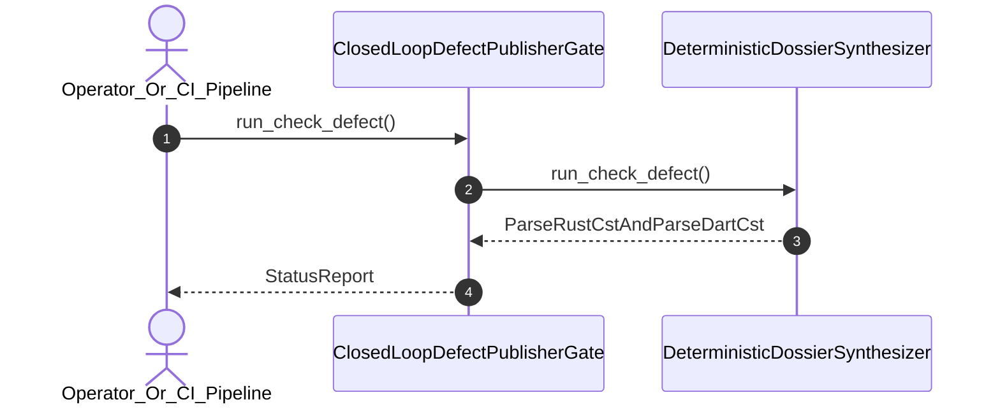

| Attribute | Specification Detail |
| :--- | :--- |
| **Issue ID** | #617 |
| **Title** | User Story 41: run check defect |
| **Type** | user-story |
| **Parent Epic** | [EPIC-06-BP_06_Deterministic_Static_5_Pillar_Code_Auditor_and_Defect_Dossier_Synthesizer_Blueprint](../epics/EPIC-06-BP_06_Deterministic_Static_5_Pillar_Code_Auditor_and_Defect_Dossier_Synthesizer_Blueprint.md) |
| **SysML Interaction** | `BP_06_Deterministic_Static_5_Pillar_Code_Auditor_and_Defect_Dossier_Synthesizer_Blueprint_SequenceInteraction` |
| **SysML Test Case** | `Test_run_check_defect` |
| **Generation Mode** | subagent |
| **Specification Source** | [schema/model.sysml](../../schema/model.sysml) |

# User Story 41: run check defect

## User Story

As a `Operator_Or_CI_Pipeline`, I want to invoke `run_check_defect()` (`./target/release/verify-baseline check-defect ./.pipeline/defects/<NAME>.md`) on `ClosedLoopDefectPublisherGate` and `DeterministicDossierSynthesizer`, so that `run_check_defect(DefectDossierArgs)` validates 7-section defect dossiers produced by the `ra_ap_syntax` typed AST, Stage-2 `./lints/deap-dylint-mir/` `rustc_middle::mir` (`TyCtxt`), and `deap_core::dart_cst` (`logos` + `rowan`) auditor with `./crates/deap-core/src/source_ast.rs` (`source_ast.rs`) deleted.

## Architectural Realization (3-Layer Definition of Done)

### Layer 1: Domain State & Data Model
- Domain state attributes on `ClosedLoopDefectPublisherGate` (`schemaGateCount: Integer = 12`, `requireByteParity: Boolean = true`) and `DeterministicDossierSynthesizer` (`mandatorySectionCount: Integer = 7`, `whysChainDepth: Integer = 5`).
- Enforces **Contract A** (100% normative OMG SysML v2.0 + KerML 1.0 textual grammar coverage with full Definition and Usage symmetry and zero 16-construct artificial caps) and **Contract B** (`pulldown-cmark` / `pulldown-cmark-to-cmark` lossless Markdown AST inspection, `ra_ap_syntax` typed AST, Stage-2 `./lints/deap-dylint-mir/` `rustc_middle::mir` (`TyCtxt`), `deap_core::dart_cst` (`logos` + `rowan`) isolation, and complete deletion of `source_ast.rs` with zero hand-rolled scanners).
- Action `run_check_defect` invocation message envelope bound to `ClosedLoopDefectPublisherGate` and `DeterministicDossierSynthesizer` typed domain schemas.
- Declared lifecycle state model: `BP_06_Deterministic_Static_5_Pillar_Code_Auditor_and_Defect_Dossier_Synthesizer_Blueprint_LifecycleState` (`Idle`, `IngestingRustAndDartCst`, `EvaluatingFivePillars`, `SynthesizingDossier`, `Verified`, `Validating12Gates`, `Rejected`, `DeduplicatingSsot`, `PublishingClosedLoop`).

### Layer 2: Logic & State Management
- Behavioral execution contract: invokes `run_check_defect()` on `ClosedLoopDefectPublisherGate` and `DeterministicDossierSynthesizer` with atomic precondition verification, parsing the candidate `./.pipeline/defects/<NAME>.md` file via `pulldown-cmark`.
- State transition management: `SynthesizingDossier -> Validating12Gates` (trigger `synthesize_defect_dossier_markdown` / `run_check_defect`).
- Formal constraints and requirements enforced: **REQ-0606** (`REQ_0606_BP_06_Deterministic_Static_5_Pillar_Code_Auditor_and_Defect_Dossier_Synthesizer_Blueprint`), `Invariant_REQ_0606_SC_01`, and `Invariant_REQ_0606_SC_02`.
- Modularity & legacy scanner deletion target: bounds implementation inside `< 380`-SLOC submodules (`./crates/verify-baseline/src/defect_dossier/` and `./crates/verify-baseline/src/defect_auditor/`) while permanently deleting `./crates/deap-core/src/source_ast.rs` (`source_ast.rs`) and retiring all hand-rolled regex/substring defect detectors.

### Layer 3: Presentation & Actuator Interface Binding
- Component port bindings: `dossierCandidateInPort: String (in)`, `verifiedReceiptOutPort: String (out)`, `findingInPort: String (in)`, `dossierMarkdownOutPort: String (out)`.
- Interaction binding (`BP_06_Deterministic_Static_5_Pillar_Code_Auditor_and_Defect_Dossier_Synthesizer_Blueprint_SequenceInteraction`): routes `run_check_defect` invocation from `Operator_Or_CI_Pipeline` to `ClosedLoopDefectPublisherGate` and `DeterministicDossierSynthesizer`.
- Diagnostic fault surface: reports deterministic `ariadne` / `miette` rejection diagnostics (`E0602`--`E0605`) to `Operator_Or_CI_Pipeline` across the declared interface boundary when guard or invariant checks fail.

## UML Sequence Diagram

## Acceptance Criteria (BDD)
- [ ] AC-US-41-01: Given `ClosedLoopDefectPublisherGate` and `DeterministicDossierSynthesizer` receive a candidate dossier with `schemaGateCount == 12`, `mandatorySectionCount == 7`, and `whysChainDepth == 5`, When `Operator_Or_CI_Pipeline` invokes `run_check_defect`, Then the candidate dossier is parsed via `pulldown-cmark` and transitions to `Validating12Gates`.
- [ ] AC-US-41-02: Given active state management during `run_check_defect`, When `ClosedLoopDefectPublisherGate` evaluates formal constraint `Invariant_REQ_0606_SC_01` (`dossier_schema_check_count == 12 && pillar_coverage_count == 5`), Then constraint satisfaction is verified before committing state updates.
- [ ] AC-US-41-03: Given active state management during `run_check_defect`, When `ClosedLoopDefectPublisherGate` evaluates formal constraint `Invariant_REQ_0606_SC_02` (`closed_loop_mismatch_bytes == 0 && zeroRegexMode == true`), Then constraint satisfaction is verified before committing state updates.
- [ ] AC-US-41-04: Given requirement allocation for `run_check_defect`, When formal requirement **REQ-0606** (`REQ_0606_BP_06_Deterministic_Static_5_Pillar_Code_Auditor_and_Defect_Dossier_Synthesizer_Blueprint`) is verified, Then normative Contract A and Contract B satisfaction is confirmed across `< 380`-SLOC submodules with `source_ast.rs` deleted.
- [ ] AC-US-41-05: Given ingress port binding (`dossierCandidateInPort: String`, `findingInPort: String`), When `run_check_defect` completes, Then the validation outcome is routed across `verifiedReceiptOutPort: String` and `dossierMarkdownOutPort: String` to `Operator_Or_CI_Pipeline`.
- [ ] AC-US-41-06: Given violated formal constraint `Invariant_REQ_0606_SC_01`, a missing section, an ephemeral or host-specific path, or a Unicode em dash, When `Operator_Or_CI_Pipeline` invokes `run_check_defect`, Then `ClosedLoopDefectPublisherGate` rejects the request fail-closed without partial state mutation, preserves prior verified state, and emits a deterministic `ariadne` / `miette` fault diagnostic (`E0605`).

## Required Features
- [ ] #680 - [Feature 26: [BP 06 Deterministic Static 5 Pillar Code Auditor and Defect Dossier Synthesizer Blueprint] ClosedLoopDefectPublisherGate](../features/FEAT-26-ClosedLoopDefectPublisherGate.md)
- [ ] #681 - [Feature 27: [BP 06 Deterministic Static 5 Pillar Code Auditor and Defect Dossier Synthesizer Blueprint] DeterministicDossierSynthesizer](../features/FEAT-27-DeterministicDossierSynthesizer.md)
- [ ] #682 - [Feature 28: [BP 06 Deterministic Static 5 Pillar Code Auditor and Defect Dossier Synthesizer Blueprint] DeterministicStaticDefectAuditor](../features/FEAT-28-DeterministicStaticDefectAuditor.md)

## Source References
Operational concept definitions and system sequence interaction models:
- System Architecture Model: `schema/model.sysml`
- Normative Systems Engineering Standard: ISO/IEC/IEEE 29148:2018 §6.4.2 Concept of Operations

Authoritative user story flows and interaction lifelines derive from `schema/model.sysml` pursuant to ISO/IEC/IEEE 29148.
