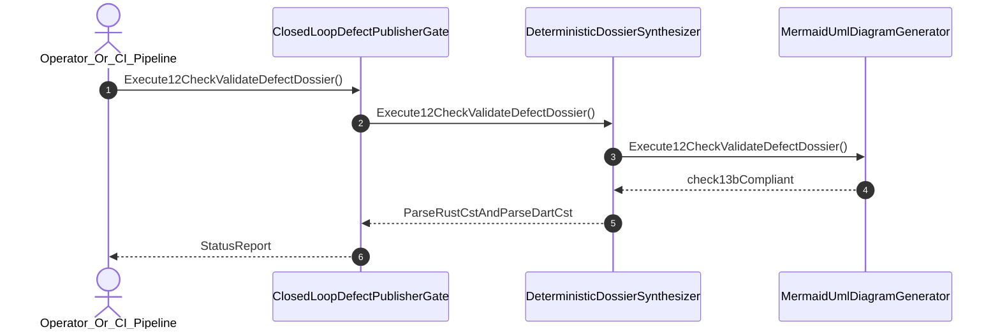

| Attribute | Specification Detail |
| :--- | :--- |
| **Issue ID** | #729 |
| **Title** | User Story 42: Execute12 Check Validate Defect Dossier |
| **Type** | user-story |
| **Parent Epic** | [EPIC-06-BP_06_Deterministic_Static_5_Pillar_Code_Auditor_and_Defect_Dossier_Synthesizer_Blueprint](../epics/EPIC-06-BP_06_Deterministic_Static_5_Pillar_Code_Auditor_and_Defect_Dossier_Synthesizer_Blueprint.md) (#690) |
| **SysML Interaction** | `BP_06_Deterministic_Static_5_Pillar_Code_Auditor_and_Defect_Dossier_Synthesizer_Blueprint_SequenceInteraction` |
| **SysML Test Case** | `Test_Execute12CheckValidateDefectDossier` |
| **Generation Mode** | subagent |
| **Specification Source** | [schema/model.sysml](../../schema/model.sysml) |

# User Story 42: Execute12 Check Validate Defect Dossier

## User Story

As a `Operator_Or_CI_Pipeline`, I want to invoke `Execute12CheckValidateDefectDossier()` on `ClosedLoopDefectPublisherGate`, `DeterministicDossierSynthesizer`, and `MermaidUmlDiagramGenerator`, so that the 12-check `validate_defect_dossier` gate verifies all 7 canonical sections, 5 causal `Why ...? Because ...` steps, Check 13B Rules E1--E5 Mermaid compliance (`forbidSemicolons = true`, `check13bCompliant = true`), workspace-relative paths, and zero Unicode em dashes using `pulldown-cmark` AST inspection.

## Architectural Realization (3-Layer Definition of Done)

### Layer 1: Domain State & Data Model
- Domain state attributes on `ClosedLoopDefectPublisherGate` (`schemaGateCount: Integer = 12`, `requireByteParity: Boolean = true`), `DeterministicDossierSynthesizer` (`mandatorySectionCount: Integer = 7`, `whysChainDepth: Integer = 5`), and `MermaidUmlDiagramGenerator` (`forbidSemicolons: Boolean = true`, `check13bCompliant: Boolean = true`).
- Enforces **Contract A** (100% normative OMG SysML v2.0 + KerML 1.0 textual grammar coverage with full Definition and Usage symmetry and zero 16-construct artificial caps) and **Contract B** (`pulldown-cmark` lossless Markdown AST inspection, `ra_ap_syntax` typed AST, Stage-2 `./lints/deap-dylint-mir/` `rustc_middle::mir` (`TyCtxt`), `deap_core::dart_cst` (`logos` + `rowan`) isolation, and complete deletion of `source_ast.rs` with zero hand-rolled scanners).
- Action `Execute12CheckValidateDefectDossier` invocation message envelope bound to `ClosedLoopDefectPublisherGate` and `DeterministicDossierSynthesizer` typed domain schemas.
- Declared lifecycle state model: `BP_06_Deterministic_Static_5_Pillar_Code_Auditor_and_Defect_Dossier_Synthesizer_Blueprint_LifecycleState` (`Idle`, `IngestingRustAndDartCst`, `EvaluatingFivePillars`, `SynthesizingDossier`, `Verified`, `Validating12Gates`, `Rejected`, `DeduplicatingSsot`, `PublishingClosedLoop`).

### Layer 2: Logic & State Management
- Behavioral execution contract: invokes `Execute12CheckValidateDefectDossier()` across all `schemaGateCount == 12` structural, lexical, and Mermaid E1--E5 checks on `ClosedLoopDefectPublisherGate`.
- State transition management: `Validating12Gates -> DeduplicatingSsot` (trigger `all_12_checks_passed`) or `Validating12Gates -> Rejected` (trigger `schema_or_Mermaid_check_violation`).
- Formal constraints and requirements enforced: **REQ-0606** (`REQ_0606_BP_06_Deterministic_Static_5_Pillar_Code_Auditor_and_Defect_Dossier_Synthesizer_Blueprint`), `Invariant_REQ_0606_SC_01`, and `Invariant_REQ_0606_SC_02`.
- Modularity & legacy scanner deletion target: bounds implementation inside `< 380`-SLOC submodules (`./crates/verify-baseline/src/defect_dossier/` and `./crates/verify-baseline/src/defect_auditor/`) while permanently deleting `./crates/deap-core/src/source_ast.rs` (`source_ast.rs`) and retiring all hand-rolled regex/substring defect detectors.

### Layer 3: Presentation & Actuator Interface Binding
- Component port bindings: `dossierCandidateInPort: String (in)`, `verifiedReceiptOutPort: String (out)`, `findingInPort: String (in)`, `dossierMarkdownOutPort: String (out)`.
- Interaction binding (`BP_06_Deterministic_Static_5_Pillar_Code_Auditor_and_Defect_Dossier_Synthesizer_Blueprint_SequenceInteraction`): routes `Execute12CheckValidateDefectDossier` across `ClosedLoopDefectPublisherGate`, `DeterministicDossierSynthesizer`, and `MermaidUmlDiagramGenerator`.
- Diagnostic fault surface: reports deterministic `ariadne` / `miette` rejection diagnostics (`E0602`--`E0605`) to `Operator_Or_CI_Pipeline` across the declared interface boundary when any of the 12 checks fail.

## UML Sequence Diagram

## Acceptance Criteria (BDD)
- [ ] AC-US-42-01: Given `ClosedLoopDefectPublisherGate` is in declared state `Validating12Gates` with `schemaGateCount == 12`, `mandatorySectionCount == 7`, and `whysChainDepth == 5`, When `Operator_Or_CI_Pipeline` invokes `Execute12CheckValidateDefectDossier`, Then all 12 structural, lexical, and Mermaid E1--E5 checks are evaluated via `pulldown-cmark` and the state machine transitions to `DeduplicatingSsot` on `all_12_checks_passed`.
- [ ] AC-US-42-02: Given active state management during `Execute12CheckValidateDefectDossier`, When formal constraint `Invariant_REQ_0606_SC_01` (`dossier_schema_check_count == 12`) is evaluated, Then constraint satisfaction is verified before committing state updates.
- [ ] AC-US-42-03: Given active state management during `Execute12CheckValidateDefectDossier`, When formal constraint `Invariant_REQ_0606_SC_02` (`zeroRegexMode == true`) is evaluated, Then zero Unicode em dashes and zero hardcoded OS/user/machine paths are confirmed.
- [ ] AC-US-42-04: Given requirement allocation for `Execute12CheckValidateDefectDossier`, When formal requirement **REQ-0606** (`REQ_0606_BP_06_Deterministic_Static_5_Pillar_Code_Auditor_and_Defect_Dossier_Synthesizer_Blueprint`) is verified, Then normative Contract A and Contract B satisfaction is confirmed across `< 380`-SLOC submodules with `source_ast.rs` deleted.
- [ ] AC-US-42-05: Given ingress port binding (`dossierCandidateInPort: String`, `findingInPort: String`), When `Execute12CheckValidateDefectDossier` completes, Then the verified dossier candidate proceeds to SSOT deduplication and status is reported across `verifiedReceiptOutPort: String`.
- [ ] AC-US-42-06: Given a candidate dossier that fails any of the 12 validation gates or violates `Invariant_REQ_0606_SC_01`, When `Execute12CheckValidateDefectDossier` executes, Then `ClosedLoopDefectPublisherGate` transitions to `Rejected` on `schema_or_Mermaid_check_violation`, preserves prior verified state, and emits a deterministic `ariadne` / `miette` fault diagnostic (`E0605`).

## Required Features
- [ ] #680 - [Feature 26: [BP 06 Deterministic Static 5 Pillar Code Auditor and Defect Dossier Synthesizer Blueprint] ClosedLoopDefectPublisherGate](../features/FEAT-26-ClosedLoopDefectPublisherGate.md)
- [ ] #681 - [Feature 27: [BP 06 Deterministic Static 5 Pillar Code Auditor and Defect Dossier Synthesizer Blueprint] DeterministicDossierSynthesizer](../features/FEAT-27-DeterministicDossierSynthesizer.md)
- [ ] #684 - [Feature 30: [BP 06 Deterministic Static 5 Pillar Code Auditor and Defect Dossier Synthesizer Blueprint] MermaidUmlDiagramGenerator](../features/FEAT-30-MermaidUmlDiagramGenerator.md)

## Source References
Operational concept definitions and system sequence interaction models:
- System Architecture Model: `schema/model.sysml`
- Normative Systems Engineering Standard: ISO/IEC/IEEE 29148:2018 §6.4.2 Concept of Operations

Authoritative user story flows and interaction lifelines derive from `schema/model.sysml` pursuant to ISO/IEC/IEEE 29148.
