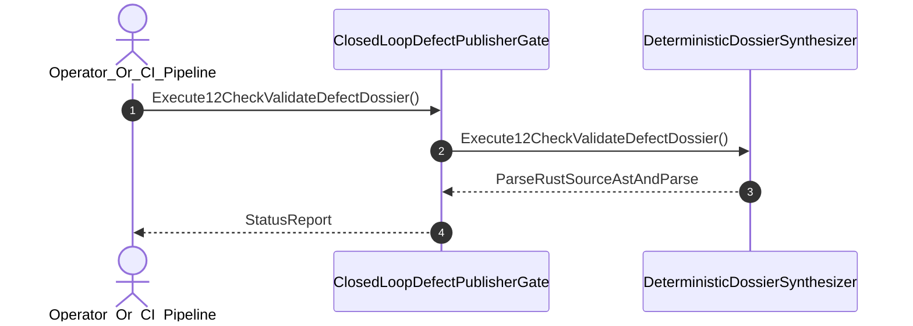

| Attribute | Specification Detail |
| :--- | :--- |
| **Issue ID** | #729 |
| **Title** | User Story 42: Execute12 Check Validate Defect Dossier |
| **Type** | user-story |
| **Parent Epic** | [EPIC-06-BP_06_Deterministic_Static_5_Pillar_Code_Auditor_and_Defect_Dossier_Synthesizer_Blueprint](../epics/EPIC-06-BP_06_Deterministic_Static_5_Pillar_Code_Auditor_and_Defect_Dossier_Synthesizer_Blueprint.md) |
| **SysML Interaction** | `BP_06_Deterministic_Static_5_Pillar_Code_Auditor_and_Defect_Dossier_Synthesizer_Blueprint_SequenceInteraction` |
| **SysML Test Case** | `Test_Execute12CheckValidateDefectDossier` |
| **Generation Mode** | subagent |
| **Specification Source** | [schema/model.sysml](../../schema/model.sysml) |

# User Story 42: Execute12 Check Validate Defect Dossier

## User Story

As a `Operator_Or_CI_Pipeline`, I want to invoke `Execute12CheckValidateDefectDossier()` on `DeterministicDossierSynthesizer`, so that Execute 12-check validate_defect_dossier gate.

## Architectural Realization (3-Layer Definition of Done)

### Layer 1: Domain State & Data Model
- Domain state attributes on `DeterministicDossierSynthesizer`: `mandatorySectionCount: Integer`, `whysChainDepth: Integer`.
- Action `Execute12CheckValidateDefectDossier` invocation message envelope bound to `DeterministicDossierSynthesizer` typed domain schema.
- Declared lifecycle state model: `BP_06_Deterministic_Static_5_Pillar_Code_Auditor_and_Defect_Dossier_Synthesizer_Blueprint_LifecycleState`, `Idle`, `IngestingSourceAst`, `EvaluatingFivePillars`, `SynthesizingDossier`, `Verified`, `Validating12Gates`, `Rejected`, `DeduplicatingSsot`, `PublishingClosedLoop`.

### Layer 2: Logic & State Management
- Behavioral execution contract: invokes `Execute12CheckValidateDefectDossier()` on `DeterministicDossierSynthesizer` with atomic precondition verification.
- State transition management: `Idle -> IngestingSourceAst` (trigger `verify_baseline_audit_code_path`).
- Formal constraints and requirements enforced: `REQ-0606 (REQ_0606_BP_06_Deterministic_Static_5_Pillar_Code_Auditor_and_Defect_Dossier_Synthesizer_Blueprint)`.

### Layer 3: Presentation & Actuator Interface Binding
- Component port bindings on `DeterministicDossierSynthesizer`: `findingInPort: String (in)`, `dossierMarkdownOutPort: String (out)`.
- Interaction binding (`BP_06_Deterministic_Static_5_Pillar_Code_Auditor_and_Defect_Dossier_Synthesizer_Blueprint_SequenceInteraction`): routes `Execute12CheckValidateDefectDossier` invocation from `Operator_Or_CI_Pipeline` to `DeterministicDossierSynthesizer` and returns `ParseRustSourceAstAndParse`.
- Diagnostic fault surface: reports deterministic rejection diagnostics to `Operator_Or_CI_Pipeline` across the declared interface boundary when guard or invariant checks fail.

## UML Sequence Diagram

## Acceptance Criteria (BDD)
- [ ] AC-US-42-01: Given `DeterministicDossierSynthesizer` is in declared state `Idle` with domain state attributes (`mandatorySectionCount: Integer`, `whysChainDepth: Integer`), When `Operator_Or_CI_Pipeline` invokes `Execute12CheckValidateDefectDossier` on `DeterministicDossierSynthesizer`, Then `DeterministicDossierSynthesizer` validates and binds the request against `DeterministicDossierSynthesizer` domain state (`mandatorySectionCount: Integer`, `whysChainDepth: Integer`) and transitions to `IngestingSourceAst`.
- [ ] AC-US-42-02: Given `DeterministicDossierSynthesizer` active state management during `Execute12CheckValidateDefectDossier`, When `DeterministicDossierSynthesizer` evaluates formal constraint `Invariant_REQ_0606_SC_01`, Then `DeterministicDossierSynthesizer` verifies constraint satisfaction before committing state updates.
- [ ] AC-US-42-03: Given `DeterministicDossierSynthesizer` active state management during `Execute12CheckValidateDefectDossier`, When `DeterministicDossierSynthesizer` evaluates formal constraint `Invariant_REQ_0606_SC_02`, Then `DeterministicDossierSynthesizer` verifies constraint satisfaction before committing state updates.
- [ ] AC-US-42-04: Given `DeterministicDossierSynthesizer` requirement allocation for `Execute12CheckValidateDefectDossier`, When `DeterministicDossierSynthesizer` verifies formal requirement `REQ-0606 (REQ_0606_BP_06_Deterministic_Static_5_Pillar_Code_Auditor_and_Defect_Dossier_Synthesizer_Blueprint)`, Then `DeterministicDossierSynthesizer` confirms normative requirement satisfaction across execution.
- [ ] AC-US-42-05: Given `DeterministicDossierSynthesizer` ingress port binding (`findingInPort: String`), When `DeterministicDossierSynthesizer` completes `Execute12CheckValidateDefectDossier`, Then `DeterministicDossierSynthesizer` delivers `ParseRustSourceAstAndParse` across egress port (`dossierMarkdownOutPort: String`) to `Operator_Or_CI_Pipeline`.
- [ ] AC-US-42-06: Given violated formal constraint `Invariant_REQ_0606_SC_01`, When `Operator_Or_CI_Pipeline` invokes `Execute12CheckValidateDefectDossier` on `DeterministicDossierSynthesizer`, Then `DeterministicDossierSynthesizer` rejects the request without partial state mutation, preserves prior verified state, and emits a deterministic fault diagnostic across the interface binding.

## Required Features
- [ ] #680 - [Feature 26: [BP 06 Deterministic Static 5 Pillar Code Auditor and Defect Dossier Synthesizer Blueprint] ClosedLoopDefectPublisherGate](../features/FEAT-26-ClosedLoopDefectPublisherGate.md)
- [ ] #681 - [Feature 27: [BP 06 Deterministic Static 5 Pillar Code Auditor and Defect Dossier Synthesizer Blueprint] DeterministicDossierSynthesizer](../features/FEAT-27-DeterministicDossierSynthesizer.md)

## Source References
Operational concept definitions and system sequence interaction models:
- System Architecture Model: `schema/model.sysml`
- Normative Systems Engineering Standard: ISO/IEC/IEEE 29148:2018 §6.4.2 Concept of Operations

Authoritative user story flows and interaction lifelines derive from `schema/model.sysml` pursuant to ISO/IEC/IEEE 29148.
