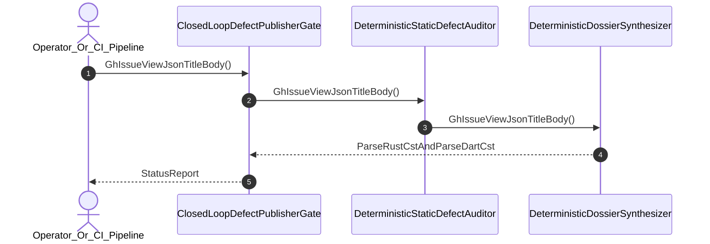

| Attribute | Specification Detail |
| :--- | :--- |
| **Issue ID** | #731 |
| **Title** | User Story 44: Gh Issue View Json Title Body |
| **Type** | user-story |
| **Parent Epic** | [EPIC-06-BP_06_Deterministic_Static_5_Pillar_Code_Auditor_and_Defect_Dossier_Synthesizer_Blueprint](../epics/EPIC-06-BP_06_Deterministic_Static_5_Pillar_Code_Auditor_and_Defect_Dossier_Synthesizer_Blueprint.md) (#690) |
| **SysML Interaction** | `BP_06_Deterministic_Static_5_Pillar_Code_Auditor_and_Defect_Dossier_Synthesizer_Blueprint_SequenceInteraction` |
| **SysML Test Case** | `Test_GhIssueViewJsonTitleBody` |
| **Generation Mode** | subagent |
| **Specification Source** | [schema/model.sysml](../../schema/model.sysml) |

# User Story 44: Gh Issue View Json Title Body

## User Story

As a `Operator_Or_CI_Pipeline`, I want to invoke `GhIssueViewJsonTitleBody()` on `ClosedLoopDefectPublisherGate`, `DeterministicStaticDefectAuditor`, and `DeterministicDossierSynthesizer`, so that `gh issue view --json title,body,url` retrieves the live GitHub issue document via `GitHubIssueSsotQueryPort` and proves zero-byte discrepancy (`closed_loop_mismatch_bytes == 0`, `requireByteParity == true`) after CRLF-to-LF normalization against the local `./.pipeline/defects/<NAME>.md` file.

## Architectural Realization (3-Layer Definition of Done)

### Layer 1: Domain State & Data Model
- Domain state attributes on `ClosedLoopDefectPublisherGate` (`schemaGateCount: Integer = 12`, `requireByteParity: Boolean = true`), `DeterministicStaticDefectAuditor` (`closed_loop_mismatch_bytes: Integer = 0`, `auditor_subagent_count: Integer = 0`), and `DeterministicDossierSynthesizer` (`mandatorySectionCount: Integer = 7`, `whysChainDepth: Integer = 5`).
- Enforces **Contract A** (100% normative OMG SysML v2.0 + KerML 1.0 textual grammar coverage with full Definition and Usage symmetry and zero 16-construct artificial caps) and **Contract B** (`ra_ap_syntax` typed AST + Stage-2 `./lints/deap-dylint-mir/` `rustc_middle::mir` (`TyCtxt`) 5-pillar defect dossier auditor + `deap_core::dart_cst` (`logos` + `rowan`) isolation + typed `serde_json` + `pulldown-cmark` + complete deletion of `source_ast.rs`, zero hand-rolled scanners).
- Action `GhIssueViewJsonTitleBody` invocation message envelope bound to `ClosedLoopDefectPublisherGate` and `DeterministicStaticDefectAuditor` typed domain schemas.
- Declared lifecycle state model: `BP_06_Deterministic_Static_5_Pillar_Code_Auditor_and_Defect_Dossier_Synthesizer_Blueprint_LifecycleState` (`Idle`, `IngestingRustAndDartCst`, `EvaluatingFivePillars`, `SynthesizingDossier`, `Verified`, `Validating12Gates`, `Rejected`, `DeduplicatingSsot`, `PublishingClosedLoop`).

### Layer 2: Logic & State Management
- Behavioral execution contract: invokes `GhIssueViewJsonTitleBody()` on `ClosedLoopDefectPublisherGate` and `DeterministicStaticDefectAuditor`, deserializing the `gh issue view --json title,body,url` response via typed `serde_json` and verifying `closed_loop_mismatch_bytes == 0` after LF normalization.
- State transition management: `PublishingClosedLoop -> Verified` (trigger `closed_loop_mismatch_bytes_0`) or `PublishingClosedLoop -> Rejected` (trigger `remote_payload_mismatch`).
- Formal constraints and requirements enforced: **REQ-0606** (`REQ_0606_BP_06_Deterministic_Static_5_Pillar_Code_Auditor_and_Defect_Dossier_Synthesizer_Blueprint`), `Invariant_REQ_0606_SC_01`, and `Invariant_REQ_0606_SC_02`.
- Modularity & legacy scanner deletion target: bounds implementation inside `< 380`-SLOC submodules (`./crates/verify-baseline/src/defect_dossier/` and `./crates/verify-baseline/src/defect_auditor/`) while permanently deleting `./crates/deap-core/src/source_ast.rs` (`source_ast.rs`) and retiring all hand-rolled regex/substring defect detectors.

### Layer 3: Presentation & Actuator Interface Binding
- Component port bindings: `GitHubIssueSsotQueryPort: String (in)`, `verifiedReceiptOutPort: String (out)`, `findingInPort: String (in)`, `dossierMarkdownOutPort: String (out)`.
- Interaction binding (`BP_06_Deterministic_Static_5_Pillar_Code_Auditor_and_Defect_Dossier_Synthesizer_Blueprint_SequenceInteraction`): routes `GhIssueViewJsonTitleBody` across `ClosedLoopDefectPublisherGate`, `DeterministicStaticDefectAuditor`, and `DeterministicDossierSynthesizer` and emits the verified receipt on `verifiedReceiptOutPort`.
- Diagnostic fault surface: reports deterministic `ariadne` / `miette` byte-diff rejection diagnostics (`E0604`) to `Operator_Or_CI_Pipeline` across the declared interface boundary when `closed_loop_mismatch_bytes != 0`.

## UML Sequence Diagram

## Acceptance Criteria (BDD)
- [ ] AC-US-44-01: Given `ClosedLoopDefectPublisherGate` is in declared state `PublishingClosedLoop` with `requireByteParity == true` and `closed_loop_mismatch_bytes == 0`, When `Operator_Or_CI_Pipeline` invokes `GhIssueViewJsonTitleBody`, Then the live remote GitHub issue JSON (`title,body,url`) is deserialized via typed `serde_json`, verified byte-for-byte after LF normalization, and the state machine transitions to `Verified`.
- [ ] AC-US-44-02: Given active state management during `GhIssueViewJsonTitleBody`, When formal constraint `Invariant_REQ_0606_SC_01` (`dossier_schema_check_count == 12 && pillar_coverage_count == 5`) is evaluated, Then constraint satisfaction is verified before committing state updates.
- [ ] AC-US-44-03: Given active state management during `GhIssueViewJsonTitleBody`, When formal constraint `Invariant_REQ_0606_SC_02` (`closed_loop_mismatch_bytes == 0 && zeroRegexMode == true`) is evaluated, Then zero byte discrepancy is confirmed before committing state updates.
- [ ] AC-US-44-04: Given requirement allocation for `GhIssueViewJsonTitleBody`, When formal requirement **REQ-0606** (`REQ_0606_BP_06_Deterministic_Static_5_Pillar_Code_Auditor_and_Defect_Dossier_Synthesizer_Blueprint`) is verified, Then normative Contract A and Contract B satisfaction is confirmed across `< 380`-SLOC submodules with `source_ast.rs` deleted.
- [ ] AC-US-44-05: Given ingress port binding (`GitHubIssueSsotQueryPort: String`, `findingInPort: String`), When `GhIssueViewJsonTitleBody` completes with `closed_loop_mismatch_bytes == 0`, Then the verified GitHub issue URL receipt is emitted across `verifiedReceiptOutPort: String` to `Operator_Or_CI_Pipeline`.
- [ ] AC-US-44-06: Given `closed_loop_mismatch_bytes > 0` (`remote_payload_mismatch`) or violated formal constraint `Invariant_REQ_0606_SC_02`, When `Operator_Or_CI_Pipeline` invokes `GhIssueViewJsonTitleBody`, Then `ClosedLoopDefectPublisherGate` transitions to `Rejected` without emitting a verified receipt, preserves prior verified state, and emits a deterministic `ariadne` / `miette` byte-diff fault diagnostic (`E0604`).

## Required Features
- [ ] #680 - [Feature 26: [BP 06 Deterministic Static 5 Pillar Code Auditor and Defect Dossier Synthesizer Blueprint] ClosedLoopDefectPublisherGate](../features/FEAT-26-ClosedLoopDefectPublisherGate.md)
- [ ] #681 - [Feature 27: [BP 06 Deterministic Static 5 Pillar Code Auditor and Defect Dossier Synthesizer Blueprint] DeterministicDossierSynthesizer](../features/FEAT-27-DeterministicDossierSynthesizer.md)
- [ ] #682 - [Feature 28: [BP 06 Deterministic Static 5 Pillar Code Auditor and Defect Dossier Synthesizer Blueprint] DeterministicStaticDefectAuditor](../features/FEAT-28-DeterministicStaticDefectAuditor.md)

## Source References
Operational concept definitions and system sequence interaction models:
- System Architecture Model: `schema/model.sysml`
- Normative Systems Engineering Standard: ISO/IEC/IEEE 29148:2018 §6.4.2 Concept of Operations

Authoritative user story flows and interaction lifelines derive from `schema/model.sysml` pursuant to ISO/IEC/IEEE 29148.
