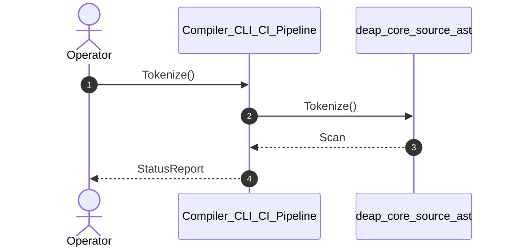

| Attribute | Specification Detail |
| :--- | :--- |
| **Issue ID** | #607 |
| **Title** | User Story 46: Tokenize |
| **Type** | user-story |
| **Parent Epic** | [EPIC-05-BP_05_Unified_AST_Safety_Docstring_Synthesizer_and_Check_36_Verification_Blueprint](../epics/EPIC-05-BP_05_Unified_AST_Safety_Docstring_Synthesizer_and_Check_36_Verification_Blueprint.md) |
| **SysML Interaction** | `BP_05_Unified_AST_Safety_Docstring_Synthesizer_and_Check_36_Verification_Blueprint_SequenceInteraction` |
| **SysML Test Case** | `Test_Tokenize` |
| **Generation Mode** | subagent |
| **Specification Source** | [schema/subsystems/b_p_05_unified_a_s_t_safety_docstring_synthesizer_and_check_36_verification_blueprint/behavior.sysml](../../schema/subsystems/b_p_05_unified_a_s_t_safety_docstring_synthesizer_and_check_36_verification_blueprint/behavior.sysml) |

# User Story 46: Tokenize

## UML Sequence Diagram

## Acceptance Criteria (BDD)
- [ ] AC-US-46-01: Given operational environment initialized, When Tokenize executes, Then deap_core_source_ast processes the AST within defined latency envelope.
- [ ] AC-US-46-02: Given formal constraints, When semantic validator executes, Then asserts invariant satisfaction.
- [ ] AC-US-46-03: Given exceptional conditions, When error recovery activates, Then graceful recovery occurs without data loss.

## Required Features
- [ ] #655 - [Feature 01: [BP 01 Compiler Enforced Forbid Lint Gate and Zero Suppression AST Architecture Blueprint] CompilerLintEnforcementGate](../features/FEAT-01-CompilerLintEnforcementGate.md)
- [ ] [Feature 21: [BP 05 Unified AST Safety Docstring Synthesizer and Check 36 Verification Blueprint] deap_core_source_ast](../features/FEAT-21-deap_core_source_ast.md)

## Source References
Operational concept definitions and system sequence interaction models:
- Subsystem Behavior Specification: `schema/subsystems/b_p_05_unified_a_s_t_safety_docstring_synthesizer_and_check_36_verification_blueprint/behavior.sysml`
- ConOps Operational Activities: `schema/conops/activities.sysml`
- System Architecture Model: `schema/model.sysml`
- Normative Systems Engineering Standard: ISO/IEC/IEEE 29148:2018 §6.4.2 Concept of Operations

Authoritative user story flows and interaction lifelines derive from `schema/subsystems/b_p_05_unified_a_s_t_safety_docstring_synthesizer_and_check_36_verification_blueprint/behavior.sysml` pursuant to ISO/IEC/IEEE 29148.
