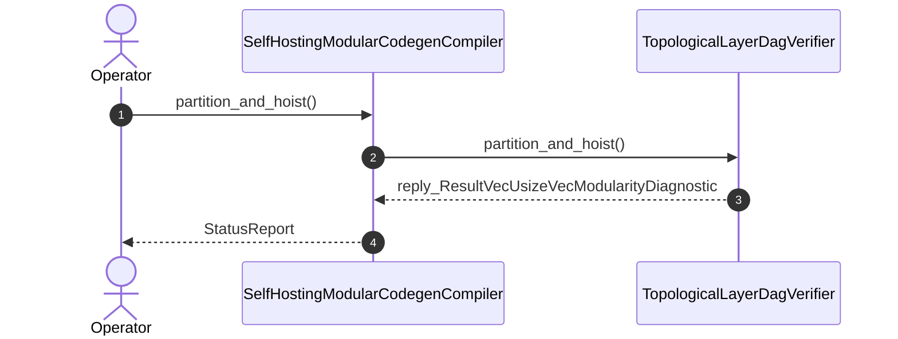

| Attribute | Specification Detail |
| :--- | :--- |
| **Issue ID** | #796 |
| **Title** | User Story 46: Partition And Hoist |
| **Type** | user-story |
| **Parent Epic** | [EPIC-07-BP_07_Self_Hosting_4_Level_Modular_Multi_File_Code_Generator_Blueprint](../epics/EPIC-07-BP_07_Self_Hosting_4_Level_Modular_Multi_File_Code_Generator_Blueprint.md) (#852) |
| **SysML Interaction** | `BP_07_Self_Hosting_4_Level_Modular_Multi_File_Code_Generator_Blueprint_SequenceInteraction` |
| **SysML Test Case** | `Test_partition_and_hoist` |
| **Generation Mode** | subagent |
| **Specification Source** | [schema/model.sysml](../../schema/model.sysml) |

# User Story 46: Partition And Hoist

## User Story
As a `SelfHostingModularCodegenCompiler`, I want to invoke `partition_and_hoist()` on `TopologicalLayerDagVerifier`, so that `partition_and_hoist(pkg)` lowers full OMG SysML v2.0 + KerML 1.0 package hierarchies across Levels 1 through 4 (package directories, classifier facets, chunked action/state handlers, and ANF boolean expression helpers) within `C_MOD_01..03` bounds.

## Architectural Realization (3-Layer Definition of Done)

### Layer 1: Domain State & Data Model
- Domain state attributes on `TopologicalLayerDagVerifier`: `max_layer_tier: Integer`, `zero_recursion_kahn: Boolean`, `Blueprint_ID: String`, `Requirement_ID: String`, `Title: String`, `Status: String`, `Target_Crates: String`, `Tracked_Issues: String`, `Generation_Mode: String`, `Specification_Source: String`, `crates_compile_sysml_src_driver_rs: String`, `crates_compile_sysml_src_flutter_codegen_rs: String`, `compile_sysml_codegen_ast_token_builder: String`, `compile_sysml_codegen_ast_pretty_emitter: String`, `compile_sysml_codegen_ast_fixed_point_gate: String`, `deap_core_rust_cst_extract_module: String`, `max_file_lines: Real`, `max_items_per_file: Real`, `max_cyclomatic_complexity: Real`, `stage_fixed_point_mismatch_files: Real`, `runtime_llm_subagent_count: Real`.
- **Contract A (100% Normative OMG SysML v2.0 + KerML 1.0 Grammar Coverage -- Zero 16-Construct Caps)**: Lowers full Definition and Usage symmetry across all OMG SysML v2.0 and KerML 1.0 constructs (`package`/`library package`/`standard library package`, `import`, `metadata def`/`@Metadata`/`#capability`/`#hazard`/`#risk`/`#rt_loop`/`#dal`/`#fls` and backward-compatible `hazard def`/`risk def`/`capability def`, `part def`/`part`, `item def`/`item`, `attribute def`/`attribute`, `enum def`/`enum`, `port def`/`port`, `connection def`/`connection`, `interface def`/`interface`, `flow def`/`flow`, `allocation def`/`allocation`, `occurrence def`/`occurrence`, `action def`/`action`, `state def`/`state`, `calc def`/`calc`, `constraint def`/`constraint`, `requirement def`/`requirement`, `concern def`/`concern`, `use case def`/`use case`, `analysis def`/`analysis`, `verification def`/`verification`, `test case def`/`test case`, `interaction def`/`interaction`, `view def`/`view`, `viewpoint def`/`viewpoint`, `rendering def`/`rendering`, `variation`/`variant`, and KerML specialization/multiplicity/expressions) via `deap_core::sysml_cst` (`logos` + `rowan` + `salsa` + `ariadne`).
- Action `partition_and_hoist` invocation message envelope bound to `TopologicalLayerDagVerifier` typed domain schema.
- Declared lifecycle state model: `BP_07_Self_Hosting_4_Level_Modular_Multi_File_Code_Generator_Blueprint_LifecycleState`, `Idle`, `VerifyingDagAndLayers`, `RejectedFailClosed`, `LoweringFourLevels`, `SynthesizingInMemoryUnits`, `BuildingSynAst`, `FormattingPrettyPlease`, `AtomicTreePersisted`, `VerifyingSelfHostFixedPoint`, `VerifiedFixedPoint`.

### Layer 2: Logic & State Management
- Behavioral execution contract: invokes `partition_and_hoist()` on `TopologicalLayerDagVerifier` with atomic precondition verification across 4 lowering levels (`max_action_steps_per_stage = 6`, `max_transitions_per_handler = 6`, `anf_branch_budget = 6`).
- State transition management: `Idle -> VerifyingDagAndLayers` (trigger `loadPackageAst`).
- Formal constraints and requirements enforced: `C_MOD_01 (max_file_lines >= 50 and max_file_lines <= 400)`, `C_MOD_02 (max_items_per_file >= 1 and max_items_per_file <= 12)`, `C_MOD_03 (max_cyclomatic_complexity >= 1 and max_cyclomatic_complexity <= 8)`, `C_MOD_04 (stage_fixed_point_mismatch_files >= 0 and stage_fixed_point_mismatch_files <= 0)`, `C_MOD_05 (runtime_llm_subagent_count >= 0 and runtime_llm_subagent_count <= 0)`, `REQ-0607 (REQ_0607_BP_07_Self_Hosting_4_Level_Modular_Multi_File_Code_Generator_Blueprint)`.
- **Contract B & Submodule Modularity Ratchet (`< 380` SLOC)**: Enforces `syn` + `proc-macro2` + `quote` + `prettyplease` deterministic fixed-point Rust codegen (`SHA-256(Stage 1) == SHA-256(Stage 2)`) and `ra_ap_syntax` lossless CST analysis with zero hand-rolled string/line/char-by-char scanners, bounding implementation inside `< 380` exec SLOC submodules (`./crates/compile-sysml/src/modular_codegen/` and `./crates/deap-core/src/rust_cst/`) while explicitly deleting legacy hand-rolled scanners and string-concatenation codegen templates in `./crates/compile-sysml/src/driver.rs` (`-450+` SLOC) and `./crates/compile-sysml/src/flutter_codegen.rs` (`-650+` SLOC).

### Layer 3: Presentation & Actuator Interface Binding
- Component port bindings on `TopologicalLayerDagVerifier`: `dependency_edges_in: String (in)`, `topological_order_out: String (out)`.
- Interaction binding (`BP_07_Self_Hosting_4_Level_Modular_Multi_File_Code_Generator_Blueprint_SequenceInteraction`): routes `partition_and_hoist` invocation from `SelfHostingModularCodegenCompiler` to `TopologicalLayerDagVerifier` and returns `reply_ResultVecUsizeVecModularityDiagnostic`.
- Diagnostic fault surface: reports deterministic rejection diagnostics to `SelfHostingModularCodegenCompiler` across the declared interface boundary when guard or invariant checks fail.

## UML Sequence Diagram

## Acceptance Criteria (BDD)
- [ ] AC-US-46-01: Given `TopologicalLayerDagVerifier` is in declared state `Idle` with domain state attributes (`max_layer_tier: Integer`, `zero_recursion_kahn: Boolean`), When `SelfHostingModularCodegenCompiler` invokes `partition_and_hoist` on `TopologicalLayerDagVerifier`, Then `TopologicalLayerDagVerifier` validates and binds the request against `TopologicalLayerDagVerifier` domain state (`max_layer_tier: Integer`, `zero_recursion_kahn: Boolean`) and transitions to `VerifyingDagAndLayers`.
- [ ] AC-US-46-02: Given `TopologicalLayerDagVerifier` active state management during `partition_and_hoist`, When `TopologicalLayerDagVerifier` evaluates formal constraint `C_MOD_01 (max_file_lines >= 50 and max_file_lines <= 400)`, Then `TopologicalLayerDagVerifier` verifies constraint satisfaction before committing state updates.
- [ ] AC-US-46-03: Given `TopologicalLayerDagVerifier` active state management during `partition_and_hoist`, When `TopologicalLayerDagVerifier` evaluates formal constraint `C_MOD_02 (max_items_per_file >= 1 and max_items_per_file <= 12)`, Then `TopologicalLayerDagVerifier` verifies constraint satisfaction before committing state updates.
- [ ] AC-US-46-04: Given `TopologicalLayerDagVerifier` active state management during `partition_and_hoist`, When `TopologicalLayerDagVerifier` evaluates formal constraint `C_MOD_03 (max_cyclomatic_complexity >= 1 and max_cyclomatic_complexity <= 8)`, Then `TopologicalLayerDagVerifier` verifies constraint satisfaction before committing state updates.
- [ ] AC-US-46-05: Given `TopologicalLayerDagVerifier` active state management during `partition_and_hoist`, When `TopologicalLayerDagVerifier` evaluates formal constraint `C_MOD_04 (stage_fixed_point_mismatch_files >= 0 and stage_fixed_point_mismatch_files <= 0)`, Then `TopologicalLayerDagVerifier` verifies constraint satisfaction before committing state updates.
- [ ] AC-US-46-06: Given `TopologicalLayerDagVerifier` active state management during `partition_and_hoist`, When `TopologicalLayerDagVerifier` evaluates formal constraint `C_MOD_05 (runtime_llm_subagent_count >= 0 and runtime_llm_subagent_count <= 0)`, Then `TopologicalLayerDagVerifier` verifies constraint satisfaction before committing state updates.
- [ ] AC-US-46-07: Given `TopologicalLayerDagVerifier` ingress port binding (`dependency_edges_in: String`), When `TopologicalLayerDagVerifier` completes `partition_and_hoist`, Then `TopologicalLayerDagVerifier` delivers `reply_ResultVecUsizeVecModularityDiagnostic` across egress port (`topological_order_out: String`) to `SelfHostingModularCodegenCompiler`.
- [ ] AC-US-46-08: Given violated formal constraint `C_MOD_01 (max_file_lines >= 50 and max_file_lines <= 400)`, When `SelfHostingModularCodegenCompiler` invokes `partition_and_hoist` on `TopologicalLayerDagVerifier`, Then `TopologicalLayerDagVerifier` rejects the request without partial state mutation, preserves prior verified state, and emits a deterministic fault diagnostic across the interface binding.

## Required Features
- [ ] #832 - [Feature 34: [BP 07 Self Hosting 4 Level Modular Multi File Code Generator Blueprint] SelfHostingModularCodegenCompiler](../features/FEAT-34-SelfHostingModularCodegenCompiler.md)
- [ ] #833 - [Feature 35: [BP 07 Self Hosting 4 Level Modular Multi File Code Generator Blueprint] TopologicalLayerDagVerifier](../features/FEAT-35-TopologicalLayerDagVerifier.md)

## Source References
Operational concept definitions and system sequence interaction models:
- System Architecture Model: `schema/model.sysml`
- Normative Systems Engineering Standard: ISO/IEC/IEEE 29148:2018 §6.4.2 Concept of Operations

Authoritative user story flows and interaction lifelines derive from `schema/model.sysml` pursuant to ISO/IEC/IEEE 29148.
