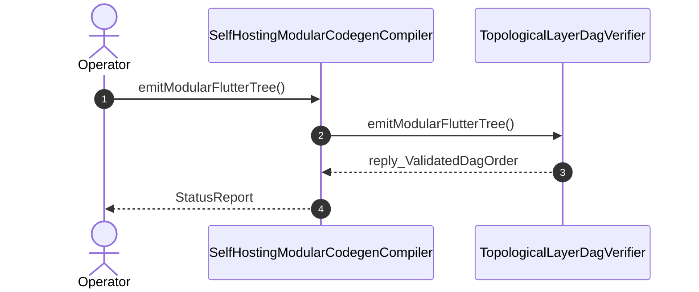

| Attribute | Specification Detail |
| :--- | :--- |
| **Issue ID** | TBD |
| **Title** | User Story 48: emit Modular Flutter Tree |
| **Type** | user-story |
| **Parent Epic** | [EPIC-07-BP_07_Self_Hosting_4_Level_Modular_Multi_File_Code_Generator_Blueprint](../epics/EPIC-07-BP_07_Self_Hosting_4_Level_Modular_Multi_File_Code_Generator_Blueprint.md) |
| **SysML Interaction** | `BP_07_Self_Hosting_4_Level_Modular_Multi_File_Code_Generator_Blueprint_SequenceInteraction` |
| **SysML Test Case** | `Test_emitModularFlutterTree` |
| **Generation Mode** | subagent |
| **Specification Source** | [schema/model.sysml](../../schema/model.sysml) |

# User Story 48: emit Modular Flutter Tree

## User Story

As a `SelfHostingModularCodegenCompiler`, I want to invoke `emitModularFlutterTree()` on `TopologicalLayerDagVerifier`, so that emitModularFlutterTree(graph).

## Architectural Realization (3-Layer Definition of Done)

### Layer 1: Domain State & Data Model
- Domain state attributes on `TopologicalLayerDagVerifier`: `max_layer_tier: Integer`, `zero_recursion_kahn: Boolean`, `Blueprint_ID: String`, `Requirement_ID: String`, `Title: String`, `Status: String`, `Target_Crates: String`, `Tracked_Issues: String`, `Generation_Mode: String`, `Specification_Source: String`, `max_file_lines: Real`, `max_items_per_file: Real`, `max_cyclomatic_complexity: Real`, `stage_fixed_point_mismatch_files: Real`, `runtime_llm_subagent_count: Real`.
- Action `emitModularFlutterTree` invocation message envelope bound to `TopologicalLayerDagVerifier` typed domain schema.
- Declared lifecycle state model: `BP_07_Self_Hosting_4_Level_Modular_Multi_File_Code_Generator_Blueprint_LifecycleState`, `Idle`, `VerifyingDagAndLayers`, `RejectedFailClosed`, `LoweringFourLevels`, `SynthesizingInMemoryUnits`, `AtomicTreePersisted`, `VerifyingSelfHostFixedPoint`, `VerifiedFixedPoint`, `ModularCodegenLifecycle`, `ResolvingLayers`, `VerifyingDag`, `PartitioningPackages`, `AbortedFailClosed`, `SplittingFacets`, `OutliningBehaviors`, `HoistingPredicates`, `SynthesizingTree`, `VerifyingBounds`, `PersistingAtomic`, `Verified`.

### Layer 2: Logic & State Management
- Behavioral execution contract: invokes `emitModularFlutterTree()` on `TopologicalLayerDagVerifier` with atomic precondition verification.
- State transition management: `Idle -> VerifyingDagAndLayers` (trigger `loadPackageAst`).
- Formal constraints and requirements enforced: `C_MOD_01 (max_file_lines >= 50 and max_file_lines <= 400)`, `C_MOD_02 (max_items_per_file >= 1 and max_items_per_file <= 12)`, `C_MOD_03 (max_cyclomatic_complexity >= 1 and max_cyclomatic_complexity <= 8)`, `C_MOD_04 (stage_fixed_point_mismatch_files >= 0 and stage_fixed_point_mismatch_files <= 0)`, `C_MOD_05 (runtime_llm_subagent_count >= 0 and runtime_llm_subagent_count <= 0)`, `REQ-0607 (REQ_0607_BP_07_Self_Hosting_4_Level_Modular_Multi_File_Code_Generator_Blueprint)`.

### Layer 3: Presentation & Actuator Interface Binding
- Component port bindings on `TopologicalLayerDagVerifier`: `dependency_edges_in: String (in)`, `topological_order_out: String (out)`.
- Interaction binding (`BP_07_Self_Hosting_4_Level_Modular_Multi_File_Code_Generator_Blueprint_SequenceInteraction`): routes `emitModularFlutterTree` invocation from `SelfHostingModularCodegenCompiler` to `TopologicalLayerDagVerifier` and returns `reply_ValidatedDagOrder`.
- Diagnostic fault surface: reports deterministic rejection diagnostics to `SelfHostingModularCodegenCompiler` across the declared interface boundary when guard or invariant checks fail.

## UML Sequence Diagram

## Acceptance Criteria (BDD)
- [ ] AC-US-48-01: Given `TopologicalLayerDagVerifier` is in declared state `Idle` with domain state attributes (`max_layer_tier: Integer`, `zero_recursion_kahn: Boolean`), When `SelfHostingModularCodegenCompiler` invokes `emitModularFlutterTree` on `TopologicalLayerDagVerifier`, Then `TopologicalLayerDagVerifier` validates and binds the request against `TopologicalLayerDagVerifier` domain state (`max_layer_tier: Integer`, `zero_recursion_kahn: Boolean`) and transitions to `VerifyingDagAndLayers`.
- [ ] AC-US-48-02: Given `TopologicalLayerDagVerifier` active state management during `emitModularFlutterTree`, When `TopologicalLayerDagVerifier` evaluates formal constraint `C_MOD_01 (max_file_lines >= 50 and max_file_lines <= 400)`, Then `TopologicalLayerDagVerifier` verifies constraint satisfaction before committing state updates.
- [ ] AC-US-48-03: Given `TopologicalLayerDagVerifier` active state management during `emitModularFlutterTree`, When `TopologicalLayerDagVerifier` evaluates formal constraint `C_MOD_02 (max_items_per_file >= 1 and max_items_per_file <= 12)`, Then `TopologicalLayerDagVerifier` verifies constraint satisfaction before committing state updates.
- [ ] AC-US-48-04: Given `TopologicalLayerDagVerifier` active state management during `emitModularFlutterTree`, When `TopologicalLayerDagVerifier` evaluates formal constraint `C_MOD_03 (max_cyclomatic_complexity >= 1 and max_cyclomatic_complexity <= 8)`, Then `TopologicalLayerDagVerifier` verifies constraint satisfaction before committing state updates.
- [ ] AC-US-48-05: Given `TopologicalLayerDagVerifier` active state management during `emitModularFlutterTree`, When `TopologicalLayerDagVerifier` evaluates formal constraint `C_MOD_04 (stage_fixed_point_mismatch_files >= 0 and stage_fixed_point_mismatch_files <= 0)`, Then `TopologicalLayerDagVerifier` verifies constraint satisfaction before committing state updates.
- [ ] AC-US-48-06: Given `TopologicalLayerDagVerifier` active state management during `emitModularFlutterTree`, When `TopologicalLayerDagVerifier` evaluates formal constraint `C_MOD_05 (runtime_llm_subagent_count >= 0 and runtime_llm_subagent_count <= 0)`, Then `TopologicalLayerDagVerifier` verifies constraint satisfaction before committing state updates.
- [ ] AC-US-48-07: Given `TopologicalLayerDagVerifier` ingress port binding (`dependency_edges_in: String`), When `TopologicalLayerDagVerifier` completes `emitModularFlutterTree`, Then `TopologicalLayerDagVerifier` delivers `reply_ValidatedDagOrder` across egress port (`topological_order_out: String`) to `SelfHostingModularCodegenCompiler`.
- [ ] AC-US-48-08: Given violated formal constraint `C_MOD_01 (max_file_lines >= 50 and max_file_lines <= 400)`, When `SelfHostingModularCodegenCompiler` invokes `emitModularFlutterTree` on `TopologicalLayerDagVerifier`, Then `TopologicalLayerDagVerifier` rejects the request without partial state mutation, preserves prior verified state, and emits a deterministic fault diagnostic across the interface binding.

## Required Features
- [ ] [Feature 39: [BP 07 Self Hosting 4 Level Modular Multi File Code Generator Blueprint] SelfHostingModularCodegenCompiler](../features/FEAT-39-SelfHostingModularCodegenCompiler.md)
- [ ] [Feature 40: [BP 07 Self Hosting 4 Level Modular Multi File Code Generator Blueprint] TopologicalLayerDagVerifier](../features/FEAT-40-TopologicalLayerDagVerifier.md)

## Source References
Operational concept definitions and system sequence interaction models:
- System Architecture Model: `schema/model.sysml`
- Normative Systems Engineering Standard: ISO/IEC/IEEE 29148:2018 §6.4.2 Concept of Operations

Authoritative user story flows and interaction lifelines derive from `schema/model.sysml` pursuant to ISO/IEC/IEEE 29148.
