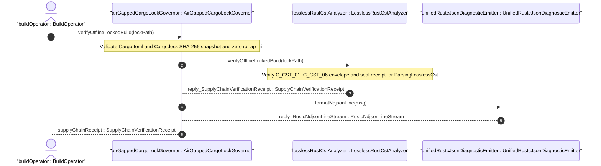
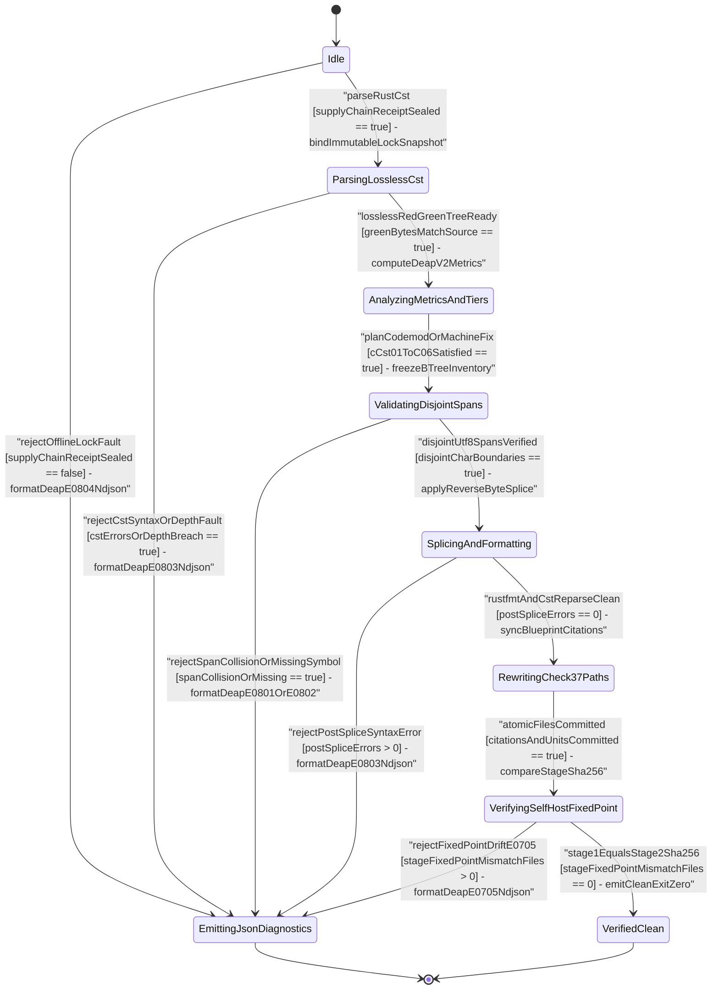

| Attribute | Specification Detail |
| :--- | :--- |
| **Issue ID** | TBD |
| **Title** | User Story 51: verify Offline Locked Build |
| **Type** | user-story |
| **Parent Epic** | [EPIC-08-BP_08_Lossless_Rust_CST_Codemod_Engine_and_Unified_rustc_Compatible_JSON_Diagnostics](../epics/EPIC-08-BP_08_Lossless_Rust_CST_Codemod_Engine_and_Unified_rustc_Compatible_JSON_Diagnostics.md) |
| **SysML Interaction** | `BP_08_Lossless_Rust_CST_Codemod_Engine_and_Unified_rustc_Compatible_JSON_Diagnostics_SequenceInteraction` |
| **SysML Test Case** | `Test_verifyOfflineLockedBuild` |
| **Generation Mode** | subagent |
| **Specification Source** | [schema/model.sysml](../../schema/model.sysml) |

# User Story 51: verify Offline Locked Build

## Parent Epic
- [ ] [EPIC-08-BP_08_Lossless_Rust_CST_Codemod_Engine_and_Unified_rustc_Compatible_JSON_Diagnostics](../epics/EPIC-08-BP_08_Lossless_Rust_CST_Codemod_Engine_and_Unified_rustc_Compatible_JSON_Diagnostics.md) (establishes air-gapped DO-330 TQL-4 offline dependency lock governance before lossless `ra_ap_syntax` and `rowan` CST analysis or codemod execution)

## Domain Object Mapping
- **Primary Domain Objects:** `AirGappedCargoLockGovernor`, `LosslessRustCstAnalyzer`, `UnifiedRustcJsonDiagnosticEmitter` (package `BP_08_Lossless_Rust_CST_Codemod_Engine_and_Unified_rustc_Compatible_JSON_Diagnostics` in `schema/model.sysml` and `docs/designs/blueprint-08-rust-analyzer-cst-refactoring-and-json-diagnostics.sysml`).
- **Actor/Role:** `BuildOperator` (external air-gapped DO-330 TQL-4 build runner invoking `verify-baseline` and workspace `--offline --locked` supply-chain gates).
- **Architectural & Subsystem Tracing:** Traces from **REQ-0608** (`BP-08` / `DEAP-BP-DET-08`, UUIDv5 `6ba7b810-9dad-11d1-80b4-00c04fd430c8`) and `UC_AC_07_Air_Gapped_Offline_Cargo_Lock_Reproducibility_and_Twelve_Gate_Blueprint_Conformance` through `FEAT-41` (`AirGappedCargoLockGovernor`), `FEAT-42` (`LosslessRustCstAnalyzer`), and `FEAT-44` (`UnifiedRustcJsonDiagnosticEmitter`) into `crates/deap-core/src/workspace.rs`, `crates/deap-core/src/source_ast.rs`, `crates/deap-core/src/diagnostics.rs`, and `crates/verify-baseline/src/blueprint_gate.rs`.

## User Story

**As an** `AirGappedCargoLockGovernor` acting on behalf of an air-gapped `BuildOperator`,
**I want to** invoke `verifyOfflineLockedBuild(lockPath)` against an immutable `Cargo.toml` and `Cargo.lock` snapshot and seal a `SupplyChainVerificationReceipt` with `LosslessRustCstAnalyzer`,
**So that** all six workspace crates (`deap-core`, `compile-sysml`, `verify-baseline`, `ingest-sysml`, `assemble-conops`, `reconcile-backlog`) execute reproducibly under `--offline --locked` (`cargo vendor`-compatible) with SHA-256-pinned lightweight syntax crates (`ra_ap_syntax`, `rowan`, `syn`, `quote`, `prettyplease`), zero heavyweight semantic solver dependencies (`ra_ap_hir`), verified **C_CST_01**..**C_CST_06** complexity bounds, and fail-closed single-line `rustc`-compatible NDJSON diagnostics (**DEAP-E0804** / **DEAP-E0803**).

### Core BDD Realization (OOA/OOD)
- **Given** `AirGappedCargoLockGovernor` holds immutable `offline_locked_enforced == true` and `vendor_bundle_supported == true` and `LosslessRustCstAnalyzer` resides in lifecycle state `Idle` with **C_CST_01**..**C_CST_06** thresholds configured,
- **When** `BuildOperator` triggers `verifyOfflineLockedBuild(lockPath)` on `AirGappedCargoLockGovernor` over `manifest_lock_in` (`CargoTomlAndLockfile` protocol),
- **Then** `AirGappedCargoLockGovernor` validates 64-hex-digit SHA-256 package checksums, confirms `ra_ap_syntax`, `rowan`, `syn`, `quote`, and `prettyplease` pinning with zero `ra_ap_hir` crate presence, verifies `--offline --locked` workspace build readiness across all six crates, transitions `LosslessRustCstAnalyzer` to `ParsingLosslessCst` (`parseRustCst`), and emits `reply_SupplyChainVerificationReceipt` on `lock_receipt_out`.

## Architectural Realization (3-Layer Definition of Done)

### Layer 1: Domain State & Data Model
- **Target Domain Modules:** `crates/deap-core/src/workspace.rs` and `crates/deap-core/src/source_ast.rs` compiled under `#![forbid(unsafe_code)]`.
- **Deterministic Ordered Collections & Value Snapshots:**
  - `LockManifestSnapshot`: immutable snapshot storing canonicalized workspace `Cargo.toml` and `Cargo.lock` SHA-256 digests (`[u8; 32]`), deterministic `BTreeMap<String, LockedPackageRecord>` keyed lexically by `"<crate>@<version>"`, workspace member `BTreeSet<String>` (`deap-core`, `compile-sysml`, `verify-baseline`, `ingest-sysml`, `assemble-conops`, `reconcile-backlog`), `offline_locked_enforced: bool`, and `vendor_bundle_supported: bool`.
  - `LockedPackageRecord`: stores exact SemVer identifier, validated 64-hex-digit SHA-256 archive digest, `PackageSourceKind` (`RegistryLocked`, `WorkspacePath`, `VendoredBundle`), and `BTreeSet<String>` directed dependency edges.
  - `CstComplexityEnvelope` & `SupplyChainVerificationReceipt`: binds `LosslessRustCstAnalyzer` domain attributes (`max_fn_exec_sloc: u32`, `max_fn_param_count: u32`, `max_mut_bool_flags: u32`, `max_predicate_arity: u32`, `stage_fixed_point_mismatch_files: u32`, `runtime_llm_token_count: u32`, `tier_bc_max_doc_lines: u32`, `lossless_roundtrip_required: bool`, `deterministic_uuid: String`) to a cryptographically sealed receipt token required before entering `ParsingLosslessCst`.
- **Typed Domain Error Taxonomy (Zero Stringly-Typed Errors):**
  - `OfflineLockGovernanceError` (deriving `Debug`, `Clone`, `PartialEq`, and `Eq` in `crates/deap-core/src/workspace.rs`, zero stringly-typed `Err` payloads): explicit variants `LockPolicyDisabled`, `ManifestSizeCeilingExceeded`, `MalformedTomlOrLockSyntax`, `UnpinnedGitOrWildcardSpecifier`, `ForbiddenSemanticDependencyDetected` (blocking `ra_ap_hir`, `ra_ap_ide`, and root-workspace `rustc_private`), `MissingRequiredCstDependency`, `InvalidSha256ChecksumHex`, `PackageGraphDepthOrCycleExceeded`, `ManifestToLockDriftDetected`, `CstConstraintEnvelopeViolation`, and `OfflineCargoCheckFailed`, each mapping deterministically to **DEAP-E0804** or **DEAP-E0803**.
- **Lifecycle State Model:** `BP_08_Lossless_Rust_CST_Codemod_Engine_and_Unified_rustc_Compatible_JSON_Diagnostics_LifecycleState` (`Idle`, `ParsingLosslessCst`, `AnalyzingMetricsAndTiers`, `ValidatingDisjointSpans`, `EmittingJsonDiagnostics`, `SplicingAndFormatting`, `RewritingCheck37Paths`, `VerifyingSelfHostFixedPoint`, `VerifiedClean`).

### Layer 2: Logic & State Management
- **Total Function & Complexity Bounds:** Every verification and state-transition function in `crates/deap-core/src/workspace.rs`, `crates/deap-core/src/source_ast.rs`, and `crates/verify-baseline/src/blueprint_gate.rs` is a non-panicking total function satisfying `<= 50` executable SLOC (**C_CST_01**, strictly within the `<= 80` executable SLOC workspace ceiling), `<= 5` formal parameters (**C_CST_02**, excluding `&self`), `0` mutable boolean local flags (**C_CST_03** `max_mut_bool_flags == 0`), compound boolean predicate arity `<= 3`, and `cfg(test)`-excluded production SLOC accounting.
- **Bounds-Safe Indexing, Depth Ceiling & Checked Arithmetic:** Enforces iterative dependency-graph and CST pre-check traversal capped at `MAX_AST_DEPTH = 64` (**FM-BP08-003**, **FM-BP08-007**), slice and collection lookups exclusively via `.get()` indexing (zero unchecked bracket indexing, zero `.unwrap()` or `.expect()` in production paths), and `checked_add` / `saturating_add` / `saturating_sub` across manifest byte totals, `[[package]]` counters, and traversal depth accumulators.
- **Air-Gapped Pinning & Forbidden Crate Firewall:** Mandates `offline_locked_enforced == true` and `vendor_bundle_supported == true` (**SC-BP08-01**), verifies that `ra_ap_syntax`, `rowan`, `syn`, `quote`, and `prettyplease` resolve to locked registry/vendored entries carrying 64-hex-digit SHA-256 checksums, rejects `ra_ap_hir` and unpinned git/wildcard dependencies fail-closed, and enforces formal constraints **C_CST_01**..**C_CST_06** under **REQ-0608**.
- **Deterministic State Transition Guards:** Gates `Idle -> ParsingLosslessCst` (`parseRustCst`) strictly on an immutable, hash-verified `SupplyChainVerificationReceipt` (**SC-BP08-02**); any **FM-BP08-001**..**FM-BP08-004** or **FM-BP08-005**..**FM-BP08-007** fault short-circuits directly to `EmittingJsonDiagnostics` without mutating analyzer state or workspace files.

### Layer 3: Presentation & Actuator Interface Binding
- **SysML Port & Protocol Realization:**
  - `AirGappedCargoLockGovernor`: ingress port `manifest_lock_in` (`CargoTomlAndLockfile` protocol) and egress port `lock_receipt_out` (`SupplyChainVerificationReceipt` protocol).
  - `LosslessRustCstAnalyzer`: ingress port `rust_source_in` (`Utf8RustSourceBuffer` protocol) and egress ports `item_inventory_out` (`BTreeOrderedItemInventory` protocol) and `metrics_report_out` (`DeapV2AstMetricsReport` protocol), unlocked only after `verifyOfflineLockedBuild` returns `reply_SupplyChainVerificationReceipt`.
- **CLI & `--message-format=json` NDJSON Actuator Binding:**
  - Wired into `crates/verify-baseline/src/blueprint_gate.rs` (`verify-baseline check-blueprint` and workspace baseline runner) and `crates/deap-core/src/diagnostics.rs` (`UnifiedRustcJsonDiagnosticEmitter::formatNdjsonLine`).
  - Executes `cargo check --workspace --offline --locked` with network access disabled (`CARGO_NET_OFFLINE=true`), suppresses premature receipt emission until all six workspace crates pass (**SC-BP08-04**), and when `--message-format=json` is active emits strictly single-line (`0` embedded `0x0A` bytes), zero-ANSI (`0` `0x1B` escape bytes) `rustc`-compatible JSON records (`{"reason":"compiler-message","message":{"code":{"code":"DEAP-E0804"},...}}`) under an exclusive stdout line lock before exiting with code `1` on rejection or `0` on `VerifiedClean`.

## Target Rust Modules & Atomic Implementation Micro-Tasks

1. **Micro-Task `MT-US51-01` (Domain Snapshot & Typed Error Model)**
   - **Target Module:** `crates/deap-core/src/workspace.rs` (referencing AST metadata contracts in `crates/deap-core/src/sysml_ast/mod.rs`)
   - **Callable Signature:** `pub fn parse_locked_manifest_snapshot(cargo_toml_bytes: &[u8], cargo_lock_bytes: &[u8], vendor_cfg_bytes: Option<&[u8]>, max_lock_bytes: usize) -> Result<LockManifestSnapshot, OfflineLockGovernanceError>` (`4` params, `<= 46` exec SLOC, `0` `mut bool` flags).
   - **Contract & Verification:** Enforces `#![forbid(unsafe_code)]`, checks byte ceilings via `.get(..max_lock_bytes)` and `saturating_add` / `checked_add`, computes immutable SHA-256 manifest/lock digests, populates `BTreeMap<String, LockedPackageRecord>`, and rejects disabled offline/vendor policies or malformed TOML syntax with `OfflineLockGovernanceError`. Unit tested inside an isolated `cfg(test)` module via native Rust unit-test functions covering nominal parsing and byte-ceiling overflow.
   - **Traceability:** `[REQ-0608]`, `[FLS: fls_8tsynkj2cufj]`, **SC-BP08-01**, **SC-BP08-03**.

2. **Micro-Task `MT-US51-02` (Pinned CST Supply-Chain, SHA-256 Checksum & Zero-`ra_ap_hir` Graph Verifier)**
   - **Target Module:** `crates/deap-core/src/workspace.rs`
   - **Callable Signature:** `pub fn verify_pinned_cst_dependency_graph(snapshot: &LockManifestSnapshot, required_crates: &BTreeSet<String>, forbidden_crates: &BTreeSet<String>, max_depth: usize) -> Result<BTreeSet<String>, OfflineLockGovernanceError>` (`4` params, `<= 48` exec SLOC, `0` `mut bool` flags).
   - **Contract & Verification:** Iteratively traverses `Cargo.lock` `[[package]]` edges up to `MAX_AST_DEPTH = 64` (`max_depth <= 64`) using `.get()` lookups and `saturating_add` depth tracking; verifies 64-hex-digit SHA-256 `checksum` presence on every registry crate; confirms exact pinning of `ra_ap_syntax`, `rowan`, `syn`, `quote`, and `prettyplease`; rejects `ra_ap_hir`, `ra_ap_ide`, root `rustc_private`, and git/wildcard specifiers fail-closed (**DEAP-E0804**). Verified by isolated `cfg(test)` fault-injection unit-test fixtures.
   - **Traceability:** `[REQ-0608]`, `[FLS: fls_qcb1n9c0e5hz]`, **SC-BP08-01**, **SC-BP08-02**, **SC-BP08-03**.

3. **Micro-Task `MT-US51-03` (CST Complexity Envelope Guard & Sealed Receipt Handshake)**
   - **Target Module:** `crates/deap-core/src/source_ast.rs`
   - **Callable Signature:** `pub fn verify_analyzer_envelope_and_seal_receipt(snapshot: &LockManifestSnapshot, verified_crates: &BTreeSet<String>, envelope: &CstComplexityEnvelope) -> Result<SupplyChainVerificationReceipt, OfflineLockGovernanceError>` (`3` params, `<= 44` exec SLOC, `0` `mut bool` flags).
   - **Contract & Verification:** Evaluates **C_CST_01** (`1 <= max_fn_exec_sloc <= 50`), **C_CST_02** (`0 <= max_fn_param_count <= 5`), **C_CST_03** (`max_mut_bool_flags == 0`), **C_CST_04** (`stage_fixed_point_mismatch_files == 0`), **C_CST_05** (`runtime_llm_token_count == 0`), **C_CST_06** (`tier_bc_max_doc_lines == 2`), `max_predicate_arity == 3` (`rt_loop`-compatible pure total predicates), `lossless_roundtrip_required == true`, and `deterministic_uuid == "6ba7b810-9dad-11d1-80b4-00c04fd430c8"`, returning a sealed `SupplyChainVerificationReceipt` authorizing `Idle -> ParsingLosslessCst`.
   - **Traceability:** `[REQ-0608]`, `[FLS: fls_izdv9i4spokw]`, **SC-BP08-02**, **SC-BP08-05**.

4. **Micro-Task `MT-US51-04` (Air-Gapped `--offline --locked` Runner & Single-Line NDJSON Diagnostic Binding)**
   - **Target Module:** `crates/verify-baseline/src/blueprint_gate.rs` (emitting diagnostics through `crates/deap-core/src/diagnostics.rs`)
   - **Callable Signature:** `pub fn run_offline_locked_workspace_gate(workspace_root: &Path, lock_rel_path: &Path, json_mode: bool) -> Result<SupplyChainVerificationReceipt, OfflineLockGovernanceError>` (`3` params, `<= 49` exec SLOC, `0` `mut bool` flags).
   - **Contract & Verification:** Verifies pre- and post-execution `Cargo.toml`/`Cargo.lock` SHA-256 snapshot parity (preventing TOCTOU drift under **FM-BP08-002**), runs `cargo check --workspace --offline --locked` across all six workspace crates, and on any `OfflineLockGovernanceError` serializes a single-line zero-ANSI `compiler-message` NDJSON frame (**DEAP-E0804** / **DEAP-E0803**) via `crates/deap-core/src/diagnostics.rs` when `json_mode == true`. Verified by isolated `cfg(test)` temp-directory unit-test fixtures.
   - **Traceability:** `[REQ-0608]`, `[FLS: fls_pocsh1neugpc]`, **SC-BP08-01**, **SC-BP08-04**, **SC-BP08-16**.

## UML Sequence Diagram



## UML State Machine Diagram



## Operational Context

In DO-178C Level A, DO-330 TQL-4, ISO 26262 ASIL D, and ECSS-E-ST-40C air-gapped verification environments (**REQ-0608** / `AC-07`), compiler and verification binaries (`deap-core`, `compile-sysml`, `verify-baseline`, `ingest-sysml`, `assemble-conops`, `reconcile-backlog`) execute on network-isolated runners where ambient internet fetches, floating git dependencies, or heavyweight incremental semantic engines (`ra_ap_hir`) violate deterministic build reproducibility. `AirGappedCargoLockGovernor` enforces pre-execution `--offline --locked` supply-chain integrity (`cargo vendor`-compatible) over `Cargo.toml` and `Cargo.lock`, pinning lossless syntax and AST formatting dependencies (`ra_ap_syntax`, `rowan`, `syn`, `quote`, `prettyplease`) by 64-hex-digit SHA-256 package checksums before `LosslessRustCstAnalyzer` transitions out of `Idle`.

### Mathematical Formulations & Derivations

$$
\begin{aligned}
\text{ValidLock}(M, L) &\iff (f_{\text{offline}} = 1) \land (f_{\text{locked}} = 1) \land (H_{256}(M) = H_{\text{snap}}) \land (D_{\text{pkg}}(L) \le D_{\max}) \\
\text{PinnedGraph}(P) &\iff (P_{\text{req}} \subseteq P) \land (P \cap P_{\text{forbid}} = \emptyset) \land \forall p \in P_{\text{reg}}, \quad \lvert h_{256}(p) \rvert = 64 \\
\text{EnvelopeOk}(C) &\iff (1 \le s_{\max} \le 50) \land (0 \le a_{\max} \le 5) \land (b_{\text{mut}} = 0) \land (\Delta_{\text{stage}} = 0) \land (K_{\text{LLM}} = 0) \land (d_{\text{bc}} = 2) \\
\text{AdmitCst}(M, L, P, C) &\iff \text{ValidLock}(M, L) \land \text{PinnedGraph}(P) \land \text{EnvelopeOk}(C) \\
\text{ValidNdjson}(r) &\iff (n_{\text{LF}}(r) = 0) \land (n_{\text{ESC}}(r) = 0)
\end{aligned}
$$

- Parameter Definitions & Engineering Units:
- $M$: Canonicalized workspace `Cargo.toml` manifest byte buffer ingested on `manifest_lock_in` (bounded to $1048576$ bytes).
- $L$: Canonicalized workspace `Cargo.lock` lockfile byte buffer ingested on `manifest_lock_in` (bounded to $8388608$ bytes).
- $f_{\text{offline}}, f_{\text{locked}}$: Boolean supply-chain enforcement flags (`offline_locked_enforced == 1`, `vendor_bundle_supported == 1`; dimensionless binary flags in $\{0, 1\}$).
- $H_{256}(M), H_{\text{snap}}$: Pre-check and post-check SHA-256 cryptographic digests of the manifest/lockfile snapshot (`32` bytes / `64` hexadecimal characters).
- $D_{\text{pkg}}(L), D_{\max}$: Traversed dependency and syntax nesting depth versus hard iteration ceiling $D_{\max} = 64$ levels (`MAX_AST_DEPTH = 64` levels).
- $P, P_{\text{req}}, P_{\text{forbid}}, P_{\text{reg}}$: Resolved locked package set $P$, required pinned syntax/codegen crate set $P_{\text{req}} = \{\text{ra-ap-syntax}, \text{rowan}, \text{syn}, \text{quote}, \text{prettyplease}\}$, forbidden heavyweight semantic crate set $P_{\text{forbid}} = \{\text{ra-ap-hir}, \text{ra-ap-ide}, \text{rustc-private}\}$, and registry-sourced package subset $P_{\text{reg}} \subseteq P$ (measured in crate entries).
- $\lvert h_{256}(p) \rvert$: Length of the hexadecimal SHA-256 archive checksum string for registry package $p$ (exact constant `64` hexadecimal characters).
- $s_{\max}$: Upper bound on executable lines of code per Rust function under **C_CST_01** (`1 <= max_fn_exec_sloc <= 50` executable SLOC, excluding `doc` comment blocks, comments, outer attributes, and `cfg(test)` modules; hard workspace function ceiling `<= 80` executable SLOC).
- $a_{\max}$: Upper bound on formal parameters per Rust callable excluding `self`, `&self`, and `&mut self` receivers under **C_CST_02** (`0 <= max_fn_param_count <= 5` parameters).
- $b_{\text{mut}}$: Permitted count of mutable boolean local flags per function body under **C_CST_03** (`max_mut_bool_flags == 0` flags).
- $\Delta_{\text{stage}}$: Permitted Stage-1 versus Stage-2 self-hosted modular codegen SHA-256 mismatch count under **C_CST_04** (`stage_fixed_point_mismatch_files == 0` files).
- $K_{\text{LLM}}$: Permitted runtime LLM token count across CST analysis and codemod passes under **C_CST_05** (`runtime_llm_token_count == 0` tokens).
- $d_{\text{bc}}$: Target compacted docstring line count on `DocTier::RustTierBC` items under **C_CST_06** (`tier_bc_max_doc_lines == 2` lines).
- $n_{\text{LF}}(r), n_{\text{ESC}}(r)$: Count of raw newline (`0x0A`) bytes and ANSI escape (`0x1B`) bytes inside serialized single-line `compiler-message` NDJSON diagnostic line $r$ (`0` bytes each under **SC-BP08-04**).

## Acceptance Criteria (BDD)

- [ ] **AC-US-51-01 (Nominal -- Air-Gapped `--offline --locked` Verification & Sealed Receipt `[TEST_US51_01_NominalOfflineLockedBuild]`):**
  - **Given** workspace `Cargo.toml` and `Cargo.lock` pin `ra_ap_syntax`, `rowan`, `syn`, `quote`, and `prettyplease` with 64-hex-digit SHA-256 checksums, zero `ra_ap_hir` entries, `offline_locked_enforced == true`, `vendor_bundle_supported == true`, and `LosslessRustCstAnalyzer` in `Idle` satisfying **C_CST_01**..**C_CST_06**,
  - **When** `AirGappedCargoLockGovernor` invokes `verifyOfflineLockedBuild(lockPath)` and executes air-gapped `--offline --locked` verification across `deap-core`, `compile-sysml`, `verify-baseline`, `ingest-sysml`, `assemble-conops`, and `reconcile-backlog`,
  - **Then** verification succeeds with zero network access, `LosslessRustCstAnalyzer` transitions `Idle -> ParsingLosslessCst` (`parseRustCst`), and `reply_SupplyChainVerificationReceipt` is emitted atomically on `lock_receipt_out` with exit code `0`.

- [ ] **AC-US-51-02 (Boundary -- Exact Complexity Ceiling, `cargo vendor` Bundle & `MAX_AST_DEPTH = 64` Graph Envelope `[TEST_US51_02_BoundaryWorkspaceEnvelopeAndDepth]`):**
  - **Given** an air-gapped `cargo vendor` workspace bundle whose `[[package]]` dependency DAG reaches exact depth `MAX_AST_DEPTH == 64` and whose `CstComplexityEnvelope` sits on the upper/exact boundary (`max_fn_exec_sloc == 50` per **C_CST_01**, `max_fn_param_count == 5` per **C_CST_02**, `max_mut_bool_flags == 0` per **C_CST_03**, `stage_fixed_point_mismatch_files == 0` per **C_CST_04**, `runtime_llm_token_count == 0` per **C_CST_05**, `tier_bc_max_doc_lines == 2` per **C_CST_06**),
  - **When** `AirGappedCargoLockGovernor` evaluates `verifyOfflineLockedBuild(lockPath)` using `.get()` bounds checks and `checked_add` / `saturating_add` counters,
  - **Then** all boundary predicates evaluate `true` without integer wraparound or stack recursion, sealing `SupplyChainVerificationReceipt` in `BTreeMap` package order.

- [ ] **AC-US-51-03 (Fail-Closed `UCA-BP08-001` / `FM-BP08-001` -- Malformed Lockfile, Truncated Checksum, or Forbidden `ra_ap_hir` Dependency `[TEST_US51_03_UcaBp08001MalformedOrForbiddenDependency]`):**
  - **Given** a fault-injected `CargoTomlAndLockfile` payload on `manifest_lock_in` containing either `offline_locked_enforced == false`, an unpinned git/wildcard dependency specifier, a truncated non-64-hex SHA-256 `checksum`, or a forbidden `ra_ap_hir` crate entry (**FM-BP08-001**),
  - **When** `AirGappedCargoLockGovernor` invokes `verifyOfflineLockedBuild(lockPath)`,
  - **Then** execution fails closed under **SC-BP08-01** with `OfflineLockGovernanceError` (**DEAP-E0804**, exit code `1`), suppresses `reply_SupplyChainVerificationReceipt`, and transitions directly to `EmittingJsonDiagnostics` with zero partial state mutation.

- [ ] **AC-US-51-04 (Fail-Closed `UCA-BP08-002` / `FM-BP08-002` -- Out-of-Order Pre-Receipt CST Dispatch or TOCTOU Manifest-to-Lock Drift `[TEST_US51_04_UcaBp08002OutOfOrderOrLockDrift]`):**
  - **Given** an out-of-order attempt to invoke `LosslessRustCstAnalyzer` CST parsing before `SupplyChainVerificationReceipt` is sealed, or a concurrent mutation altering `Cargo.toml` / `Cargo.lock` SHA-256 digests mid-verification (**FM-BP08-002**),
  - **When** `AirGappedCargoLockGovernor` and `LosslessRustCstAnalyzer` evaluate lifecycle precondition guards,
  - **Then** execution aborts fail-closed under **SC-BP08-02** with `OfflineLockGovernanceError::ManifestToLockDriftDetected` (**DEAP-E0804**, exit code `1`), keeping workspace sources untouched.

- [ ] **AC-US-51-05 (Fail-Closed `UCA-BP08-003` / `FM-BP08-003` & `FM-BP08-005` -- Package Depth `> 64`, Lockfile Size Overflow, or Violated `C_CST_01`..`C_CST_06` Threshold `[TEST_US51_05_UcaBp08003ResourceOrCstConstraintBreach]`):**
  - **Given** a cyclic or `65`-level `[[package]]` dependency chain exceeding `MAX_AST_DEPTH = 64`, an oversized `Cargo.lock` buffer exceeding the byte ceiling, or a mutated analyzer configuration (`max_fn_exec_sloc == 51` breaching **C_CST_01**, `max_fn_param_count == 6` breaching **C_CST_02**, or `max_mut_bool_flags == 1` breaching **C_CST_03**),
  - **When** `AirGappedCargoLockGovernor` invokes `verifyOfflineLockedBuild(lockPath)` on `LosslessRustCstAnalyzer`,
  - **Then** checked arithmetic and depth guards trap the breach without panic or stack overflow (**SC-BP08-03**, **SC-BP08-05**, **SC-BP08-07**), rejecting the build fail-closed with **DEAP-E0804** / **DEAP-E0803** and exit code `1`.

- [ ] **AC-US-51-06 (Fail-Closed `UCA-BP08-004` / `FM-BP08-004` -- Atomic Receipt Suppression & Single-Line Zero-ANSI `--message-format=json` NDJSON Output `[TEST_US51_06_UcaBp08004SingleLineNdjsonIntegrity]`):**
  - **Given** `--message-format=json` is active and one of the six workspace crates fails `--offline --locked` checksum verification with a multi-line cargo error message containing ANSI escape sequences (**FM-BP08-004**),
  - **When** `AirGappedCargoLockGovernor` routes the `OfflineLockGovernanceError` to `UnifiedRustcJsonDiagnosticEmitter::formatNdjsonLine`,
  - **Then** `lock_receipt_out` emits zero partial receipts (**SC-BP08-04**) and `ndjson_out` emits exactly one single-line UTF-8 JSON object (`reason: "compiler-message"`, `message.code.code: "DEAP-E0804"`) containing `0` embedded `0x0A` newline bytes and `0` `0x1B` ANSI escape bytes (`ValidNdjson`).

## Formal SysML Test Case & Verification Binding

- **Primary SysML Test Case Def:** `Test_verifyOfflineLockedBuild` (suite root aggregating `TEST_US51_01_NominalOfflineLockedBuild` .. `TEST_US51_06_UcaBp08004SingleLineNdjsonIntegrity`)
- **Subject Parts:** `AirGappedCargoLockGovernor`, `LosslessRustCstAnalyzer`, `UnifiedRustcJsonDiagnosticEmitter`
- **Verified Safety Requirement:** `REQ_0608_BP_08_Lossless_Rust_CST_Codemod_Engine_and_Unified_rustc_Compatible_JSON_Diagnostics` (**REQ-0608**)
- **Verification Objective:** "Verify air-gapped `--offline --locked` `Cargo.lock` SHA-256 supply-chain reproducibility, pinned `ra_ap_syntax`/`rowan`/`syn`/`quote`/`prettyplease` dependency isolation without `ra_ap_hir`, **C_CST_01**..**C_CST_06** guard enforcement, and fail-closed single-line `DEAP-E0804`/`DEAP-E0803` NDJSON rejection across **FM-BP08-001**..**FM-BP08-007**."

```sysml
test case def Test_verifyOfflineLockedBuild {
    subject AirGappedCargoLockGovernor;
    verify requirement REQ_0608_BP_08_Lossless_Rust_CST_Codemod_Engine_and_Unified_rustc_Compatible_JSON_Diagnostics;
    objective "Master verification suite binding nominal, boundary, and UCA-BP08-001..004 fail-closed offline Cargo.lock verification scenarios for US-51.";
    step run_nominal_offline_locked_verification;
    step run_boundary_depth_and_cst_envelope_verification;
    step run_uca_fault_injection_and_ndjson_rejection_checks;
}

test case def TEST_US51_01_NominalOfflineLockedBuild {
    subject AirGappedCargoLockGovernor;
    verify requirement REQ_0608_BP_08_Lossless_Rust_CST_Codemod_Engine_and_Unified_rustc_Compatible_JSON_Diagnostics;
    objective "Verify AC-US-51-01 nominal --offline --locked SHA-256 checksum validation, pinned CST crate resolution without ra_ap_hir, and SupplyChainVerificationReceipt emission.";
    step ingest_immutable_cargo_toml_and_lock_snapshot;
    step verify_pinned_cst_crates_and_absence_of_ra_ap_hir;
    step assert_supply_chain_receipt_and_parsing_lossless_cst_state;
}

test case def TEST_US51_02_BoundaryWorkspaceEnvelopeAndDepth {
    subject LosslessRustCstAnalyzer;
    verify requirement REQ_0608_BP_08_Lossless_Rust_CST_Codemod_Engine_and_Unified_rustc_Compatible_JSON_Diagnostics;
    objective "Verify AC-US-51-02 exact C_CST_01..C_CST_06 upper bounds, cargo vendor bundle resolution, and MAX_AST_DEPTH = 64 package DAG traversal without overflow.";
    step configure_boundary_cst_envelope_and_depth_64_vendor_lock;
    step invoke_verify_offline_locked_build_with_checked_counters;
    step assert_btree_ordered_receipt_without_wraparound;
}

test case def TEST_US51_03_UcaBp08001MalformedOrForbiddenDependency {
    subject AirGappedCargoLockGovernor;
    verify requirement REQ_0608_BP_08_Lossless_Rust_CST_Codemod_Engine_and_Unified_rustc_Compatible_JSON_Diagnostics;
    objective "Verify AC-US-51-03 fail-closed SC-BP08-01 rejection (DEAP-E0804) on unlocked manifest flags, truncated SHA-256 checksums, unpinned git/wildcard specs, or forbidden ra_ap_hir.";
    step inject_unpinned_or_ra_ap_hir_manifest_payload;
    step invoke_verify_offline_locked_build;
    step assert_fail_closed_deap_e0804_and_zero_receipt_emission;
}

test case def TEST_US51_04_UcaBp08002OutOfOrderOrLockDrift {
    subject AirGappedCargoLockGovernor;
    verify requirement REQ_0608_BP_08_Lossless_Rust_CST_Codemod_Engine_and_Unified_rustc_Compatible_JSON_Diagnostics;
    objective "Verify AC-US-51-04 fail-closed SC-BP08-02 rejection (DEAP-E0804) on pre-receipt CST invocation or TOCTOU Cargo.toml-to-Cargo.lock SHA-256 digest drift.";
    step mutate_lock_digest_after_initial_snapshot_or_call_out_of_order;
    step evaluate_precondition_and_snapshot_parity_guards;
    step assert_fail_closed_drift_error_and_untouched_workspace;
}

test case def TEST_US51_05_UcaBp08003ResourceOrCstConstraintBreach {
    subject LosslessRustCstAnalyzer;
    verify requirement REQ_0608_BP_08_Lossless_Rust_CST_Codemod_Engine_and_Unified_rustc_Compatible_JSON_Diagnostics;
    objective "Verify AC-US-51-05 fail-closed SC-BP08-03 and SC-BP08-05 rejection on package depth > 64, oversized Cargo.lock buffer, or violated C_CST_01..C_CST_06 thresholds.";
    step inject_depth_65_cycle_or_over_limit_c_cst_01_envelope;
    step invoke_verify_offline_locked_build;
    step assert_non_panicking_fail_closed_rejection_exit_code_1;
}

test case def TEST_US51_06_UcaBp08004SingleLineNdjsonIntegrity {
    subject UnifiedRustcJsonDiagnosticEmitter;
    verify requirement REQ_0608_BP_08_Lossless_Rust_CST_Codemod_Engine_and_Unified_rustc_Compatible_JSON_Diagnostics;
    objective "Verify AC-US-51-06 atomic receipt suppression and single-line zero-ANSI compiler-message NDJSON serialization under --message-format=json (SC-BP08-04).";
    step trigger_offline_lock_failure_with_ansi_multiline_diagnostic_input;
    step serialize_diagnostic_via_format_ndjson_line;
    step assert_zero_0x0a_zero_0x1b_single_line_deap_e0804_record;
}
```

## Required Features
- [ ] [Feature 41: [BP 08 Lossless Rust CST Codemod Engine and Unified rustc Compatible JSON Diagnostics] AirGappedCargoLockGovernor](../features/FEAT-41-AirGappedCargoLockGovernor.md) (owns `manifest_lock_in`, `lock_receipt_out`, `--offline --locked` `Cargo.lock` SHA-256 checksum governance, and `cargo vendor` air-gapped readiness)
- [ ] [Feature 42: [BP 08 Lossless Rust CST Codemod Engine and Unified rustc Compatible JSON Diagnostics] LosslessRustCstAnalyzer](../features/FEAT-42-LosslessRustCstAnalyzer.md) (enforces **C_CST_01**..**C_CST_03** complexity envelope preconditions and gates `Idle -> ParsingLosslessCst` on `SupplyChainVerificationReceipt`)
- [ ] [Feature 44: [BP 08 Lossless Rust CST Codemod Engine and Unified rustc Compatible JSON Diagnostics] UnifiedRustcJsonDiagnosticEmitter](../features/FEAT-44-UnifiedRustcJsonDiagnosticEmitter.md) (serializes fail-closed **DEAP-E0804** / **DEAP-E0803** lock rejections into single-line zero-ANSI `rustc`-compatible `compiler-message` NDJSON streams)

## Logical UI & Interface Bindings

| Interface Channel | Category | Target Component / Handler | Target Container / Endpoint | Data Source Binding |
| --- | --- | --- | --- | --- |
| cli | Air-Gapped Verification CLI | `BlueprintGateOfflineLockHandler` (`crates/verify-baseline/src/blueprint_gate.rs`) | `verify-baseline check-blueprint` (`--offline --locked`) | `BP_08_Lossless_Rust_CST_Codemod_Engine_and_Unified_rustc_Compatible_JSON_Diagnostics::AirGappedCargoLockGovernor::manifest_lock_in` |
| ndjson | M2M Compiler Diagnostic Stream | `UnifiedRustcJsonDiagnosticEmitter` (`crates/deap-core/src/diagnostics.rs`) | `stdout` (`--message-format=json`, `reason: "compiler-message"`) | `BP_08_Lossless_Rust_CST_Codemod_Engine_and_Unified_rustc_Compatible_JSON_Diagnostics::UnifiedRustcJsonDiagnosticEmitter::ndjson_out` |

## Source References
Operational concept definitions, failure mode mitigations, and system sequence interaction models:
- System Architecture Model: [schema/model.sysml](../../schema/model.sysml)
- Blueprint SysML v2 Specification: `docs/designs/blueprint-08-rust-analyzer-cst-refactoring-and-json-diagnostics.sysml`
- Component Failure Mode Registry: [docs/research/FAILURE_MODE_REGISTRY.md](../research/FAILURE_MODE_REGISTRY.md) (`FM-BP08-001`..`FM-BP08-008`)
- Target Implementation Modules: `crates/deap-core/src/workspace.rs`, `crates/deap-core/src/source_ast.rs`, `crates/deap-core/src/diagnostics.rs`, `crates/deap-core/src/sysml_ast/mod.rs`, `crates/verify-baseline/src/blueprint_gate.rs`
- Normative Systems Engineering Standard: ISO/IEC/IEEE 29148:2018 Section 6.4.2 Concept of Operations and RTCA DO-330 TQL-4 Tool Operational Requirements

Authoritative user story flows, `test case def` verification bindings, and interaction lifelines derive deterministically from `schema/model.sysml` pursuant to ISO/IEC/IEEE 29148:2018.
