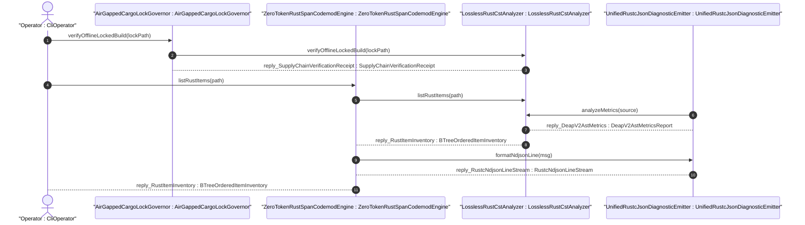
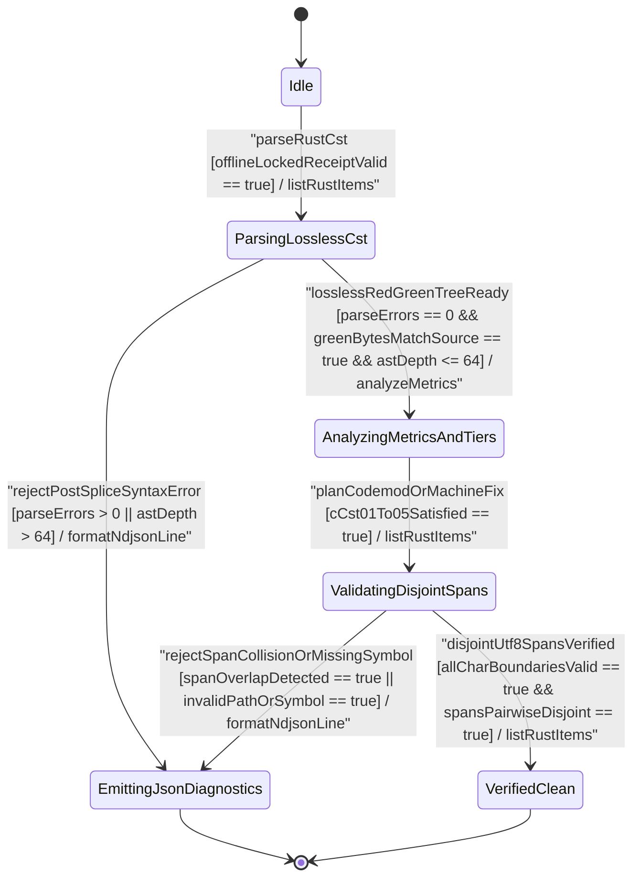

| Attribute | Specification Detail |
| :--- | :--- |
| **Issue ID** | TBD |
| **Title** | User Story 52: list Rust Items |
| **Type** | user-story |
| **Parent Epic** | [EPIC-08-BP_08_Lossless_Rust_CST_Codemod_Engine_and_Unified_rustc_Compatible_JSON_Diagnostics](../epics/EPIC-08-BP_08_Lossless_Rust_CST_Codemod_Engine_and_Unified_rustc_Compatible_JSON_Diagnostics.md) |
| **SysML Interaction** | `BP_08_Lossless_Rust_CST_Codemod_Engine_and_Unified_rustc_Compatible_JSON_Diagnostics_SequenceInteraction` |
| **SysML Test Case** | `Test_listRustItems` |
| **Generation Mode** | subagent |
| **Specification Source** | [schema/model.sysml](../../schema/model.sysml) |

# User Story 52: list Rust Items

## Parent Epic
- [ ] [EPIC-08-BP_08_Lossless_Rust_CST_Codemod_Engine_and_Unified_rustc_Compatible_JSON_Diagnostics](../epics/EPIC-08-BP_08_Lossless_Rust_CST_Codemod_Engine_and_Unified_rustc_Compatible_JSON_Diagnostics.md) (realizes deterministic zero-LLM-token Rust CST item inventory extraction, UTF-8 `TextRange` span verification, and single-line `rustc`-compatible NDJSON diagnostics under **REQ-0608** / **BP-08**)

## Domain Object Mapping
- **Primary Domain Objects:** `ZeroTokenRustSpanCodemodEngine` (**FEAT-45**), `LosslessRustCstAnalyzer` (**FEAT-42**), `UnifiedRustcJsonDiagnosticEmitter` (**FEAT-44**), `AirGappedCargoLockGovernor` (**FEAT-41**), `RustItemInventory`, `RustCstItemDescriptor`, `Utf8ByteSpan`, `DocTier`, `RustCstInventoryError`
- **Actor/Role:** `CliOperator` invoking `compile-sysml --list-rust-items <PATH>` (or automated `verify-baseline` CST audit inspection) through `ZeroTokenRustSpanCodemodEngine` after `AirGappedCargoLockGovernor` offline lockfile verification

## User Story

**As a** `ZeroTokenRustSpanCodemodEngine` orchestrated under an `AirGappedCargoLockGovernor`-verified workspace,
**I want to** invoke `listRustItems(path)` on `LosslessRustCstAnalyzer` and route structured outcomes through `UnifiedRustcJsonDiagnosticEmitter`,
**So that** `compile-sysml --list-rust-items <PATH>` emits a deterministic `BTreeMap`-ordered inventory of Rust CST items with trivia-complete UTF-8 `TextRange` `[byte_start..byte_end)` intervals and `cfg(test)`-excluded `DocTier` classifications at zero runtime LLM token cost (**C-CST-05**), failing closed with single-line `rustc`-compatible NDJSON diagnostics (**DEAP-E0801**..**DEAP-E0804**) on malformed syntax, span collisions, or depth breaches.

## Architectural Realization (3-Layer Definition of Done)

### Layer 1: Domain State & Data Model
- **SysML AST Domain State Attributes**:
  - `LosslessRustCstAnalyzer` (**FEAT-42**): `max_fn_exec_sloc: Integer = 50`, `max_fn_param_count: Integer = 5`, `max_mut_bool_flags: Integer = 0`, `max_predicate_arity: Integer = 3`, `lossless_roundtrip_required: Boolean = true`, `deterministic_uuid: String = "6ba7b810-9dad-11d1-80b4-00c04fd430c8"`.
  - `ZeroTokenRustSpanCodemodEngine` (**FEAT-45**): `runtime_llm_token_count: Integer = 0`, `tier_bc_max_doc_lines: Integer = 2`, `skip_generated_tree: Boolean = true`, `rewrite_check37_citations: Boolean = true`.
  - `UnifiedRustcJsonDiagnosticEmitter` (**FEAT-44**): `cli_binary_count: Integer = 5`, `zero_ansi_in_json_mode: Boolean = true`, `machine_applicable_only: Boolean = true`, `envelope_reason: String = "compiler-message"`.
  - `AirGappedCargoLockGovernor` (**FEAT-41**): `offline_locked_enforced: Boolean = true`, `vendor_bundle_supported: Boolean = true`.
- **Deterministic Rust Data Structures (`crates/deap-core/src/source_ast.rs` & `crates/deap-core/src/error.rs`)**:
  - Enforces `#![forbid(unsafe_code)]` across all CST parsing and inventory modules, zero `HashMap`/`HashSet` usage, and zero `Result<T, String>` signatures.
  - `RustItemInventory` stores item descriptors exclusively in `BTreeMap<(u32, String), RustCstItemDescriptor>` keyed by `(byte_start, symbol_name)` alongside a `BTreeSet<String>` symbol index for `O(log M)` duplicate and lookup checks.
  - `RustCstItemDescriptor` captures `kind: RustItemKind`, `name: String`, `full_span: Utf8ByteSpan` (`byte_start: u32`, `byte_end: u32`, `start_line: u32`, `end_line: u32` encompassing leading `///` / outer `doc` docblocks and outer Rust item attributes), `doc_tier: DocTier` (`RustTierA`, `RustTierBC`, or `TestExcluded` for `cfg(test)`-gated modules and unit `test`-annotated items), `exec_sloc: u32`, `param_count: u8` (excluding `self`, `&self`, and `&mut self` receivers), and `mut_bool_flags: u8`.
  - Typed domain error enum `RustCstInventoryError` maps 1:1 to deterministic diagnostic codes (`DEAP-E0801` missing symbol or invalid path, `DEAP-E0802` overlapping or non-char-boundary `TextRange` span collision, `DEAP-E0803` lossless CST round-trip or syntax error, `DEAP-E0804` `MAX_AST_DEPTH = 64` or checked-arithmetic ceiling breach).
- **Declared Lifecycle State Model**: `BP_08_Lossless_Rust_CST_Codemod_Engine_and_Unified_rustc_Compatible_JSON_Diagnostics_LifecycleState` (`Idle`, `ParsingLosslessCst`, `AnalyzingMetricsAndTiers`, `ValidatingDisjointSpans`, `EmittingJsonDiagnostics`, `SplicingAndFormatting`, `RewritingCheck37Paths`, `VerifyingSelfHostFixedPoint`, `VerifiedClean`).

### Layer 2: Logic & State Management
- **Total Bounded Functions & Complexity Envelope**:
  - Every production Rust callable obeys `<= 50` executable SLOC (**C-CST-01**, well within the `<= 80` workspace exec SLOC ceiling), `<= 5` formal parameters excluding receivers (**C-CST-02**), `0` mutable local boolean flags (**C-CST-03**), `stage_fixed_point_mismatch_files == 0` (**C-CST-04**), `runtime_llm_token_count == 0` (**C-CST-05**), and `tier_bc_max_doc_lines == 2` (**C-CST-06**) under **REQ-0608**.
  - Iterative `ra_ap_syntax` and `rowan` Red/Green syntax-tree walks enforce an explicit depth ceiling `MAX_AST_DEPTH = 64`, slice indexing exclusively via `.get()`, and saturating/checked integer arithmetic (`saturating_add`, `saturating_sub`, `checked_add`, `checked_sub`) across all byte offsets, line tables, and metric counters (**SC-BP08-07**, **SC-BP08-15**).
- **State Transition & Invariant Enforcement**:
  - `Idle -> ParsingLosslessCst` (trigger `parseRustCst`): verifies canonical workspace-relative path confinement, UTF-8 buffer validity, `ra_ap_syntax::SourceFile::parse` zero-error completion, and bit-for-bit root `rowan` `GreenNode` byte equality against input bytes (`Invariant_REQ_0608_SC_01`).
  - `ParsingLosslessCst -> AnalyzingMetricsAndTiers` (trigger `losslessRedGreenTreeReady`): isolates `cfg(test)` module subtrees and unit `test` items via immutable lexical scope frames so test code never pollutes `DocTier::RustTierA` / `DocTier::RustTierBC` metadata or `production_exec_sloc` (**SC-BP08-06**).
  - `AnalyzingMetricsAndTiers -> ValidatingDisjointSpans` (trigger `planCodemodOrMachineFix`): verifies half-open UTF-8 `TextRange` bounds `0 <= byte_start <= byte_end <= source.len()`, `source.is_char_boundary(byte_start)`, `source.is_char_boundary(byte_end)`, and pairwise disjointness `prev_byte_end <= next_byte_start` (`Invariant_REQ_0608_SC_03`).
  - Transitions fail-closed to `EmittingJsonDiagnostics` via `rejectSpanCollisionOrMissingSymbol` (or syntax/depth guard breach) without mutating workspace files.

### Layer 3: Presentation & Actuator Interface Binding
- **Component Port & Protocol Bindings**:
  - `AirGappedCargoLockGovernor`: `manifest_lock_in: String` (`CargoTomlAndLockfile`) and `lock_receipt_out: String` (`SupplyChainVerificationReceipt`).
  - `ZeroTokenRustSpanCodemodEngine`: `codemod_command_in: String` (`CstCodemodCommand`), `atomic_patch_out: String` (`AtomicWorkspacePatch`), and `codemod_error_out: String` (`RustcJsonDiagnosticStream`).
  - `LosslessRustCstAnalyzer`: `rust_source_in: String` (`Utf8RustSourceBuffer`), `item_inventory_out: String` (`BTreeOrderedItemInventory`), and `metrics_report_out: String` (`DeapV2AstMetricsReport`).
  - `UnifiedRustcJsonDiagnosticEmitter`: `finding_in: String` (`DeapDiagnosticFinding`) and `ndjson_out: String` (`RustcNdjsonLineStream`).
- **CLI & `--message-format=json` NDJSON Surface (`crates/compile-sysml/src/cli.rs`, `crates/compile-sysml/src/driver.rs`, `crates/deap-core/src/diagnostics.rs`, `crates/verify-baseline/src/audit_code.rs`)**:
  - Exposes `compile-sysml --list-rust-items <PATH> [--message-format=json]` and feeds `verify-baseline` Check-36/Check-37 CST structural auditing.
  - Emits deterministic `BTreeMap`-ordered item records on standard output (exit code `0`) or single-line zero-ANSI `rustc`-compatible NDJSON frames (`reason: "compiler-message"`, `message.code.code` in `DEAP-E0801`..`DEAP-E0804`, zero embedded `0x0A` newlines, zero `0x1B` ANSI escape sequences per `Invariant_REQ_0608_SC_04_REQ_0608`) under an exclusive stdout line lock with exit code `1` on failure.

## Target Rust Module Paths & Atomic Implementation Micro-Tasks

- **Primary Domain & CST Engine Module**: `crates/deap-core/src/source_ast.rs` (error integration in `crates/deap-core/src/error.rs`)
- **NDJSON Diagnostic & Inventory Formatter Module**: `crates/deap-core/src/diagnostics.rs`
- **CLI Argument & Driver Dispatch Modules**: `crates/compile-sysml/src/cli.rs` and `crates/compile-sysml/src/driver.rs`
- **Baseline Audit Consumer Module**: `crates/verify-baseline/src/audit_code.rs`

| Micro-Task ID | Target Rust Module Path | Atomic Function / Type Signature (`<= 5` Params, `<= 80` Exec SLOC) | Responsibility, Bounds & Safety Invariants | Traceability (`[REQ-*]` & `[FLS: fls_*]`) |
| :--- | :--- | :--- | :--- | :--- |
| `MT-US52-01` | `crates/deap-core/src/source_ast.rs` | `pub struct RustItemInventory`, `pub struct RustCstItemDescriptor`, `pub struct Utf8ByteSpan`, `pub enum RustCstInventoryError` (`<= 44` exec SLOC) | Defines `#![forbid(unsafe_code)]` domain types, `MAX_AST_DEPTH: usize = 64`, `BTreeMap<(u32, String), RustCstItemDescriptor>` storage, `BTreeSet<String>` symbol index, `cfg(test)`-excluded `DocTier` classification enum, and typed `RustCstInventoryError` (`DEAP-E0801`..`DEAP-E0804`) with zero `Result<T, String>`. | `[REQ-0608]` `[FLS: fls_8tsynkj2cufj]` |
| `MT-US52-02` | `crates/deap-core/src/source_ast.rs` | `pub fn parse_lossless_rust_cst(rel_path: &Path, source_bytes: &[u8], max_depth: usize) -> Result<VerifiedLosslessCst, RustCstInventoryError>` (`3` params, `<= 46` exec SLOC) | Rejects non-canonical or `..` path traversal (`DEAP-E0801`), validates strict UTF-8 and zero-error `ra_ap_syntax::SourceFile::parse` (`DEAP-E0803`), verifies bit-for-bit root `rowan` `GreenNode` lossless byte equality (`Invariant_REQ_0608_SC_01`), enforces `max_depth <= MAX_AST_DEPTH` (`64`) via `saturating_add(1)` (`DEAP-E0804`), and builds an `O(N)` monotone line-offset table accessed via `.get()`. | `[REQ-0608]` `[FLS: fls_qcb1n9c0e5hz]` |
| `MT-US52-03` | `crates/deap-core/src/source_ast.rs` | `pub fn list_rust_cst_items(verified_cst: &VerifiedLosslessCst, bounds: &CstComplexityBounds) -> Result<RustItemInventory, RustCstInventoryError>` (`2` params, `<= 48` exec SLOC) | Iteratively extracts CST items within `MAX_AST_DEPTH = 64` using zero mutable `bool` flags (**C-CST-03**), isolates `cfg(test)` modules and unit `test` items into `DocTier::TestExcluded` (**SC-BP08-06**), computes leading `///` / outer `doc` and item-attribute trivia-attached `[byte_start..byte_end)` spans verified with `str::is_char_boundary` and pairwise disjointness (`DEAP-E0802`), checks **C-CST-01**..**C-CST-05** via `saturating_add`/`checked_sub`, and populates `BTreeMap`. | `[REQ-0608]` `[FLS: fls_lv7w7aalpwm5]` |
| `MT-US52-04` | `crates/compile-sysml/src/driver.rs`, `crates/compile-sysml/src/cli.rs`, `crates/deap-core/src/diagnostics.rs`, `crates/verify-baseline/src/audit_code.rs` | `pub fn emit_rust_item_inventory(inventory: &RustItemInventory, format: MessageFormat, out: &mut dyn Write) -> Result<(), RustCstInventoryError>` (`3` params, `<= 42` exec SLOC) | Binds `--list-rust-items <PATH>` and `--message-format=json` to serialize deterministic `BTreeMap` item descriptors (`kind`, `name`, `[byte_start..byte_end)`, `start_line..end_line`, `DocTier`, `exec_sloc`, `param_count`) or single-line zero-ANSI `compiler-message` NDJSON diagnostics (`DEAP-E0801`..`DEAP-E0804`, zero `0x0A`/`0x1B` bytes) with fail-closed exit code `1`. | `[REQ-0608]` `[FLS: fls_izdv9i4spokw]` |

```rust
#![forbid(unsafe_code)]

/// Canonical domain contract for `compile-sysml --list-rust-items <PATH>`.
/// Realises: [REQ-0608] [FLS: fls_8tsynkj2cufj]
pub struct Utf8ByteSpan {
    pub byte_start: u32,
    pub byte_end: u32,
    pub start_line: u32,
    pub end_line: u32,
}

/// Excludes `cfg(test)` modules and unit `test` items from production `DocTier` budgets.
pub enum InventoryDocTier {
    RustTierA,
    RustTierBC,
    TestExcluded,
}
```

## UML Sequence Diagram



## UML State Machine Diagram



## Operational Context

`compile-sysml --list-rust-items <PATH>` executes inside air-gapped DO-178C Level A / DO-330 TQL-4 build environments (`--offline --locked`, `K_LLM = 0`) to provide deterministic, trivia-preserving item coordinates for modular CST extraction (`--extract-rust-module`) and `verify-baseline` structural audits without ad-hoc text-pattern heuristics or lossy token reformatting.

### Mathematical Formulations & Derivations

$$
\begin{aligned}
\mathcal{L}(S) &\iff \bigoplus_{i=1}^{k} \beta(t_i) = S \land \sum_{i=1}^{k} (b_i - a_i) = \lvert S \rvert \\
\mathcal{V}_{\text{span}}(S, \mathcal{I}) &\iff \forall i \in \{1, \dots, M\}, \quad 0 \le a_i \le b_i \le \lvert S \rvert \land \chi(S, a_i) = 1 \land \chi(S, b_i) = 1 \\
\mathcal{D}_{\text{disjoint}}(\mathcal{I}) &\iff \forall i \in \{1, \dots, M - 1\}, \quad b_i \le a_{i+1} \land k_i <_{\text{lex}} k_{i+1} \\
T_{\text{inv}}(N, M) &= O(N + M \log M), \quad S_{\text{inv}}(N, M) = O(N + M), \quad K_{\text{LLM}} = 0
\end{aligned}
$$

- Parameter Definitions & Engineering Units:
- $S$: Input Rust `.rs` source file payload modeled as a finite UTF-8 byte sequence of length $\lvert S \rvert$ (`bytes`).
- $t_i, \beta(t_i)$: Leaf concrete syntax token $i \in \{1, \dots, k\}$ in the `rowan` `GreenNode` tree and its projected byte slice (`bytes`), where $\mathcal{L}(S)$ enforces lossless round-trip reconstruction (`Invariant_REQ_0608_SC_01`).
- $\mathcal{I}, M$: Ordered item inventory containing $M$ extracted top-level and module-scoped CST item descriptors (`items`), excluding `cfg(test)` subtrees from production `DocTier` and executable SLOC totals.
- $[a_i, b_i)$: Half-open UTF-8 `TextRange` `[byte_start..byte_end)` of item $i$ including leading `///` / outer `doc` docblocks and outer item attributes (`bytes`).
- $\chi(S, x) \in \{0, 1\}$: UTF-8 codepoint boundary indicator equal to $1$ if and only if byte offset $x$ lies on a valid UTF-8 character boundary in $S$ (`Invariant_REQ_0608_SC_03`).
- $k_i$: Composite `BTreeMap` ordering key $(a_i, \sigma_i)$ combining 0-based `byte_start` offset $a_i$ and item identifier $\sigma_i$ under strict lexicographical order $<_{\text{lex}}$.
- $N, T_{\text{inv}}(N, M), S_{\text{inv}}(N, M), K_{\text{LLM}}$: Input byte count $N$ (`bytes`), linearithmic inventory extraction time $O(N + M \log M)$, linear memory footprint $O(N + M)$, and runtime LLM token consumption $K_{\text{LLM}} = 0$ (`tokens`, **C-CST-05**).

## Acceptance Criteria (BDD)

- [ ] **AC-US-52-01 (Nominal -- Deterministic `BTreeMap` Inventory & `cfg(test)`-Excluded `DocTier` Metadata [`TEST_US52_01_NominalBTreeItemInventoryAndDocTier`])**: **Given** `AirGappedCargoLockGovernor` has verified `--offline --locked` workspace lock integrity (`reply_SupplyChainVerificationReceipt`) and an isolated temporary `.rs` fixture contains unordered `pub struct`, `pub fn`, and `pub(crate) fn` items (with `&self` receivers, leading `///` docblocks, and outer `must_use` attributes) plus a trailing `cfg(test)` module with unit `test` functions, **When** `ZeroTokenRustSpanCodemodEngine` invokes `listRustItems(path)` on `LosslessRustCstAnalyzer`, **Then** `LosslessRustCstAnalyzer` transitions `Idle -> ParsingLosslessCst -> AnalyzingMetricsAndTiers -> ValidatingDisjointSpans -> VerifiedClean`, verifies bit-for-bit root `rowan` `GreenNode` byte equality (`Invariant_REQ_0608_SC_01`) with `runtime_llm_token_count == 0` (**C-CST-05**), classifies public items as `DocTier::RustTierA`, `pub(crate)` items as `DocTier::RustTierBC`, and `cfg(test)` items as `DocTier::TestExcluded` excluded from `production_exec_sloc`, and emits `reply_RustItemInventory` (`BTreeOrderedItemInventory`) sorted deterministically by `(byte_start, name)` with trivia-complete `[byte_start..byte_end)` intervals.
- [ ] **AC-US-52-02 (Boundary -- Multi-Byte UTF-8 Docblocks, `MAX_AST_DEPTH = 64` & Exact `C_CST_01`..`C_CST_03` Limits [`TEST_US52_02_BoundaryMultibyteUtf8MaxDepthAndParamEnvelope`])**: **Given** a valid UTF-8 `.rs` fixture containing multi-byte UTF-8 symbols inside leading `///` docblocks, nested CST blocks reaching exact depth `MAX_AST_DEPTH = 64`, and a method with `&mut self` plus exactly `5` value parameters (`max_fn_param_count == 5`, **C-CST-02**), `50` executable SLOC (`max_fn_exec_sloc == 50`, **C-CST-01**), and `0` mutable `bool` flags (**C-CST-03**), **When** `compile-sysml --list-rust-items <PATH> --message-format=json` executes, **Then** every `[byte_start..byte_end)` boundary satisfies `str::is_char_boundary` (`Invariant_REQ_0608_SC_03`), receiver stripping yields `param_count == 5`, iterative traversal succeeds at depth `64` using `.get()` and `saturating_add` without stack overflow, and single-line JSON output contains zero embedded `0x0A` or `0x1B` bytes (`Invariant_REQ_0608_SC_04_REQ_0608`) with exit code `0`.
- [ ] **AC-US-52-03 (Fail-Closed Fault Injection `UCA-BP08-01` -- Malformed CST Syntax, Non-UTF-8 Input & Path Traversal [`TEST_US52_03_FailClosedMalformedSyntaxAndPathTraversal`, `FM-BP08-005`, `FM-BP08-017`])**: **Given** fault-injected Unsafe Control Action **UCA-BP08-01** supplying `--list-rust-items` with either a path-traversing `../` path, invalid UTF-8 byte sequence, or malformed Rust syntax (`ra_ap_syntax::SourceFile::parse` reporting `errors().len() > 0`), **When** `ZeroTokenRustSpanCodemodEngine` dispatches `listRustItems(path)` under `--message-format=json`, **Then** `LosslessRustCstAnalyzer` halts in `ParsingLosslessCst` (**SC-BP08-05**, **SC-BP08-03**), transitions to `EmittingJsonDiagnostics`, emits a single-line zero-ANSI `rustc`-compatible NDJSON diagnostic (`reason: "compiler-message"`, **DEAP-E0801** or **DEAP-E0803**) via `UnifiedRustcJsonDiagnosticEmitter`, performs zero partial file writes, and terminates fail-closed with exit code `1`.
- [ ] **AC-US-52-04 (Fail-Closed Fault Injection `UCA-BP08-02` -- Overlapping `TextRange` Span Collision & Unbalanced `cfg(test)` Scope [`TEST_US52_04_FailClosedOverlappingSpanAndTestScopeLeak`, `FM-BP08-006`, `FM-BP08-008`, `FM-BP08-018`])**: **Given** fault-injected Unsafe Control Action **UCA-BP08-02** presenting overlapping item `TextRange` intervals (`prev_byte_end > next_byte_start`), mid-codepoint `!is_char_boundary` offsets, or unbalanced `cfg(test)` attribute spans attempting to leak test exemption into adjacent production items, **When** `ValidatingDisjointSpans` evaluates `DisjointValid` (`Invariant_REQ_0608_SC_03`) and `cfg(test)` isolation (**SC-BP08-06**, **SC-BP08-08**), **Then** `LosslessRustCstAnalyzer` triggers `rejectSpanCollisionOrMissingSymbol`, emits single-line zero-ANSI NDJSON diagnostic **DEAP-E0802**, suppresses `reply_RustItemInventory` on `item_inventory_out`, and exits fail-closed with exit code `1`.
- [ ] **AC-US-52-05 (Fail-Closed Fault Injection `UCA-BP08-03` -- `MAX_AST_DEPTH = 64` Exhaustion & Complexity / Arithmetic Breach [`TEST_US52_05_FailClosedAstDepthAndComplexityBreach`, `FM-BP08-007`, `FM-BP08-016`, `FM-BP08-019`])**: **Given** fault-injected Unsafe Control Action **UCA-BP08-03** supplying an adversarial `.rs` buffer exceeding `MAX_AST_DEPTH = 64` (depth `>= 65`) or breaching **C-CST-01**..**C-CST-03** (`exec_sloc > 50`, `param_count > 5`, or mutable local `bool` flag `> 0`), **When** `LosslessRustCstAnalyzer` executes bounded iterative CST traversal under `--message-format=json`, **Then** checked/saturating depth and counter guards abort immediately without call-stack overflow or integer wraparound (**SC-BP08-07**, **SC-BP08-04**, **SC-BP08-16**), emit single-line zero-ANSI `compiler-message` NDJSON (**DEAP-E0804**), preserve prior verified workspace state untouched, and exit fail-closed with exit code `1`.

## Formal SysML Test Case & Verification Binding

- **Primary Compiler-Owned SysML Test Case Def:** `Test_listRustItems`
- **Behavioral BDD Verification Suite (`TEST-*`):**
  - `TEST_US52_01_NominalBTreeItemInventoryAndDocTier` (nominal `BTreeMap` inventory, lossless `rowan` round-trip, and `cfg(test)`-excluded `DocTier`)
  - `TEST_US52_02_BoundaryMultibyteUtf8MaxDepthAndParamEnvelope` (boundary UTF-8 `TextRange` codepoint alignment, `MAX_AST_DEPTH = 64`, `50` exec SLOC, `5` non-receiver params)
  - `TEST_US52_03_FailClosedMalformedSyntaxAndPathTraversal` (fail-closed **UCA-BP08-01** / **FM-BP08-005** / **FM-BP08-017** -> **DEAP-E0801** / **DEAP-E0803**)
  - `TEST_US52_04_FailClosedOverlappingSpanAndTestScopeLeak` (fail-closed **UCA-BP08-02** / **FM-BP08-006** / **FM-BP08-008** / **FM-BP08-018** -> **DEAP-E0802**)
  - `TEST_US52_05_FailClosedAstDepthAndComplexityBreach` (fail-closed **UCA-BP08-03** / **FM-BP08-007** / **FM-BP08-016** / **FM-BP08-019** -> **DEAP-E0804**)
- **Subject Parts:** `ZeroTokenRustSpanCodemodEngine`, `LosslessRustCstAnalyzer`, `UnifiedRustcJsonDiagnosticEmitter`
- **Verified Safety Requirement:** `REQ_0608_BP_08_Lossless_Rust_CST_Codemod_Engine_and_Unified_rustc_Compatible_JSON_Diagnostics` (**REQ-0608**)

```sysml
test case def Test_listRustItems {
    subject LosslessRustCstAnalyzer;
    verify requirement REQ_0608_BP_08_Lossless_Rust_CST_Codemod_Engine_and_Unified_rustc_Compatible_JSON_Diagnostics;
    objective "Verify deterministic BTreeMap Rust CST item inventory extraction with lossless GreenNode byte parity and cfg(test)-excluded DocTier metadata";
    step verify_offline_locked_supply_chain_receipt;
    step parse_utf8_source_into_lossless_red_green_cst;
    step assert_btree_ordered_inventory_and_disjoint_utf8_spans;
}

test case def TEST_US52_01_NominalBTreeItemInventoryAndDocTier {
    subject ZeroTokenRustSpanCodemodEngine;
    verify requirement REQ_0608_BP_08_Lossless_Rust_CST_Codemod_Engine_and_Unified_rustc_Compatible_JSON_Diagnostics;
    objective "Nominal verification of --list-rust-items BTreeMap ordering, leading docblock/attribute TextRange inclusion, and cfg(test)-excluded DocTier classification";
    step inject_mixed_tier_and_cfg_test_rust_fixture;
    step invoke_list_rust_items_with_zero_llm_tokens;
    step assert_btree_order_lossless_roundtrip_and_doc_tiers;
}

test case def TEST_US52_02_BoundaryMultibyteUtf8MaxDepthAndParamEnvelope {
    subject LosslessRustCstAnalyzer;
    verify requirement REQ_0608_BP_08_Lossless_Rust_CST_Codemod_Engine_and_Unified_rustc_Compatible_JSON_Diagnostics;
    objective "Boundary verification at MAX_AST_DEPTH = 64, 50 exec SLOC, 5 non-receiver params, and multi-byte UTF-8 docblock TextRange char boundaries";
    step inject_multibyte_utf8_depth_64_boundary_fixture;
    step invoke_list_rust_items_json_mode;
    step assert_utf8_char_boundaries_and_zero_ansi_single_line_output;
}

test case def TEST_US52_03_FailClosedMalformedSyntaxAndPathTraversal {
    subject ZeroTokenRustSpanCodemodEngine;
    verify requirement REQ_0608_BP_08_Lossless_Rust_CST_Codemod_Engine_and_Unified_rustc_Compatible_JSON_Diagnostics;
    objective "Fail-closed UCA-BP08-01 fault-injection verification rejecting path traversal, non-UTF-8 bytes, and CST syntax errors with DEAP-E0801 or DEAP-E0803";
    step inject_uca_bp08_01_malformed_or_traversing_input;
    step invoke_list_rust_items_json_mode;
    step assert_exit_code_1_and_single_line_deap_e0801_e0803_ndjson;
}

test case def TEST_US52_04_FailClosedOverlappingSpanAndTestScopeLeak {
    subject LosslessRustCstAnalyzer;
    verify requirement REQ_0608_BP_08_Lossless_Rust_CST_Codemod_Engine_and_Unified_rustc_Compatible_JSON_Diagnostics;
    objective "Fail-closed UCA-BP08-02 fault-injection verification rejecting overlapping or mid-codepoint TextRange spans and unbalanced cfg(test) scopes with DEAP-E0802";
    step inject_uca_bp08_02_overlapping_or_mid_codepoint_span;
    step evaluate_disjoint_valid_and_cfg_test_scope_guards;
    step assert_exit_code_1_zero_inventory_leak_and_deap_e0802_ndjson;
}

test case def TEST_US52_05_FailClosedAstDepthAndComplexityBreach {
    subject UnifiedRustcJsonDiagnosticEmitter;
    verify requirement REQ_0608_BP_08_Lossless_Rust_CST_Codemod_Engine_and_Unified_rustc_Compatible_JSON_Diagnostics;
    objective "Fail-closed UCA-BP08-03 fault-injection verification trapping AST depth > 64 and C_CST_01..C_CST_03 breaches with single-line DEAP-E0804 NDJSON";
    step inject_uca_bp08_03_depth_65_and_over_budget_fn_fixture;
    step execute_bounded_iterative_cst_walk;
    step assert_no_stack_overflow_exit_code_1_and_deap_e0804_ndjson;
}
```

## Required Features
- [ ] [Feature 41: [BP 08 Lossless Rust CST Codemod Engine and Unified rustc Compatible JSON Diagnostics] AirGappedCargoLockGovernor](../features/FEAT-41-AirGappedCargoLockGovernor.md) (enforces `--offline --locked` `Cargo.lock` supply-chain verification receipt prerequisite before CST analysis executes)
- [ ] [Feature 42: [BP 08 Lossless Rust CST Codemod Engine and Unified rustc Compatible JSON Diagnostics] LosslessRustCstAnalyzer](../features/FEAT-42-LosslessRustCstAnalyzer.md) (provides lossless `ra_ap_syntax` + `rowan` Red/Green CST parsing, `MAX_AST_DEPTH = 64` traversal, `cfg(test)`-excluded `DocTier` classification, and `BTreeOrderedItemInventory` synthesis)
- [ ] [Feature 44: [BP 08 Lossless Rust CST Codemod Engine and Unified rustc Compatible JSON Diagnostics] UnifiedRustcJsonDiagnosticEmitter](../features/FEAT-44-UnifiedRustcJsonDiagnosticEmitter.md) (serializes fail-closed `DEAP-E0801`..`DEAP-E0804` diagnostics and `--message-format=json` frames as single-line zero-ANSI `compiler-message` NDJSON)
- [ ] [Feature 45: [BP 08 Lossless Rust CST Codemod Engine and Unified rustc Compatible JSON Diagnostics] ZeroTokenRustSpanCodemodEngine](../features/FEAT-45-ZeroTokenRustSpanCodemodEngine.md) (hosts `--list-rust-items <PATH>` command routing, zero-LLM-token enforcement **C-CST-05**, and disjoint UTF-8 `TextRange` span contract validation)

## Logical UI & Interface Bindings

| Interface Channel | Category | Target Component / Handler | Target Container / Endpoint | Data Source Binding |
| --- | --- | --- | --- | --- |
| `cli` | Deterministic CLI Inventory Stream | `ZeroTokenRustSpanCodemodEngine::emit_rust_item_inventory` (`crates/compile-sysml/src/driver.rs`) | `compile-sysml --list-rust-items <PATH>` | `BP_08_Lossless_Rust_CST_Codemod_Engine_and_Unified_rustc_Compatible_JSON_Diagnostics::LosslessRustCstAnalyzer::item_inventory_out` |
| `ndjson` | M2M `rustc`-Compatible JSON Stream | `UnifiedRustcJsonDiagnosticEmitter::formatNdjsonLine` (`crates/deap-core/src/diagnostics.rs`) | `compile-sysml --list-rust-items <PATH> --message-format=json` | `BP_08_Lossless_Rust_CST_Codemod_Engine_and_Unified_rustc_Compatible_JSON_Diagnostics::UnifiedRustcJsonDiagnosticEmitter::ndjson_out` |

## Source References
Operational concept definitions and system sequence interaction models:
- System Architecture Model: [schema/model.sysml](../../schema/model.sysml)
- Blueprint SysML v2 Specification: `docs/designs/blueprint-08-rust-analyzer-cst-refactoring-and-json-diagnostics.sysml`
- Component Failure Mode Registry: [docs/research/FAILURE_MODE_REGISTRY.md](../research/FAILURE_MODE_REGISTRY.md) (`FM-BP08-005`..`FM-BP08-008`, `FM-BP08-017`..`FM-BP08-020`)
- Normative Target Source Modules: `crates/deap-core/src/source_ast.rs`, `crates/deap-core/src/diagnostics.rs`, `crates/compile-sysml/src/cli.rs`, `crates/compile-sysml/src/driver.rs`, `crates/verify-baseline/src/audit_code.rs`
- Normative Systems Engineering Standard: ISO/IEC/IEEE 29148:2018 Section 6.4.2 Concept of Operations

Authoritative user story flows and interaction lifelines derive from `schema/model.sysml` pursuant to ISO/IEC/IEEE 29148.
