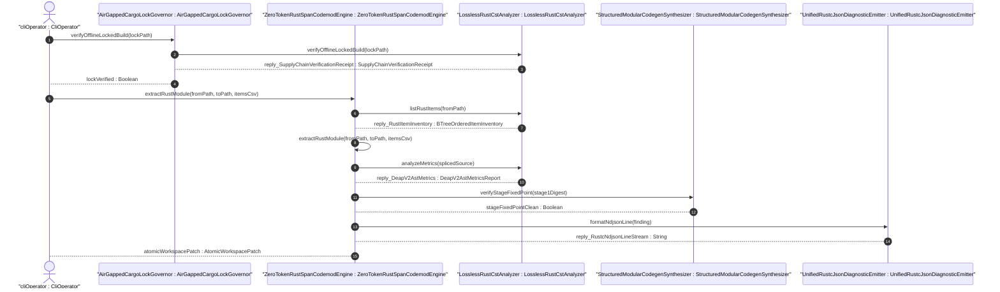
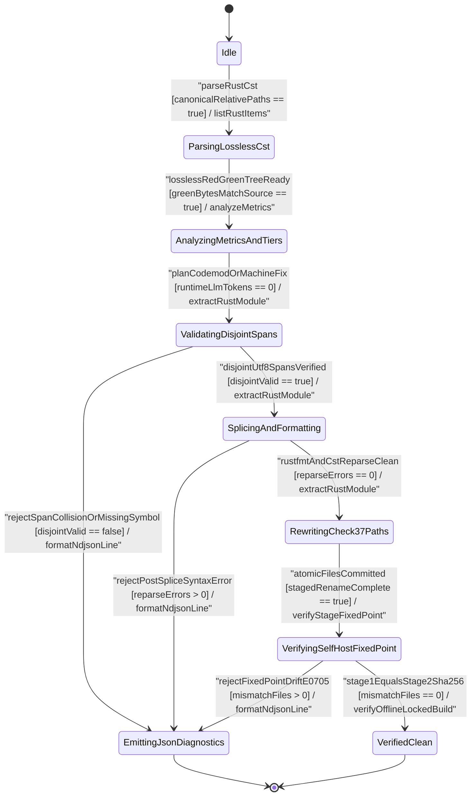

| Attribute | Specification Detail |
| :--- | :--- |
| **Issue ID** | TBD |
| **Title** | User Story 53: extract Rust Module |
| **Type** | user-story |
| **Parent Epic** | [EPIC-08-BP_08_Lossless_Rust_CST_Codemod_Engine_and_Unified_rustc_Compatible_JSON_Diagnostics](../epics/EPIC-08-BP_08_Lossless_Rust_CST_Codemod_Engine_and_Unified_rustc_Compatible_JSON_Diagnostics.md) |
| **SysML Interaction** | `BP_08_Lossless_Rust_CST_Codemod_Engine_and_Unified_rustc_Compatible_JSON_Diagnostics_SequenceInteraction` |
| **SysML Test Case** | `Test_extractRustModule` |
| **Generation Mode** | subagent |
| **Specification Source** | [schema/model.sysml](../../schema/model.sysml) |

# User Story 53: extract Rust Module

## Parent Epic
- [ ] [EPIC-08-BP_08_Lossless_Rust_CST_Codemod_Engine_and_Unified_rustc_Compatible_JSON_Diagnostics](../epics/EPIC-08-BP_08_Lossless_Rust_CST_Codemod_Engine_and_Unified_rustc_Compatible_JSON_Diagnostics.md) (governs **REQ-0608** zero-token lossless `ra_ap_syntax` + `rowan` CST span refactoring, Tier B/C docstring compaction, Check-37 blueprint citation synchronization, and single-line `rustc`-compatible NDJSON diagnostics)

## Domain Object Mapping
- **Primary Domain Objects:** `ZeroTokenRustSpanCodemodEngine` ([FEAT-45](../features/FEAT-45-ZeroTokenRustSpanCodemodEngine.md)), `LosslessRustCstAnalyzer` ([FEAT-42](../features/FEAT-42-LosslessRustCstAnalyzer.md)), `StructuredModularCodegenSynthesizer` ([FEAT-43](../features/FEAT-43-StructuredModularCodegenSynthesizer.md)), `UnifiedRustcJsonDiagnosticEmitter` ([FEAT-44](../features/FEAT-44-UnifiedRustcJsonDiagnosticEmitter.md)), `AirGappedCargoLockGovernor` ([FEAT-41](../features/FEAT-41-AirGappedCargoLockGovernor.md))
- **Actor/Role:** `CliOperator` (deterministic compiler operator or air-gapped CI runner invoking `compile-sysml` CST codemod subcommands under `--offline --locked` governance)
- **Target Rust Module Paths:**
  - `crates/deap-core/src/source_ast.rs` (lossless `ra_ap_syntax` + `rowan` Red/Green CST item inventory, `cfg(test)` outer-attribute-excluded `DocTier` classification, reverse-byte-order UTF-8 `TextRange` span splicer, and zero-error post-splice `SourceFile::parse` gate)
  - `crates/deap-core/src/workspace.rs` (canonical symlink-rejecting workspace path resolver, Check-37 `docs/architecture/blueprints/` and `README.md` module path citation rewriter, and atomic multi-file temp-and-rename batch committer)
  - `crates/deap-core/src/diagnostics.rs` (typed `CodemodError` mapping to single-line zero-ANSI `rustc`-compatible `reason: "compiler-message"` NDJSON records `DEAP-E0801`..`DEAP-E0804` and `DEAP-E0705`)
  - `crates/compile-sysml/src/cli.rs`, `crates/compile-sysml/src/driver.rs`, `crates/compile-sysml/src/docstring.rs`, and `crates/compile-sysml/src/modular_codegen/mod.rs` (`--list-rust-items`, `--extract-rust-module`, `--compact-tier-bc`, and `--message-format=json` CLI execution enforcing unconditional `crates/compile-sysml/src/modular_codegen/generated/` compaction exclusion)
  - `crates/verify-baseline/src/checks/codebase.rs` and `crates/verify-baseline/src/checks/docstring_gate.rs` (Check-37 Rust module citation audit and 2-line `DocTier::RustTierBC` docstring contract verification, exemplified by split module layouts such as `crates/deap-core/src/sysml_ast/mod.rs` and `crates/deap-core/src/sysml_ast/actions.rs`)

## User Story (BDD Realization)
**As a** `CliOperator` executing deterministic workspace refactoring under `AirGappedCargoLockGovernor` (`--offline --locked`, `runtime_llm_token_count == 0`),
**I want to** invoke `extractRustModule(fromPath, toPath, itemsCsv)` and companion `--compact-tier-bc` CST span operations on `ZeroTokenRustSpanCodemodEngine` backed by `LosslessRustCstAnalyzer`,
**So that** target top-level Rust items (including leading `///` docblocks and `ast::Attr` outer `derive` / `allow` attributes) are inventoried in deterministic `BTreeMap` order, spliced in reverse UTF-8 `TextRange` byte order into an atomic submodule carrying a Tier A `//!` header, verified for zero syntax errors via in-memory `ra_ap_syntax::SourceFile::parse`, synchronized across Check-37 citations in `docs/architecture/blueprints/` and `README.md`, and isolated from `crates/compile-sysml/src/modular_codegen/generated/` Stage-1/Stage-2 fixed-point drift and `cfg(test)` outer-attribute `DocTier` corruption.

**Given** an air-gapped Rust workspace module transitioned to `<mod>/mod.rs` containing multiple top-level items with leading `///` docblocks, `ast::Attr` outer `derive` attributes, and a `cfg(test)` test module alongside `docs/architecture/blueprints/` and `README.md` citations,
**When** `CliOperator` invokes `compile-sysml --extract-rust-module --from <mod>/mod.rs --to <mod>/<sub>.rs --items <ItemA,ItemB>` (or `--compact-tier-bc <DIR>`),
**Then** `ZeroTokenRustSpanCodemodEngine` validates disjoint UTF-8 `TextRange` boundaries, applies reverse-byte-order span edits without mutating executable tokens or `crates/compile-sysml/src/modular_codegen/generated/`, re-parses every modified Rust buffer to zero CST errors, atomically commits `<mod>/mod.rs`, `<mod>/<sub>.rs`, and Check-37 `/mod.rs` citation rewrites, or fails closed with exit code `1` and a single-line `DEAP-E0801`..`DEAP-E0804` / `DEAP-E0705` NDJSON diagnostic.

## Architectural Realization (3-Layer Definition of Done)

### Layer 1: Domain State & Data Model
- Enforces `#![forbid(unsafe_code)]` across `crates/deap-core/src/source_ast.rs`, `crates/deap-core/src/workspace.rs`, and `crates/compile-sysml/src/docstring.rs` with zero `Result<T, String>` signatures and zero `HashMap`/`HashSet` containers.
- Defines deterministic ordered domain structures in `crates/deap-core/src/source_ast.rs`:
  - `ZeroTokenCodemodConfig`: seals SysML `ZeroTokenRustSpanCodemodEngine` attributes `runtime_llm_token_count: usize` (`0`, `C_CST_05`), `tier_bc_max_doc_lines: usize` (`2`, `C_CST_06`), `skip_generated_tree: bool` (`true`), and `rewrite_check37_citations: bool` (`true`).
  - `DocTier`: exhaustive classification enum (`RustTierA`, `RustTierBC`, `TestExcluded`) ensuring items nested inside `cfg(test)` outer-attribute modules or bearing `test` outer `ast::Attr` nodes resolve to `DocTier::TestExcluded` and are never coerced into `RustTierA` or `RustTierBC` rewriting.
  - `RustItemDescriptor`: stores `name: String`, `kind: RustItemKind`, `full_span: (usize, usize)` (encompassing leading `///` outer docblocks and `ast::Attr` outer `doc` / `derive` attributes), `doc_span: Option<(usize, usize)>`, `doc_tier: DocTier`, and `realises_reqs: BTreeSet<String>`, indexed inside `BTreeMap<String, RustItemDescriptor>`.
  - `SpanSpliceEdit`: stores validated UTF-8 byte interval `(byte_start, byte_end)` and `replacement: String`, ordered via `BTreeMap<PathBuf, Vec<SpanSpliceEdit>>`.
  - `CodemodError`: typed domain error enum with variants `MissingSymbolOrInvalidBoundary` (`DEAP-E0801`), `OverlappingSpanCollision` (`DEAP-E0802`), `PostSpliceSyntaxOrTraceabilityBreach` (`DEAP-E0803`), `ResourceDepthOrArithmeticOverflow` (`DEAP-E0804`), and `SelfHostFixedPointDrift` (`DEAP-E0705`).
- Binds directly to SysML `state def` `BP_08_Lossless_Rust_CST_Codemod_Engine_and_Unified_rustc_Compatible_JSON_Diagnostics_LifecycleState` (`Idle`, `ParsingLosslessCst`, `AnalyzingMetricsAndTiers`, `ValidatingDisjointSpans`, `EmittingJsonDiagnostics`, `SplicingAndFormatting`, `RewritingCheck37Paths`, `VerifyingSelfHostFixedPoint`, `VerifiedClean`).

### Layer 2: Logic & State Management
- All executable Rust functions satisfy `C_CST_01` (`max_fn_exec_sloc <= 50`, strictly within the `<= 80` exec SLOC ceiling), `C_CST_02` (`max_fn_param_count <= 5` excluding receivers), and `C_CST_03` (`max_mut_bool_flags == 0`), using total pattern matching without panicking `.unwrap()`, `.expect()`, or unchecked `[i]` slice indexing.
- Enforces `MAX_AST_DEPTH = 64` during recursive `rowan` Red/Green syntax-tree traversal, `.get(byte_start..byte_end)` combined with `str::is_char_boundary` for every UTF-8 slice, and checked/saturating arithmetic (`checked_add`, `checked_sub`, `saturating_add`) for all byte-offset delta and buffer-capacity computations (`Invariant_REQ_0608_SC_03`, `Invariant_REQ_0608_SC_04_REQ_0608`).
- Executes `--extract-rust-module` by sorting verified disjoint `SpanSpliceEdit` intervals in descending `byte_start` order (`O(M log M)`) and splicing in reverse byte order (`O(N + M)`) so upstream UTF-8 byte offsets remain invariant across multi-item extractions.
- Executes `--compact-tier-bc` across canonical non-symlink directories while unconditionally skipping `crates/compile-sysml/src/modular_codegen/generated/` (`C_CST_04`, preserving Stage-1 == Stage-2 SHA-256 parity in `StructuredModularCodegenSynthesizer`), preserving `DocTier::RustTierA` 7-section contracts and `cfg(test)`-excluded `DocTier::TestExcluded` items verbatim, compacting `DocTier::RustTierBC` docblocks to 2-line `/// <summary>` + `/// Realises: [REQ-*]` headers (`C_CST_06`), and asserting non-trivia executable token sequence equality (`Invariant_REQ_0608_SC_01`).
- Re-parses every spliced Rust buffer (`<mod>/mod.rs`, `<mod>/<sub>.rs`, and compacted `.rs` files) in memory via `ra_ap_syntax::SourceFile::parse` asserting `errors().is_empty()` before staging temp-and-rename multi-file commits co-atomic with Check-37 `<mod>.rs` to `<mod>/mod.rs` path citation updates across `docs/architecture/blueprints/` and `README.md`.

### Layer 3: Presentation & Actuator Interface Binding
- Binds SysML ports on `ZeroTokenRustSpanCodemodEngine` (`codemod_command_in` `[protocol: CstCodemodCommand]`, `atomic_patch_out` `[protocol: AtomicWorkspacePatch]`, `codemod_error_out` `[protocol: RustcJsonDiagnosticStream]`) to `LosslessRustCstAnalyzer` (`rust_source_in`, `item_inventory_out`, `metrics_report_out`), `StructuredModularCodegenSynthesizer` (`lowered_ir_in`, `formatted_rust_out`), and `UnifiedRustcJsonDiagnosticEmitter` (`finding_in`, `ndjson_out`, `machine_fix_inout`).
- Exposes deterministic CLI subcommands in `crates/compile-sysml/src/cli.rs` (`--list-rust-items <PATH>`, `--extract-rust-module --from <MOD_RS> --to <SUB_RS> --items <CSV>`, `--compact-tier-bc <DIR>`, and `--message-format=json`).
- Under `--message-format=json`, routes all `CodemodError` diagnostics through `UnifiedRustcJsonDiagnosticEmitter` (`crates/deap-core/src/diagnostics.rs`) as strictly single-line `rustc`-compatible NDJSON objects (`reason: "compiler-message"`, `message.code.code` in `DEAP-E0801`..`DEAP-E0804` / `DEAP-E0705`, exact UTF-8 `byte_start`/`byte_end`, 1-based line/column coordinates, `MachineApplicable` vs `MaybeIncorrect` span applicability, zero embedded `0x0A` newline bytes per record, and zero `0x1B` ANSI escape sequences).

| Interface Channel | Category | Target Component / Handler | Target Container / Endpoint | Data Source Binding |
| --- | --- | --- | --- | --- |
| `cli` | Operator & CI CLI | `crates/compile-sysml/src/cli.rs` (`ZeroTokenRustSpanCodemodEngine`) | `compile-sysml --extract-rust-module` / `--compact-tier-bc` / `--list-rust-items` | `ZeroTokenRustSpanCodemodEngine::codemod_command_in` (`CstCodemodCommand`) |
| `filesystem` | Atomic Workspace Actuator | `crates/deap-core/src/workspace.rs` (`AtomicWorkspacePatch`) | `<mod>/mod.rs`, `<mod>/<sub>.rs`, `docs/architecture/blueprints/`, `README.md` | `ZeroTokenRustSpanCodemodEngine::atomic_patch_out` (`AtomicWorkspacePatch`) |
| `ndjson` | M2M JSON Diagnostic Stream | `crates/deap-core/src/diagnostics.rs` (`UnifiedRustcJsonDiagnosticEmitter`) | `stdout` (`--message-format=json` single-line `compiler-message` NDJSON) | `ZeroTokenRustSpanCodemodEngine::codemod_error_out` (`RustcJsonDiagnosticStream`) |

## Atomic Implementation Micro-Tasks (3-5 Bounded Units)

1. **`MT-53-01` -- Typed Codemod Domain Model, `BTreeMap` Item Inventory & `cfg(test)`-Excluded `DocTier` Classifier**
   - **Target Path:** `crates/deap-core/src/source_ast.rs`
   - **Signature:** `pub fn inventory_extractable_items(source: &str, max_depth: usize) -> Result<BTreeMap<String, RustItemDescriptor>, CodemodError>` (`2` params, `<= 45` exec SLOC, `0` mutable bools)
   - **Contract:** Parses `source` losslessly via `ra_ap_syntax::SourceFile::parse`, verifies root `rowan` GreenNode byte projection equals `source.as_bytes()`, enforces `max_depth <= MAX_AST_DEPTH` (`64`), classifies `cfg(test)` and `test` outer `ast::Attr` subtrees as `DocTier::TestExcluded` so their `DocTier` is preserved and excluded from Tier A/BC rewriting, captures full outer trivia (`///` docblocks and `ast::Attr` outer `derive` / `allow` attributes) into `RustItemDescriptor`, and returns a deterministic `BTreeMap` keyed by item identifier.
   - **Traceability:** `[REQ-0608]`, `[FLS: fls_66m4rnbssgig]`

2. **`MT-53-02` -- Disjoint UTF-8 `TextRange` Validator, Reverse-Byte-Order Span Splicer & Zero-Error CST Re-Parse Gate**
   - **Target Path:** `crates/deap-core/src/source_ast.rs`
   - **Signature:** `pub fn splice_disjoint_reverse_spans(source: &str, edits: &[SpanSpliceEdit]) -> Result<String, CodemodError>` (`2` params, `<= 48` exec SLOC, `0` mutable bools)
   - **Contract:** Verifies `0 <= byte_start <= byte_end <= source.len()`, `source.is_char_boundary(byte_start)`, `source.is_char_boundary(byte_end)`, and pairwise non-overlap (`b_i <= a_{i+1}`) across sorted intervals (emitting `CodemodError::MissingSymbolOrInvalidBoundary` / `DEAP-E0801` or `CodemodError::OverlappingSpanCollision` / `DEAP-E0802` on violation), computes target buffer capacity via `checked_add`/`checked_sub` (`DEAP-E0804` on overflow), applies `.get(start..end)` slices strictly in descending `byte_start` order, and re-parses the spliced output with `ra_ap_syntax::SourceFile::parse` failing closed with `CodemodError::PostSpliceSyntaxOrTraceabilityBreach` (`DEAP-E0803`) if `errors().len() > 0`.
   - **Traceability:** `[REQ-0608]`, `[FLS: fls_qcb1n9c0e5hz]`

3. **`MT-53-03` -- Atomic `--extract-rust-module` Orchestrator & Check-37 Blueprint Citation Rewriter**
   - **Target Path:** `crates/deap-core/src/workspace.rs` and `crates/compile-sysml/src/driver.rs`
   - **Signature:** `pub fn extract_rust_module_atomic(workspace_root: &Path, from_rel: &Path, to_rel: &Path, items: &BTreeSet<String>) -> Result<AtomicPatchReceipt, CodemodError>` (`4` params, `<= 50` exec SLOC, `0` mutable bools)
   - **Contract:** Rejects non-canonical, symlinked, or `..`-traversing paths (`DEAP-E0801`), resolves every symbol in `items` against `inventory_extractable_items`, synthesizes `--to <mod>/<sub>.rs` with a Tier A `//!` module header, splices extracted items from `--from <mod>/mod.rs` via `splice_disjoint_reverse_spans` while inserting submodule wiring, re-verifies zero-error CST re-parse on both buffers, rewrites `<mod>.rs` citations to `<mod>/mod.rs` across `docs/architecture/blueprints/` and `README.md` for Check-37 (`crates/verify-baseline/src/checks/codebase.rs`), and commits all staged temp files via atomic rename (`runtime_llm_token_count == 0`).
   - **Traceability:** `[REQ-0608]`, `[FLS: fls_9ucqbbd0s2yo]`

4. **`MT-53-04` -- Lossless `--compact-tier-bc` Docblock Compactor Skipping `modular_codegen/generated/`**
   - **Target Path:** `crates/compile-sysml/src/docstring.rs` and `crates/verify-baseline/src/checks/docstring_gate.rs`
   - **Signature:** `pub fn compact_tier_bc_tree(workspace_root: &Path, target_dir: &Path) -> Result<CompactionReceipt, CodemodError>` (`2` params, `<= 48` exec SLOC, `0` mutable bools)
   - **Contract:** Traverses canonical non-symlink `.rs` files in `BTreeSet` path order, unconditionally skips `crates/compile-sysml/src/modular_codegen/generated/` (`skip_generated_tree == true`, protecting `crates/compile-sysml/src/modular_codegen/mod.rs` Stage-1 == Stage-2 SHA-256 fixed-point parity `C_CST_04` / `DEAP-E0705`), preserves `DocTier::RustTierA` 7-section docstrings and `cfg(test)`-excluded `DocTier::TestExcluded` items untouched, compacts legacy 28-line `DocTier::RustTierBC` docblocks via reverse-byte-order `SpanSpliceEdit` to 2-line `/// <summary>` + `/// Realises: [REQ-*]` contracts (`C_CST_06`), and verifies identical non-trivia executable CST token sequences plus zero-error CST re-parse prior to atomic file commit.
   - **Traceability:** `[REQ-0608]`, `[FLS: fls_8tsynkj2cufj]`

5. **`MT-53-05` -- CLI Subcommand Wiring & Single-Line `rustc`-Compatible NDJSON Diagnostic Binding**
   - **Target Path:** `crates/compile-sysml/src/cli.rs` and `crates/deap-core/src/diagnostics.rs`
   - **Signature:** `pub fn emit_codemod_ndjson_diagnostic(err: &CodemodError, writer: &mut dyn Write) -> Result<(), std::io::Error>` (`2` params, `<= 40` exec SLOC, `0` mutable bools)
   - **Contract:** Dispatches `--list-rust-items`, `--extract-rust-module`, and `--compact-tier-bc` under `--message-format=json`, serializing `CodemodError` outcomes into single-line `reason: "compiler-message"` JSON lines carrying `"DEAP-E0801"`..`"DEAP-E0804"` or `"DEAP-E0705"`, exact UTF-8 byte and 1-based line/column spans, `0` internal `0x0A` newline bytes, and `0` `0x1B` ANSI escape bytes (`Invariant_REQ_0608_SC_04_REQ_0608`).
   - **Traceability:** `[REQ-0608]`, `[FLS: fls_exe4zodlwfez]`

## UML Sequence Diagram



## UML State Machine Diagram



## Component Failure Mode & STPA Hazard Traceability (`FM-BP08-017`..`FM-BP08-020`)

| Failure Mode ID | Universal Dimension | STPA Unsafe Control Action | Failure Mechanism & Mitigated Hazard | Diagnostic & Safety Constraint | Bound Verification Test Case |
| --- | --- | --- | --- | --- | --- |
| `FM-BP08-017` | `(1) Input/Boundary & Malformed Syntax` | `UCA-BP08-CODEMOD-01` | `--extract-rust-module` or `--compact-tier-bc` invoked with missing AST symbol, `..` path traversal, mid-codepoint UTF-8 `TextRange` (`!is_char_boundary`), detached `///` / `ast::Attr` outer `derive` trivia, or mutated `C_CST_05`/`C_CST_06` guards. | `DEAP-E0801` / **SC-BP08-03** (`Invariant_REQ_0608_SC_03`) | `TEST_US53_03_FailClosedUcaMissingItemOrMidCodepointSpanE0801` |
| `FM-BP08-018` | `(2) State/Concurrency & Ordering` | `UCA-BP08-CODEMOD-02` | Overlapping or forward-applied `TextRange` splices (`b_i > a_{i+1}`), non-deterministic item ordering, or mutating `crates/compile-sysml/src/modular_codegen/generated/` breaking Stage-1 == Stage-2 SHA-256 parity. | `DEAP-E0802`, `DEAP-E0705` / **SC-BP08-03**, **SC-BP08-10** (`Invariant_REQ_0608_SC_02`, `C_CST_04`) | `TEST_US53_04_FailClosedUcaSpanCollisionAndForwardOffsetHazardE0802` |
| `FM-BP08-019` | `(3) Resource/Depth/Arithmetic Exhaustion` | `UCA-BP08-CODEMOD-04` | Unchecked `TextRange` delta underflow/overflow, CST depth exceeding `MAX_AST_DEPTH = 64`, cyclic directory symlinks, or quadratic string reallocation breaching `O(N + M log M)` time and `O(N + M)` space. | `DEAP-E0804` / **SC-BP08-04** (`Invariant_REQ_0608_SC_04_REQ_0608`) | `TEST_US53_05_FailClosedUcaPostSpliceSyntaxErrorAndArithmeticGuardE0803E0804` |
| `FM-BP08-020` | `(4) Output/Serialization & Partial-Write Integrity` | `UCA-BP08-CODEMOD-03` | Post-splice buffer fails `SourceFile::parse` (`errors > 0`), drops `/// Realises: [REQ-*]` or mutates executable tokens, or writes `<mod>/mod.rs` without atomically updating Check-37 blueprint and `README.md` citations. | `DEAP-E0803` / **SC-BP08-03** (`Invariant_REQ_0608_SC_01`, `Invariant_REQ_0608_SC_03`) | `TEST_US53_05_FailClosedUcaPostSpliceSyntaxErrorAndArithmeticGuardE0803E0804` |

## Mathematical Formulations & Complexity Bounds

$$
\begin{aligned}
D_{\text{valid}}(S, E) &\iff \forall i \in \{1, \dots, m\}, \quad 0 \le a_i \le b_i \le \lvert S \rvert \land B_{\text{utf8}}(S, a_i) \land B_{\text{utf8}}(S, b_i) \\
&\land \forall i \in \{1, \dots, m - 1\}, \quad b_i \le a_{i+1} \\
C_{\text{admissible}}(S, E) &\iff D_{\text{valid}}(S, E) \land \varepsilon_{\text{cst}}(\sigma_{\text{rev}}(S, E)) = 0 \land K_{\text{llm}} = 0 \\
\Delta_{\text{stage}}(T_1, T_2) &= 0 \iff H_{256}(T_1) = H_{256}(T_2) \\
T_{\text{codemod}}(N, M) &= O(N + M \log M), \quad M_{\text{codemod}}(N, M) = O(N + M)
\end{aligned}
$$

- Parameter Definitions & Engineering Units:
- $S$: Input UTF-8 Rust source buffer of byte length $N = \lvert S \rvert$ (bytes).
- $E$: Ordered sequence of $m = M$ candidate `SpanSpliceEdit` byte intervals $\{(a_1, b_1, r_1), \dots, (a_m, b_m, r_m)\}$ (edit operations).
- $B_{\text{utf8}}(S, x)$: Boolean UTF-8 codepoint boundary predicate (`str::is_char_boundary`) at byte offset $x \in [0, \lvert S \rvert]$ (dimensionless boolean).
- $D_{\text{valid}}(S, E)$: Pairwise disjoint, sorted UTF-8 byte-interval admissibility predicate (`DisjointValid` under `Invariant_REQ_0608_SC_03`, dimensionless boolean).
- $\sigma_{\text{rev}}(S, E)$: Reverse-byte-order spliced UTF-8 buffer applying edits from index $i = m$ down to $i = 1$ (bytes).
- $\varepsilon_{\text{cst}}(S')$: Count of CST syntax errors reported by `ra_ap_syntax::SourceFile::parse` on post-splice buffer $S'$, required to equal $0$ (`AdmissibleCommit`, syntax error count).
- $K_{\text{llm}}$: Runtime LLM token consumption across listing, extraction, and docstring compaction, constrained to $0$ tokens (`C_CST_05`, tokens).
- $\Delta_{\text{stage}}(T_1, T_2)$: File digest mismatch count between Stage-1 ($T_1$) and Stage-2 ($T_2$) self-hosted `modular_codegen/generated/` trees under SHA-256 digest operator $H_{256}$, constrained to $0$ files (`C_CST_04`, files).
- $T_{\text{codemod}}(N, M)$ and $M_{\text{codemod}}(N, M)$: Asymptotic time and linear memory complexity for $N$ source bytes and $M$ span edits (`Class P` bound).

## Acceptance Criteria (BDD)

- [ ] **AC-US-53-01 (Nominal -- Deterministic `BTreeMap` Inventory, Reverse-Byte-Order Module Extraction & Check-37 Citation Rewriting [`Test_extractRustModule` / `TEST_US53_01_NominalAtomicModuleExtractionAndCheck37Rewrite`]):**
  - **Given** an isolated temporary workspace containing `<mod>/mod.rs` (transitioned from `<mod>.rs`) with top-level structs and functions carrying leading `///` docblocks and `ast::Attr` outer `derive` / `allow` attributes (`max_fn_exec_sloc <= 50` per `C_CST_01`, `max_fn_param_count <= 5` per `C_CST_02`, `max_mut_bool_flags == 0` per `C_CST_03`), plus `docs/architecture/blueprints/` and `README.md` citing `<mod>.rs`,
  - **When** `CliOperator` executes `compile-sysml --list-rust-items <mod>/mod.rs` followed by `compile-sysml --extract-rust-module --from <mod>/mod.rs --to <mod>/<sub>.rs --items <ItemA,ItemB>`,
  - **Then** `ZeroTokenRustSpanCodemodEngine` emits a deterministic `BTreeMap`-ordered item inventory, splices `<ItemA,ItemB>` (with their full `///` and `ast::Attr` outer `derive` / `allow` trivia spans) in reverse UTF-8 `TextRange` byte order into `<mod>/<sub>.rs` prefixed with a Tier A `//!` header, verifies zero syntax errors via `ra_ap_syntax::SourceFile::parse` on both Rust modules, atomically rewrites `<mod>.rs` citations to `<mod>/mod.rs` across `docs/architecture/blueprints/` and `README.md` (`rewrite_check37_citations == true`), consumes `0` LLM tokens (`C_CST_05`), and transitions to `VerifiedClean` with exit code `0`.

- [ ] **AC-US-53-02 (Boundary -- Lossless `--compact-tier-bc` Skipping `modular_codegen/generated/` & Preserving `cfg(test)`-Excluded `DocTier` [`TEST_US53_02_BoundaryTierBcCompactionSkippingGeneratedAndCfgTest`]):**
  - **Given** a workspace tree containing `DocTier::RustTierA` public items with 7-section docstrings, `DocTier::RustTierBC` `pub(crate)`/private helpers with legacy 28-line docblocks carrying `/// Realises: [REQ-0608]` and multi-byte UTF-8 comment prose, a `cfg(test)` outer-attribute unit-test module containing `test` outer-attribute helpers, and a populated `crates/compile-sysml/src/modular_codegen/generated/` directory tree,
  - **When** `CliOperator` executes `compile-sysml --compact-tier-bc crates`,
  - **Then** `ZeroTokenRustSpanCodemodEngine` compacts `DocTier::RustTierBC` docblocks outside `generated/` to exact 2-line `/// <summary>` + `/// Realises: [REQ-0608]` contracts (`C_CST_06`, `tier_bc_max_doc_lines == 2`), leaves `crates/compile-sysml/src/modular_codegen/generated/` byte-for-byte untouched (`skip_generated_tree == true`, `stage_fixed_point_mismatch_files == 0` under `C_CST_04`), preserves `DocTier::RustTierA` and `cfg(test)`-excluded `DocTier::TestExcluded` items without mutation, preserves 100% of non-trivia executable CST tokens (`Invariant_REQ_0608_SC_01`), and passes zero-error CST re-parse.

- [ ] **AC-US-53-03 (Fail-Closed `UCA-BP08-CODEMOD-01` / `FM-BP08-017` -- Missing Symbol, Path Traversal, or Mid-Codepoint UTF-8 `TextRange` [`TEST_US53_03_FailClosedUcaMissingItemOrMidCodepointSpanE0801`]):**
  - **Given** a `--message-format=json` invocation of `--extract-rust-module` specifying either a non-existent AST item identifier, a `..` parent-directory traversal path, or a fault-injected `SpanSpliceEdit` landing on a non-char-boundary multi-byte UTF-8 byte offset (`!source.is_char_boundary(offset)`),
  - **When** `ZeroTokenRustSpanCodemodEngine` evaluates input preconditions in `ValidatingDisjointSpans`,
  - **Then** execution aborts fail-closed via `rejectSpanCollisionOrMissingSymbol` to `EmittingJsonDiagnostics` before any file mutation, emits a single-line zero-ANSI `rustc`-compatible NDJSON record with `reason: "compiler-message"` and code `"DEAP-E0801"`, leaves all workspace files unmodified, and exits with code `1`.

- [ ] **AC-US-53-04 (Fail-Closed `UCA-BP08-CODEMOD-02` / `FM-BP08-018` -- Overlapping `TextRange` Collision or Self-Host Fixed-Point Drift [`TEST_US53_04_FailClosedUcaSpanCollisionAndForwardOffsetHazardE0802`]):**
  - **Given** a proposed `SpanSpliceEdit` batch containing overlapping UTF-8 byte intervals (`b_i > a_{i+1}` violating `DisjointValid`) or a fault-injected Stage-1 versus Stage-2 digest divergence (`stage_fixed_point_mismatch_files > 0`) detected during `VerifyingSelfHostFixedPoint`,
  - **When** `ZeroTokenRustSpanCodemodEngine` and `StructuredModularCodegenSynthesizer` evaluate span disjointness and `verifyStageFixedPoint` under `--message-format=json`,
  - **Then** execution transitions immediately to `EmittingJsonDiagnostics` (`rejectSpanCollisionOrMissingSymbol` emitting `"DEAP-E0802"` or `rejectFixedPointDriftE0705` emitting `"DEAP-E0705"` as single-line zero-ANSI NDJSON), commits zero partial writes to disk, and exits with code `1`.

- [ ] **AC-US-53-05 (Fail-Closed `UCA-BP08-CODEMOD-03` & `UCA-BP08-CODEMOD-04` / `FM-BP08-019`..`020` -- Post-Splice Syntax Error, Dropped `[REQ-*]`, Symlink Loop, or Arithmetic/Depth Breach [`TEST_US53_05_FailClosedUcaPostSpliceSyntaxErrorAndArithmeticGuardE0803E0804`]):**
  - **Given** a fault-injected splice replacement that introduces an unclosed delimiter (`SourceFile::parse` `errors().len() > 0`), strips a `/// Realises: [REQ-*]` tag during compaction, nests CST nodes past `MAX_AST_DEPTH = 64`, traverses a cyclic directory symlink, or overflows checked `TextRange` delta arithmetic (`checked_add` / `checked_sub`),
  - **When** `ZeroTokenRustSpanCodemodEngine` executes `SplicingAndFormatting` or directory traversal under `--message-format=json`,
  - **Then** `ZeroTokenRustSpanCodemodEngine` discards all staged temp buffers prior to renaming `<mod>/mod.rs`, `<mod>/<sub>.rs`, or Check-37 blueprint citations, transitions via `rejectPostSpliceSyntaxError` to `EmittingJsonDiagnostics`, emits a single-line zero-ANSI NDJSON diagnostic (`"DEAP-E0803"` for syntax/traceability breach or `"DEAP-E0804"` for depth/symlink/arithmetic breach), preserves prior verified disk state byte-for-byte, and exits with code `1`.

## Formal SysML Test Case & Verification Bindings

- **Canonical Model Test Case Def:** `Test_extractRustModule` (bound to `TEST_US53_01`..`TEST_US53_05`)
- **Subject Part:** `ZeroTokenRustSpanCodemodEngine`
- **Verified Safety Requirement:** `REQ_0608_BP_08_Lossless_Rust_CST_Codemod_Engine_and_Unified_rustc_Compatible_JSON_Diagnostics` (**REQ-0608**)
- **Verification Objective:** "Verify deterministic reverse-byte-order UTF-8 CST module extraction, Check-37 blueprint citation rewriting, `modular_codegen/generated/`-isolated Tier B/C docblock compaction preserving `cfg(test)`-excluded `DocTier` subtrees, zero-error post-splice CST re-parse, and fail-closed `UCA-BP08-CODEMOD-01..04` single-line NDJSON diagnostics."

```sysml
test case def Test_extractRustModule {
    subject ZeroTokenRustSpanCodemodEngine;
    verify requirement REQ_0608_BP_08_Lossless_Rust_CST_Codemod_Engine_and_Unified_rustc_Compatible_JSON_Diagnostics;
    objective "Canonical end-to-end verification of zero-token lossless CST module extraction, Check-37 citation rewriting, and fail-closed span safety.";
    step parse_lossless_cst_and_inventory_btreemap_items;
    step validate_disjoint_utf8_spans_and_splice_reverse_byte_order;
    step assert_zero_error_post_splice_reparse_and_atomic_check37_commit;
}

test case def TEST_US53_01_NominalAtomicModuleExtractionAndCheck37Rewrite {
    subject ZeroTokenRustSpanCodemodEngine;
    verify requirement REQ_0608_BP_08_Lossless_Rust_CST_Codemod_Engine_and_Unified_rustc_Compatible_JSON_Diagnostics;
    objective "Verify AC-US-53-01 deterministic BTreeMap item listing, reverse-byte-order extraction with outer docblocks and attributes, zero-error CST re-parse, and atomic Check-37 blueprint/README path rewriting.";
    step stage_isolated_temp_workspace_with_mod_rs_and_blueprint_citations;
    step invoke_list_rust_items_and_extract_rust_module;
    step assert_zero_cst_errors_tier_a_header_and_check37_mod_rs_rewrites;
}

test case def TEST_US53_02_BoundaryTierBcCompactionSkippingGeneratedAndCfgTest {
    subject ZeroTokenRustSpanCodemodEngine;
    verify requirement REQ_0608_BP_08_Lossless_Rust_CST_Codemod_Engine_and_Unified_rustc_Compatible_JSON_Diagnostics;
    objective "Verify AC-US-53-02 lossless 2-line Tier B/C compaction skipping modular_codegen/generated/, preserving Tier A and cfg(test)-excluded DocTier subtrees, and preserving executable CST tokens.";
    step stage_tier_a_tier_bc_cfg_test_and_generated_fixture_tree;
    step invoke_compact_tier_bc_across_tree;
    step assert_two_line_tier_bc_untouched_generated_and_token_parity;
}

test case def TEST_US53_03_FailClosedUcaMissingItemOrMidCodepointSpanE0801 {
    subject ZeroTokenRustSpanCodemodEngine;
    verify requirement REQ_0608_BP_08_Lossless_Rust_CST_Codemod_Engine_and_Unified_rustc_Compatible_JSON_Diagnostics;
    objective "Verify AC-US-53-03 fail-closed UCA-BP08-CODEMOD-01 (FM-BP08-017) rejection on missing AST symbol, path traversal, or non-char-boundary UTF-8 TextRange offset.";
    step inject_missing_symbol_and_mid_codepoint_utf8_span_faults;
    step invoke_extract_rust_module_with_json_message_format;
    step assert_exit_one_single_line_deap_e0801_and_zero_disk_writes;
}

test case def TEST_US53_04_FailClosedUcaSpanCollisionAndForwardOffsetHazardE0802 {
    subject ZeroTokenRustSpanCodemodEngine;
    verify requirement REQ_0608_BP_08_Lossless_Rust_CST_Codemod_Engine_and_Unified_rustc_Compatible_JSON_Diagnostics;
    objective "Verify AC-US-53-04 fail-closed UCA-BP08-CODEMOD-02 (FM-BP08-018) rejection on overlapping TextRange intervals and Stage-1/Stage-2 fixed-point drift.";
    step inject_overlapping_text_range_batch_and_fixed_point_mismatch;
    step evaluate_disjoint_span_and_fixed_point_gates_in_json_mode;
    step assert_exit_one_single_line_deap_e0802_or_e0705_and_untouched_files;
}

test case def TEST_US53_05_FailClosedUcaPostSpliceSyntaxErrorAndArithmeticGuardE0803E0804 {
    subject ZeroTokenRustSpanCodemodEngine;
    verify requirement REQ_0608_BP_08_Lossless_Rust_CST_Codemod_Engine_and_Unified_rustc_Compatible_JSON_Diagnostics;
    objective "Verify AC-US-53-05 fail-closed UCA-BP08-CODEMOD-03 and UCA-BP08-CODEMOD-04 (FM-BP08-019, FM-BP08-020) rejection on post-splice CST syntax error, dropped REQ tag, MAX_AST_DEPTH breach, symlink loop, or arithmetic overflow.";
    step inject_broken_splice_delimiter_depth_breach_and_checked_overflow;
    step execute_splicing_and_directory_walk_in_json_mode;
    step assert_staged_rollback_single_line_deap_e0803_e0804_and_zero_partial_writes;
}
```

## Required Features
- [ ] [Feature 45: [BP 08 Lossless Rust CST Codemod Engine and Unified rustc Compatible JSON Diagnostics] ZeroTokenRustSpanCodemodEngine](../features/FEAT-45-ZeroTokenRustSpanCodemodEngine.md) (primary realizing feature owning `--list-rust-items`, `--extract-rust-module`, `--compact-tier-bc`, reverse-byte-order `TextRange` splicing, `modular_codegen/generated/` skip isolation, and Check-37 path rewriting)
- [ ] [Feature 42: [BP 08 Lossless Rust CST Codemod Engine and Unified rustc Compatible JSON Diagnostics] LosslessRustCstAnalyzer](../features/FEAT-42-LosslessRustCstAnalyzer.md) (provides lossless `ra_ap_syntax` + `rowan` Red/Green syntax-tree parsing, `cfg(test)`-excluded `DocTier` classification, `BTreeMap` item inventory, and post-splice zero-error CST re-parse verification)
- [ ] [Feature 43: [BP 08 Lossless Rust CST Codemod Engine and Unified rustc Compatible JSON Diagnostics] StructuredModularCodegenSynthesizer](../features/FEAT-43-StructuredModularCodegenSynthesizer.md) (enforces Stage-1 == Stage-2 SHA-256 self-host fixed-point parity across `crates/compile-sysml/src/modular_codegen/generated/` verified after codemod execution)
- [ ] [Feature 44: [BP 08 Lossless Rust CST Codemod Engine and Unified rustc Compatible JSON Diagnostics] UnifiedRustcJsonDiagnosticEmitter](../features/FEAT-44-UnifiedRustcJsonDiagnosticEmitter.md) (serializes fail-closed `DEAP-E0801`..`DEAP-E0804` and `DEAP-E0705` outcomes as single-line zero-ANSI `rustc`-compatible `compiler-message` NDJSON lines)
- [ ] [Feature 41: [BP 08 Lossless Rust CST Codemod Engine and Unified rustc Compatible JSON Diagnostics] AirGappedCargoLockGovernor](../features/FEAT-41-AirGappedCargoLockGovernor.md) (guarantees reproducible `--offline --locked` dependency governance for pinned `ra_ap_syntax` and `rowan` crates)

## Source References
Operational concept definitions and system sequence interaction models:
- Structural Schema: [schema/model.sysml](../../schema/model.sysml)
- Engineering Design Blueprint Metamodel: `docs/designs/blueprint-08-rust-analyzer-cst-refactoring-and-json-diagnostics.sysml`
- Component Failure Mode Registry: [docs/research/FAILURE_MODE_REGISTRY.md](../research/FAILURE_MODE_REGISTRY.md) (`FM-BP08-017`..`FM-BP08-020`)
- Normative Systems Engineering Standard: ISO/IEC/IEEE 29148:2018 Section 6.4.2 Concept of Operations and Behavioral Specification

Authoritative user story flows, CST codemod invariants, and interaction lifelines derive from `schema/model.sysml` pursuant to ISO/IEC/IEEE 29148:2018.
