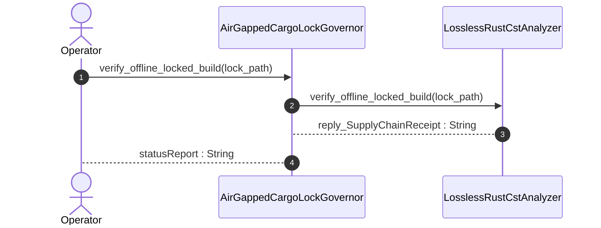

| Attribute | Specification Detail |
| :--- | :--- |
| **Issue ID** | #803 |
| **Title** | User Story 53: Verify Offline Locked Build |
| **Type** | user-story |
| **Parent Epic** | [EPIC-08-BP_08_Lossless_Rust_CST_Codemod_Engine_and_Unified_rustc_Compatible_JSON_Diagnostics](../epics/EPIC-08-BP_08_Lossless_Rust_CST_Codemod_Engine_and_Unified_rustc_Compatible_JSON_Diagnostics.md) |
| **SysML Interaction** | `BP_08_Lossless_Rust_CST_Codemod_Engine_and_Unified_rustc_Compatible_JSON_Diagnostics_SequenceInteraction` |
| **SysML Test Case** | `Test_verify_offline_locked_build` |
| **Generation Mode** | subagent |
| **Specification Source** | [schema/model.sysml](../../schema/model.sysml) |

# User Story 53: Verify Offline Locked Build

## User Story
As a `AirGappedCargoLockGovernor`, I want to invoke `verify_offline_locked_build()` on `LosslessRustCstAnalyzer`, so that verify_offline_locked_build(lock_path).

## Architectural Realization (3-Layer Definition of Done)

### Layer 1: Domain State & Data Model
- Domain state attributes on `AirGappedCargoLockGovernor` (`offline_locked_enforced: Boolean`, `vendor_bundle_supported: Boolean`) and `LosslessRustCstAnalyzer` (`max_fn_exec_sloc: Integer`, `max_fn_param_count: Integer`, `max_mut_bool_flags: Integer`, `max_predicate_arity: Integer`, `lossless_roundtrip_required: Boolean`, `deterministic_uuid: String`).
- **Contract A (100% Normative OMG SysML v2.0 + KerML 1.0 Grammar Coverage)**: Preserves full Definition and Usage symmetry across all OMG SysML v2.0 and KerML 1.0 constructs (`package`, `library package`, `standard library package`, `import`, `metadata def` / `@Metadata` / `#capability` / `#hazard` / `#risk` / `#rt_loop` / `#dal` / `#fls`, `part def`/`part`, `item def`/`item`, `attribute def`/`attribute`, `enum def`/`enum`, `port def`/`port`, `interface def`/`interface`, `connection def`/`connection`, `flow def`/`flow`, `allocation def`/`allocation`, `occurrence def`/`occurrence`, `action def`/`action`, `state def`/`state`, `calc def`/`calc`, `constraint def`/`constraint`, `requirement def`/`requirement`, `concern def`/`concern`, `use case def`/`use case`, `analysis def`/`analysis`, `verification def`/`verification`, `test case def`/`test case`, `interaction def`/`interaction`, `view def`/`view`, `viewpoint def`/`viewpoint`, `rendering def`/`rendering`, `variation`/`variant`, and KerML specialization/expressions with zero 16-construct artificial caps).
- **Contract B Supply-Chain & CST Data Model**: Parsed `cargo_lock::Lockfile`, `cargo_metadata::Metadata`, `cargo_util_schemas` / `cargo_platform` target specifications, `toml_edit::DocumentMut` manifest ASTs, and `SupplyChainReceipt` bound to action `verify_offline_locked_build(lock_path: String)`.
- Declared lifecycle state model: `BP_08_Lossless_Rust_CST_Codemod_Engine_and_Unified_rustc_Compatible_JSON_Diagnostics_LifecycleState` (`Idle`, `ParsingLosslessCst`, `AnalyzingMetricsAndTiers`, `ValidatingDisjointSpans`, `EmittingJsonDiagnostics`, `SplicingAndFormatting`, `RewritingCheck37Paths`, `VerifyingSelfHostFixedPoint`, `VerifiedClean`).

### Layer 2: Logic & State Management
- Behavioral execution contract: invokes `verify_offline_locked_build(lock_path)` on `AirGappedCargoLockGovernor` and `LosslessRustCstAnalyzer` with atomic `--offline --locked` dependency graph and SHA-256 package checksum verification via `cargo-lock`, `cargo_metadata`, `cargo-util-schemas`, `cargo-platform`, and `toml_edit`.
- State transition management: `Idle -> ParsingLosslessCst` (trigger `parseRustCst`).
- Formal constraints and requirements enforced: `C_CST_01 (max_fn_exec_sloc >= 1 and max_fn_exec_sloc <= 50)`, `C_CST_02 (max_fn_param_count >= 0 and max_fn_param_count <= 5)`, `C_CST_03 (max_mut_bool_flags >= 0 and max_mut_bool_flags <= 0)`, `C_CST_04 (stage_fixed_point_mismatch_files >= 0 and stage_fixed_point_mismatch_files <= 0)`, `C_CST_05 (runtime_llm_token_count >= 0 and runtime_llm_token_count <= 0)`, `C_CST_06 (tier_bc_max_doc_lines >= 2 and tier_bc_max_doc_lines <= 2)`, `REQ-0608 (REQ_0608_BP_08_Lossless_Rust_CST_Codemod_Engine_and_Unified_rustc_Compatible_JSON_Diagnostics)`.
- Modularity & net-negative scanner deletion target: bounds implementation inside `< 380` exec SLOC submodules (`crates/deap-core/src/rust_cst/{mod,vfs,parse,items,extract_module,doc_edit,diagnostics_ndjson}.rs`, `crates/deap-core/src/json_diag/`, `crates/compile-sysml/src/codemod/`) while executing explicit net-negative deletion of ~19,700+ lines of hand-rolled scanners (`crates/deap-core/src/workspace.rs` (356 lines), `crates/deap-core/src/rust_cst.rs` (599 lines), `crates/compile-sysml/src/docstring.rs` (549 lines), `crates/verify-baseline/src/checks/docstring_tier_rules.rs` (729 lines), `crates/verify-baseline/src/checks/structural.rs` (980 lines), and `crates/verify-baseline/src/ratchet_table.rs`).

### Layer 3: Presentation & Actuator Interface Binding
- Component port bindings: `manifest_lock_in: String (in)` and `lock_receipt_out: String (out)` on `AirGappedCargoLockGovernor`; `rust_source_in: String (in)`, `item_inventory_out: String (out)`, and `metrics_report_out: String (out)` on `LosslessRustCstAnalyzer`.
- Interaction binding (`BP_08_Lossless_Rust_CST_Codemod_Engine_and_Unified_rustc_Compatible_JSON_Diagnostics_SequenceInteraction`): routes `verify_offline_locked_build` invocation from `AirGappedCargoLockGovernor` to `LosslessRustCstAnalyzer` and returns `reply_SupplyChainReceipt`.
- Diagnostic fault surface: emits deterministic single-line `rustc`-compatible NDJSON rejection diagnostics (`DEAP-E0804`, `reason: "compiler-message"`) when `--offline --locked` or invariant checks fail.

## UML Sequence Diagram



## Formal SysML Test Case & Verification Binding
```sysml
test case def Test_verify_offline_locked_build {
    subject AirGappedCargoLockGovernor;
    verify requirement REQ_0608_BP_08_Lossless_Rust_CST_Codemod_Engine_and_Unified_rustc_Compatible_JSON_Diagnostics;
    objective "Verify air-gapped --offline --locked Cargo.lock SHA-256 package checksums via cargo-lock and cargo_metadata and enforce C_CST_01..C_CST_06.";
    step invoke_verify_offline_locked_build;
    step assert_supply_chain_receipt_and_invariants;
}
```

## Acceptance Criteria (BDD)
- [ ] AC-US-53-01: Given `LosslessRustCstAnalyzer` is in declared state `Idle` with domain state attributes (`max_fn_exec_sloc: Integer`, `max_fn_param_count: Integer`, `max_mut_bool_flags: Integer`, `max_predicate_arity: Integer`, `lossless_roundtrip_required: Boolean`, `deterministic_uuid: String`), When `AirGappedCargoLockGovernor` invokes `verify_offline_locked_build` on `LosslessRustCstAnalyzer`, Then `LosslessRustCstAnalyzer` validates and binds the request against `LosslessRustCstAnalyzer` domain state (`max_fn_exec_sloc: Integer`, `max_fn_param_count: Integer`, `max_mut_bool_flags: Integer`, `max_predicate_arity: Integer`, `lossless_roundtrip_required: Boolean`, `deterministic_uuid: String`) and transitions to `ParsingLosslessCst`.
- [ ] AC-US-53-02: Given `LosslessRustCstAnalyzer` active state management during `verify_offline_locked_build`, When `LosslessRustCstAnalyzer` evaluates formal constraint `C_CST_01 (max_fn_exec_sloc >= 1 and max_fn_exec_sloc <= 50)`, Then `LosslessRustCstAnalyzer` verifies constraint satisfaction before committing state updates.
- [ ] AC-US-53-03: Given `LosslessRustCstAnalyzer` active state management during `verify_offline_locked_build`, When `LosslessRustCstAnalyzer` evaluates formal constraint `C_CST_02 (max_fn_param_count >= 0 and max_fn_param_count <= 5)`, Then `LosslessRustCstAnalyzer` verifies constraint satisfaction before committing state updates.
- [ ] AC-US-53-04: Given `LosslessRustCstAnalyzer` active state management during `verify_offline_locked_build`, When `LosslessRustCstAnalyzer` evaluates formal constraint `C_CST_03 (max_mut_bool_flags >= 0 and max_mut_bool_flags <= 0)`, Then `LosslessRustCstAnalyzer` verifies constraint satisfaction before committing state updates.
- [ ] AC-US-53-05: Given `LosslessRustCstAnalyzer` active state management during `verify_offline_locked_build`, When `LosslessRustCstAnalyzer` evaluates formal constraint `C_CST_04 (stage_fixed_point_mismatch_files >= 0 and stage_fixed_point_mismatch_files <= 0)`, Then `LosslessRustCstAnalyzer` verifies constraint satisfaction before committing state updates.
- [ ] AC-US-53-06: Given `LosslessRustCstAnalyzer` active state management during `verify_offline_locked_build`, When `LosslessRustCstAnalyzer` evaluates formal constraint `C_CST_05 (runtime_llm_token_count >= 0 and runtime_llm_token_count <= 0)`, Then `LosslessRustCstAnalyzer` verifies constraint satisfaction before committing state updates.
- [ ] AC-US-53-07: Given `LosslessRustCstAnalyzer` ingress port binding (`rust_source_in: String`), When `LosslessRustCstAnalyzer` completes `verify_offline_locked_build`, Then `LosslessRustCstAnalyzer` delivers `reply_SupplyChainReceipt` across egress port (`item_inventory_out: String`, `metrics_report_out: String`) to `AirGappedCargoLockGovernor`.
- [ ] AC-US-53-08: Given violated formal constraint `C_CST_01 (max_fn_exec_sloc >= 1 and max_fn_exec_sloc <= 50)`, When `AirGappedCargoLockGovernor` invokes `verify_offline_locked_build` on `LosslessRustCstAnalyzer`, Then `LosslessRustCstAnalyzer` rejects the request without partial state mutation, preserves prior verified state, and emits a deterministic fault diagnostic across the interface binding.

## Required Features
- [ ] #834 - [Feature 36: [BP 08 Lossless Rust CST Codemod Engine and Unified rustc Compatible JSON Diagnostics] AirGappedCargoLockGovernor](../features/FEAT-36-AirGappedCargoLockGovernor.md) (governs `--offline --locked` dependency verification via `cargo-lock`, `cargo_metadata`, `cargo-util-schemas`, `cargo-platform`, and `toml_edit`)
- [ ] #835 - [Feature 37: [BP 08 Lossless Rust CST Codemod Engine and Unified rustc Compatible JSON Diagnostics] LosslessRustCstAnalyzer](../features/FEAT-37-LosslessRustCstAnalyzer.md) (validates `ra_ap_syntax` + `rowan` CST structural invariants `C_CST_01..C_CST_03`)

## Source References
Operational concept definitions and system sequence interaction models:
- System Architecture Model: `schema/model.sysml`
- Normative Systems Engineering Standard: ISO/IEC/IEEE 29148:2018 §6.4.2 Concept of Operations

Authoritative user story flows and interaction lifelines derive from `schema/model.sysml` pursuant to ISO/IEC/IEEE 29148.
