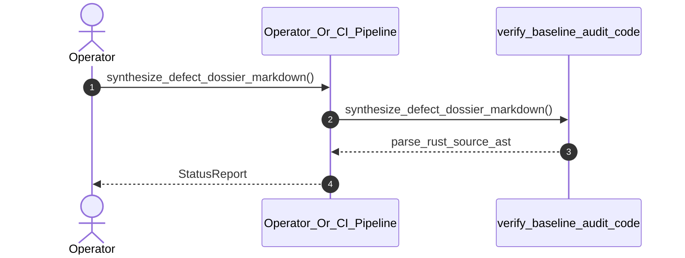

| Attribute | Specification Detail |
| :--- | :--- |
| **Issue ID** | #615 |
| **Title** | User Story 54: synthesize defect dossier markdown |
| **Type** | user-story |
| **Parent Epic** | [EPIC-06-BP_06_Deterministic_Static_5_Pillar_Code_Auditor_and_Defect_Dossier_Synthesizer_Blueprint](../epics/EPIC-06-BP_06_Deterministic_Static_5_Pillar_Code_Auditor_and_Defect_Dossier_Synthesizer_Blueprint.md) |
| **SysML Interaction** | `BP_06_Deterministic_Static_5_Pillar_Code_Auditor_and_Defect_Dossier_Synthesizer_Blueprint_SequenceInteraction` |
| **SysML Test Case** | `Test_synthesize_defect_dossier_markdown` |
| **Generation Mode** | subagent |
| **Specification Source** | [schema/subsystems/b_p_06_deterministic_static_5_pillar_code_auditor_and_defect_dossier_synthesizer_blueprint/behavior.sysml](../../schema/subsystems/b_p_06_deterministic_static_5_pillar_code_auditor_and_defect_dossier_synthesizer_blueprint/behavior.sysml) |

# User Story 54: synthesize defect dossier markdown

## UML Sequence Diagram

## Acceptance Criteria (BDD)
- [ ] AC-US-54-01: Given operational environment initialized, When synthesize_defect_dossier_markdown executes, Then verify_baseline_audit_code processes the AST within defined latency envelope.
- [ ] AC-US-54-02: Given formal constraints, When semantic validator executes, Then asserts invariant satisfaction.
- [ ] AC-US-54-03: Given exceptional conditions, When error recovery activates, Then graceful recovery occurs without data loss.

## Required Features
- [ ] #655 - [Feature 01: [BP 01 Compiler Enforced Forbid Lint Gate and Zero Suppression AST Architecture Blueprint] CompilerLintEnforcementGate](../features/FEAT-01-CompilerLintEnforcementGate.md)
- [ ] [Feature 26: [BP 06 Deterministic Static 5 Pillar Code Auditor and Defect Dossier Synthesizer Blueprint] verify_baseline_audit_code](../features/FEAT-26-verify_baseline_audit_code.md)

## Source References
Operational concept definitions and system sequence interaction models:
- Subsystem Behavior Specification: `schema/subsystems/b_p_06_deterministic_static_5_pillar_code_auditor_and_defect_dossier_synthesizer_blueprint/behavior.sysml`
- ConOps Operational Activities: `schema/conops/activities.sysml`
- System Architecture Model: `schema/model.sysml`
- Normative Systems Engineering Standard: ISO/IEC/IEEE 29148:2018 §6.4.2 Concept of Operations

Authoritative user story flows and interaction lifelines derive from `schema/subsystems/b_p_06_deterministic_static_5_pillar_code_auditor_and_defect_dossier_synthesizer_blueprint/behavior.sysml` pursuant to ISO/IEC/IEEE 29148.
