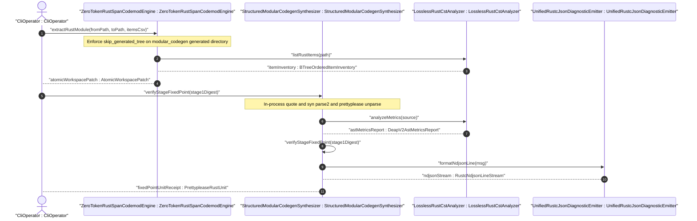
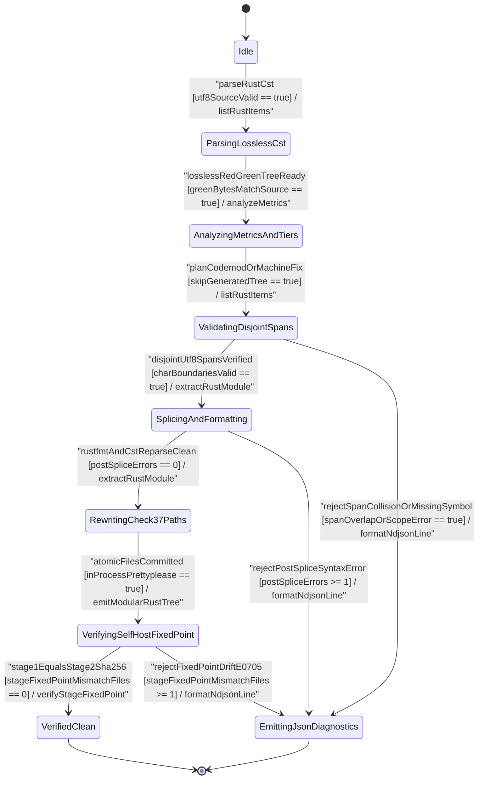

| Attribute | Specification Detail |
| :--- | :--- |
| **Issue ID** | TBD |
| **Title** | User Story 54: verify Stage Fixed Point |
| **Type** | user-story |
| **Parent Epic** | [EPIC-08-BP_08_Lossless_Rust_CST_Codemod_Engine_and_Unified_rustc_Compatible_JSON_Diagnostics](../epics/EPIC-08-BP_08_Lossless_Rust_CST_Codemod_Engine_and_Unified_rustc_Compatible_JSON_Diagnostics.md) |
| **SysML Interaction** | `BP_08_Lossless_Rust_CST_Codemod_Engine_and_Unified_rustc_Compatible_JSON_Diagnostics_SequenceInteraction` |
| **SysML Test Case** | `Test_verifyStageFixedPoint` |
| **Generation Mode** | subagent |
| **Specification Source** | [schema/model.sysml](../../schema/model.sysml) |

# User Story 54: verify Stage Fixed Point

## Parent Epic
- [ ] [EPIC-08-BP_08_Lossless_Rust_CST_Codemod_Engine_and_Unified_rustc_Compatible_JSON_Diagnostics](../epics/EPIC-08-BP_08_Lossless_Rust_CST_Codemod_Engine_and_Unified_rustc_Compatible_JSON_Diagnostics.md) (establishes deterministic lossless CST refactoring, structured in-process `syn` + `quote` + `prettyplease` modular synthesis, Stage-1 to Stage-2 SHA-256 fixed-point verification, and unified single-line `rustc`-compatible NDJSON diagnostics under **REQ-0608** and **REQ-0607**)

## Domain Object Mapping
- **Primary Domain Objects:** `StructuredModularCodegenSynthesizer` (`FEAT-43`), `ZeroTokenRustSpanCodemodEngine` (`FEAT-45`), `LosslessRustCstAnalyzer` (`FEAT-42`), `UnifiedRustcJsonDiagnosticEmitter` (`FEAT-44`), `ModularRustMultiFileEmitter` (`FEAT-38`), `SelfHostingModularCodegenCompiler` (`FEAT-39`)
- **Actor/Role:** `CliOperator` (external build runner or air-gapped CI operator invoking `compile-sysml` fixed-point verification after lowering or workspace codemod passes)

## User Story & BDD Realization

**As a** `CliOperator` executing deterministic self-hosting compiler verification under `StructuredModularCodegenSynthesizer` (`FEAT-43`),
**I want to** invoke `verifyStageFixedPoint(stage1Digest)` across the lowered 4-level `ModuleGraph` (`LoweredModuleGraphIr`) emitted in-process through `quote`, `syn::parse2`, and `prettyplease::unparse` while enforcing the `crates/compile-sysml/src/modular_codegen/generated/` docblock-compaction skip and `cfg(test)`-excluded `DocTier` rules,
**So that** Stage-1 committed Rust modules and Stage-2 re-synthesized Rust units achieve bit-for-bit SHA-256 tree parity (**C_CST_04** and **C_MOD_04** `stage_fixed_point_mismatch_files == 0`) or fail closed transactionally with a single-line `rustc`-compatible `DEAP-E0705` NDJSON diagnostic and zero partial disk writes.

**Given** committed Stage-1 modules under `crates/compile-sysml/src/modular_codegen/generated/` preserved untouched by `--compact-tier-bc` (`skip_generated_tree == true`) and a lowered `ModuleGraph` (`LoweredModuleGraphIr`) derived from `.pipeline/upstream/schema/modular_codegen.sysml`
**When** `StructuredModularCodegenSynthesizer` executes `verifyStageFixedPoint(stage1Digest)` in state `VerifyingSelfHostFixedPoint`
**Then** every Stage-2 unit is synthesized in-process via `quote` -> `syn::parse2` -> `prettyplease::unparse`, verified for `cfg(test)`-excluded `DocTier` and DEAP v2.0 modularity bounds (`MAX_AST_DEPTH = 64`), and proven SHA-256-identical to Stage 1 (`stage_fixed_point_mismatch_files == 0`) before transitioning to `VerifiedClean`.

## Architectural Realization (3-Layer Definition of Done)

### Layer 1: Domain State & Data Model
- **SysML Component & Attribute Contract:** Realizes `StructuredModularCodegenSynthesizer` (`stage_fixed_point_mismatch_files: Integer = 0`, `in_process_prettyplease: Boolean = true`) in concert with `ZeroTokenRustSpanCodemodEngine` (`skip_generated_tree: Boolean = true`, `tier_bc_max_doc_lines: Integer = 2`, `runtime_llm_token_count: Integer = 0`), `LosslessRustCstAnalyzer` (`max_fn_exec_sloc: Integer = 50`, `max_fn_param_count: Integer = 5`, `max_mut_bool_flags: Integer = 0`, `max_predicate_arity: Integer = 3`, `lossless_roundtrip_required: Boolean = true`), and `UnifiedRustcJsonDiagnosticEmitter` (`cli_binary_count: Integer = 5`, `zero_ansi_in_json_mode: Boolean = true`, `envelope_reason: String = "compiler-message"`).
- **Deterministic Rust Data Structures (`crates/compile-sysml/src/modular_codegen/emitters/rust_emitter.rs`, `crates/compile-sysml/src/modular_codegen/mod.rs`, `crates/deap-core/src/source_ast.rs`):** Enforces `#![forbid(unsafe_code)]` across pure domain types `StageTreeDigestManifest` (`unit_digests: BTreeMap<String, [u8; 32]>`, `aggregate_sha256: [u8; 32]`, `mismatch_file_count: usize`), `VerifiedUnitBuffer` (`relative_path: String`, `formatted_source: String`, `sha256_digest: [u8; 32]`, `doc_tier_verified: bool`), and `BTreeSet<String>` union path inventories (zero `HashMap` or `HashSet` nondeterminism).
- **Typed Fail-Closed Error Taxonomy:** Defines `non_exhaustive` outer-attributed `FixedPointSynthesisError` (`TokenDepthExceeded`, `SynAstParseRejected`, `PathEscapeRejected`, `CompactionBoundaryViolated`, `CfgTestDocTierScopeError`, `StageFixedPointMismatch`, `CounterOverflow`) mapped 1:1 to deterministic `DEAP-E0705`, `DEAP-E0801`, `DEAP-E0803`, and `DEAP-E0804` codes with zero `Result<T, String>` signatures.
- **Lifecycle State Model:** Bound to `BP_08_Lossless_Rust_CST_Codemod_Engine_and_Unified_rustc_Compatible_JSON_Diagnostics_LifecycleState` (`Idle`, `ParsingLosslessCst`, `AnalyzingMetricsAndTiers`, `ValidatingDisjointSpans`, `SplicingAndFormatting`, `RewritingCheck37Paths`, `VerifyingSelfHostFixedPoint`, `VerifiedClean`, `EmittingJsonDiagnostics`).

### Layer 2: Logic & State Management
- **Total Bounded Function Contract:** Every production callable enforces `<= 50` executable SLOC (satisfying **C_CST_01** `max_fn_exec_sloc <= 50` and the workspace `<= 80` exec SLOC ceiling), `<= 5` formal parameters excluding receivers (**C_CST_02** `max_fn_param_count <= 5`), `0` mutable `bool` local flags (**C_CST_03** `max_mut_bool_flags == 0`), `0` runtime LLM tokens (**C_CST_05** `runtime_llm_token_count == 0`), iterative CST and token-tree walks bounded by `MAX_AST_DEPTH = 64`, non-panicking `.get()` slice/map indexing, and `saturating_add` / `checked_add` integer arithmetic.
- **In-Process `E0705`-Preserving Structured AST Synthesis:** Lowers `BTreeMap`-ordered `ModuleGraph` items in `crates/compile-sysml/src/modular_codegen/emitters/rust_emitter.rs` via `quote` `TokenStream` generation, `syn::parse2::<syn::File>` AST validation, and `prettyplease::unparse` deterministic layout (`in_process_prettyplease == true`, zero external subprocesses), followed by in-memory `ra_ap_syntax` re-parse verification.
- **Compaction-Skip & `cfg(test)`-Excluded `DocTier` Isolation:** Enforces `skip_generated_tree == true` so `--compact-tier-bc` (`tier_bc_max_doc_lines == 2`, **C_CST_06**) skips `crates/compile-sysml/src/modular_codegen/generated/` (preserving Check-36 7-section DO-178C `DocTier::RustTierA` safety docblocks on Stage-1 files), while `crates/deap-core/src/source_ast.rs` excludes `cfg(test)`-attributed module subtrees and `test`-attributed items from production `DocTier` classification and `production_exec_sloc` accounting.
- **Transactional Fixed-Point Gate:** Compares Stage-1 (`crates/compile-sysml/src/modular_codegen/generated/mod.rs` subtree) and isolated Stage-2 SHA-256 manifests across the `BTreeSet` union of normalized relative paths. Transitions `VerifyingSelfHostFixedPoint -> VerifiedClean` on `stage1EqualsStage2Sha256` (`stage_fixed_point_mismatch_files == 0`, **C_CST_04** / **C_MOD_04**), or transitions `VerifyingSelfHostFixedPoint -> EmittingJsonDiagnostics` on `rejectFixedPointDriftE0705` while discarding uncommitted staging buffers.

### Layer 3: Presentation & Actuator Interface Binding
- **SysML Port & Protocol Bindings:** `StructuredModularCodegenSynthesizer` consumes `lowered_ir_in: String` (`LoweredModuleGraphIr` protocol) and emits `formatted_rust_out: String` (`PrettypleaseRustUnit` protocol); fault outcomes route to `UnifiedRustcJsonDiagnosticEmitter` ingress `finding_in: String` (`DeapDiagnosticFinding`) and egress `ndjson_out: String` (`RustcNdjsonLineStream`).
- **CLI & `--message-format=json` NDJSON Surface (`crates/compile-sysml/src/cli.rs`, `crates/deap-core/src/diagnostics.rs`):** Binds `compile-sysml` fixed-point verification (`--emit-modular-rust` / `--verify-stage-fixed-point` with `--message-format=json`) to single-line `rustc`-compatible NDJSON serialization (`reason: "compiler-message"`, `message.code.code` prefixed `"DEAP-E"`, UTF-8 `byte_start`/`byte_end` and 1-based line/column `spans`, `zero_ansi_in_json_mode == true` guaranteeing zero `0x0A` embedded newlines and zero `0x1B` ANSI escape sequences) with deterministic process exit codes (`0` on `VerifiedClean`, `1` on `EmittingJsonDiagnostics`).

## Target Rust Module Paths & Atomic Implementation Micro-Tasks

| Micro-Task ID | Target Rust Module Path | Callable / Type Signature (`<= 5` Params, Zero `Result<T, String>`) | Exec SLOC Cap | Traceability (`[REQ-*]` & `[FLS: fls_*]`) |
| :--- | :--- | :--- | :--- | :--- |
| `MT-US54-01` | `crates/compile-sysml/src/modular_codegen/emitters/rust_emitter.rs` | `pub struct StageTreeDigestManifest` (`BTreeMap<String, [u8; 32]>`) and `non_exhaustive` `pub enum FixedPointSynthesisError` | `<= 45` SLOC | `[REQ-0608]`, `[REQ-0607]`, `[FLS: fls_9ucqbbd0s2yo]` |
| `MT-US54-02` | `crates/deap-core/src/source_ast.rs` | `pub fn verify_cfg_test_excluded_doc_tiers(source: &str, unit_path: &str, skip_generated_tree: bool, max_ast_depth: usize) -> Result<DeapV2AstMetrics, FixedPointSynthesisError>` | `<= 50` SLOC | `[REQ-0608]`, `[REQ-0607]`, `[FLS: fls_utuu8mdbuyxm]` |
| `MT-US54-03` | `crates/compile-sysml/src/modular_codegen/emitters/rust_emitter.rs` | `pub fn synthesize_prettyplease_unit(unit_path: &str, tokens: TokenStream, max_ast_depth: usize) -> Result<VerifiedUnitBuffer, FixedPointSynthesisError>` | `<= 48` SLOC | `[REQ-0608]`, `[REQ-0607]`, `[FLS: fls_qcb1n9c0e5hz]` |
| `MT-US54-04` | `crates/compile-sysml/src/modular_codegen/mod.rs` | `pub fn verify_stage_fixed_point(stage1_dir: &Path, stage2_units: &BTreeMap<String, VerifiedUnitBuffer>, expected_stage1_digest: &[u8; 32]) -> Result<StageTreeDigestManifest, FixedPointSynthesisError>` | `<= 50` SLOC | `[REQ-0608]`, `[REQ-0607]`, `[FLS: fls_exe4zodlwfez]` |
| `MT-US54-05` | `crates/compile-sysml/src/cli.rs` and `crates/deap-core/src/diagnostics.rs` | `pub fn emit_fixed_point_ndjson_outcome(outcome: &Result<StageTreeDigestManifest, FixedPointSynthesisError>, json_mode: bool, writer: &mut dyn Write) -> Result<i32, FixedPointSynthesisError>` | `<= 42` SLOC | `[REQ-0608]`, `[FLS: fls_7bxv8lybxm18]` |

- **Micro-Task Behavioral Guarantees:**
  1. `MT-US54-01` seals immutable `BTreeMap<String, [u8; 32]>` relative-path SHA-256 manifests and typed `FixedPointSynthesisError` variants under `#![forbid(unsafe_code)]`, eliminating stringly-typed error returns and hash-order nondeterminism across `crates/compile-sysml/src/modular_codegen/generated/mod.rs` and `crates/deap-core/src/sysml_ast/mod.rs` consumers (`[REQ-0608]`, `[REQ-0607]`, `[FLS: fls_9ucqbbd0s2yo]`).
  2. `MT-US54-02` enforces canonical path confinement and unconditional `modular_codegen/generated/` skip when `skip_generated_tree == true` during `--compact-tier-bc`, and traverses `ra_ap_syntax::SourceFile::parse` Red/Green trees iteratively up to `MAX_AST_DEPTH = 64` (using `.get()` child indexing and `saturating_add` depth counters) to exclude `cfg(test)`-attributed modules and `test`-attributed items from `DocTier::RustTierA` / `DocTier::RustTierBC` and `production_exec_sloc` checks (`[REQ-0608]`, `[REQ-0607]`, `[FLS: fls_utuu8mdbuyxm]`).
  3. `MT-US54-03` validates `quote` `TokenStream` nesting depth `<= MAX_AST_DEPTH` (`64`), parses tokens via `syn::parse2::<syn::File>` (`DEAP-E0803` on failure), formats deterministically in-process via `prettyplease::unparse`, and re-verifies post-render `cfg(test)`-excluded `DocTier` and **C_CST_01**..**C_CST_03** bounds to preserve `E0705` AST emission idempotence (`[REQ-0608]`, `[REQ-0607]`, `[FLS: fls_qcb1n9c0e5hz]`).
  4. `MT-US54-04` computes SHA-256 digests (`crates/deap-core/src/digest.rs`) over Stage-1 files in `crates/compile-sysml/src/modular_codegen/generated/` and isolated Stage-2 `VerifiedUnitBuffer` entries, evaluates union keys in `BTreeSet` order via `.get()` lookups and `checked_add` / `saturating_add` mismatch counters, and enforces **C_CST_04** / **C_MOD_04** (`stage_fixed_point_mismatch_files == 0`) prior to atomic commit (`[REQ-0608]`, `[REQ-0607]`, `[FLS: fls_exe4zodlwfez]`).
  5. `MT-US54-05` formats any `FixedPointSynthesisError` through `UnifiedRustcJsonDiagnosticEmitter` (`crates/deap-core/src/diagnostics.rs`) into a single-line zero-ANSI `compiler-message` NDJSON frame (`DEAP-E0705`, `DEAP-E0801`, `DEAP-E0803`, `DEAP-E0804`) when `--message-format=json` is active (`[REQ-0608]`, `[FLS: fls_7bxv8lybxm18]`).

## UML Sequence Diagram



## UML State Machine Diagram



## Operational Context & Mathematical Formulations

`StructuredModularCodegenSynthesizer` (**REQ-0608** / **BP-08** and **REQ-0607** / **BP-07**) isolates machine-generated self-hosting compiler modules under `crates/compile-sysml/src/modular_codegen/generated/` from CST docstring-compaction codemods (`skip_generated_tree == true`). Every lowered `ModuleGraph` compilation unit $u \in \mathcal{U}$ is synthesized purely in-process through deterministic `BTreeMap` lexical ordering, `quote` token emission, `syn::parse2` syntax-tree validation bounded by $D_{\max}$, and `prettyplease::unparse` canonical formatting:

$$
\begin{aligned}
E_{\text{mod}}(M) &= U_{\text{pretty}}(P_{\text{syn}}(Q_{\text{quote}}(M))) \\
\Delta_{\text{diff}}(T_{1}, T_{2}) &= \lvert \{ p \in \mathcal{P}(T_{1}) \cup \mathcal{P}(T_{2}) \mid H(T_{1}, p) \neq H(T_{2}, p) \} \rvert \\
\Delta_{\text{diff}}(T_{1}, T_{2}) &= 0 \iff D_{\text{tree}}(T_{1}) = D_{\text{tree}}(T_{2})
\end{aligned}
$$

- Parameter Definitions & Engineering Units:
- $M$: Lowered 4-level `ModuleGraph` intermediate representation (`LoweredModuleGraphIr`, dimensionless AST descriptor).
- $Q_{\text{quote}}, P_{\text{syn}}, U_{\text{pretty}}$: Deterministic in-process `quote` token-stream projection, `syn::parse2` AST validation operator (bounded by `MAX_AST_DEPTH = 64` levels), and `prettyplease::unparse` source layout operator (`in_process_prettyplease = true`, `0` external subprocesses, `runtime_llm_token_count = 0` tokens).
- $T_{1}, T_{2}$: Committed Stage-1 generated tree (`crates/compile-sysml/src/modular_codegen/generated/`) and isolated Stage-2 re-synthesized tree.
- $\mathcal{P}(T)$: `BTreeSet`-ordered set of normalized relative `.rs` file paths within tree $T$ (files).
- $H(T, p)$: 256-bit SHA-256 digest of file $p$ in tree $T$ (or sentinel zero vector when $p \notin \mathcal{P}(T)$).
- $\Delta_{\text{diff}}(T_{1}, T_{2})$: Count of divergent relative file paths (`stage_fixed_point_mismatch_files`, constrained to exactly `0` files by **C_CST_04** and **C_MOD_04**).
- $D_{\text{tree}}(T)$: Aggregate SHA-256 manifest digest across all `(p, H(T, p))` entries in deterministic `BTreeMap` key order (bytes).

## Acceptance Criteria (BDD)

- [ ] **AC-US-54-01 (Nominal -- Stage-1 == Stage-2 Metacircular SHA-256 Fixed-Point Parity, Bound to `Test_verifyStageFixedPoint` and `TEST_US54_01_NominalStageFixedPointParity`):** **Given** `StructuredModularCodegenSynthesizer` enters `VerifyingSelfHostFixedPoint` upon `atomicFilesCommitted` with `.pipeline/upstream/schema/modular_codegen.sysml` lowered to `LoweredModuleGraphIr` and committed Stage-1 modules present in `crates/compile-sysml/src/modular_codegen/generated/`, **When** `verifyStageFixedPoint(stage1Digest)` synthesizes Stage-2 units in-process via `quote` -> `syn::parse2` -> `prettyplease::unparse` (`in_process_prettyplease == true`, **C_CST_05** `runtime_llm_token_count == 0`) and evaluates `verify_stage_fixed_point`, **Then** `SHA-256(Stage 1) == SHA-256(Stage 2)` holds across 100% of `BTreeMap`-ordered relative paths (**C_CST_04** and **C_MOD_04** `stage_fixed_point_mismatch_files == 0`), `VerifyingSelfHostFixedPoint` transitions via `stage1EqualsStage2Sha256` to `VerifiedClean`, and `compile-sysml` exits with code `0`.
- [ ] **AC-US-54-02 (Boundary -- `modular_codegen/generated/` Compaction Skip, `cfg(test)`-Excluded `DocTier`, and Exact `MAX_AST_DEPTH = 64` Envelope, Bound to `TEST_US54_02_BoundaryCompactionSkipAndCfgTestDocTier`):** **Given** a workspace fixture containing external `DocTier::RustTierBC` items with 28-line docblocks, committed Stage-1 7-section Check-36 `DocTier::RustTierA` modules inside `crates/compile-sysml/src/modular_codegen/generated/`, `cfg(test)`-attributed modules containing `test`-attributed functions exceeding `50` lines, and production syntax trees at exact boundary `MAX_AST_DEPTH = 64` (`50` exec SLOC per **C_CST_01**, `5` parameters per **C_CST_02**, `0` mutable `bool` flags per **C_CST_03**), **When** `compile-sysml --compact-tier-bc` executes with `skip_generated_tree == true` followed by `verifyStageFixedPoint(stage1Digest)`, **Then** external `DocTier::RustTierBC` docblocks compact to `2` lines (**C_CST_06**), `crates/compile-sysml/src/modular_codegen/generated/` remains byte-for-byte unmutated, `cfg(test)` and `test` subtrees are excluded from `DocTier` and `production_exec_sloc`, and `stage_fixed_point_mismatch_files == 0` is verified with exit code `0`.
- [ ] **AC-US-54-03 (Fail-Closed Fault Injection `UCA-BP08-012` / `FM-BP08-012` & `FM-BP08-010` -- Stage-1 vs Stage-2 SHA-256 Drift & Compaction-Skip Breach `DEAP-E0705`, Bound to `TEST_US54_03_FailClosedStageFixedPointDriftE0705`):** **Given** a fault-injected Stage-1 versus Stage-2 divergence (either a 1-byte docstring/whitespace mutation simulating a bypassed `modular_codegen/generated/` compaction skip or an extra/missing `.rs` relative path in Stage 2) executed with `--message-format=json`, **When** `StructuredModularCodegenSynthesizer` runs `verify_stage_fixed_point`, **Then** `mismatch_file_count >= 1` violates **C_CST_04**, triggers `rejectFixedPointDriftE0705` to `EmittingJsonDiagnostics`, discards isolated Stage-2 buffers with zero partial target writes, and emits a single-line zero-ANSI `compiler-message` NDJSON diagnostic carrying `message.code.code == "DEAP-E0705"` with exit code `1`.
- [ ] **AC-US-54-04 (Fail-Closed Fault Injection `UCA-BP08-009` / `FM-BP08-009` -- Malformed `quote` TokenStream Rejected by `syn::parse2` or Path Traversal Escape `DEAP-E0803`, Bound to `TEST_US54_04_FailClosedMalformedSynAstAndPathEscapeE0803`):** **Given** a fault-injected `LoweredModuleGraphIr` unit carrying either syntactically invalid `quote` tokens rejected by `syn::parse2::<syn::File>` or a non-canonical relative path (`..` or leading `/`) escaping `crates/compile-sysml/src/modular_codegen/generated/` under `--message-format=json`, **When** `synthesize_prettyplease_unit` validates the candidate unit prior to `prettyplease::unparse`, **Then** execution aborts fail-closed without invoking external processes or mutating disk files, transitions to `EmittingJsonDiagnostics`, emits a single-line zero-ANSI `compiler-message` NDJSON record with `message.code.code == "DEAP-E0803"`, and exits with code `1`.
- [ ] **AC-US-54-05 (Fail-Closed Fault Injection `UCA-BP08-011` / `FM-BP08-011` & `FM-BP08-006` -- `MAX_AST_DEPTH = 64` Exhaustion & Unbalanced `cfg(test)` Scope `DEAP-E0804` / `DEAP-E0801`, Bound to `TEST_US54_05_FailClosedAstDepthAndCfgTestScopeE0804`):** **Given** a fault-injected syntax or token tree nested to depth `65` (`> MAX_AST_DEPTH = 64`) or a malformed unbalanced `cfg(test)` attribute span evaluated during `verify_cfg_test_excluded_doc_tiers` under `--message-format=json`, **When** `StructuredModularCodegenSynthesizer` validates Stage-2 unit invariants, **Then** iterative bounded traversal halts without stack overflow, transitions fail-closed to `EmittingJsonDiagnostics`, emits a single-line zero-ANSI `compiler-message` NDJSON diagnostic (`"DEAP-E0804"` on depth/counter exhaustion or `"DEAP-E0801"` on scope error), preserves prior verified disk state, and exits with code `1`.

## Formal SysML Test Case & Verification Binding

- **Primary Compiler-Owned SysML Test Case Def:** `Test_verifyStageFixedPoint`
- **Bound BDD Scenario Test Case Defs:** `TEST_US54_01_NominalStageFixedPointParity`, `TEST_US54_02_BoundaryCompactionSkipAndCfgTestDocTier`, `TEST_US54_03_FailClosedStageFixedPointDriftE0705`, `TEST_US54_04_FailClosedMalformedSynAstAndPathEscapeE0803`, `TEST_US54_05_FailClosedAstDepthAndCfgTestScopeE0804`
- **Subject Part:** `StructuredModularCodegenSynthesizer`
- **Verified Safety Requirements:** `REQ_0608_BP_08_Lossless_Rust_CST_Codemod_Engine_and_Unified_rustc_Compatible_JSON_Diagnostics`, `REQ_0607_BP_07_Self_Hosting_4_Level_Modular_Multi_File_Code_Generator_Blueprint`
- **Verification Objective:** "Prove deterministic in-process syn/quote/prettyplease AST emission, modular_codegen/generated/ compaction-skip preservation, cfg(test)-excluded DocTier enforcement, Stage-1 == Stage-2 SHA-256 fixed-point parity (C_CST_04), and fail-closed single-line DEAP-E0705/E0801/E0803/E0804 NDJSON diagnostics across nominal, boundary, and UCA fault-injection scenarios."

```sysml
test case def Test_verifyStageFixedPoint {
    subject StructuredModularCodegenSynthesizer;
    verify requirement REQ_0608_BP_08_Lossless_Rust_CST_Codemod_Engine_and_Unified_rustc_Compatible_JSON_Diagnostics;
    objective "Master verification harness orchestrating nominal, boundary, and fail-closed Stage-1 to Stage-2 SHA-256 fixed-point verification on StructuredModularCodegenSynthesizer.";
    step ingest_lowered_module_graph_ir;
    step synthesize_stage2_via_syn_quote_prettyplease;
    step assert_stage1_equals_stage2_sha256_or_fail_closed_ndjson;
}

test case def TEST_US54_01_NominalStageFixedPointParity {
    subject StructuredModularCodegenSynthesizer;
    verify requirement REQ_0608_BP_08_Lossless_Rust_CST_Codemod_Engine_and_Unified_rustc_Compatible_JSON_Diagnostics;
    verify requirement REQ_0607_BP_07_Self_Hosting_4_Level_Modular_Multi_File_Code_Generator_Blueprint;
    objective "Verify nominal Stage-1 == Stage-2 SHA-256 tree parity (C_CST_04 and C_MOD_04 stage_fixed_point_mismatch_files == 0) via in-process quote, syn::parse2, and prettyplease::unparse.";
    step load_committed_stage1_manifest;
    step emit_isolated_stage2_prettyplease_units;
    step assert_zero_mismatch_files_and_verified_clean_state;
}

test case def TEST_US54_02_BoundaryCompactionSkipAndCfgTestDocTier {
    subject StructuredModularCodegenSynthesizer;
    verify requirement REQ_0608_BP_08_Lossless_Rust_CST_Codemod_Engine_and_Unified_rustc_Compatible_JSON_Diagnostics;
    objective "Verify skip_generated_tree compaction skip over modular_codegen/generated/, cfg(test)-excluded DocTier classification, and exact MAX_AST_DEPTH = 64 boundary acceptance.";
    step run_tier_bc_compaction_across_mixed_workspace_fixture;
    step verify_generated_tree_unmutated_and_cfg_test_excluded;
    step assert_boundary_depth_64_fixed_point_clean;
}

test case def TEST_US54_03_FailClosedStageFixedPointDriftE0705 {
    subject StructuredModularCodegenSynthesizer;
    verify requirement REQ_0608_BP_08_Lossless_Rust_CST_Codemod_Engine_and_Unified_rustc_Compatible_JSON_Diagnostics;
    verify requirement REQ_0607_BP_07_Self_Hosting_4_Level_Modular_Multi_File_Code_Generator_Blueprint;
    objective "Inject UCA-BP08-012 / FM-BP08-012 Stage-1 vs Stage-2 SHA-256 divergence and verify fail-closed DEAP-E0705 single-line NDJSON emission with zero partial disk writes.";
    step inject_single_byte_or_path_drift_in_staged_tree;
    step execute_verify_stage_fixed_point_in_json_mode;
    step assert_exit_code_1_zero_partial_writes_and_deap_e0705_ndjson;
}

test case def TEST_US54_04_FailClosedMalformedSynAstAndPathEscapeE0803 {
    subject StructuredModularCodegenSynthesizer;
    verify requirement REQ_0608_BP_08_Lossless_Rust_CST_Codemod_Engine_and_Unified_rustc_Compatible_JSON_Diagnostics;
    objective "Inject UCA-BP08-009 / FM-BP08-009 malformed quote TokenStream or path-escaping unit path and verify fail-closed DEAP-E0803 single-line NDJSON rejection prior to prettyplease::unparse.";
    step inject_malformed_token_stream_and_traversal_path;
    step execute_synthesize_prettyplease_unit_in_json_mode;
    step assert_exit_code_1_and_deap_e0803_ndjson;
}

test case def TEST_US54_05_FailClosedAstDepthAndCfgTestScopeE0804 {
    subject StructuredModularCodegenSynthesizer;
    verify requirement REQ_0608_BP_08_Lossless_Rust_CST_Codemod_Engine_and_Unified_rustc_Compatible_JSON_Diagnostics;
    objective "Inject UCA-BP08-011 / FM-BP08-011 depth-65 nested syntax tree (> MAX_AST_DEPTH = 64) and unbalanced cfg(test) scope and verify fail-closed DEAP-E0804 / DEAP-E0801 single-line NDJSON diagnostics.";
    step inject_depth_65_ast_and_unbalanced_cfg_test_fixture;
    step execute_verify_cfg_test_excluded_doc_tiers_in_json_mode;
    step assert_no_stack_overflow_exit_code_1_and_ndjson_diagnostic;
}
```

## Logical UI & Interface Bindings

| Interface Channel | Category | Target Component / Handler | Target Container / Endpoint | Data Source Binding |
| --- | --- | --- | --- | --- |
| `cli` | Deterministic Compiler CLI | `StructuredModularCodegenSynthesizer` (`crates/compile-sysml/src/cli.rs`) | `compile-sysml --emit-modular-rust` / `--verify-stage-fixed-point` | `schema/model.sysml` (`StructuredModularCodegenSynthesizer::formatted_rust_out`) |
| `ndjson` | M2M `rustc`-Compatible JSON Stream | `UnifiedRustcJsonDiagnosticEmitter` (`crates/deap-core/src/diagnostics.rs`) | `stdout` (`--message-format=json`, `reason: "compiler-message"`) | `schema/model.sysml` (`UnifiedRustcJsonDiagnosticEmitter::ndjson_out`) |

## Required Features

- [ ] [Feature 43: [BP 08 Lossless Rust CST Codemod Engine and Unified rustc Compatible JSON Diagnostics] StructuredModularCodegenSynthesizer](../features/FEAT-43-StructuredModularCodegenSynthesizer.md) (primary host component realizing `verifyStageFixedPoint`, in-process `quote` + `syn::parse2` + `prettyplease::unparse` synthesis, and **C_CST_04** Stage-1 == Stage-2 SHA-256 tree parity)
- [ ] [Feature 42: [BP 08 Lossless Rust CST Codemod Engine and Unified rustc Compatible JSON Diagnostics] LosslessRustCstAnalyzer](../features/FEAT-42-LosslessRustCstAnalyzer.md) (provides `MAX_AST_DEPTH = 64` lossless `ra_ap_syntax` + `rowan` Red/Green CST parsing, `cfg(test)`-excluded `DocTier` classification, and **C_CST_01**..**C_CST_03** AST metric verification)
- [ ] [Feature 45: [BP 08 Lossless Rust CST Codemod Engine and Unified rustc Compatible JSON Diagnostics] ZeroTokenRustSpanCodemodEngine](../features/FEAT-45-ZeroTokenRustSpanCodemodEngine.md) (enforces `skip_generated_tree == true` exclusion of `crates/compile-sysml/src/modular_codegen/generated/` during `--compact-tier-bc` docblock compaction prior to fixed-point verification)
- [ ] [Feature 44: [BP 08 Lossless Rust CST Codemod Engine and Unified rustc Compatible JSON Diagnostics] UnifiedRustcJsonDiagnosticEmitter](../features/FEAT-44-UnifiedRustcJsonDiagnosticEmitter.md) (serializes fail-closed `DEAP-E0705`, `DEAP-E0801`, `DEAP-E0803`, and `DEAP-E0804` rejections as single-line zero-ANSI `rustc`-compatible `compiler-message` NDJSON lines)
- [ ] [Feature 41: [BP 08 Lossless Rust CST Codemod Engine and Unified rustc Compatible JSON Diagnostics] AirGappedCargoLockGovernor](../features/FEAT-41-AirGappedCargoLockGovernor.md) (guarantees reproducible `--offline --locked` `Cargo.lock` dependency pinning for `syn`, `quote`, `proc-macro2`, and `prettyplease` in air-gapped environments)
- [ ] [Feature 38: [BP 07 Self Hosting 4 Level Modular Multi File Code Generator Blueprint] ModularRustMultiFileEmitter](../features/FEAT-38-ModularRustMultiFileEmitter.md) (establishes Check-36 7-section DO-178C safety docstrings and atomic multi-file Stage-1 persistence under `crates/compile-sysml/src/modular_codegen/generated/`)
- [ ] [Feature 39: [BP 07 Self Hosting 4 Level Modular Multi File Code Generator Blueprint] SelfHostingModularCodegenCompiler](../features/FEAT-39-SelfHostingModularCodegenCompiler.md) (defines **REQ-0607** / **C_MOD_04** metacircular Stage-1 to Stage-2 SHA-256 bootstrap fixed-point invariant)

## Source References
Operational concept definitions, failure mode derivations, and system sequence interaction models:
- System Architecture Model: [schema/model.sysml](../../schema/model.sysml)
- Upstream Engineering Blueprints: `docs/designs/blueprint-08-rust-analyzer-cst-refactoring-and-json-diagnostics.sysml` and `docs/designs/blueprint-07-self-hosting-modular-codegen-compiler.sysml`
- Component Failure Mode Registry: [docs/research/FAILURE_MODE_REGISTRY.md](../research/FAILURE_MODE_REGISTRY.md) (`FM-BP08-009`..`FM-BP08-012`, `FM-BP07-017`..`FM-BP07-020`, `FM-BP07-029`..`FM-BP07-036`)
- Normative Systems Engineering Standard: ISO/IEC/IEEE 29148:2018 Section 6.4.2 Concept of Operations

Authoritative user story flows, failure mode mitigations, and interaction lifelines derive from `schema/model.sysml` pursuant to ISO/IEC/IEEE 29148.
