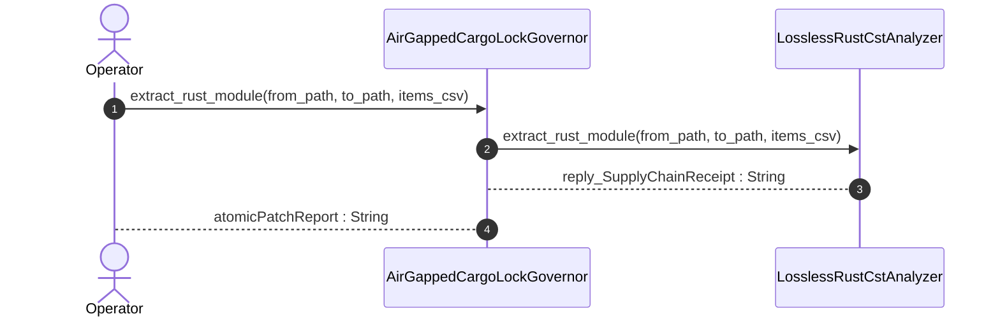

| Attribute | Specification Detail |
| :--- | :--- |
| **Issue ID** | #805 |
| **Title** | User Story 55: Extract Rust Module |
| **Type** | user-story |
| **Parent Epic** | [EPIC-08-BP_08_Lossless_Rust_CST_Codemod_Engine_and_Unified_rustc_Compatible_JSON_Diagnostics](../epics/EPIC-08-BP_08_Lossless_Rust_CST_Codemod_Engine_and_Unified_rustc_Compatible_JSON_Diagnostics.md) |
| **SysML Interaction** | `BP_08_Lossless_Rust_CST_Codemod_Engine_and_Unified_rustc_Compatible_JSON_Diagnostics_SequenceInteraction` |
| **SysML Test Case** | `Test_extract_rust_module` |
| **Generation Mode** | subagent |
| **Specification Source** | [schema/model.sysml](../../schema/model.sysml) |

# User Story 55: Extract Rust Module

## User Story
As a `AirGappedCargoLockGovernor`, I want to invoke `extract_rust_module()` on `LosslessRustCstAnalyzer`, so that extract_rust_module(from_path, to_path, items_csv).

## Architectural Realization (3-Layer Definition of Done)

### Layer 1: Domain State & Data Model
- Domain state attributes on `ZeroTokenRustSpanCodemodEngine` (`runtime_llm_token_count: Integer`, `tier_bc_max_doc_lines: Integer`, `skip_generated_tree: Boolean`, `rewrite_check37_citations: Boolean`) and `LosslessRustCstAnalyzer` (`max_fn_exec_sloc: Integer`, `max_fn_param_count: Integer`, `max_mut_bool_flags: Integer`, `max_predicate_arity: Integer`, `lossless_roundtrip_required: Boolean`, `deterministic_uuid: String`).
- **Contract A (100% Normative OMG SysML v2.0 + KerML 1.0 Grammar Coverage)**: Preserves full Definition and Usage symmetry across the OMG SysML v2.0 and KerML 1.0 textual grammar with zero 16-construct artificial caps.
- **Contract B Span-Splice & Markdown AST Data Model**: `SpanSpliceEdit` (`ra_ap_text_edit::TextEdit` + `rowan::TextRange`), `ra_ap_syntax::SourceFile` Red/Green syntax trees, and `pulldown-cmark` / `pulldown-cmark-to-cmark` CommonMark AST nodes bound to `extract_rust_module(from_path: String, to_path: String, items_csv: String)`.
- Declared lifecycle state model: `BP_08_Lossless_Rust_CST_Codemod_Engine_and_Unified_rustc_Compatible_JSON_Diagnostics_LifecycleState` (`Idle`, `ParsingLosslessCst`, `AnalyzingMetricsAndTiers`, `ValidatingDisjointSpans`, `EmittingJsonDiagnostics`, `SplicingAndFormatting`, `RewritingCheck37Paths`, `VerifyingSelfHostFixedPoint`, `VerifiedClean`).

### Layer 2: Logic & State Management
- Behavioral execution contract: invokes `extract_rust_module(from_path, to_path, items_csv)` with pairwise `TextRange` disjointness verification (`Invariant_REQ_0608_SC_02`), reverse-byte-order `ra_ap_text_edit::TextEdit` splicing, post-splice `ra_ap_syntax::SourceFile::parse` validation, and lossless `pulldown-cmark` + `pulldown-cmark-to-cmark` Check 37 path rewriting (`C_CST_05` `runtime_llm_token_count == 0`).
- State transition management: `Idle -> ParsingLosslessCst` (trigger `parseRustCst`).
- Formal constraints and requirements enforced: `C_CST_01 (max_fn_exec_sloc >= 1 and max_fn_exec_sloc <= 50)`, `C_CST_02 (max_fn_param_count >= 0 and max_fn_param_count <= 5)`, `C_CST_03 (max_mut_bool_flags >= 0 and max_mut_bool_flags <= 0)`, `C_CST_04 (stage_fixed_point_mismatch_files >= 0 and stage_fixed_point_mismatch_files <= 0)`, `C_CST_05 (runtime_llm_token_count >= 0 and runtime_llm_token_count <= 0)`, `C_CST_06 (tier_bc_max_doc_lines >= 2 and tier_bc_max_doc_lines <= 2)`, `REQ-0608 (REQ_0608_BP_08_Lossless_Rust_CST_Codemod_Engine_and_Unified_rustc_Compatible_JSON_Diagnostics)`.
- Modularity & net-negative scanner deletion target: bounds implementation inside `< 380` exec SLOC submodules (`crates/deap-core/src/rust_cst/{extract_module,doc_edit}.rs`, `crates/compile-sysml/src/codemod/`) while executing explicit net-negative deletion of ~19,700+ lines of hand-rolled scanners (`crates/deap-core/src/rust_cst.rs` (599 lines), `crates/compile-sysml/src/docstring.rs` (549 lines), `crates/verify-baseline/src/checks/docstring_tier_rules.rs` (729 lines), `crates/verify-baseline/src/checks/structural.rs` (980 lines), `crates/deap-core/src/workspace.rs` (356 lines), and `crates/verify-baseline/src/ratchet_table.rs`).

### Layer 3: Presentation & Actuator Interface Binding
- Component port bindings: `codemod_command_in: String (in)`, `atomic_patch_out: String (out)`, `codemod_error_out: String (out)` on `ZeroTokenRustSpanCodemodEngine`; `rust_source_in: String (in)`, `item_inventory_out: String (out)`, `metrics_report_out: String (out)` on `LosslessRustCstAnalyzer`.
- Interaction binding (`BP_08_Lossless_Rust_CST_Codemod_Engine_and_Unified_rustc_Compatible_JSON_Diagnostics_SequenceInteraction`): routes `extract_rust_module` invocation from `AirGappedCargoLockGovernor` to `LosslessRustCstAnalyzer` and `ZeroTokenRustSpanCodemodEngine` and returns `reply_SupplyChainReceipt`.
- Diagnostic fault surface: routes `DEAP-E0801` (missing symbol), `DEAP-E0802` (overlapping spans), and `DEAP-E0803` (post-splice CST syntax error) across `BP_08_CodemodToDiagnosticEmitterConnection` as single-line NDJSON diagnostics.

## UML Sequence Diagram



## Formal SysML Test Case & Verification Binding
```sysml
test case def Test_extract_rust_module {
    subject ZeroTokenRustSpanCodemodEngine;
    verify requirement REQ_0608_BP_08_Lossless_Rust_CST_Codemod_Engine_and_Unified_rustc_Compatible_JSON_Diagnostics;
    objective "Verify zero-LLM-token atomic module extraction via ra_ap_text_edit, post-splice ra_ap_syntax verification, and pulldown-cmark Check 37 path rewriting.";
    step invoke_extract_rust_module;
    step assert_disjoint_splice_and_check37_rewrites;
}
```

## Acceptance Criteria (BDD)
- [ ] AC-US-55-01: Given `LosslessRustCstAnalyzer` is in declared state `Idle` with domain state attributes (`max_fn_exec_sloc: Integer`, `max_fn_param_count: Integer`, `max_mut_bool_flags: Integer`, `max_predicate_arity: Integer`, `lossless_roundtrip_required: Boolean`, `deterministic_uuid: String`), When `AirGappedCargoLockGovernor` invokes `extract_rust_module` on `LosslessRustCstAnalyzer`, Then `LosslessRustCstAnalyzer` validates and binds the request against `LosslessRustCstAnalyzer` domain state (`max_fn_exec_sloc: Integer`, `max_fn_param_count: Integer`, `max_mut_bool_flags: Integer`, `max_predicate_arity: Integer`, `lossless_roundtrip_required: Boolean`, `deterministic_uuid: String`) and transitions to `ParsingLosslessCst`.
- [ ] AC-US-55-02: Given `LosslessRustCstAnalyzer` active state management during `extract_rust_module`, When `LosslessRustCstAnalyzer` evaluates formal constraint `C_CST_01 (max_fn_exec_sloc >= 1 and max_fn_exec_sloc <= 50)`, Then `LosslessRustCstAnalyzer` verifies constraint satisfaction before committing state updates.
- [ ] AC-US-55-03: Given `LosslessRustCstAnalyzer` active state management during `extract_rust_module`, When `LosslessRustCstAnalyzer` evaluates formal constraint `C_CST_02 (max_fn_param_count >= 0 and max_fn_param_count <= 5)`, Then `LosslessRustCstAnalyzer` verifies constraint satisfaction before committing state updates.
- [ ] AC-US-55-04: Given `LosslessRustCstAnalyzer` active state management during `extract_rust_module`, When `LosslessRustCstAnalyzer` evaluates formal constraint `C_CST_03 (max_mut_bool_flags >= 0 and max_mut_bool_flags <= 0)`, Then `LosslessRustCstAnalyzer` verifies constraint satisfaction before committing state updates.
- [ ] AC-US-55-05: Given `LosslessRustCstAnalyzer` active state management during `extract_rust_module`, When `LosslessRustCstAnalyzer` evaluates formal constraint `C_CST_04 (stage_fixed_point_mismatch_files >= 0 and stage_fixed_point_mismatch_files <= 0)`, Then `LosslessRustCstAnalyzer` verifies constraint satisfaction before committing state updates.
- [ ] AC-US-55-06: Given `LosslessRustCstAnalyzer` active state management during `extract_rust_module`, When `LosslessRustCstAnalyzer` evaluates formal constraint `C_CST_05 (runtime_llm_token_count >= 0 and runtime_llm_token_count <= 0)`, Then `LosslessRustCstAnalyzer` verifies constraint satisfaction before committing state updates.
- [ ] AC-US-55-07: Given `LosslessRustCstAnalyzer` ingress port binding (`rust_source_in: String`), When `LosslessRustCstAnalyzer` completes `extract_rust_module`, Then `LosslessRustCstAnalyzer` delivers `reply_SupplyChainReceipt` across egress port (`item_inventory_out: String`, `metrics_report_out: String`) to `AirGappedCargoLockGovernor`.
- [ ] AC-US-55-08: Given violated formal constraint `C_CST_01 (max_fn_exec_sloc >= 1 and max_fn_exec_sloc <= 50)`, When `AirGappedCargoLockGovernor` invokes `extract_rust_module` on `LosslessRustCstAnalyzer`, Then `LosslessRustCstAnalyzer` rejects the request without partial state mutation, preserves prior verified state, and emits a deterministic fault diagnostic across the interface binding.

## Required Features
- [ ] #838 - [Feature 40: [BP 08 Lossless Rust CST Codemod Engine and Unified rustc Compatible JSON Diagnostics] ZeroTokenRustSpanCodemodEngine](../features/FEAT-40-ZeroTokenRustSpanCodemodEngine.md) (executes reverse-byte-order `TextRange` module extraction and `pulldown-cmark` Check 37 path rewriting)
- [ ] #835 - [Feature 37: [BP 08 Lossless Rust CST Codemod Engine and Unified rustc Compatible JSON Diagnostics] LosslessRustCstAnalyzer](../features/FEAT-37-LosslessRustCstAnalyzer.md) (provides composite item spans and post-splice `ra_ap_syntax` CST verification)
- [ ] #834 - [Feature 36: [BP 08 Lossless Rust CST Codemod Engine and Unified rustc Compatible JSON Diagnostics] AirGappedCargoLockGovernor](../features/FEAT-36-AirGappedCargoLockGovernor.md) (enforces `Invariant_REQ_0608_SC_02` and `REQ-0608` governance invariants)

## Source References
Operational concept definitions and system sequence interaction models:
- System Architecture Model: `schema/model.sysml`
- Normative Systems Engineering Standard: ISO/IEC/IEEE 29148:2018 §6.4.2 Concept of Operations

Authoritative user story flows and interaction lifelines derive from `schema/model.sysml` pursuant to ISO/IEC/IEEE 29148.
