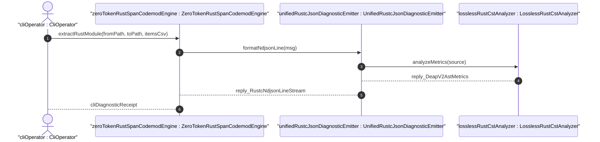
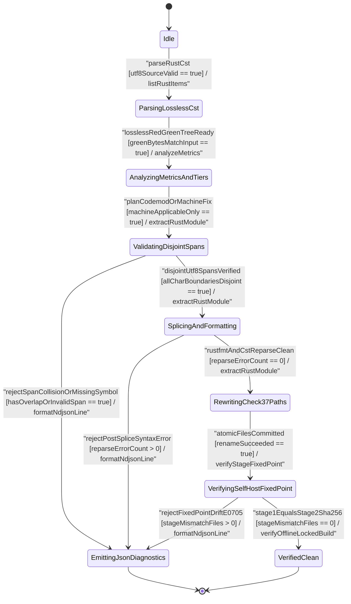

| Attribute | Specification Detail |
| :--- | :--- |
| **Issue ID** | TBD |
| **Title** | User Story 55: format Ndjson Line |
| **Type** | user-story |
| **Parent Epic** | [EPIC-08-BP_08_Lossless_Rust_CST_Codemod_Engine_and_Unified_rustc_Compatible_JSON_Diagnostics](../epics/EPIC-08-BP_08_Lossless_Rust_CST_Codemod_Engine_and_Unified_rustc_Compatible_JSON_Diagnostics.md) |
| **SysML Interaction** | `BP_08_Lossless_Rust_CST_Codemod_Engine_and_Unified_rustc_Compatible_JSON_Diagnostics_SequenceInteraction` |
| **SysML Test Case** | `Test_formatNdjsonLine` |
| **Generation Mode** | subagent |
| **Specification Source** | [schema/model.sysml](../../schema/model.sysml) |

# User Story 55: format Ndjson Line

## Parent Epic
- [ ] [EPIC-08-BP_08_Lossless_Rust_CST_Codemod_Engine_and_Unified_rustc_Compatible_JSON_Diagnostics](../epics/EPIC-08-BP_08_Lossless_Rust_CST_Codemod_Engine_and_Unified_rustc_Compatible_JSON_Diagnostics.md) (realizes unified `rustc`-compatible `--message-format=json` single-line NDJSON emission and atomic reverse-byte-order `MachineApplicable` span auto-fixing under **REQ-0608**)

## User Story

**As a** `ZeroTokenRustSpanCodemodEngine` or workspace CLI operator invoking `--message-format=json` and `--apply-machine-fixes` across `verify-baseline`, `compile-sysml`, `ingest-sysml`, `assemble-conops`, and `reconcile-backlog`,
**I want to** invoke `formatNdjsonLine(msg: DeapDiagnosticFinding)` on `UnifiedRustcJsonDiagnosticEmitter` (`FEAT-44`, implemented in `crates/deap-core/src/diagnostics.rs`),
**So that** every compiler, CST codemod, ingestion, ConOps, and backlog diagnostic serializes deterministically into a single-line zero-ANSI `rustc`-compatible NDJSON `compiler-message` record with `"DEAP-E"` diagnostic codes and validated UTF-8 `TextRange` `spans`, while `--apply-machine-fixes` applies exclusively non-overlapping `"MachineApplicable"` `suggested_replacement` edits in reverse byte order with fail-closed `LosslessRustCstAnalyzer` re-parse verification.

## Domain Object Mapping
- **Primary Domain Objects:** `UnifiedRustcJsonDiagnosticEmitter` (`FEAT-44`), `ZeroTokenRustSpanCodemodEngine` (`FEAT-45`), `LosslessRustCstAnalyzer` (`FEAT-42`), `DeapDiagnosticFinding`, `RustcCompilerMessageEnvelope`, `RustcDiagnosticSpan`, `DiagnosticEmitError`
- **Actor/Role:** `CliOperator` (external build/CI toolchain caller) and `ZeroTokenRustSpanCodemodEngine` (internal CST codemod and diagnostic caller)
- **Target Rust Module & CLI Entrypoints:**
  - Core diagnostic & reverse-span fix engine: `crates/deap-core/src/diagnostics.rs` (collaborating with `crates/deap-core/src/source_ast.rs` and `crates/deap-core/src/sysml_ast/mod.rs`)
  - Unified 5-CLI `--message-format=json` / `--apply-machine-fixes` entrypoints: `crates/verify-baseline/src/main.rs`, `crates/compile-sysml/src/main.rs`, `crates/ingest-sysml/src/main.rs`, `crates/assemble-conops/src/main.rs`, and `crates/reconcile-backlog/src/main.rs`

## Architectural Realization (3-Layer Definition of Done)

### Layer 1: Domain State & Data Model
- **SysML Component State (`UnifiedRustcJsonDiagnosticEmitter`):** Enforces `cli_binary_count: Integer = 5` (`5 binaries`), `zero_ansi_in_json_mode: Boolean = true`, `machine_applicable_only: Boolean = true`, and `envelope_reason: String = "compiler-message"`, bound to package invariants `C_CST_01` (`1 <= max_fn_exec_sloc <= 50` SLOC), `C_CST_02` (`0 <= max_fn_param_count <= 5` params), `C_CST_03` (`max_mut_bool_flags == 0` flags), `C_CST_04` (`stage_fixed_point_mismatch_files == 0` files), `C_CST_05` (`runtime_llm_token_count == 0` tokens), and `C_CST_06` (`tier_bc_max_doc_lines == 2` lines) under **REQ-0608**.
- **Typed Rust Data Model (`crates/deap-core/src/diagnostics.rs`):** Compiled under `#![forbid(unsafe_code)]` with derived `Debug`, `Clone`, `PartialEq`, and `Eq` value semantics:
  - `DiagnosticEmitError` typed error enum (`InvalidEnvelopeConfig`, `InvalidDiagnosticCodePrefix`, `UnrecognizedSeverityLevel`, `InvertedOrOutOfBoundsSpan`, `MidCodepointUtf8Boundary`, `OverlappingMachineFixSpan`, `DiagnosticDepthExceeded`, `ArithmeticOverflow`, `PostSpliceCstSyntaxError`, `NdjsonControlByteLeak`, `AtomicIoPersistFault`) -- zero `Result<T, String>` signatures across all modules.
  - `RustcCompilerMessageEnvelope` (`reason`, `message: RustcDiagnosticMessage`), `RustcDiagnosticCode` (`code`, `explanation`), `DiagnosticLevel` (`Error`, `Warning`, `Note`, `Help`), `Applicability` (`MachineApplicable`, `MaybeIncorrect`, `HasPlaceholders`, `Unspecified`), and `RustcDiagnosticSpan` (`file_name`, `byte_start`, `byte_end`, `line_start`, `line_end`, `column_start`, `column_end`, `is_primary`, `suggested_replacement`, `suggestion_applicability`).
  - Deterministic `BTreeMap<String, Vec<RustcDiagnosticSpan>>` and `BTreeSet` collections key all per-file replacement batches and deduplicated finding registries without randomized hash iteration.
- **Lifecycle State Model (`BP_08_Lossless_Rust_CST_Codemod_Engine_and_Unified_rustc_Compatible_JSON_Diagnostics_LifecycleState`):** Tracks deterministic transitions across `Idle`, `ParsingLosslessCst`, `AnalyzingMetricsAndTiers`, `ValidatingDisjointSpans`, `EmittingJsonDiagnostics`, `SplicingAndFormatting`, `RewritingCheck37Paths`, `VerifyingSelfHostFixedPoint`, and `VerifiedClean`.

### Layer 2: Logic & State Management
- **Total Bounded Functions:** Every production function in `crates/deap-core/src/diagnostics.rs` and the 5 CLI adapters obeys `<= 50` SLOC target executable size (`<= 80` SLOC hard workspace ceiling, excluding `cfg(test)` unit-test module scopes), `<= 5` params formal arity (`C_CST_02`), `0` flags of mutable `bool` local state (`C_CST_03`), iterative/bounded recursion capped at `MAX_AST_DEPTH = 64` levels, bounds-safe `.get()` slice access, and `checked_add` / `checked_sub` / `saturating_add` integer arithmetic.
- **Coordinate Resolution & Single-Line NDJSON Invariant:** Precomputes `O(N)` monotone UTF-8 line-start byte offset tables and resolves `TextRange` spans in `O(log N)` binary search (`O(N + M log M)` total complexity, `O(N + M)` space, `0` tokens of runtime LLM usage). Validates `0 <= byte_start <= byte_end <= source.len()` and `str::is_char_boundary` at both endpoints, verifies `"DEAP-E"` code prefixes, strips/rejects ANSI CSI sequences (`0x1B`), and guarantees `0` bytes of raw newline (`0x0A`) or escape (`0x1B`) control characters inside the serialized JSON record prior to appending the single record terminator.
- **Reverse-Byte-Order `MachineApplicable` Patching & Fail-Closed CST Re-Parse:** Filters candidate child spans strictly to `Applicability::MachineApplicable` (`machine_applicable_only == true`), sorts intervals by `(byte_start, byte_end)`, rejects any overlapping span collision (`prev.byte_end > next.byte_start`) fail-closed with `DEAP-E0802` (`ValidatingDisjointSpans -> EmittingJsonDiagnostics`), applies replacements strictly in reverse byte order (`descending byte_start`) so lower byte offsets remain invariant, re-parses the spliced UTF-8 buffer via `LosslessRustCstAnalyzer` (`crates/deap-core/src/source_ast.rs`, `0` errors required, rejecting broken syntax with `DEAP-E0803` via `SplicingAndFormatting -> EmittingJsonDiagnostics`), and commits exclusively through staged temp-file atomic rename.

### Layer 3: Presentation & Actuator Interface Binding
- **SysML Port Bindings (`UnifiedRustcJsonDiagnosticEmitter`):**
  - `finding_in: String` (`in`, `DeapDiagnosticFinding` protocol): ingests structured findings from CST codemods, SysML compilation, baseline checks, ingestion, ConOps assembly, and backlog reconciliation.
  - `ndjson_out: String` (`out`, `RustcNdjsonLineStream` protocol): emits newline-delimited `compiler-message` JSON lines under an exclusive `StdoutLock`.
  - `machine_fix_inout: String` (`inout`, `AtomicSpanFixTransaction` protocol): executes transactional reverse-byte-order `MachineApplicable` workspace patches.
- **SysML Interaction Realization (`BP_08_Lossless_Rust_CST_Codemod_Engine_and_Unified_rustc_Compatible_JSON_Diagnostics_SequenceInteraction`):** Receives `formatNdjsonLine` from `ZeroTokenRustSpanCodemodEngine`, delegates post-splice syntax and DEAP v2.0 metrics validation `analyzeMetrics` to `LosslessRustCstAnalyzer` (`reply_DeapV2AstMetrics`), and returns `reply_RustcNdjsonLineStream`.
- **5-CLI `--message-format=json` & `--apply-machine-fixes` Binding:** Unifies flag parsing and exit-code `1` fail-closed dispatch across `crates/verify-baseline/src/main.rs`, `crates/compile-sysml/src/main.rs`, `crates/ingest-sysml/src/main.rs`, `crates/assemble-conops/src/main.rs`, and `crates/reconcile-backlog/src/main.rs`, suppressing all human-mode banners and ANSI color codes whenever `--message-format=json` is active.

## Atomic Implementation Micro-Tasks (`crates/deap-core/src/diagnostics.rs` & 5 CLIs)

| Micro-Task ID | Target Path | Symbol / Signature (`<= 5` params, `<= 80` exec SLOC) | Responsibility & Fail-Closed Contract | Traceability Tags |
| :--- | :--- | :--- | :--- | :--- |
| `MT-US55-01` | `crates/deap-core/src/diagnostics.rs` | `pub enum DiagnosticEmitError` & `pub struct RustcCompilerMessageEnvelope` (`0` params, `<= 48` exec SLOC) | Define `#![forbid(unsafe_code)]` typed error taxonomy (zero `Result<T, String>`), `DiagnosticLevel`, `Applicability`, `RustcDiagnosticSpan`, `DeapDiagnosticFinding`, and `BTreeMap`-backed file fix batches enforcing `cli_binary_count == 5` and `envelope_reason == "compiler-message"`. | `[REQ-0608]` `[FLS: fls_szibmtfv117b]` |
| `MT-US55-02` | `crates/deap-core/src/diagnostics.rs` | `pub fn resolve_utf8_span(source: &str, line_starts: &[usize], file_name: &str, range: ByteSpan, fix: Option<SuggestedFix>) -> Result<RustcDiagnosticSpan, DiagnosticEmitError>` (`5` params, `<= 44` exec SLOC) | Precompute `O(N)` monotone line-start offsets using `.get()` and `saturating_add`, resolve 1-based line/column coordinates via `O(log N)` binary search with `checked_sub`, and reject `byte_start > byte_end`, `byte_end > source.len()`, or `!source.is_char_boundary(...)` fail-closed (`DEAP-E0801`, **SC-BP08-13**). | `[REQ-0608]` `[FLS: fls_77sc35ddv9e4]` |
| `MT-US55-03` | `crates/deap-core/src/diagnostics.rs` | `pub fn format_ndjson_line(finding: &DeapDiagnosticFinding, config: &EmitterConfig) -> Result<String, DiagnosticEmitError>` (`2` params, `<= 46` exec SLOC) | Validate `"DEAP-E"` diagnostic code prefix, canonical severity `level`, and `children` nesting `<= MAX_AST_DEPTH` (`64`, `DEAP-E0804`, **SC-BP08-15**); strip/reject `0x1B` ANSI escapes; serialize single-line `compiler-message` JSON verified free of `0x0A` and `0x1B` bytes (**SC-BP08-16**). | `[REQ-0608]` `[FLS: fls_qcb1n9c0e5hz]` |
| `MT-US55-04` | `crates/deap-core/src/diagnostics.rs` | `pub fn apply_machine_applicable_fixes(source: &str, spans: &[RustcDiagnosticSpan], target_path: &Path) -> Result<AtomicFixOutcome, DiagnosticEmitError>` (`3` params, `<= 50` exec SLOC) | Filter strictly to `Applicability::MachineApplicable`, verify `DisjointValid` non-overlap (`prev.byte_end <= next.byte_start`, rejecting overlaps with `DEAP-E0802`, **SC-BP08-14**), splice UTF-8 ranges in reverse byte order via `.get()` and `checked_add`, re-parse via `LosslessRustCstAnalyzer` (`DEAP-E0803` on syntax error), and commit via atomic temp-file rename. | `[REQ-0608]` `[FLS: fls_utuu8mdbuyxm]` |
| `MT-US55-05` | `crates/deap-core/src/diagnostics.rs`, `crates/verify-baseline/src/main.rs`, `crates/compile-sysml/src/main.rs`, `crates/ingest-sysml/src/main.rs`, `crates/assemble-conops/src/main.rs`, `crates/reconcile-backlog/src/main.rs` | `pub fn emit_cli_ndjson_stream(findings: &[DeapDiagnosticFinding], mode: OutputMode, config: &EmitterConfig, out: &mut dyn Write) -> Result<usize, DiagnosticEmitError>` (`4` params, `<= 42` exec SLOC) | Acquire exclusive line-atomic output lock across all 5 workspace CLIs under `--message-format=json` and `--apply-machine-fixes`, suppress human banners, flush single-line NDJSON records, and propagate deterministic exit code `1` on any diagnostic error (**SC-BP08-14**, `AC-06`). | `[REQ-0608]` `[FLS: fls_exe4zodlwfez]` |

## UML Sequence Diagram



## UML State Machine Diagram



## Operational Context & Mathematical Formulations

Under **REQ-0608** (`BP-08`, DO-178C Level A / DO-330 TQL-4 / ISO 26262 ASIL D), `UnifiedRustcJsonDiagnosticEmitter` unifies diagnostic serialization and machine-applicable span patching across all 5 compiler toolchain CLIs (`verify-baseline`, `compile-sysml`, `ingest-sysml`, `assemble-conops`, `reconcile-backlog`) without external LLM invocations (`runtime_llm_token_count == 0` tokens).

### Mathematical Formulations & Derivations

$$
\begin{aligned}
D_{\text{disjoint}}(S, E) &\iff \forall i \in \{1, \dots, m\}, \quad 0 \le a_i \le b_i \le \lvert S \rvert \land B_{\text{utf8}}(S, a_i) \land B_{\text{utf8}}(S, b_i) \land \forall j \in \{1, \dots, m - 1\}, \quad b_j \le a_{j+1} \\
A_{\text{commit}}(S, E) &\iff D_{\text{disjoint}}(S, E) \land K_{\text{err}}(P_{\text{cst}}(R_{\text{rev}}(S, E))) = 0 \\
\forall d_k \in Q_{\text{ndjson}}, \quad N_{\text{byte}}(F_{\text{json}}(d_k), 10) &= 0 \land N_{\text{byte}}(F_{\text{json}}(d_k), 27) = 0 \\
T_{\text{diag}}(N, M) &= O(N + M \log M), \quad S_{\text{diag}}(N, M) = O(N + M), \quad K_{\text{LLM}} = 0
\end{aligned}
$$

- Parameter Definitions & Engineering Units:
- $S$: Input UTF-8 Rust or specification source buffer of byte length $\lvert S \rvert$ (bytes).
- $E$: Ordered sequence of $m$ `MachineApplicable` replacement intervals $(a_i, b_i, r_i)$ sorted in ascending byte order where $a_i$ is `byte_start` and $b_i$ is `byte_end` (bytes).
- $B_{\text{utf8}}(S, x)$: Boolean UTF-8 codepoint boundary predicate (`str::is_char_boundary`) at byte offset $x$ (boolean flag).
- $D_{\text{disjoint}}(S, E)$: Disjoint valid UTF-8 `TextRange` invariant corresponding to `Invariant_REQ_0608_SC_03` (boolean flag).
- $R_{\text{rev}}(S, E)$: Reverse-byte-order splicing operator applying $(a_i, b_i, r_i)$ from index $m$ down to index `1` item so unpatched prefix offsets $[0, a_i)$ remain invariant (bytes).
- $K_{\text{err}}(P_{\text{cst}}(\cdot))$: Syntax error count reported by `ra_ap_syntax::SourceFile::parse` via `LosslessRustCstAnalyzer` after splicing, required to equal `0` errors for `AdmissibleCommit` $A_{\text{commit}}(S, E)$ (errors).
- $Q_{\text{ndjson}}$: Emitted stream of `compiler-message` diagnostic records $d_k$ serialized by $F_{\text{json}}(d_k)$ prior to appending the line delimiter (records).
- $N_{\text{byte}}(\cdot, 10)$ and $N_{\text{byte}}(\cdot, 27)$: Raw control-character counts of ASCII LF (`0x0A`, code `10` bytes) and ASCII ESC (`0x1B`, code `27` bytes) inside an encoded JSON record, both strictly constrained to `0` occurrences (`Invariant_REQ_0608_SC_04_REQ_0608`).
- $T_{\text{diag}}(N, M)$ and $S_{\text{diag}}(N, M)$: Time and memory complexity over source size $N$ (bytes) and diagnostic span count $M$ (spans), with runtime LLM token consumption $K_{\text{LLM}} = 0$ tokens (`C_CST_05`).

## Acceptance Criteria (BDD)

- [ ] **AC-US-55-01 (Nominal -- 5-CLI Single-Line `rustc` NDJSON & Reverse-Byte-Order `MachineApplicable` Patching -> `TEST-US-55-01` / `TEST_US_55_01_NominalSingleLineNdjsonAcrossFiveClis`):**
  - **Given** `UnifiedRustcJsonDiagnosticEmitter` is configured with `cli_binary_count == 5` binaries, `envelope_reason == "compiler-message"`, `zero_ansi_in_json_mode == true`, and `machine_applicable_only == true` across `verify-baseline`, `compile-sysml`, `ingest-sysml`, `assemble-conops`, and `reconcile-backlog`, and receives a `DeapDiagnosticFinding` carrying two disjoint `"MachineApplicable"` child replacement spans plus one `"MaybeIncorrect"` child suggestion,
  - **When** `ZeroTokenRustSpanCodemodEngine` or a CLI entrypoint invokes `formatNdjsonLine` under `--message-format=json` followed by `--apply-machine-fixes`,
  - **Then** every CLI emits strictly single-line NDJSON records with `reason: "compiler-message"`, `"DEAP-E"` prefixed `message.code.code`, exact UTF-8 `byte_start`/`byte_end` and 1-based line/column `spans`, and `0` bytes of raw `0x0A` or `0x1B` control characters, while `--apply-machine-fixes` patches exclusively the `"MachineApplicable"` spans in reverse byte order, leaves the `"MaybeIncorrect"` span unapplied, verifies `0` errors via `LosslessRustCstAnalyzer`, and commits atomically (`AC-06`).

- [ ] **AC-US-55-02 (Boundary -- Touching Multi-Byte UTF-8 Endpoints, `MAX_AST_DEPTH = 64` levels, and `C_CST_01..C_CST_05` Limits -> `TEST-US-55-02` / `TEST_US_55_02_BoundaryMultiByteUtf8AdjacentSpansAndDepth64`):**
  - **Given** a UTF-8 source buffer containing 2-byte, 3-byte, and 4-byte codepoints with two adjacent touching `"MachineApplicable"` `TextRange` edits (`b_1 == a_2`, including offsets at `0` bytes and `source.len()`) and a nested diagnostic `children` chain of exact recursion depth `MAX_AST_DEPTH = 64` levels,
  - **When** `UnifiedRustcJsonDiagnosticEmitter` executes `resolve_utf8_span`, `format_ndjson_line`, and `apply_machine_applicable_fixes`,
  - **Then** `UnifiedRustcJsonDiagnosticEmitter` accepts the exact boundary depth of `64` levels and adjacent `b_1 == a_2` UTF-8 character boundaries without off-by-one truncation, preserves `C_CST_01` (`max_fn_exec_sloc <= 50` SLOC), `C_CST_02` (`max_fn_param_count <= 5` params), `C_CST_03` (`max_mut_bool_flags == 0` flags), and `C_CST_05` (`runtime_llm_token_count == 0` tokens), and emits valid lossless UTF-8 output.

- [ ] **AC-US-55-03 (Fail-Closed Fault Injection [Failure Pillar A: `FM-BP08-013` / `UCA-BP08-13` / `SC-BP08-13`] -- Inverted, Out-of-Bounds, Mid-Codepoint Span, or Non-`DEAP-E` Code -> `TEST-US-55-03` / `TEST_US_55_03_FailClosedMalformedFindingOrMidCodepointSpan`):**
  - **Given** a fault-injected `DeapDiagnosticFinding` ingested on `finding_in` containing either an inverted `TextRange` (`byte_start > byte_end`), an out-of-bounds offset (`byte_end > source.len()`), a mid-codepoint byte index (`!source.is_char_boundary(byte_start)`), or a diagnostic code lacking the `"DEAP-E"` prefix (**UCA-BP08-13** / `FM-BP08-013`),
  - **When** `formatNdjsonLine` and `resolve_utf8_span` evaluate input preconditions on `UnifiedRustcJsonDiagnosticEmitter`,
  - **Then** execution rejects the malformed finding fail-closed with `DiagnosticEmitError` (`0` panics), emits `1` line of `DEAP-E0801` `compiler-message` diagnostic on `ndjson_out`, performs `0` files of filesystem mutation, and terminates with non-zero exit status `1` code enforcing **SC-BP08-13**.

- [ ] **AC-US-55-04 (Fail-Closed Fault Injection [Failure Pillar B: `FM-BP08-014` / `UCA-BP08-14` / `SC-BP08-14`] -- Overlapping `MachineApplicable` `TextRange` Collision & Concurrent Stdout Serialization -> `TEST-US-55-04` / `TEST_US_55_04_FailClosedOverlappingMachineApplicableSpans`):**
  - **Given** an `--apply-machine-fixes` transaction presenting two overlapping `"MachineApplicable"` `TextRange` intervals (`prev.byte_end > next.byte_start`) alongside concurrent diagnostic emission requests (**UCA-BP08-14** / `FM-BP08-014`),
  - **When** `UnifiedRustcJsonDiagnosticEmitter` evaluates `ValidatingDisjointSpans` and acquires the output stream lock,
  - **Then** `UnifiedRustcJsonDiagnosticEmitter` transitions via `rejectSpanCollisionOrMissingSymbol` to `EmittingJsonDiagnostics`, aborts the transaction prior to any byte splice so target files remain bit-for-bit untouched (`0` bytes altered), serializes `1` line of untorn `DEAP-E0802` NDJSON diagnostic under exclusive stdout lock, and terminates with non-zero exit status `1` code enforcing **SC-BP08-14**.

- [ ] **AC-US-55-05 (Fail-Closed Fault Injection [Failure Pillar C: `FM-BP08-015` / `UCA-BP08-15` / `SC-BP08-15`] -- Recursive Child Depth `> 64` levels or Checked Arithmetic Overflow -> `TEST-US-55-05` / `TEST_US_55_05_FailClosedDepth65OrCheckedArithmeticExhaustion`):**
  - **Given** a fault-injected diagnostic tree whose nested `children` depth reaches `65` levels (`> MAX_AST_DEPTH` where `MAX_AST_DEPTH = 64` levels) or whose aggregate `suggested_replacement` byte delta overflows checked length arithmetic (**UCA-BP08-15** / `FM-BP08-015`),
  - **When** `UnifiedRustcJsonDiagnosticEmitter` invokes `format_ndjson_line` or computes post-splice buffer capacity via `checked_add` and `checked_sub`,
  - **Then** `UnifiedRustcJsonDiagnosticEmitter` traps the bound breach without stack overflow or integer wraparound, emits `1` line of `DEAP-E0804` resource-exhaustion NDJSON diagnostic within `O(N + M log M)` complexity bounds, and terminates fail-closed with non-zero exit status `1` code enforcing **SC-BP08-15**.

- [ ] **AC-US-55-06 (Fail-Closed Fault Injection [Failure Pillar D: `FM-BP08-016` / `UCA-BP08-16` / `SC-BP08-16`] -- Post-Splice CST Syntax Error & Raw `0x0A` / `0x1B` Leak Prevention -> `TEST-US-55-06` / `TEST_US_55_06_FailClosedPostSpliceSyntaxErrorAndAnsiNewlineGuard`):**
  - **Given** a `"MachineApplicable"` `suggested_replacement` edit that introduces an unbalanced brace syntax error upon reverse-byte-order splicing, combined with a diagnostic message string containing embedded raw newlines (`0x0A`) and ANSI CSI color escapes (`0x1B`) (**UCA-BP08-16** / `FM-BP08-016`),
  - **When** `UnifiedRustcJsonDiagnosticEmitter` re-parses the spliced buffer through `LosslessRustCstAnalyzer` (`analyzeMetrics` / `SourceFile::parse`) in `SplicingAndFormatting` and formats the resulting rejection line via `formatNdjsonLine`,
  - **Then** `UnifiedRustcJsonDiagnosticEmitter` transitions via `rejectPostSpliceSyntaxError` to `EmittingJsonDiagnostics`, discards the uncommitted temp buffer leaving on-disk workspace files untouched (`0` files modified), sanitizes/encodes the `DEAP-E0803` NDJSON record so `0` bytes of raw `0x0A` or `0x1B` characters appear inside the JSON line, and terminates with non-zero exit status `1` code enforcing **SC-BP08-16**.

## Formal SysML Test Case & Verification Binding

- **Primary Compiler-Owned SysML Test Case Def:** `Test_formatNdjsonLine`
- **Bound Behavioral & Fault-Injection SysML Test Cases:** `TEST_US_55_01_NominalSingleLineNdjsonAcrossFiveClis` (`TEST-US-55-01`), `TEST_US_55_02_BoundaryMultiByteUtf8AdjacentSpansAndDepth64` (`TEST-US-55-02`), `TEST_US_55_03_FailClosedMalformedFindingOrMidCodepointSpan` (`TEST-US-55-03`), `TEST_US_55_04_FailClosedOverlappingMachineApplicableSpans` (`TEST-US-55-04`), `TEST_US_55_05_FailClosedDepth65OrCheckedArithmeticExhaustion` (`TEST-US-55-05`), `TEST_US_55_06_FailClosedPostSpliceSyntaxErrorAndAnsiNewlineGuard` (`TEST-US-55-06`)
- **Subject Part:** `UnifiedRustcJsonDiagnosticEmitter`
- **Verified Safety Requirement:** `REQ_0608_BP_08_Lossless_Rust_CST_Codemod_Engine_and_Unified_rustc_Compatible_JSON_Diagnostics` (**REQ-0608**)

```sysml
test case def Test_formatNdjsonLine {
    subject UnifiedRustcJsonDiagnosticEmitter;
    verify requirement REQ_0608_BP_08_Lossless_Rust_CST_Codemod_Engine_and_Unified_rustc_Compatible_JSON_Diagnostics;
    objective "Verify deterministic single-line rustc-compatible NDJSON formatting and reverse-byte-order MachineApplicable span patching across all five DEAP CLIs";
    step ingest_deap_diagnostic_finding;
    step resolve_utf8_text_range_coordinates;
    step serialize_zero_ansi_single_line_ndjson;
    step verify_reverse_order_machine_applicable_patch;
}

test case def TEST_US_55_01_NominalSingleLineNdjsonAcrossFiveClis {
    subject UnifiedRustcJsonDiagnosticEmitter;
    verify requirement REQ_0608_BP_08_Lossless_Rust_CST_Codemod_Engine_and_Unified_rustc_Compatible_JSON_Diagnostics;
    objective "Verify AC-US-55-01 nominal single-line compiler-message NDJSON output across all 5 CLIs and selective reverse-byte-order MachineApplicable auto-fix";
    step invoke_five_clis_with_message_format_json;
    step assert_single_line_compiler_message_schema_and_deap_e_prefix;
    step apply_reverse_byte_order_machine_applicable_fixes;
    step assert_maybe_incorrect_unapplied_and_cst_clean;
}

test case def TEST_US_55_02_BoundaryMultiByteUtf8AdjacentSpansAndDepth64 {
    subject UnifiedRustcJsonDiagnosticEmitter;
    verify requirement REQ_0608_BP_08_Lossless_Rust_CST_Codemod_Engine_and_Unified_rustc_Compatible_JSON_Diagnostics;
    objective "Verify AC-US-55-02 boundary multi-byte UTF-8 touching spans (b_1 == a_2) at buffer endpoints and exact MAX_AST_DEPTH = 64 child nesting";
    step inject_adjacent_multibyte_utf8_spans_and_depth_64_children;
    step execute_resolve_utf8_span_and_format_ndjson_line;
    step assert_lossless_utf8_boundaries_and_c_cst_01_to_05_compliance;
}

test case def TEST_US_55_03_FailClosedMalformedFindingOrMidCodepointSpan {
    subject UnifiedRustcJsonDiagnosticEmitter;
    verify requirement REQ_0608_BP_08_Lossless_Rust_CST_Codemod_Engine_and_Unified_rustc_Compatible_JSON_Diagnostics;
    objective "Verify AC-US-55-03 fail-closed rejection of UCA-BP08-13 / FM-BP08-013 inverted, out-of-bounds, mid-codepoint spans or missing DEAP-E prefixes under SC-BP08-13";
    step inject_mid_codepoint_and_inverted_text_range_finding;
    step invoke_format_ndjson_line;
    step assert_deap_e0801_single_line_rejection_and_exit_code_1;
}

test case def TEST_US_55_04_FailClosedOverlappingMachineApplicableSpans {
    subject UnifiedRustcJsonDiagnosticEmitter;
    verify requirement REQ_0608_BP_08_Lossless_Rust_CST_Codemod_Engine_and_Unified_rustc_Compatible_JSON_Diagnostics;
    objective "Verify AC-US-55-04 fail-closed rejection of UCA-BP08-14 / FM-BP08-014 overlapping MachineApplicable spans and line-atomic stdout locking under SC-BP08-14";
    step inject_overlapping_machine_applicable_replacement_spans;
    step invoke_apply_machine_applicable_fixes;
    step assert_deap_e0802_emitted_and_zero_disk_mutation;
}

test case def TEST_US_55_05_FailClosedDepth65OrCheckedArithmeticExhaustion {
    subject UnifiedRustcJsonDiagnosticEmitter;
    verify requirement REQ_0608_BP_08_Lossless_Rust_CST_Codemod_Engine_and_Unified_rustc_Compatible_JSON_Diagnostics;
    objective "Verify AC-US-55-05 fail-closed trapping of UCA-BP08-15 / FM-BP08-015 depth 65 child recursion and checked arithmetic overflow under SC-BP08-15";
    step inject_depth_65_diagnostic_children_and_overflow_delta;
    step invoke_format_ndjson_line_and_capacity_check;
    step assert_deap_e0804_emitted_within_n_log_n_budget;
}

test case def TEST_US_55_06_FailClosedPostSpliceSyntaxErrorAndAnsiNewlineGuard {
    subject UnifiedRustcJsonDiagnosticEmitter;
    verify requirement REQ_0608_BP_08_Lossless_Rust_CST_Codemod_Engine_and_Unified_rustc_Compatible_JSON_Diagnostics;
    objective "Verify AC-US-55-06 fail-closed rollback on UCA-BP08-16 / FM-BP08-016 post-splice CST syntax error and zero 0x0A/0x1B byte leakage under SC-BP08-16";
    step inject_syntax_breaking_replacement_and_ansi_newline_message;
    step execute_reverse_splice_and_lossless_cst_reparse;
    step assert_temp_buffer_discarded_and_zero_ansi_deap_e0803_ndjson;
}
```

## Required Features
- [ ] [Feature 44: [BP 08 Lossless Rust CST Codemod Engine and Unified rustc Compatible JSON Diagnostics] UnifiedRustcJsonDiagnosticEmitter](../features/FEAT-44-UnifiedRustcJsonDiagnosticEmitter.md) (primary owning feature providing `UnifiedRustcJsonDiagnosticEmitter`, `finding_in`, `ndjson_out`, `machine_fix_inout`, and `formatNdjsonLine`)
- [ ] [Feature 45: [BP 08 Lossless Rust CST Codemod Engine and Unified rustc Compatible JSON Diagnostics] ZeroTokenRustSpanCodemodEngine](../features/FEAT-45-ZeroTokenRustSpanCodemodEngine.md) (upstream interaction caller invoking `formatNdjsonLine` and consuming `reply_RustcNdjsonLineStream` for CST codemod diagnostics)
- [ ] [Feature 42: [BP 08 Lossless Rust CST Codemod Engine and Unified rustc Compatible JSON Diagnostics] LosslessRustCstAnalyzer](../features/FEAT-42-LosslessRustCstAnalyzer.md) (post-splice lossless `ra_ap_syntax` + `rowan` CST re-parse and `analyzeMetrics` collaborator verifying `AdmissibleCommit`)
- [ ] [Feature 41: [BP 08 Lossless Rust CST Codemod Engine and Unified rustc Compatible JSON Diagnostics] AirGappedCargoLockGovernor](../features/FEAT-41-AirGappedCargoLockGovernor.md) (air-gapped `--offline --locked` supply-chain prerequisite gating workspace CLI execution and zero-ANSI lockfile rejection reporting)

## Logical UI & Interface Bindings

| Interface Channel | Category | Target Component / Handler | Target Container / Endpoint | Data Source Binding |
| :--- | :--- | :--- | :--- | :--- |
| `cli-ndjson` | M2M CLI Stream | `UnifiedRustcJsonDiagnosticEmitter::format_ndjson_line` | `--message-format=json` (`stdout` across `verify-baseline`, `compile-sysml`, `ingest-sysml`, `assemble-conops`, `reconcile-backlog`) | `BP_08_Lossless_Rust_CST_Codemod_Engine_and_Unified_rustc_Compatible_JSON_Diagnostics::UnifiedRustcJsonDiagnosticEmitter::ndjson_out` |
| `cli-autofix` | Transactional File Actuator | `UnifiedRustcJsonDiagnosticEmitter::apply_machine_applicable_fixes` | `--apply-machine-fixes` (staged temp-and-rename workspace patch) | `BP_08_Lossless_Rust_CST_Codemod_Engine_and_Unified_rustc_Compatible_JSON_Diagnostics::UnifiedRustcJsonDiagnosticEmitter::machine_fix_inout` |
| `cst-diagnostic-bus` | Internal Domain Port | `UnifiedRustcJsonDiagnosticEmitter::resolve_utf8_span` | `crates/deap-core/src/diagnostics.rs` | `BP_08_Lossless_Rust_CST_Codemod_Engine_and_Unified_rustc_Compatible_JSON_Diagnostics::UnifiedRustcJsonDiagnosticEmitter::finding_in` |

## Source References
Operational concept definitions, failure mode mitigations, and system sequence interaction models:
- System Architecture Model: [schema/model.sysml](../../schema/model.sysml)
- Component Failure Mode Registry: [docs/research/FAILURE_MODE_REGISTRY.md](../research/FAILURE_MODE_REGISTRY.md) (`FM-BP08-013`..`FM-BP08-016`)
- Core Diagnostic & CST Target Modules: `crates/deap-core/src/diagnostics.rs`, `crates/deap-core/src/source_ast.rs`, `crates/deap-core/src/sysml_ast/mod.rs`
- Normative Systems Engineering Standard: ISO/IEC/IEEE 29148:2018 Section 6.4.2 Concept of Operations

Authoritative user story flows, failure-mode guards, and interaction lifelines derive from `schema/model.sysml` pursuant to ISO/IEC/IEEE 29148.
