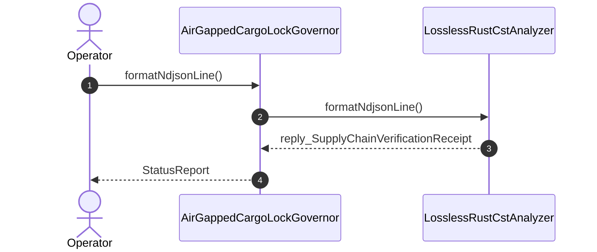

| Attribute | Specification Detail |
| :--- | :--- |
| **Issue ID** | TBD |
| **Title** | User Story 55: format Ndjson Line |
| **Type** | user-story |
| **Parent Epic** | [EPIC-08-BP_08_Lossless_Rust_CST_Codemod_Engine_and_Unified_rustc_Compatible_JSON_Diagnostics](../epics/EPIC-08-BP_08_Lossless_Rust_CST_Codemod_Engine_and_Unified_rustc_Compatible_JSON_Diagnostics.md) |
| **SysML Interaction** | `BP_08_Lossless_Rust_CST_Codemod_Engine_and_Unified_rustc_Compatible_JSON_Diagnostics_SequenceInteraction` |
| **SysML Test Case** | `Test_formatNdjsonLine` |
| **Generation Mode** | subagent |
| **Specification Source** | [schema/model.sysml](../../schema/model.sysml) |

# User Story 55: format Ndjson Line

## User Story

As a `AirGappedCargoLockGovernor`, I want to invoke `formatNdjsonLine()` on `LosslessRustCstAnalyzer`, so that formatNdjsonLine(msg).

## Architectural Realization (3-Layer Definition of Done)

### Layer 1: Domain State & Data Model
- Domain state attributes on `LosslessRustCstAnalyzer`: `max_fn_exec_sloc: Integer`, `max_fn_param_count: Integer`, `max_mut_bool_flags: Integer`, `max_predicate_arity: Integer`, `lossless_roundtrip_required: Boolean`, `deterministic_uuid: String`, `Blueprint_ID: String`, `Requirement_ID: String`, `Title: String`, `Status: String`, `Target_Crates: String`, `Tracked_Issues: String`, `Generation_Mode: String`, `Specification_Source: String`, `max_fn_exec_sloc: Real`, `max_fn_param_count: Real`, `max_mut_bool_flags: Real`, `stage_fixed_point_mismatch_files: Real`, `runtime_llm_token_count: Real`, `tier_bc_max_doc_lines: Real`.
- Action `formatNdjsonLine` invocation message envelope bound to `LosslessRustCstAnalyzer` typed domain schema.
- Declared lifecycle state model: `BP_08_Lossless_Rust_CST_Codemod_Engine_and_Unified_rustc_Compatible_JSON_Diagnostics_LifecycleState`, `Idle`, `ParsingLosslessCst`, `AnalyzingMetricsAndTiers`, `ValidatingDisjointSpans`, `EmittingJsonDiagnostics`, `SplicingAndFormatting`, `RewritingCheck37Paths`, `VerifyingSelfHostFixedPoint`, `VerifiedClean`.

### Layer 2: Logic & State Management
- Behavioral execution contract: invokes `formatNdjsonLine()` on `LosslessRustCstAnalyzer` with atomic precondition verification.
- State transition management: `Idle -> ParsingLosslessCst` (trigger `parseRustCst`).
- Formal constraints and requirements enforced: `C_CST_01 (max_fn_exec_sloc >= 1 and max_fn_exec_sloc <= 50)`, `C_CST_02 (max_fn_param_count >= 0 and max_fn_param_count <= 5)`, `C_CST_03 (max_mut_bool_flags >= 0 and max_mut_bool_flags <= 0)`, `C_CST_04 (stage_fixed_point_mismatch_files >= 0 and stage_fixed_point_mismatch_files <= 0)`, `C_CST_05 (runtime_llm_token_count >= 0 and runtime_llm_token_count <= 0)`, `C_CST_06 (tier_bc_max_doc_lines >= 2 and tier_bc_max_doc_lines <= 2)`, `REQ-0608 (REQ_0608_BP_08_Lossless_Rust_CST_Codemod_Engine_and_Unified_rustc_Compatible_JSON_Diagnostics)`.

### Layer 3: Presentation & Actuator Interface Binding
- Component port bindings on `LosslessRustCstAnalyzer`: `rust_source_in: String (in)`, `item_inventory_out: String (out)`, `metrics_report_out: String (out)`.
- Interaction binding (`BP_08_Lossless_Rust_CST_Codemod_Engine_and_Unified_rustc_Compatible_JSON_Diagnostics_SequenceInteraction`): routes `formatNdjsonLine` invocation from `AirGappedCargoLockGovernor` to `LosslessRustCstAnalyzer` and returns `reply_SupplyChainVerificationReceipt`.
- Diagnostic fault surface: reports deterministic rejection diagnostics to `AirGappedCargoLockGovernor` across the declared interface boundary when guard or invariant checks fail.

## UML Sequence Diagram

## Acceptance Criteria (BDD)
- [ ] AC-US-55-01: Given `LosslessRustCstAnalyzer` is in declared state `Idle` with domain state attributes (`max_fn_exec_sloc: Integer`, `max_fn_param_count: Integer`, `max_mut_bool_flags: Integer`, `max_predicate_arity: Integer`, `lossless_roundtrip_required: Boolean`, `deterministic_uuid: String`), When `AirGappedCargoLockGovernor` invokes `formatNdjsonLine` on `LosslessRustCstAnalyzer`, Then `LosslessRustCstAnalyzer` validates and binds the request against `LosslessRustCstAnalyzer` domain state (`max_fn_exec_sloc: Integer`, `max_fn_param_count: Integer`, `max_mut_bool_flags: Integer`, `max_predicate_arity: Integer`, `lossless_roundtrip_required: Boolean`, `deterministic_uuid: String`) and transitions to `ParsingLosslessCst`.
- [ ] AC-US-55-02: Given `LosslessRustCstAnalyzer` active state management during `formatNdjsonLine`, When `LosslessRustCstAnalyzer` evaluates formal constraint `C_CST_01 (max_fn_exec_sloc >= 1 and max_fn_exec_sloc <= 50)`, Then `LosslessRustCstAnalyzer` verifies constraint satisfaction before committing state updates.
- [ ] AC-US-55-03: Given `LosslessRustCstAnalyzer` active state management during `formatNdjsonLine`, When `LosslessRustCstAnalyzer` evaluates formal constraint `C_CST_02 (max_fn_param_count >= 0 and max_fn_param_count <= 5)`, Then `LosslessRustCstAnalyzer` verifies constraint satisfaction before committing state updates.
- [ ] AC-US-55-04: Given `LosslessRustCstAnalyzer` active state management during `formatNdjsonLine`, When `LosslessRustCstAnalyzer` evaluates formal constraint `C_CST_03 (max_mut_bool_flags >= 0 and max_mut_bool_flags <= 0)`, Then `LosslessRustCstAnalyzer` verifies constraint satisfaction before committing state updates.
- [ ] AC-US-55-05: Given `LosslessRustCstAnalyzer` active state management during `formatNdjsonLine`, When `LosslessRustCstAnalyzer` evaluates formal constraint `C_CST_04 (stage_fixed_point_mismatch_files >= 0 and stage_fixed_point_mismatch_files <= 0)`, Then `LosslessRustCstAnalyzer` verifies constraint satisfaction before committing state updates.
- [ ] AC-US-55-06: Given `LosslessRustCstAnalyzer` active state management during `formatNdjsonLine`, When `LosslessRustCstAnalyzer` evaluates formal constraint `C_CST_05 (runtime_llm_token_count >= 0 and runtime_llm_token_count <= 0)`, Then `LosslessRustCstAnalyzer` verifies constraint satisfaction before committing state updates.
- [ ] AC-US-55-07: Given `LosslessRustCstAnalyzer` ingress port binding (`rust_source_in: String`), When `LosslessRustCstAnalyzer` completes `formatNdjsonLine`, Then `LosslessRustCstAnalyzer` delivers `reply_SupplyChainVerificationReceipt` across egress port (`item_inventory_out: String`, `metrics_report_out: String`) to `AirGappedCargoLockGovernor`.
- [ ] AC-US-55-08: Given violated formal constraint `C_CST_01 (max_fn_exec_sloc >= 1 and max_fn_exec_sloc <= 50)`, When `AirGappedCargoLockGovernor` invokes `formatNdjsonLine` on `LosslessRustCstAnalyzer`, Then `LosslessRustCstAnalyzer` rejects the request without partial state mutation, preserves prior verified state, and emits a deterministic fault diagnostic across the interface binding.

## Required Features
- [ ] [Feature 41: [BP 08 Lossless Rust CST Codemod Engine and Unified rustc Compatible JSON Diagnostics] AirGappedCargoLockGovernor](../features/FEAT-41-AirGappedCargoLockGovernor.md)
- [ ] [Feature 42: [BP 08 Lossless Rust CST Codemod Engine and Unified rustc Compatible JSON Diagnostics] LosslessRustCstAnalyzer](../features/FEAT-42-LosslessRustCstAnalyzer.md)

## Source References
Operational concept definitions and system sequence interaction models:
- System Architecture Model: `schema/model.sysml`
- Normative Systems Engineering Standard: ISO/IEC/IEEE 29148:2018 §6.4.2 Concept of Operations

Authoritative user story flows and interaction lifelines derive from `schema/model.sysml` pursuant to ISO/IEC/IEEE 29148.
